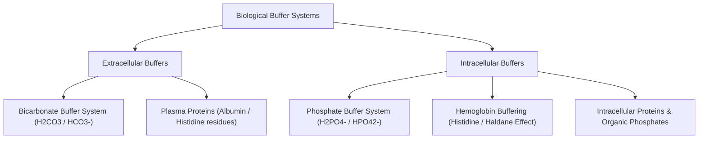

# 01. Acids, Bases and Hydrogen Ions (Protons)

## 1. Theoretical Foundations of Acids and Bases
* **Brønsted-Lowry Theory:**
  * **Acid:** A proton ($H^+$) donor.
  * **Base:** A proton ($H^+$) acceptor.
  * *Conjugate Acid-Base Pair:* An acid and its corresponding base formed after losing a proton ($HA \rightleftharpoons H^+ + A^-$).
* **Arrhenius Theory:** Acids produce $H^+$ in aqueous solution; bases produce $OH^-$.
* **Lewis Theory:** Acids are electron-pair acceptors; bases are electron-pair donors.

## 2. Dissociation Constants ($K_a$) and $pK_a$
The strength of an acid is quantified by its acid dissociation constant ($K_a$):

$$K_a = \frac{[H^+][A^-]}{[HA]}$$

$$pK_a = -\log_{10}(K_a)$$

* **High $K_a$ / Low $pK_a$:** Strong acid (completely dissociates in water, e.g., $HCl$).
* **Low $K_a$ / High $pK_a$:** Weak acid (partially dissociates, e.g., $H_2CO_3$, $CH_3COOH$).

## 3. Biological Buffers
A buffer solution resists changes in $pH$ upon the addition of small amounts of acid or base. It consists of a weak acid and its conjugate base.

### Maximum Buffering Capacity
Occurs when $pH = pK_a$, where $[HA] = [A^-]$. The effective buffering range is typically $pH = pK_a \pm 1.0$.

### Major Human Buffer Systems

| Buffer System | Components | $pK_a$ | Primary Site of Action | Key Clinical Notes |
| :--- | :--- | :--- | :--- | :--- |
| **Bicarbonate** | $H_2CO_3 / HCO_3^-$ | $6.1$ | Extracellular Fluid (ECF / Plasma) | Most important ECF buffer; **Open System** regulated by lungs ($CO_2$) and kidneys ($HCO_3^-$). Ratio $[HCO_3^-]/[\alpha PaCO_2] = 20:1$ at normal $pH\ (7.40)$. |
| **Phosphate** | $H_2PO_4^- / HPO_4^{2-}$ | $6.8$ | Intracellular Fluid (ICF) & Renal Tubules | Primary intracellular and urinary buffer. Serves as **Titratable Acidity** in renal PCT/DCT. |
| **Hemoglobin** | $Hb-H^+ / Hb^-$ | $7.2$ (deoxyHb) | Erythrocytes / Blood | Rich in **Histidine** imidazole rings. Deoxyhemoglobin is a weaker acid (better proton acceptor) than oxyhemoglobin (**Haldane Effect**). |
| **Proteins** | $Protein-H / Protein^-$ | Variable ($\sim 6.0-7.4$) | ICF & Plasma (Albumin) | Histidine imidazole groups ($pK_a \approx 6.0$) provide most buffering capacity at physiological $pH$. |

## 4. High-Yield Clinical Correlations & NEET PG / INI-CET Facts
* **Open System Efficiency:** Although the $pK_a$ of the bicarbonate buffer system ($6.1$) is far from physiological ECF $pH$ ($7.40$), it is the most powerful buffer in the body because $PaCO_2$ is continuously expired by lungs (**volatile acid**) and $HCO_3^-$ is reclaimed by kidneys.
* **Histidine Imidazole Ring:** The only amino acid side chain with a $pK_a$ ($\approx 6.0$) close to physiological $pH$, making histidine-rich proteins (Albumin, Hemoglobin) excellent physiological buffers.

---
