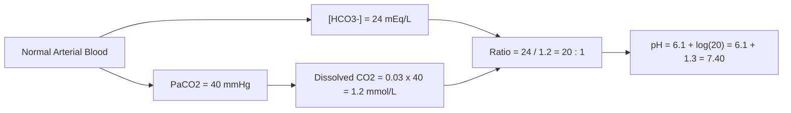

# 02. Understanding pH

## 1. Definition and Fundamental Equations
$pH$ is defined as the negative logarithm (base 10) of hydrogen ion concentration:

$$pH = -\log_{10}[H^+] = \log_{10}\left(\frac{1}{[H^+]}\right)$$

* At physiological $pH = 7.40$, $[H^+] = 40\text{ nmol/L}$ ($40 \times 10^{-9}\text{ mol/L}$).
* Normal arterial range: $pH\ 7.35 - 7.45$ ($[H^+]\ 35 - 45\text{ nmol/L}$).
* Compatible with human life: $pH\ 6.80 - 7.80$ ($[H^+]\ 16 - 160\text{ nmol/L}$).

## 2. Derivation of the Henderson-Hasselbalch Equation
Starting from the acid dissociation equilibrium:

$$HA \rightleftharpoons H^+ + A^- \implies K_a = \frac{[H^+][A^-]}{[HA]}$$

Taking the negative logarithm on both sides:

$$-\log_{10}[H^+] = -\log_{10}K_a + \log_{10}\left(\frac{[A^-]}{[HA]}\right)$$

$$\mathbf{pH = pK_a + \log_{10}\left(\frac{[A^-]}{[HA]}\right) = pK_a + \log_{10}\left(\frac{[Conjugate\ Base]}{[Weak\ Acid]}\right)}$$

### Application to Bicarbonate Buffer System
In blood plasma, carbonic acid ($H_2CO_3$) is in equilibrium with dissolved $CO_2$:

$$pH = 6.1 + \log_{10}\left(\frac{[HCO_3^-]}{0.03 \times PaCO_2}\right)$$

*Where $0.03\text{ mmol/L/mmHg}$ is the solubility coefficient ($\alpha$) of $CO_2$ in plasma at $37^\circ\text{C}$.*

## 3. Compartmental pH Distribution

| Body Fluid / Compartment | Normal $pH$ Range | $[H^+]\ (nmol/L)$ | Primary Determinant / Notes |
| :--- | :--- | :--- | :--- |
| **Arterial Blood** | $7.35 - 7.45$ | $35 - 45$ | Strictly maintained by pulmonary & renal systems |
| **Venous Blood** | $7.31 - 7.41$ | $39 - 49$ | Slightly lower due to higher $PCO_2$ from tissues |
| **Cerebrospinal Fluid (CSF)** | $7.31 - 7.33$ | $47 - 49$ | Lower $HCO_3^-$ content than plasma; $CO_2$ diffuses freely across BBB |
| **Intracellular Fluid (ICF)** | $6.90 - 7.20$ | $63 - 126$ | Metabolic activity produces $H^+$; buffered by $HPO_4^{2-}$ & proteins |
| **Lysosomes** | $4.50 - 5.00$ | $10,000 - 31,600$ | Maintained by $V\text{-type } H^+\text{-ATPase}$ proton pumps |
| **Gastric Juice** | $1.50 - 2.00$ | $10,000,000$ | $H^+/K^+\text{-ATPase}$ (Proton Pump) in parietal cells |
| **Urine** | $4.50 - 8.00$ | $10 - 31,600$ | Reflects net acid excretion (Titratable acidity + $NH_4^+$) |

## 4. High-Yield Clinical Shortcuts (Kassirer-Bleich Equation)
For rapid bedside evaluation of ABGs without logarithms:

$$[H^+] = 24 \times \frac{PaCO_2}{[HCO_3^-]}$$

* **Rule of thumb:** Every $0.01$ unit change in $pH$ around $7.40$ corresponds inversely to a $1\text{ nmol/L}$ change in $[H^+]$.
  * $pH\ 7.40 = 40\text{ nmol/L}$
  * $pH\ 7.30 = 50\text{ nmol/L}$
  * $pH\ 7.50 = 30\text{ nmol/L}$

---
