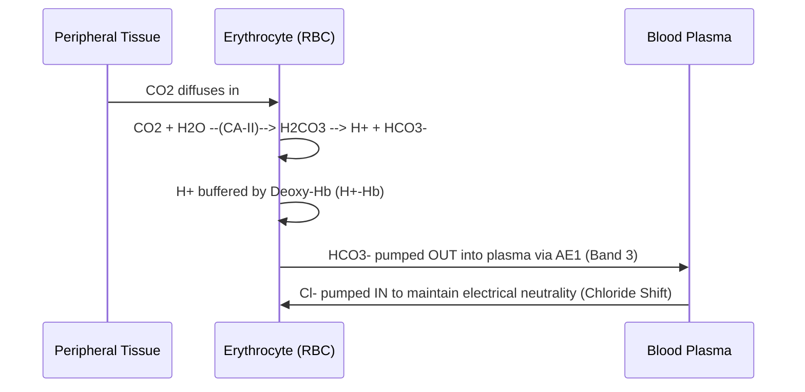
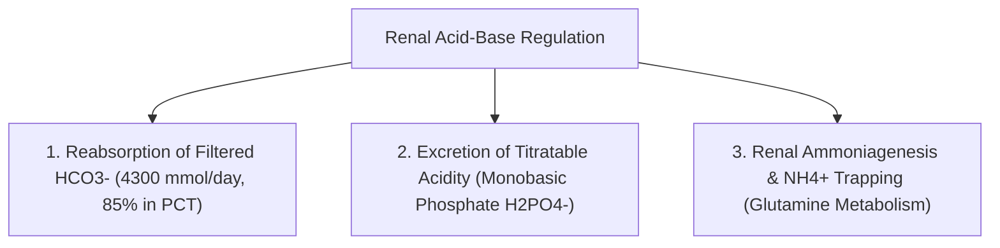

# 03. Production and Removal of Protons into and from the Blood

## 1. Sources of Metabolic Acids
Daily metabolism generates two classes of acids:

1. **Volatile Acid ($CO_2$):**
   * $\sim 15,000 - 20,000\text{ mmol/day}$ of $CO_2$ generated via TCA cycle and carbohydrate/fat oxidation.
   * $CO_2 + H_2O \xrightleftharpoons{\text{Carbonic Anhydrase}} H_2CO_3 \rightleftharpoons H^+ + HCO_3^-$.
   * Eliminated exclusively via alveolar ventilation by the **lungs**.
2. **Fixed (Non-Volatile) Acids:**
   * $\sim 1\text{ mEq/kg/day}$ ($\sim 70 - 100\text{ mEq/day}$) generated from metabolism.
   * *Sulfuric Acid ($H_2SO_4$):* Oxidation of sulfur-containing amino acids (**Methionine**, **Cysteine**).
   * *Phosphoric Acid ($H_3PO_4$):* Metabolism of phosphoproteins, nucleic acids, and phospholipids.
   * *Organic Acids:* Lactic acid (anaerobic glycolysis), Acetoacetic acid & $\beta$-hydroxybutyric acid (ketogenesis).
   * Eliminated exclusively by the **kidneys**.

## 2. Carbonic Anhydrase and Erythrocyte $CO_2$ Transport

### Carbonic Anhydrase (CA) Isoenzymes
* **CA-II:** Cytosolic form present in RBCs, renal tubular cells, and parietal cells. High turnover number.
* **CA-IV:** Membrane-bound form attached to the luminal brush border of the renal Proximal Convoluted Tubule (PCT).

### The Chloride Shift (Hamburger Phenomenon)

* **In Systemic Capillaries:** RBCs swell slightly due to osmotic entry of water alongside $Cl^-$. Hence, venous blood hematocrit is $\sim 3\%$ higher than arterial hematocrit.
* **In Pulmonary Capillaries:** The reverse Hamburger phenomenon occurs ($Cl^-$ moves OUT of RBC, $HCO_3^-$ moves IN).

## 3. Renal Mechanisms of Acid Elimination and $HCO_3^-$ Homeostasis
The kidneys maintain acid-base balance via three major processes:

### A. Reabsorption of Filtered Bicarbonate (PCT)
1. Luminal $Na^+/H^+$ Exchanger (**NHE3**) secretes $H^+$ into PCT lumen in exchange for $Na^+$.
2. Secreted $H^+$ combines with filtered $HCO_3^-$ to form $H_2CO_3$.
3. Brush-border **CA-IV** decomposes $H_2CO_3 \rightarrow CO_2 + H_2O$.
4. $CO_2$ freely diffuses into PCT cell, where cytosolic **CA-II** recombines it with $H_2O \rightarrow H^+ + HCO_3^-$.
5. $HCO_3^-$ exits basolaterally into peritubular capillary via $Na^+/3HCO_3^-$ cotransporter (**NBCe1**).

### B. Excretion of Titratable Acidity
* Filtered dibasic phosphate ($HPO_4^{2-}$) combines with secreted $H^+$ in collecting duct to form monobasic phosphate ($H_2PO_4^-$), which is excreted in urine.
* Yields $\sim 20 - 30\text{ mEq/day}$ of new $HCO_3^-$.

### C. Renal Glutaminase and Ammoniagenesis
* **Glutamine** is metabolized in PCT mitochondria by **Renal Glutaminase** and **Glutamate Dehydrogenase**:

$$\text{Glutamine} \rightarrow 2\,NH_4^+ + 2\,HCO_3^- + \alpha\text{-ketoglutarate}$$

* $NH_4^+$ is secreted into lumen via NHE3 ($NH_4^+$ substitutes for $H^+$).
* In collecting duct, $NH_3$ diffuses into lumen and combines with $H^+$ (secreted by Type A Intercalated cell $H^+\text{-ATPase}$) to form $NH_4^+$ (**Non-ionic Trapping**).
* Produces $\sim 30 - 50\text{ mEq/day}$ of new $HCO_3^-$ (can increase up to $500\text{ mEq/day}$ in severe metabolic acidosis).

### Net Acid Excretion (NAE) Formula

$$\mathbf{NAE = [U_{NH_4^+} \times V] + [U_{Titratable\ Acid} \times V] - [U_{HCO_3^-} \times V]}$$

---
