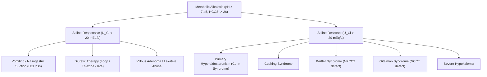

# 04. Metabolic Alkalosis and Metabolic Acidosis

## 1. Serum Anion Gap (AG)
The serum anion gap represents unmeasured anions in plasma:

$$\mathbf{Serum\ AG = [Na^+] - ([Cl^-] + [HCO_3^-])}$$

* **Normal Reference Range:** $8 - 12\text{ mEq/L}$ ($12 \pm 2\text{ mEq/L}$).
* **Major Unmeasured Anions:** Albumin (primary contributor, $\sim 11\text{ mEq/L}$), phosphate, sulfate, organic acids (lactate, acetoacetate).
* **Albumin Correction Formula:** For every $1.0\text{ g/dL}$ drop in serum albumin below $4.0\text{ g/dL}$, add $2.5\text{ mEq/L}$ to the calculated AG.

$$\text{Corrected AG} = \text{Observed AG} + 2.5 \times (4.0 - \text{Serum Albumin in g/dL})$$

## 2. High Anion Gap Metabolic Acidosis (HAGMA)
Characterized by accumulation of unmeasured organic or inorganic acids that consume $HCO_3^-$.

### Mnemonic: GOLD MARK
* **G** - Glycols (Ethylene glycol $\rightarrow$ Glycolic/Oxalic acid; Propylene glycol)
* **O** - Oxoproline (5-Oxoproline / Pyroglutamic acid from chronic Paracetamol use)
* **L** - L-Lactate (Hypoxia, shock, sepsis)
* **D** - D-Lactate (Short bowel syndrome, bacterial overgrowth)
* **M** - Methanol (Formic acid toxicity $\rightarrow$ optic disc hyperemia, blind as a bat)
* **A** - Aspirin / Salicylates (Late phase: metabolic acidosis; Early phase: respiratory alkalosis)
* **R** - Renal Failure / Uremia (Retention of phosphate, sulfate, urate)
* **K** - Ketoacidosis (Diabetic, Alcoholic, Starvation ketoacidosis $\rightarrow \beta$-hydroxybutyrate & acetoacetate)

## 3. Normal Anion Gap Metabolic Acidosis (NAGMA / Hyperchloremic Acidosis)
Loss of $HCO_3^-$ compensated by reciprocal gain of $Cl^-$ to maintain electrical neutrality.

### Mnemonic: HARDUPS
* **H** - Hyperalimentation (Total Parenteral Nutrition with $HCl$/Amino acid salts)
* **A** - Acetazolamide (Carbonic anhydrase inhibition) / Addison Disease
* **R** - Renal Tubular Acidosis (RTA Types 1, 2, 4)
* **D** - Diarrhea (Massive loss of $HCO_3^-$ in stool)
* **U** - Ureterosigmoidostomy / Ileal conduit
* **P** - Pancreatic fistulas / Small bowel drainage
* **S** - Saline administration ($0.9\%\ NaCl$ dilutional acidosis)

### Differentiation via Urinary Anion Gap (UAG)

$$\mathbf{UAG = ([U_{Na^+}] + [U_{K^+}]) - [U_{Cl^-}]}$$

* **Negative UAG ($< 0$, typically $-20\text{ to }-50\text{ mEq/L}$):** Normal renal response with increased $NH_4^+$ excretion alongside $Cl^-$. Indicates **Gastrointestinal $HCO_3^-$ loss** (e.g., Diarrhea).
* **Positive UAG ($> 0$):** Suggests reduced renal $NH_4^+$ excretion and supports **Renal Tubular Acidosis (RTA)** in the appropriate setting.

**Interpretation caveat:** The UAG is an indirect surrogate, not a direct measurement of urinary ammonium. It is most useful in hyperchloremic metabolic acidosis when urine sodium is adequate (often $\geq 20$ mEq/L) and ammonium is excreted mainly with chloride. Volume depletion/low distal sodium delivery, ketoacids, hippurate or other non-chloride urinary anions, and some drug/toxin states can make it misleading. Direct urinary $NH_4^+$ measurement is preferred when available; the urine osmolal gap can be an alternative indirect estimate.

## 4. Renal Tubular Acidosis (RTA) Comparison

| Feature | Type 1 RTA (Distal) | Type 2 RTA (Proximal) | Type 4 RTA (Hyperkalemic) |
| :--- | :--- | :--- | :--- |
| **Defect** | Impaired $H^+$ secretion by Type A intercalated cells ($H^+\text{-ATPase}$ or $AE1$) | Impaired $HCO_3^-$ reabsorption in PCT | Aldosterone deficiency or resistance |
| **Urine $pH$** | **$> 5.5$** (Inability to acidify urine) | **$< 5.5$** (If serum $HCO_3^-$ falls below renal threshold) | **$< 5.5$** |
| **Serum $K^+$** | **Hypokalemia** | **Hypokalemia** | **Hyperkalemia** |
| **Nephrolithiasis** | **Common** (Calcium phosphate stones, nephrocalcinosis) | Rare | Absent |
| **Key Associations** | Sjögren syndrome, SLE, Amphotericin B | Fanconi syndrome, Multiple Myeloma, Heavy metals | Diabetes mellitus, Addison disease, ACE inhibitors, Spironolactone |

## 5. Delta Ratio ($\Delta/\Delta$) in Mixed Acid-Base Disorders

$$\Delta/\Delta = \frac{\Delta \text{Anion Gap}}{\Delta [HCO_3^-]} = \frac{\text{Calculated AG} - 12}{24 - \text{Observed } [HCO_3^-]}$$

* **$< 0.4 - 0.8$:** Pure NAGMA or Combined HAGMA + NAGMA.
* **$1.0 - 2.0$:** Pure HAGMA (e.g., uncomplicated DKA or Lactic acidosis).
* **$> 2.0$:** Suggests HAGMA plus metabolic alkalosis or a pre-existing elevated bicarbonate (for example, chronic respiratory acidosis).

*The delta ratio is a heuristic:* the expected range depends on baseline bicarbonate, albumin correction, timing, and concurrent disorders. Interpret it with the clinical history and the full blood-gas/electrolyte pattern rather than as a stand-alone diagnostic rule.

## 6. Metabolic Alkalosis
Characterized by primary elevation of plasma $[HCO_3^-] > 26\text{ mEq/L}$ and $pH > 7.45$.

### Classification Based on Urinary Chloride ($U_{Cl^-}$)

---
