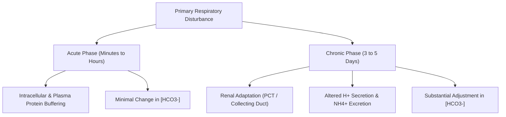

# 05. Respiratory Alkalosis and Respiratory Acidosis

## 1. Pathophysiologic Principles
Primary respiratory acid-base disorders stem from alterations in **alveolar ventilation**, causing primary changes in arterial carbon dioxide tension ($PaCO_2$):

* **Respiratory Acidosis:** Alveolar hypoventilation $\rightarrow PaCO_2 > 45\text{ mmHg} \rightarrow pH < 7.35$.
* **Respiratory Alkalosis:** Alveolar hyperventilation $\rightarrow PaCO_2 < 35\text{ mmHg} \rightarrow pH > 7.45$.

## 2. Temporal Phases of Compensation

## 3. Quantitative Acid-Base Compensation Formulas

| Primary Disorder | Expected Secondary Compensation Formula | Time to Peak Compensation |
| :--- | :--- | :--- |
| **Acute Respiratory Acidosis** | $\Delta [HCO_3^-] = 1 \times \left(\frac{\Delta PaCO_2}{10}\right)$ | $10 - 30\text{ minutes}$ (Cellular buffering) |
| **Chronic Respiratory Acidosis** | $\Delta [HCO_3^-] = 3.5 - 4.0 \times \left(\frac{\Delta PaCO_2}{10}\right)$ | $3 - 5\text{ days}$ (Renal $HCO_3^-$ retention) |
| **Acute Respiratory Alkalosis** | $\Delta [HCO_3^-] = 2 \times \left(\frac{\Delta PaCO_2}{10}\right)$ | $10 - 30\text{ minutes}$ |
| **Chronic Respiratory Alkalosis**| $\Delta [HCO_3^-] = 4 - 5 \times \left(\frac{\Delta PaCO_2}{10}\right)$ | $3 - 5\text{ days}$ (Renal $HCO_3^-$ excretion) |
| **Metabolic Acidosis** | **Winters Formula:** $\text{Expected } PaCO_2 = (1.5 \times [HCO_3^-]) + 8 \pm 2$ | $12 - 24\text{ hours}$ (Hyperventilation) |
| **Metabolic Alkalosis** | $\text{Expected } PaCO_2 = 40 + 0.7 \times ([HCO_3^-] - 24) \pm 2$ | $12 - 24\text{ hours}$ (Hypoventilation) |

**Clinical interpretation:** Compensation rules are approximate expected responses, not treatment targets. A measured bicarbonate or $PaCO_2$ outside the expected range should prompt assessment for a concurrent primary acid–base disorder. Do not infer chronicity from compensation alone without the clinical timeline.

## 4. Respiratory Acidosis
### Etiologies
* **CNS Depression:** Opioid/sedative overdose, brainstem lesions.
* **Neuromuscular Disorders:** Guillain-Barré syndrome, Myasthenia gravis, ALS, poliomyelitis.
* **Airway Obstruction / Parenchymal Disease:** Severe COPD, status asthmaticus, acute pulmonary edema, OSA.

## 5. Respiratory Alkalosis
### Etiologies
* **Hypoxia-Driven:** High altitude, severe anemia, pulmonary embolism, pneumonia.
* **Central Stimulation:** Anxiety/panic attacks, fever, sepsis, hepatic encephalopathy, pregnancy (progesterone).

### Clinical Biochemical Signatures
* **Alkalosis-Induced Hypocalcemia & Tetany:** Acute alkalosis increases negative charges on plasma albumin, promoting binding of ionized calcium ($Ca^{2+}$). Decreased free $[Ca^{2+}]$ induces neuromuscular excitability, leading to **carpopedal spasm**, **Trousseau sign**, and **Chvostek sign**.
* **Hypokalemia & Hypophosphatemia:** Alkalosis shifts $K^+$ into cells in exchange for $H^+$; hyperventilation stimulates intracellular glycolysis, consuming $P_i$.

## 6. Salicylate Poisoning: Classic Mixed Acid-Base Disorder
Early Aspirin toxicity presents with a unique mixed acid-base disorder:

1. **Direct Stimulation of Respiratory Center (Medulla):** Causes hyperventilation $\rightarrow$ **Primary Respiratory Alkalosis** (occurs first in adults).
2. **Uncoupling of Oxidative Phosphorylation & Inhibition of Dehydrogenases:** Causes accumulation of acetoacetic, lactic, and pyruvic acids $\rightarrow$ **Primary High Anion Gap Metabolic Acidosis (HAGMA)**.
3. **Net Result:** $pH$ may appear near-normal, but $PaCO_2$ is markedly low and serum Anion Gap is elevated.

---
