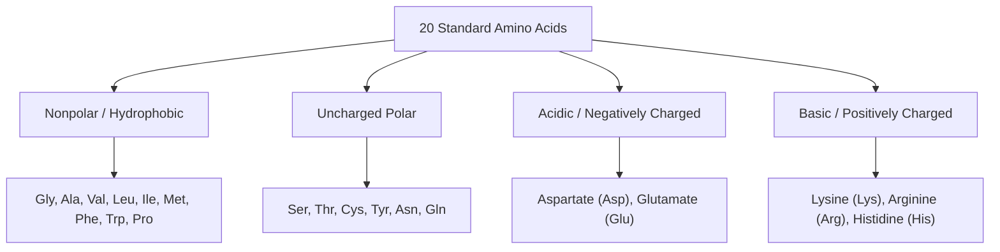
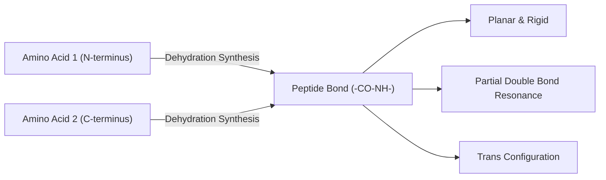

# 06. Amino Acids and the Primary Structure of Proteins

## 1. Classification and Chemical Properties of Amino Acids
All 20 standard amino acids incorporated into proteins are **L-$\alpha$-amino acids** (except glycine, which is achiral).

### High-Yield Comprehensive Classification Matrix

| Amino Acid | 3-Letter / 1-Letter | R-Group / Special Structural Feature | Metabolic Fate | High-Yield Clinical / Biochemical Facts |
| :--- | :--- | :--- | :--- | :--- |
| **Glycine** | Gly / G | $-H$ (Achiral, smallest) | Both | Inhibitory neurotransmitter; required for heme, purine, creatine, and glutathione synthesis. Flexibly fits into collagen $(Gly-X-Y)_n$. |
| **Alanine** | Ala / A | $-CH_3$ | Glucogenic | Transamination product of pyruvate (Cori / Glucose-Alanine cycle). |
| **Valine** | Val / V | Branched hydrocarbon | Glucogenic | Branched-chain amino acid (BCAA); accumulated in MSUD. Substituted for Glu at position 6 of $\beta$-globin in **Sickle Cell Anemia**. |
| **Leucine** | Leu / L | Branched hydrocarbon | **Purely Ketogenic** | BCAA; potent stimulator of mTORC1 protein synthesis. |
| **Isoleucine**| Ile / I | Branched hydrocarbon | Both | BCAA; possesses 2 chiral centers. |
| **Lysine** | Lys / K | $-\delta$-amino group ($pK_a \approx 10.5$) | **Purely Ketogenic** | Hydroxylated in collagen synthesis ($Fe^{2+}$, Vit C dependent). |
| **Histidine**| His / H | Imidazole ring ($pK_a \approx 6.0$) | Glucogenic | Buffers blood at physiological $pH$; precursor of histamine. FIGLU excretion test for Folate deficiency. |
| **Arginine** | Arg / R | Guanidino group ($pK_a \approx 12.5$) | Glucogenic | Precursor of Nitric Oxide (NO), urea, and creatine. Most basic amino acid. |
| **Cysteine** | Cys / C | Thiol / Sulfhydryl ($-SH$) | Glucogenic | Forms **disulfide bonds** (cystine); precursor of glutathione, taurine, CoA. |
| **Methionine**| Met / M | Thioether | Glucogenic | Initiator amino acid (AUG); precursor of $S$-adenosylmethionine (SAM). |
| **Proline** | Pro / P | Imino acid (Pyrrolidine ring) | Glucogenic | Secondary amine; helix-breaker in secondary structure. |
| **Tryptophan**| Trp / W | Indole ring | Both | Precursor of Serotonin, Melatonin, Niacin (60 mg Trp = 1 mg Niacin). Defective uptake in **Hartnup Disease**. |
| **Phenylalanine**| Phe / F | Benzene ring | Both | Hydroxylated to Tyr by PAH; defective in **PKU**. |
| **Tyrosine** | Tyr / Y | Phenolic hydroxyl group | Both | Precursor of Catecholamines, Thyroxine, Melanin. Defective in Alkaptonuria (HGD) & Albinism. |

## 2. Isoelectric Point ($pI$) and Zwitterion Mechanics
A **zwitterion** is a dipolar ion with equal positive and negative charges, yielding a net charge of zero at its **isoelectric point ($pI$)**.

### $pI$ Calculations
1. **For Neutral Amino Acids (Monoamino monocarboxylic):**

$$pI = \frac{pK_{a1} (\alpha\text{-COOH}) + pK_{a2} (\alpha\text{-NH}_3^+)}{2}$$

2. **For Acidic Amino Acids (Aspartate, Glutamate):**

$$pI = \frac{pK_{a1} (\alpha\text{-COOH}) + pK_{aR} (\text{side chain } -\text{COOH})}{2}$$

3. **For Basic Amino Acids (Lysine, Arginine, Histidine):**

$$pI = \frac{pK_{a2} (\alpha\text{-NH}_3^+) + pK_{aR} (\text{side chain basic group})}{2}$$

## 3. The Peptide Bond
* Formed via a condensation reaction between the $\alpha$-carboxyl group of one amino acid and the $\alpha$-amino group of another.
* **Partial Double-Bond Character:** Due to resonance, the $C-N$ bond has $\sim 40\%$ double-bond character, making it planar and rigid with **no free rotation**.
* **Trans Conformation:** Nearly all peptide bonds in proteins exist in the *trans* configuration to minimize steric hindrance (except Proline, which frequently forms *cis* peptide bonds).

## 4. Major Post-Translational Modifications (PTMs)

| PTM Type | Target Residues | Key Enzymes / Factors | Biological Function & Clinical Relevance |
| :--- | :--- | :--- | :--- |
| **Phosphorylation** | Ser, Thr, Tyr | Protein Kinases / Phosphatases | Reversible molecular switch regulating enzyme activity and signal transduction. |
| **Hydroxylation** | Pro, Lys | Prolyl/Lysyl Hydroxylase ($Fe^{2+}$, Vit C) | Essential for interchain H-bonding and triple-helix stability of collagen; impaired in **Scurvy**. |
| **$\gamma$-Carboxylation**| Glutamate (Glu) | Vitamin K-dependent $\gamma$-glutamyl carboxylase | Creates $\gamma$-carboxyglutamate (Gla) residues that bind $Ca^{2+}$; essential for **Clotting Factors II, VII, IX, X, Protein C/S**. |
| **Glycosylation** | Asn ($N$-linked); Ser/Thr ($O$-linked) | Glycosyltransferases | Cell-cell recognition, protein folding, mucosal barriers. Defective in Congenital Disorders of Glycosylation (CDG). |
| **Ubiquitination** | Lysine ($\epsilon$-amino group) | E1, E2, E3 Ubiquitin Ligases | Polyubiquitination (Lys-48) targets misfolded/short-lived proteins to the **26S Proteasome** for degradation. |
| **Acetylation** | Lysine | Histone Acetyltransferases (HATs) | Neutralizes Lys positive charge on histones, relaxing chromatin structure $\rightarrow$ **Transcriptional Activation**. |

---
