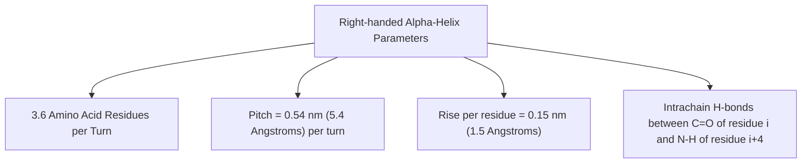

# 07. Secondary Structure of Proteins

## 1. Conformation and Torsion Angles
The secondary structure refers to the local spatial arrangement of the polypeptide backbone atoms without regard to side-chain conformations. It is governed by rotation around two main backbone bonds per residue:

* **Phi ($\phi$):** Angle of rotation around the $N - C_\alpha$ bond.
* **Psi ($\psi$):** Angle of rotation around the $C_\alpha - C'$ bond.

## 2. The Ramachandran Plot
A 2D plot mapping sterically allowed values of $\phi$ and $\psi$ torsion angles, developed by G.N. Ramachandran.

```mermaid
quadrantChart
    title Ramachandran Plot Quadrant Mapping
    x-axis Phi (Negative) --> Phi (Positive)
    y-axis Psi (Negative) --> Psi (Positive)
    quadrant-1 "Left-handed alpha-helix (rare)"
    quadrant-2 "Beta-sheets (Parallel/Antiparallel) & Collagen helix"
    quadrant-3 "Right-handed alpha-helix"
    quadrant-4 "Disallowed region (Steric clash)"
```

### High-Yield Quadrant Locations
* **Top-Left Quadrant ($\phi$ negative, $\psi$ positive):** $\beta$-pleated sheets (parallel and antiparallel), collagen triple helix.
* **Bottom-Left Quadrant ($\phi$ negative, $\psi$ negative):** Right-handed $\alpha$-helix ($\phi \approx -57^\circ, \psi \approx -47^\circ$).
* **Top-Right Quadrant ($\phi$ positive, $\psi$ positive):** Left-handed $\alpha$-helix (rare, observed in short segments).
* **Glycine:** Unique because it lacks a side chain ($R=-H$); possesses the broadest allowed regions across all 4 quadrants.
* **Proline:** Sterically restricted due to its pyrrolidine ring; constrained to $\phi \approx -60^\circ$.

## 3. The Alpha ($\alpha$) Helix
The most common secondary structural element.



### Factors Disrupting (Breaking) an $\alpha$-Helix
1. **Proline:** Introduces a rigid bend/kink and lacks an $N-H$ hydrogen donor (secondary amine). Known as the ultimate **Helix Breaker**.
2. **Glycine:** High conformational flexibility resists restricted helical geometry.
3. **Steric Repulsion / Charge Clashing:** Clusters of charged residues (e.g., consecutive $Glu^-$ or $Lys^+$) or bulky branched side chains ($Val, Ile, Thr$).

## 4. Beta ($\beta$) Pleated Sheets
Polypeptide chains arranged side-by-side held together by **interchain (or intersegment) hydrogen bonds** perpendicular to the chain axis.

| Feature | Antiparallel $\beta$-Sheet | Parallel $\beta$-Sheet |
| :--- | :--- | :--- |
| **Chain Orientation** | Adjacent strands run in opposite directions ($N\rightarrow C$ next to $C\rightarrow N$) | Adjacent strands run in same direction ($N\rightarrow C$ next to $N\rightarrow C$) |
| **Hydrogen Bonds** | **Linear ($180^\circ$)**, straight, and stronger | **Distorted / Angled**, weaker |
| **Repeat Period** | $0.70\text{ nm}$ per 2 residues | $0.65\text{ nm}$ per 2 residues |

## 5. Reverse Turns ($\beta$-Turns / Hairpin Loops)
* Connect adjacent strands in antiparallel $\beta$-sheets.
* Typically consist of **4 amino acid residues**, stabilized by a hydrogen bond between $C=O$ of residue $i$ and $N-H$ of residue $i+3$.
* Abundant in **Glycine** (flexibility) and **Proline** (forms cis-peptide bond to induce $180^\circ$ turn).

## 6. Supersecondary Structures (Structural Motifs)
* **Beta-Alpha-Beta ($\beta-\alpha-\beta$) Motif:** Most common fold connecting parallel $\beta$-strands.
* **Helix-Turn-Helix:** DNA-binding motif present in transcription factors.
* **Zinc Finger Motif:** $Cys_2His_2$ coordination of a $Zn^{2+}$ ion regulating DNA binding.
* **Leucine Zipper:** Amphipathic $\alpha$-helices with Leucine every 7th residue (heptad repeat) driving dimerization of transcription factors (e.g., C/EBP, c-Jun, c-Fos).

---
