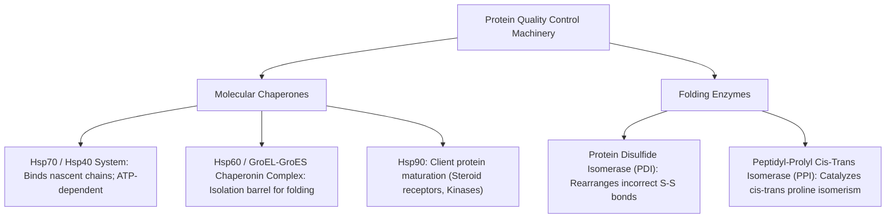
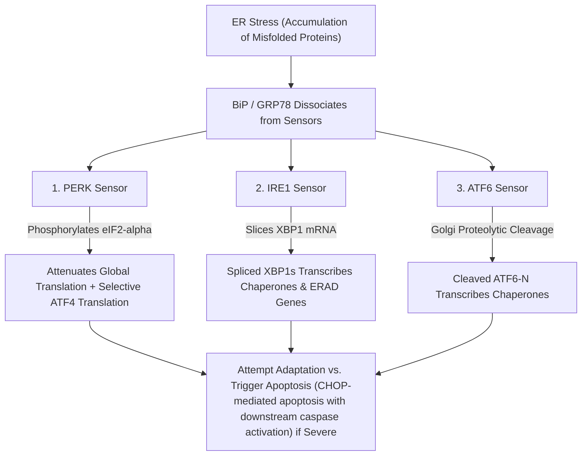
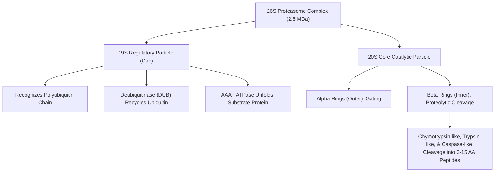
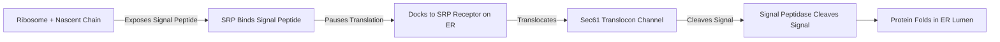
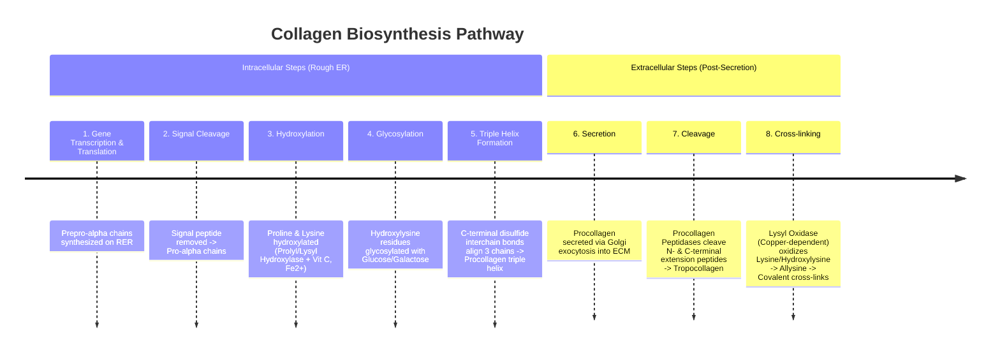

# 08. Tertiary and Quaternary Structure and Collagen

## 1. Protein Folding, Tertiary Structure, and Stabilizing Forces
Tertiary structure represents the complete three-dimensional folding of a single polypeptide chain into a compact globular or fibrous architecture.

### Non-Covalent and Covalent Stabilizing Forces
1. **Hydrophobic Interactions:** a major thermodynamic driver of protein folding (the contribution is context-dependent and not usefully expressed as a fixed percentage) (Entropic drive: burying nonpolar side chains inside the hydrophobic core away from water).
2. **Electrostatic Interactions (Salt Bridges):** Ionic bonds between oppositely charged side chains (e.g., $Asp^- ... Lys^+$).
3. **Hydrogen Bonds:** Between polar peptide backbone and side-chain groups.
4. **Van der Waals Forces:** Transient induced dipoles between tightly packed nonpolar atoms.
5. **Disulfide Bonds ($S-S$):** Covalent linkages formed between two **Cysteine** residues ($Cys-S-S-Cys =$ **Cystine**) in the oxidizing environment of the ER lumen.

---

## 2. Molecular Chaperones and Folding Enzymes
Chaperones bind exposed hydrophobic patches on unfolded or partially folded polypeptides to prevent inappropriate aggregation during synthesis and stress.

---

## 3. Protein Quality Control, ERAD, and the Unfolded Protein Response (UPR)

### ER-Associated Degradation (ERAD)
Misfolded glycoproteins in the Rough ER lumen are recognized by lectins (Calnexin/Calreticulin), retrotranslocated (dislocated) across the ER membrane into the cytosol via the Sec61/Derlin channel, polyubiquitinated, and degraded by the **26S Proteasome**.

### The Unfolded Protein Response (UPR)
Triggered by accumulation of unfolded/misfolded proteins in the ER lumen (**ER Stress**), which sequesters **BiP / GRP78** away from three ER transmembrane sensors:

---

## 4. The Ubiquitin-Proteasome System (UPS) and Autophagy

### Ubiquitination Cascade
Tagging proteins for degradation involves three sequential enzymes:
1. **E1 (Ubiquitin-Activating Enzyme):** Forms high-energy thioester bond with Ubiquitin (ATP-dependent).
2. **E2 (Ubiquitin-Conjugating Enzyme):** Transfers activated ubiquitin to its cysteine residue.
3. **E3 (Ubiquitin Ligase):** Binds specific target protein substrate and transfers ubiquitin to the $\epsilon$-amino group of a **Lysine** residue on the substrate.
* **Targeting Signal:** Polyubiquitin chains linked via **Lysine-48 (Lys-48)** target the substrate to the 26S proteasome. (Lys-63 linkages regulate signaling and autophagy).

### Architecture of the 26S Proteasome

### Proteasomal vs. Lysosomal Autophagy Degradation

| Parameter | Ubiquitin-Proteasome System (UPS) | Autophagy-Lysosomal System |
| :--- | :--- | :--- |
| **Substrate Type** | Short-lived, soluble, misfolded single proteins | Long-lived proteins, insoluble aggregates, damaged organelles (Mitophagy) |
| **Localization** | Cytosol and Nucleus | Lysosomes / Phagolysosomes |
| **Energy Requirement** | Strictly ATP-dependent | ATP-independent enzymatic digestion |
| **Key Markers** | Lys-48 Polyubiquitin, PEST sequences | **LC3-II**, p62 / SQSTM1, ATG5-ATG12 |

---

## 5. Protein Misfolding, Amyloidosis, and Prion Diseases

### Pathogenesis of Amyloidosis
Misfolded proteins adopt a predominant **$\beta$-pleated sheet rich conformation**, causing self-assembly into insoluble non-branching fibrils ($7.5 - 10\text{ nm}$ diameter).

* **Diagnostic Gold Standard:** **Congo Red Stain** showing **Apple-Green Birefringence** under polarized light microscopy.

### Key Conformational Protein-Misfolding Diseases

| Disease | Precursor Protein | Misfolded / Aggregated Entity | Key Pathological Features |
| :--- | :--- | :--- | :--- |
| **Alzheimer Disease** | Amyloid Precursor Protein (APP); Tau | **$\beta$-Amyloid ($A\beta_{42}$)** (Extracellular plaques); **Hyperphosphorylated Tau** (Intracellular Neurofibrillary Tangles) | Progressive dementia, cortical atrophy, senile plaques |
| **Parkinson Disease** | $\alpha$-Synuclein | **$\alpha$-Synuclein** aggregates | **Lewy Bodies**; loss of dopaminergic neurons in Substantia Nigra pars compacta |
| **Prion Diseases (CJD, Kuru,FFI)**| $PrP^C$ (Normal cellular $\alpha$-helical) | **$PrP^{Sc}$** (Infectious $\beta$-sheet rich, protease-resistant) | Spongiform encephalopathy; template-directed refolding of $PrP^C \rightarrow PrP^{Sc}$ |
| **AL Amyloidosis** | Immunoglobulin Light Chains | Monoclonal $\kappa$ or $\lambda$ light chains | Plasma cell dyscrasias, Multiple Myeloma, nephrotic syndrome, macroglossia |
| **AA Amyloidosis** | Serum Amyloid A (SAA) | SAA cleavage product | Chronic inflammatory states (Rheumatoid arthritis, TB, Osteomyelitis, FMF) |
| **Familial Amyloid Polyneuropathy**| Transthyretin (TTR) | Mutant TTR | Autonomic and peripheral neuropathy, cardiac amyloid |
| **Dialysis-Related Amyloidosis**| $\beta_2$-Microglobulin | $\beta_2$-Microglobulin | End-stage renal disease on long-term hemodialysis; Carpal Tunnel Syndrome |

---

## 6. Protein Targeting, Translocation, and Glycosylation

### Signal Hypothesis and ER Targeting
1. Nascent polypeptide N-terminus emerges with a **Signal Peptide** (15-30 hydrophobic residues).
2. **Signal Recognition Particle (SRP)** binds signal peptide and pauses translation.
3. SRP binds **SRP Receptor** on Rough ER membrane.
4. Ribosome docks onto **Sec61 Translocon** channel; signal peptide is cleaved by **Signal Peptidase**.
5. Protein is translocated into ER lumen (co-translational translocation).

### N-Linked vs. O-Linked Glycosylation

| Feature | N-Linked Glycosylation | O-Linked Glycosylation |
| :--- | :--- | :--- |
| **Attachment Atom / Residue** | Nitrogen of **Asparagine (Asn)** in $Asn-X-Ser/Thr$ consensus | Oxygen of **Serine (Ser)** or **Threonine (Thr)** |
| **Initiation Site** | **Rough ER Lumen** (co-translational) | **Golgi Apparatus** (post-translational) |
| **Lipid Intermediate** | **Dolichol Phosphate** (Inhibited by **Tunicamycin**) | None |
| **Sugar Donor** | Preassembled oligosaccharide ($Glc_3Man_9GlcNAc_2$) | Nucleotide sugars (UDP-GalNAc) added sequentially |
| **I-Cell Disease Defect** | Defect in **$GlcNAc\text{-phosphotransferase}$** $\rightarrow$ Failure to add **Mannose-6-Phosphate (M6P)** tag $\rightarrow$ Lysosomal enzymes misrouted to ECF $\rightarrow$ Inclusion bodies in fibroblasts. | N/A |

---

## 7. Collagen Biochemistry, Synthesis, and Clinical Disorders

### Structure of Collagen
* Basic structural unit: **Tropocollagen** (triple helix of three $\alpha$-chains, length $300\text{ nm}$, diameter $1.5\text{ nm}$).
* **Repeating Sequence:** **$(Gly - X - Y)_n$**, where $X$ is frequently **Proline** and $Y$ is **Hydroxyproline** (or Hydroxylysine).
* **Glycine Requirement:** Every third residue MUST be Glycine because its small side chain ($-H$) is the only one that can fit into the tight central axis of the triple helix.

### Step-by-Step Collagen Biosynthesis Timeline

### Major Collagen Types and Tissue Distribution

| Type | Tissue Distribution | Associated Clinical Disorders |
| :--- | :--- | :--- |
| **Type I** ($90\%$) | Bone, Skin, Tendons, Ligaments, Cornea, Dentin | **Osteogenesis Imperfecta** (COL1A1/COL1A2 mutations); Ehlers-Danlos (Classical) |
| **Type II** | Cartilage, Vitreous humor, Intervertebral disc | Achondrogenesis Type II, Stickler syndrome |
| **Type III** | Blood vessels, Skin, Uterus, Fetal tissue, Granulation tissue | **Ehlers-Danlos Syndrome (Vascular Type - COL3A1)** |
| **Type IV** | Basement membrane, Renal glomerulus, Lens capsule | **Alport syndrome** (pathogenic variants in COL4A5, X-linked, or COL4A3/COL4A4, autosomal dominant or recessive); **Goodpasture disease** (autoantibodies against the NC1 domain of the $\alpha_3$ chain of type IV collagen) |
| **Type V** | Placenta, Hair, Cell surfaces | Ehlers-Danlos Syndrome (Classical Type - COL5A1/COL5A2) |

### Inherited and Acquired Collagen Disorders

#### 1. Scurvy (Vitamin C Deficiency)
* **Mechanism:** Deficiency of **Ascorbate (Vitamin C)**, which maintains $Fe^{2+}$ in the reduced state required as an essential co-substrate for **Prolyl Hydroxylase** and **Lysyl Hydroxylase**.
* **Pathophysiology:** Decreased hydroxyproline impairs interchain hydrogen bonding, leading to unstable procollagen triple helices that denature at body temperature.
* **Clinical Features:** Perifollicular hemorrhages, corkscrew hairs, bleeding spongy gums, impaired wound healing, anemia.

#### 2. Osteogenesis Imperfecta (Brittle Bone Disease)
* **Genetics:** Autosomal dominant mutations in **COL1A1** or **COL1A2** genes encoding Type I collagen.
* **Mechanism:** Replacement of Glycine by bulky amino acids (e.g., Cysteine, Aspartate) prevents tight triple-helix packing (**Dominant Negative Effect**).
* **Clinical Features (Type I - Mildest):** Multiple recurrent fractures with minimal trauma, **Blue Sclerae** (translucent scleral connective tissue revealing underlying choroid), conductive hearing loss, **Dentinogenesis Imperfecta** (opalescent teeth).

#### 3. Ehlers-Danlos Syndrome (EDS)
Group of inherited connective tissue disorders characterized by hypermobility and tissue fragility.
* **Classical Type (Type I/II):** Mutations in **Type V Collagen** (COL5A1/COL5A2). Presents with hyperextensible skin, joint hypermobility, fragile skin prone to "cigarette-paper" scars.
* **Vascular Type (Type IV):** Autosomal dominant mutation in **Type III Collagen (COL3A1)**. Severe form presenting with arterial rupture, uterine rupture during pregnancy, and bowel perforation.

#### 4. Menkes Disease ($X$-Linked Recessive)
* **Pathophysiology:** Mutation in **ATP7A** gene encoding a copper-transporting ATPase. Impairs intestinal copper absorption and tissue distribution.
* **Enzymatic Defect:** Decreased activity of **Lysyl Oxidase** (a copper-dependent enzyme), impairing covalent extracellular cross-linking of collagen and elastin.
* **Clinical Triad:** **Kinky / Steely hair**, severe developmental delay, vascular aneurysms/hypotonia.

---

## Selected References for Clinical Updates

- [Alport Syndrome - GeneReviews](https://www.ncbi.nlm.nih.gov/books/NBK1207/)
