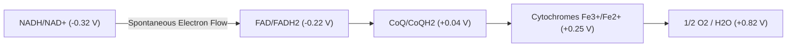
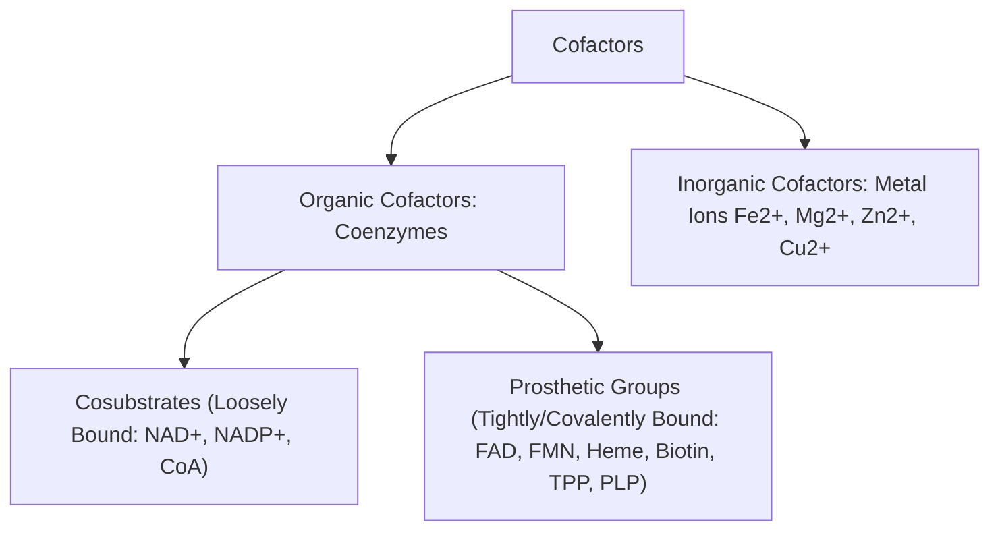

# 09. Oxidation/Reduction Reactions, Coenzymes and Prosthetic Groups

## 1. Bioenergetics and Redox Potentials

Biological oxidation-reduction (redox) reactions involve the transfer of electrons ($e^-$) from an electron donor (reducing agent) to an electron acceptor (oxidizing agent). These reactions drive cellular ATP synthesis by coupling exergonic electron transport to endergonic phosphorylation.

### Standard Reduction Potential ($E_0'$)
The reduction potential measures the tendency of a chemical species to gain electrons and be reduced, measured in volts ($\text{V}$) or millivolts ($\text{mV}$) at standard biochemical conditions ($\text{pH } 7.0, 25^\circ\text{C}, 1\text{ atm}$, $1.0\text{ M}$ concentration of reactants).

$$\Delta G^\circ' = -n F \Delta E_0'$$

*Where:*
* $\Delta G^\circ'$ = Standard free energy change ($\text{kJ/mol}$)
* $n$ = Number of electrons transferred per molecule
* $F$ = Faraday constant ($96.485\text{ kJ/V}\cdot\text{mol}$ or $23.06\text{ kcal/V}\cdot\text{mol}$)
* $\Delta E_0'$ = Difference in standard reduction potential between acceptor and donor redox pairs ($E_{0'(\text{acceptor})} - E_{0'(\text{donor})}$)

> **High-Yield Principle:** Electrons flow spontaneously from redox couples with **more negative** $E_0'$ (stronger reducing agents, high electron transfer potential) to redox couples with **more positive** $E_0'$ (stronger oxidizing agents, high electron affinity).
> * $NAD^+/NADH$ couple: $E_0' = -0.32\text{ V}$ (Strong electron donor)
> * $\frac{1}{2} O_2/H_2O$ couple: $E_0' = +0.82\text{ V}$ (Terminal electron acceptor)



---

## 2. Coenzymes vs. Prosthetic Groups

Enzymes requiring non-protein helper molecules for catalytic activity are called **apoenzymes** (inactive alone). When bound to their cofactor, they form the functional **holoenzyme**.

$$\text{Apoenzyme (Inactive Protein)} + \text{Cofactor / Coenzyme} \rightleftharpoons \text{Holoenzyme (Active)}$$



| Feature | Cosubstrates (Loosely Bound Coenzymes) | Prosthetic Groups (Tightly Bound) |
| :--- | :--- | :--- |
| **Binding Affinity** | Dissociable; binds transiently during reaction | Covalently attached or very tightly non-covalently bound |
| **Reaction Role** | Acts as a second substrate; regenerated in a separate reaction | Regenerated within the same enzyme's catalytic cycle |
| **Examples** | $NAD^+$, $NADP^+$, Coenzyme A ($CoA-SH$), $THF$ | $FAD$, $FMN$, Heme, Biotin, $TPP$, Lipoic Acid, $PLP$ |

---

## 3. Nicotinamide Adenine Dinucleotides ($NAD^+$ and $NADP^+$)

Derived from **Vitamin B3 (Niacin / Nicotinic Acid / Nicotinamide)** and the amino acid **Tryptophan** ($60\text{ mg}$ tryptophan yields $1\text{ mg}$ niacin).

### Structure and Mechanism
* **Functional Group:** Nicotinamide ring accepts a hydride ion (1 proton + 2 electrons = $H^-$).
* **Stoichiometry:**

$$NAD^+ + 2e^- + 2H^+ \rightarrow NADH + H^+$$

```
   Nicotinamide Ring (Oxidized) + H:- (Hydride Ion)  <--->  Nicotinamide Ring (Reduced)
               [NAD+]                                            [NADH]
```

### Functional Separation of $NAD^+$ and $NADP^+$
1. **$NAD^+/NADH$ Ratio:** High ratio ($\sim 700:1$) maintained in cytosol. Primarily involved in **catabolic, ATP-generating** pathways (Glycolysis, TCA cycle, Pyruvate Dehydrogenase, $\beta$-oxidation).
2. **$NADP^+/NADPH$ Ratio:** Low ratio ($\sim 0.005:1$, i.e., $NADPH$ predominant). Primarily involved in **anabolic, reductive biosynthesis** (Fatty acid synthesis, Cholesterol synthesis, Steroidogenesis) and **antioxidant defense** (regeneration of reduced glutathione via Glutathione Reductase; see Chapter 15).

> **Clinical Correlation — Pellagra (3 Ds):** Niacin deficiency leads to Pellagra characterized by **Dermatitis** (photosensitive, Casal necklace), **Diarrhea**, and **Dementia** (if untreated, death). Causes include dietary deficiency (maize-dependent diets), **Hartnup disease** (impaired neutral amino acid transport in intestine/kidneys), and **Carcinoid syndrome** (excessive diversion of tryptophan to serotonin synthesis).

---

## 4. Flavin Nucleotides ($FAD$ and $FMN$)

Derived from **Vitamin B2 (Riboflavin)**.

### Structure and Mechanism
* **Functional Group:** Isoalloxazine ring system.
* **Stoichiometry:** Accepts 2 electrons and 2 protons step-wise via a stable **semiquinone radical** intermediate.

$$FAD + 1e^- + 1H^+ \rightleftharpoons \text{FADH}^\bullet \text{ (Semiquinone)}$$
$$\text{FADH}^\bullet + 1e^- + 1H^+ \rightleftharpoons FADH_2 \text{ (Fully Reduced)}$$

```
   Isoalloxazine Ring (Oxidized) + 2H+ + 2e-  <--->  Isoalloxazine Ring (Reduced)
              [FAD / FMN]                                  [FADH2 / FMNH2]
```

* **Flavoproteins:** $FAD$ and $FMN$ are tightly bound prosthetic groups in enzymes like Succinate Dehydrogenase (Complex II), Acyl-CoA Dehydrogenase ($\beta$-oxidation), Glycerol-3-Phosphate Dehydrogenase, and Dihydrolipoyl Dehydrogenase ($E_3$ of PDH).

> **NEET PG High-Yield:** Because $FAD$ is a prosthetic group, its reduction potential is determined by the protein environment of the specific flavoprotein, ranging from $-0.40\text{ V}$ to $+0.06\text{ V}$.

---

## 5. Other Crucial Coenzymes and Prosthetic Groups

| Coenzyme / Prosthetic Group | Vitamin Precursor | Key Functional Group | High-Yield Associated Enzymes / Reactions |
| :--- | :--- | :--- | :--- |
| **Thiamine Pyrophosphate ($TPP$)** | Vitamin B1 (Thiamine) | Thiazolium ring | Pyruvate Dehydrogenase ($E_1$), $\alpha$-Ketoglutarate Dehydrogenase, Transketolase (HMP Shunt), Branched-Chain $\alpha$-Keto Acid Dehydrogenase |
| **Lipoic Acid (Lipoamide)** | Synthesized endogenous / Lysine-bound | Disulfide ring (Lysine linkage) | $E_2$ component of PDH and $\alpha$-KGDH complexes. Inhibited by **Arsenite** (binds sulfhydryl groups) |
| **Coenzyme A ($CoA-SH$)** | Vitamin B5 (Pantothenic Acid) | Reactive Thiol ($-SH$) group | Acetyl-CoA, Succinyl-CoA, Fatty Acyl-CoA formation (Thioester high-energy bonds) |
| **Pyridoxal Phosphate ($PLP$)** | Vitamin B6 (Pyridoxine) | Aldehyde group | Transaminases (AST, ALT), Decarboxylases (GAD, DOPA decarboxylase), Aminolevulinic Acid Synthase (ALA Synthase) |
| **Biotin** | Vitamin B7 (Biotin) | Imidazolidone ring covalently bound to Lysine | All Carboxylases: Pyruvate Carboxylase, Acetyl-CoA Carboxylase, Propionyl-CoA Carboxylase |
| **Cobalamin ($B_{12}$)** | Vitamin B12 | Corrin ring with Cobalt ($Co^{3+}$) | Methionine Synthase, Methylmalonyl-CoA Mutase |

---

## 6. Classification of Oxidoreductases

Enzymes catalyzing redox reactions belong to Enzyme Commission Class 1 (**EC 1**):

1. **Dehydrogenases:** Cannot use $O_2$ as a direct hydrogen acceptor. Transfer hydrogens to $NAD^+$, $NADP^+$, $FAD$, or $FMN$ (e.g., Lactate Dehydrogenase, GAPDH).
2. **Oxidases:** Use $O_2$ as a hydrogen acceptor, reducing it to $H_2O$ or $H_2O_2$ without incorporating oxygen into the substrate (e.g., Cytochrome c Oxidase [Complex IV], Glucose Oxidase, Xanthine Oxidase).
3. **Oxygenases:** Incorporate oxygen atoms directly into the substrate molecule:
   * **Monooxygenases (Mixed-function oxidases / Hydroxylases):** Incorporate 1 atom of $O_2$ into substrate, 1 atom reduced to $H_2O$ (e.g., Cytochrome P450 systems, Phenylalanine Hydroxylase).
   * **Dioxygenases:** Incorporate both atoms of $O_2$ into the substrate (e.g., Homogentisate Oxidase, Tryptophan 2,3-Dioxygenase).
4. **Hydroperoxidases:** Protect cells against peroxides (e.g., Catalase, Glutathione Peroxidase).

---

## 7. Coverage Audit

* **Major Concepts Covered:** Redox potentials, Nernst equation bioenergetics, cosubstrates vs prosthetic groups, $NAD^+/NADP^+$ functional separation, $FAD/FMN$ semiquinone radical kinetics, B-complex coenzyme spectrum, and oxidoreductase classification.
* **Source Gaps / Conflicting Claims:** None identified.
* **Obsidian Links:** Linked to 11 Aerobic Production of ATP, 15 Free Radicals ROS and Oxidative Damage, and 17 Anaerobic Glycolysis and Lactate Formation.

---
