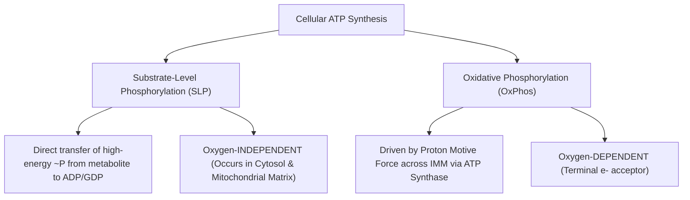

# 10. Anaerobic Production of ATP by Substrate-Level Phosphorylation, from Phosphocreatine and by the Adenylate Kinase (Myokinase) Reaction

## 1. Substrate-Level Phosphorylation (SLP) vs. Oxidative Phosphorylation

ATP synthesis in human tissues occurs via two distinct mechanisms:



| Characteristic | Substrate-Level Phosphorylation (SLP) | Oxidative Phosphorylation (OxPhos) |
| :--- | :--- | :--- |
| **Mechanism** | Direct transfer of phosphate group from high-energy substrate to $ADP$ or $GDP$ | Indirect; driven by proton gradient ($\Delta p$) generated by ETC |
| **Subcellular Location** | Cytosol (Glycolysis) and Mitochondrial Matrix (TCA Cycle) | Inner Mitochondrial Membrane (IMM) |
| **Oxygen Requirement** | Strictly **Oxygen-Independent** | Strictly **Oxygen-Dependent** |
| **Quantitation** | Minor fraction under aerobic conditions ($\sim 10\%$), primary under anaerobic | Major fraction under aerobic conditions ($\sim 90\%$) |

---

## 2. Reactions of Substrate-Level Phosphorylation

There are three key SLP reactions in human biochemistry:

### 1. Phosphoglycerate Kinase (Cytosolic Glycolysis)
High-energy mixed anhydride acyl-phosphate bond of **1,3-Bisphosphoglycerate (1,3-BPG)** is transferred to $ADP$:

$$\text{1,3-Bisphosphoglycerate} + ADP \xrightarrow{\text{Phosphoglycerate Kinase, } Mg^{2+}} \text{3-Phosphoglycerate} + ATP$$

* $\Delta G^\circ' = -18.8\text{ kJ/mol}$ (Highly exergonic).
* Yields 2 ATP per glucose molecule (1 per triose).

### 2. Pyruvate Kinase (Cytosolic Glycolysis)
High-energy enol-phosphate bond of **Phosphoenolpyruvate (PEP)** is transferred to $ADP$:

$$\text{Phosphoenolpyruvate} + ADP + H^+ \xrightarrow{\text{Pyruvate Kinase, } K^+, Mg^{2+}} \text{Pyruvate} + ATP$$

* $\Delta G^\circ' = -31.4\text{ kJ/mol}$ (Driven by spontaneous enol-to-keto tautomerization of pyruvate).
* Yields 2 ATP per glucose molecule.

### 3. Succinate Thiokinase / Succinyl-CoA Synthetase (Mitochondrial Matrix - TCA Cycle)
Thioester bond cleavage of **Succinyl-CoA** drives phosphorylation of $GDP$ (or $ADP$):

$$\text{Succinyl-CoA} + GDP + P_i \xrightarrow{\text{Succinate Thiokinase}} \text{Succinate} + GTP + CoA-SH$$

* In liver and kidney, the enzyme is $GDP$-specific ($GTP$ generated is used in gluconeogenesis via PEP carboxykinase). In heart and skeletal muscle, an $ADP$-specific isoenzyme predominant generates $ATP$.

---

## 3. The Phosphocreatine (PCr) / Creatine Kinase System

During explosive bursts of physical effort (e.g., $100\text{-meter}$ sprint, weightlifting), intramuscular ATP stores ($4–5\text{ mmol/kg}$ wet muscle) are depleted within $1–2\text{ seconds}$. The **Phosphocreatine (PCr)** system acts as an immediate high-energy phosphate buffer (phosphagen system).

```
                            Creatine Kinase (CK)
   Phosphocreatine (PCr) + ADP + H+  <=================>  Creatine + ATP
                                      [Lohmann Reaction]
```

$$\Delta G^\circ' = -43.1\text{ kJ/mol}$$

### Mechanics of the Phosphocreatine System
* **Resting State:** Excess ATP produced by oxidative phosphorylation in mitochondria donates its phosphate to Creatine via mitochondrial Creatine Kinase ($mCK$), generating $PCr$ ($20–25\text{ mmol/kg}$).
* **Active Muscle Contraction:** Cytosolic $CK$ rapidly transfers the phosphate from $PCr$ to $ADP$, regenerating $ATP$ without requiring oxygen or glycogen degradation. Supplies energy for **$5–10\text{ seconds}$** of maximal exertion.

```mermaid
graph LR
    subgraph Mitochondrion
        A[ATP from OxPhos] + B[Creatine] -->|mCK| C[PCr] + D[ADP]
    end
    C -->|PCr Shuttle to Cytosol| E[Cytosolic PCr Pool]
    subgraph Cytosol / Myofibrils
        E + F[ADP from Contraction] -->|Cytosolic CK| G[Creatine] + H[ATP for Myosin ATPase]
    end
    G -->|Creatine Shuttle back to Mito| B
```

### Diagnostic Isoenzymes of Creatine Kinase ($CK$)
$CK$ is a dimer composed of $M$ (Muscle) and $B$ (Brain) subunits:
1. **$CK-1 (BB)$:** Brain, Smooth muscle ($<1\%$ of serum $CK$). Elevated in brain infarction, bowel ischemia.
2. **$CK-2 (MB)$:** Cardiac muscle ($20–30\%$ of cardiac $CK$, $<3\%$ of skeletal muscle $CK$). historically used as a marker of **acute myocardial infarction (AMI)**; cardiac troponin, preferably a high-sensitivity assay, is now preferred (Rises in $4–8\text{ hours}$, peaks at $12–24\text{ hours}$, returns to baseline in $48–72\text{ hours}$).
3. **$CK-3 (MM)$:** Skeletal muscle ($99\%$ of skeletal $CK$, $70–80\%$ of cardiac $CK$). Elevated in rhabdomyolysis, muscular dystrophy, intramuscular injections.

---

## 4. The Adenylate Kinase (Myokinase) Reaction and AMP Signaling

When rapid muscle contraction depletes $PCr$, **Adenylate Kinase (Myokinase)** catalyzes the reversible interconversion of adenine nucleotides:

$$2 ADP \xrightarrow{\text{Adenylate Kinase (Myokinase)}} ATP + AMP$$

$$\Delta G^\circ' \approx 0\text{ kJ/mol}$$

### Metabolic Significance of $AMP$ as a Master Sensor
While cellular $ATP$ concentration drops by only $10\%$ during intense exercise, the relative concentration of $AMP$ increases by over **$1000\%$** due to the equilibrium mechanics of the myokinase reaction.

```
       Small ↓ in ATP (e.g., -10%)  ===>  Massive ↑ in AMP (e.g., +1000%)
                                              |
                       +----------------------+----------------------+
                       |                                             |
            Activates PFK-1 Directly                 Activates AMP-Activated
         [Accelerates Glycolytic Flux]               Protein Kinase (AMPK)
                                                                     |
                                                     - Stimulates GLUT4 translocation
                                                     - Stimulates Fatty Acid Oxidation
                                                     - Inhibits Anabolic Pathways (ACC)
```

> **High-Yield NEET PG Rule:** $AMP$ is the single most sensitive allosteric signal reflecting cellular energy depletion. It directly overcomes $ATP$-mediated inhibition of **Phosphofructokinase-1 (PFK-1)** in glycolysis.

---

## 5. Classification of High-Energy Compounds

Compounds are classified based on their standard free energy of hydrolysis ($\Delta G^\circ'$):
* **High-Energy Compounds ($\Delta G^\circ' < -30.5\text{ kJ/mol}$):** Possess phosphate or thioester bonds with higher group transfer potential than $ATP$.
* **Low-Energy Compounds ($\Delta G^\circ' > -30.5\text{ kJ/mol}$):** Hydrolysis yields less energy than $ATP \rightarrow ADP + P_i$.

```
           High-Energy Hierarchy (Group Transfer Potential)
           --------------------------------------------------
           1. Phosphoenolpyruvate (PEP)       (-61.9 kJ/mol)
           2. 1,3-Bisphosphoglycerate (1,3-BPG)(-49.3 kJ/mol)
           3. Phosphocreatine (PCr)           (-43.1 kJ/mol)
           4. Acetyl-CoA / Succinyl-CoA       (-31.4 kJ/mol)
           --------------------------------------------------
                       *** ATP (-30.5 kJ/mol) ***
           --------------------------------------------------
           5. Glucose-1-Phosphate             (-20.9 kJ/mol)
           6. Fructose-6-Phosphate            (-15.9 kJ/mol)
           7. Glucose-6-Phosphate             (-13.8 kJ/mol)
           8. Glycerol-3-Phosphate            (-9.2 kJ/mol)
```

---

## 6. Coverage Audit

* **Major Concepts Covered:** Substrate-Level Phosphorylation vs OxPhos, 3 specific SLP reactions, Phosphocreatine/CK system, CK isoenzyme diagnostics, Adenylate kinase/AMPK signaling, high-energy bond classification hierarchy.
* **Source Gaps / Conflicting Claims:** None identified.
* **Obsidian Links:** Linked to 12 Oxidative Phosphorylation Part 1 and 17 Anaerobic Glycolysis and Lactate Formation.

---
