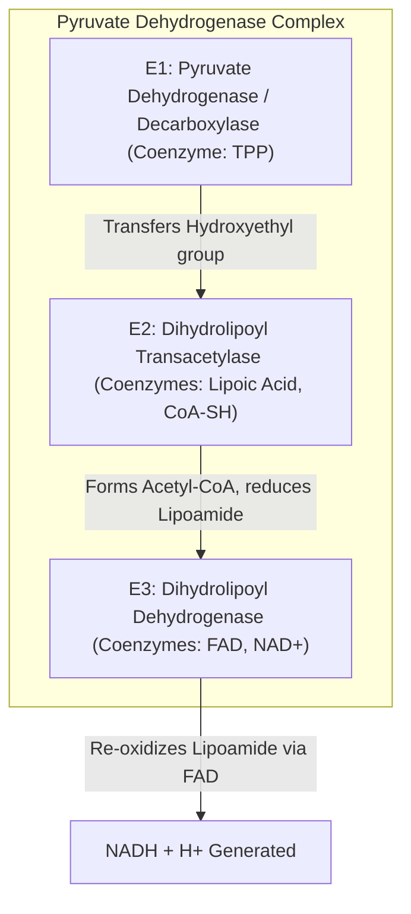
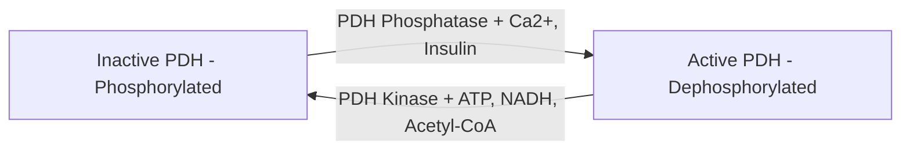
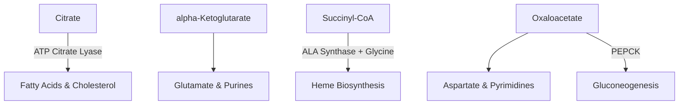

# 11. Aerobic Production of ATP

## 1. The Bridge Reaction: Pyruvate Dehydrogenase (PDH) Complex

Under aerobic conditions, pyruvate produced by cytosolic glycolysis enters the mitochondrial matrix via the **Mitochondrial Pyruvate Carrier (MPC)**. Here, it undergoes irreversible **oxidative decarboxylation** to form **Acetyl-CoA**.

$$\text{Pyruvate} + CoA-SH + NAD^+ \xrightarrow{\text{PDH Complex}} \text{Acetyl-CoA} + CO_2 + NADH + H^+$$

$$\Delta G^\circ' = -33.4\text{ kJ/mol}$$

### Architecture of the Multienzyme PDH Complex
PDH is a massive multienzyme complex composed of multiple copies of 3 catalytic enzymes ($E_1, E_2, E_3$) and 5 coenzymes:



> **NEET PG Mnemonic for PDH Coenzymes:** **"Tender Loving Care For Nancy"**
> 1. **T**PP (Thiamine Pyrophosphate, Vit B1) — $E_1$
> 2. **L**ipoic Acid (Lipoamide) — $E_2$
> 3. **C**oA-SH (Pantothenic Acid, Vit B5) — $E_2$
> 4. **F**AD (Riboflavin, Vit B2) — $E_3$
> 5. **N**AD+ (Niacin, Vit B3) — $E_3$

### Regulation of Pyruvate Dehydrogenase
PDH regulation controls entry of carbohydrates into the TCA cycle:

1. **Covalent Modification (Primary Mechanism):**
   * **PDH Kinase:** Phosphorylates $E_1$, **INACTIVATING** the complex. Activated by high energy signals ($ATP, NADH, \text{Acetyl-CoA}$). Inhibited by $Pyruvate, ADP, NAD^+, CoA-SH$.
   * **PDH Phosphatase:** Dephosphorylates $E_1$, **ACTIVATING** the complex. Activated by $Ca^{2+}$ (muscle contraction signal), $Mg^{2+}$, and **Insulin** (in adipose tissue/liver).
2. **Allosteric End-Product Inhibition:** $NADH$ directly inhibits $E_3$; $\text{Acetyl-CoA}$ directly inhibits $E_2$.



### Clinical Correlations
* **Arsenic Poisoning:** Arsenite ($AsO_3^{3-}$) binds vicinal sulfhydryl ($-SH$) groups of **Lipoic Acid**, inhibiting $E_2$ of PDH, $\alpha$-Ketoglutarate Dehydrogenase, and Branched-Chain $\alpha$-Keto Acid Dehydrogenase. Leads to severe lactic acidosis, garlic odor on breath, Mees lines on nails, and rice-water stools.
* **Pyruvate Dehydrogenase Deficiency:** X-linked dominant inheritance ($E_1\,\alpha$ subunit mutation). Pyruvate shunts to lactate (via LDH) and alanine (via ALT), causing congenital **lactic acidosis**, neurological decline, and Leigh syndrome. **Treatment:** High-fat, low-carbohydrate **ketogenic diet** (Lysine and Leucine are purely ketogenic amino acids bypassing PDH).

---

## 2. The Tricarboxylic Acid (TCA) / Citric Acid / Krebs Cycle

The TCA cycle takes place in the **mitochondrial matrix** (except Succinate Dehydrogenase, which is embedded in the IMM as Complex II). It serves as the final common pathway for the oxidation of carbohydrates, lipids, and amino acids.

```mermaid
graph TD
    Acetyl["Acetyl-CoA (2C)"] + OAA["Oxaloacetate (4C)"] -->|1. Citrate Synthase| Citrate["Citrate (6C)"]
    Citrate -->|2. Aconitase| Isocitrate["Isocitrate (6C)"]
    Isocitrate -->|3. Isocitrate DH + NAD+ -> NADH + CO2| AKG["alpha-Ketoglutarate (5C)"]
    AKG -->|4. a-KGDH Complex + NAD+ -> NADH + CO2| SuccCoA["Succinyl-CoA (4C)"]
    SuccCoA -->|5. Succinate Thiokinase + GDP -> GTP| Succinate["Succinate (4C)"]
    Succinate -->|6. Succinate DH + FAD -> FADH2| Fumarate["Fumarate (4C)"]
    Fumarate -->|7. Fumarase + H2O| Malate["Malate (4C)"]
    Malate -->|8. Malate DH + NAD+ -> NADH| OAA
```

---

## 3. Detailed Reactions of the TCA Cycle

### Step 1: Condensation (Citrate Synthase)
First committed step. Condensation of Acetyl-CoA ($2C$) with Oxaloacetate ($4C$) to form Citrate ($6C$).

$$\text{Acetyl-CoA} + \text{Oxaloacetate} + H_2O \xrightarrow{\text{Citrate Synthase}} \text{Citrate} + CoA-SH$$

* Strongly exergonic ($\Delta G^\circ' = -31.4\text{ kJ/mol}$). Inhibited by Citrate, $ATP, NADH, \text{Succinyl-CoA}$.

### Step 2: Isomerization (Aconitase)
Reversible isomerization of Citrate to Isocitrate via transient intermediate *cis*-Aconitate.

$$\text{Citrate} \rightleftharpoons \text{cis-Aconitate} \rightleftharpoons \text{Isocitrate}$$

* Contains a non-heme **$[4Fe-4S]$ iron-sulfur cluster** essential for catalytic activity.
* **Inhibitor:** **Fluoroacetate** (rat poison) is converted to Fluoroacetyl-CoA, then condensed by Citrate Synthase into **Fluorocitrate**, a lethal suicide inhibitor of Aconitase.

### Step 3: First Oxidative Decarboxylation (Isocitrate Dehydrogenase)
Rate-limiting step of the TCA cycle.

$$\text{Isocitrate} + NAD^+ \xrightarrow{\text{Isocitrate Dehydrogenase, } Mn^{2+}/Mg^{2+}} \alpha\text{-Ketoglutarate} + CO_2 + NADH + H^+$$

* **Regulation:** Strongly activated by **$ADP$** (increases substrate affinity) and $Ca^{2+}$. Inhibited by **$ATP$** and **$NADH$**.

### Step 4: Second Oxidative Decarboxylation ($\alpha$-Ketoglutarate Dehydrogenase Complex)
Multienzyme complex identical in structure and coenzyme mechanism to PDH ($E_1, E_2, E_3$ requiring $TPP$, Lipoic acid, $CoA-SH, FAD, NAD^+$).

$$\alpha\text{-Ketoglutarate} + CoA-SH + NAD^+ \xrightarrow{\alpha\text{-KGDH Complex}} \text{Succinyl-CoA} + CO_2 + NADH + H^+$$

* Activated by $Ca^{2+}$. Inhibited by $Succinyl-CoA, NADH, GTP, ATP$. **Inhibited by Arsenite**.

### Step 5: Substrate-Level Phosphorylation (Succinate Thiokinase)
Cleavage of high-energy thioester bond drives $GTP$ or $ATP$ synthesis (see Chapter 10).

$$\text{Succinyl-CoA} + GDP + P_i \xrightarrow{\text{Succinate Thiokinase}} \text{Succinate} + GTP + CoA-SH$$

### Step 6: Dehydrogenation (Succinate Dehydrogenase)
Only membrane-bound enzyme of the TCA cycle (embedded in IMM as **Complex II**). Transfers 2 hydrogen atoms directly to $FAD$.

$$\text{Succinate} + FAD \xrightarrow{\text{Succinate Dehydrogenase}} \text{Fumarate} + FADH_2$$

* **Competitive Inhibitor:** **Malonate** (structural analog of succinate).

### Step 7: Hydration (Fumarase / Fumarate Hydratase)
Stereospecific addition of $H_2O$ across the double bond of Fumarate to yield L-Malate.

$$\text{Fumarate} + H_2O \xrightarrow{\text{Fumarase}} \text{L-Malate}$$

### Step 8: Regeneration of Oxaloacetate (Malate Dehydrogenase)
Final reaction regenerating Oxaloacetate.

$$\text{L-Malate} + NAD^+ \xrightarrow{\text{Malate Dehydrogenase}} \text{Oxaloacetate} + NADH + H^+$$

* $\Delta G^\circ' = +29.7\text{ kJ/mol}$ (Endergonic). Reaction driven forward in vivo because Oxaloacetate is continuously removed by the highly exergonic Citrate Synthase reaction (Step 1).

---

## 4. Energetics and ATP Yield per Turn of the TCA Cycle

For every 1 molecule of **Acetyl-CoA** oxidized in the TCA cycle:

| Reaction Step | Enzyme | High-Energy Product | Equivalent ATP Yield (Modern P/O Ratio) |
| :--- | :--- | :--- | :--- |
| **Isocitrate $\rightarrow \alpha$-KGDH** | Isocitrate DH | $1\text{ NADH}$ | $2.5\text{ ATP}$ |
| **$\alpha$-KGDH $\rightarrow$ Succinyl-CoA** | $\alpha$-KGDH Complex | $1\text{ NADH}$ | $2.5\text{ ATP}$ |
| **Succinyl-CoA $\rightarrow$ Succinate** | Succinate Thiokinase | $1\text{ GTP (or ATP)}$ | $1.0\text{ ATP}$ |
| **Succinate $\rightarrow$ Fumarate** | Succinate DH | $1\text{ FADH}_2$ | $1.5\text{ ATP}$ |
| **Malate $\rightarrow$ Oxaloacetate** | Malate DH | $1\text{ NADH}$ | $2.5\text{ ATP}$ |
| **TOTAL YIELD PER ACETYL-CoA** | — | **$3\text{ NADH} + 1\text{ FADH}_2 + 1\text{ GTP}$** | **$10.0\text{ ATP}$** |

*(Note: Older textbooks cite $12\text{ ATP}$ using P/O ratios of 3 for $NADH$ and 2 for $FADH_2$. Modern consensus uses $2.5$ and $1.5$; see Chapter 13).

---

## 5. Amphibolic Nature and Anaplerotic Reactions

The TCA cycle is **amphibolic** (functions in both catabolism and anabolism):
* **Anabolic Outflows (Cataplerosis):**
  * Citrate $\rightarrow$ Cytosolic Acetyl-CoA (Fatty acid & Cholesterol synthesis)
  * $\alpha$-Ketoglutarate $\rightarrow$ Glutamate $\rightarrow$ Other Amino Acids & Purines
  * Succinyl-CoA $\rightarrow$ Heme synthesis (condenses with Glycine via ALA Synthase)
  * Oxaloacetate $\rightarrow$ Aspartate & Gluconeogenesis (via PEP Carboxykinase)



* **Anaplerotic (Replenishing) Reactions:** Reactions that replenish TCA cycle intermediates removed for biosynthesis.
  1. **Pyruvate Carboxylase (Most Important Anaplerotic Reaction):**
     $$\text{Pyruvate} + CO_2 + ATP + H_2O \xrightarrow{\text{Pyruvate Carboxylase, Biotin, } Mg^{2+}} \text{Oxaloacetate} + ADP + P_i$$
     * Absolutely activated by **Acetyl-CoA**.
  2. **Glutamate Dehydrogenase:** Converts Glutamate to $\alpha$-Ketoglutarate.
  3. **Transamination:** Aspartate Transaminase (AST) converts Aspartate to Oxaloacetate.

---

## 6. Coverage Audit

* **Major Concepts Covered:** Pyruvate Dehydrogenase complex architecture, coenzyme mnemonic, regulation, arsenic/PDH deficiency, complete 8-step TCA cycle, energetics ($10\text{ ATP/Acetyl-CoA}$), amphibolic pathways, and anaplerotic reactions.
* **Source Gaps / Conflicting Claims:** None identified.
* **Obsidian Links:** Linked to 10 Anaerobic ATP Production and Substrate Level Phosphorylation, 13 Oxidative Phosphorylation Part 2, and 17 Anaerobic Glycolysis and Lactate Formation.

---
