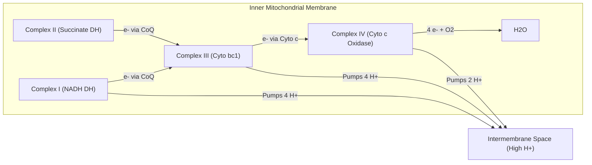
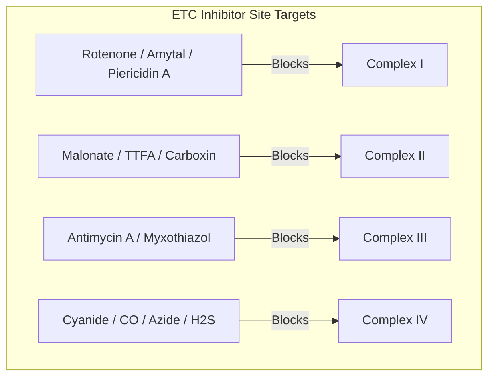

# 12. Biosynthesis of ATP by Oxidative Phosphorylation I

## 1. Structural Organization of the Electron Transport Chain (ETC)

The Electron Transport Chain consists of four multiprotein complexes (Complexes I, II, III, and IV) and two mobile electron carriers (**Coenzyme Q** and **Cytochrome c**) embedded within the **Inner Mitochondrial Membrane (IMM)**.



---

## 2. Comprehensive Analysis of ETC Complexes

### Complex I: NADH-Ubiquinone Oxidoreductase (NADH Dehydrogenase)
* **Structure:** Largest complex ($>44$ subunits, L-shaped structure).
* **Prosthetic Groups:** Flavin Mononucleotide ($FMN$) and $8–10$ Iron-Sulfur ($Fe-S$) clusters.
* **Electron Flow:** $NADH \rightarrow FMN \rightarrow Fe-S \text{ clusters} \rightarrow \text{Coenzyme Q (Ubiquinone)}$.
* **Proton Pumping:** Pumps **$4 H^+$** from matrix into intermembrane space per $2 e^-$ transferred.

$$NADH + H^+ + Q + 4 H^+_{\text{matrix}} \rightarrow NAD^+ + QH_2 + 4 H^+_{\text{IMS}}$$

### Complex II: Succinate-Ubiquinone Oxidoreductase (Succinate Dehydrogenase)
* **Structure:** Only membrane-bound enzyme of the TCA cycle.
* **Prosthetic Groups:** Covately bound $FAD$, $3 Fe-S$ clusters, and Cytochrome $b_{560}$.
* **Electron Flow:** $\text{Succinate} \rightarrow FAD \rightarrow Fe-S \text{ clusters} \rightarrow \text{Coenzyme Q}$.
* **Proton Pumping:** **Zero $H^+$ pumped** (free energy change is insufficient to drive proton translocation).

$$\text{Succinate} + Q \rightarrow \text{Fumarate} + QH_2$$

### Mobile Carrier 1: Coenzyme Q (Ubiquinone / CoQ)
* Lipophilic benzoquinone with a long isoprenoid tail (10 isoprene units in humans = $CoQ_{10}$) residing inside the hydrophobic IMM lipid bilayer.
* Accepts $2 e^-$ and $2 H^+$ step-wise via a semiquinone radical intermediate ($CoQH^\bullet$) to become fully reduced **Ubiquinol ($CoQH_2$)**.
* Collects electrons from Complex I, Complex II, Glycerol-3-Phosphate Dehydrogenase, and Electron Transferring Flavoprotein (ETF)-Q oxidoreductase ($\beta$-oxidation).

### Complex III: Ubiquinol-Cytochrome c Oxidoreductase (Cytochrome $bc_1$ Complex)
* **Structure:** Homodimer containing Cytochrome $b$ (hemes $b_L$ and $b_H$), Rieske $Fe-S$ center, and Cytochrome $c_1$.
* **The Q-Cycle Mechanism:** Bifurcated electron transfer where $1 e^-$ goes to Cytochrome $c_1 \rightarrow$ Cytochrome $c$, while the other $e^-$ recycles via Cytochrome $b$ to reduce $Q$ to $QH_2$.
* **Proton Pumping:** Pumps **$4 H^+$** into intermembrane space per $2 e^-$ passed to Cytochrome $c$.

$$QH_2 + 2 \text{ Cyt } c\,(\text{Fe}^{3+}) + 2 H^+_{\text{matrix}} \rightarrow Q + 2 \text{ Cyt } c\,(\text{Fe}^{2+}) + 4 H^+_{\text{IMS}}$$

### Mobile Carrier 2: Cytochrome c
* Peripheral, water-soluble hemeprotein associated with the outer face of the IMM. Transfers $1 e^-$ at a time from Complex III to Complex IV.
* **Apoptotic Role:** Release of Cytochrome c into the cytosol triggers **Apoptosome** formation ($Apaf-1 + \text{Procaspase-9} + dATP$), activating the intrinsic apoptotic cascade.

### Complex IV: Cytochrome c Oxidase
* **Structure:** Contains Cytochrome $a$, Cytochrome $a_3$, $Cu_A$ center, and $Cu_B$ center.
* **Mechanism:** $4 e^-$ from 4 Cytochrome $c$ molecules are transferred to $1 O_2$ molecule to produce $2 H_2O$.
* **Proton Pumping:** Pumps **$2 H^+$** into intermembrane space per pair of electrons ($2 e^-$).

$$2 \text{ Cyt } c\,(\text{Fe}^{2+}) + \frac{1}{2} O_2 + 4 H^+_{\text{matrix}} \rightarrow 2 \text{ Cyt } c\,(\text{Fe}^{3+}) + H_2O + 2 H^+_{\text{IMS}}$$

---

## 3. Summary of Proton Translocation Stoichiometry

```
      Electron Source      Complex I    Complex II   Complex III   Complex IV   Total H+ Pumped
      -----------------------------------------------------------------------------------------
      NADH  (from Matrix)     4 H+         0 H+         4 H+          2 H+          10 H+
      FADH2 (via Complex II)   --          0 H+         4 H+          2 H+           6 H+
```

---

## 4. Specific Site-Directed ETC Inhibitors

Inhibitors bind to specific ETC components, arresting electron flow, halting oxygen consumption, and preventing proton gradient formation.



| Complex Target | Inhibitors | Mechanism of Action / Clinical Context |
| :--- | :--- | :--- |
| **Complex I** | **Rotenone** (Pesticide), **Amytal** (Barbiturate), **Piericidin A** (Antibiotic) | Blocks electron transfer from $Fe-S$ clusters to Coenzyme Q |
| **Complex II** | **Malonate** (Competitive), **TTFA**, **Carboxin** | Inhibits Succinate Dehydrogenase |
| **Complex III** | **Antimycin A**, **Myxothiazol**, **Stigmatellin** | Antimycin A blocks $e^-$ transfer from Cytochrome $b_H$ to $Q$ ($Q_i$ site) |
| **Complex IV** | **Cyanide ($CN^-$)**, **Carbon Monoxide ($CO$)**, **Sodium Azide ($NaN_3$)**, **Hydrogen Sulfide ($H_2S$)** | Binds tightly to $Fe^{3+}$ in Cytochrome $a_3-Cu_B$ binuclear center, completely halting respiration |

> **High-Yield NEET PG Rule — Cyanide vs. Carbon Monoxide Poisoning:**
> * **Cyanide ($CN^-$):** Binds **$Fe^{3+}$ (Ferric state)** of Cytochrome $a_3$. Treatment: Sodium Nitrite (forms methemoglobin $Fe^{3+}$, which sequesters $CN^-$ as cyanmethemoglobin) + Sodium Thiosulfate (Rhodanese converts $CN^-$ to thiocyanate) OR **Hydroxocobalamin** (forms cyanocobalamin).
> * **Carbon Monoxide ($CO$):** Binds **$Fe^{2+}$ (Ferrous state)** of Hemoglobin and Cytochrome $a_3$. Treatment: $100\%$ Hyperbaric Oxygen Therapy.

---

## 5. Coverage Audit

* **Major Concepts Covered:** ETC structural layout, detailed breakdown of Complexes I–IV, mobile carriers ($CoQ$, Cytochrome $c$), proton translocation stoichiometry ($10 H^+$ vs $6 H^+$), site-specific ETC inhibitors, and Cyanide vs CO toxicology.
* **Source Gaps / Conflicting Claims:** None identified.
* **Obsidian Links:** Linked to 11 Aerobic Production of ATP and 13 Oxidative Phosphorylation Part 2.

---
