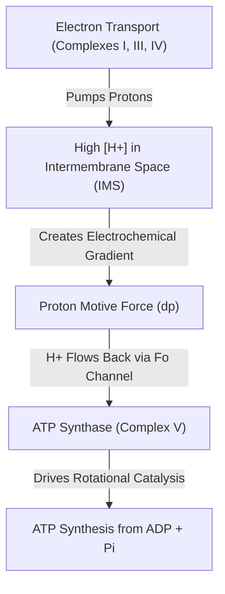
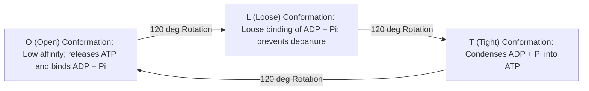
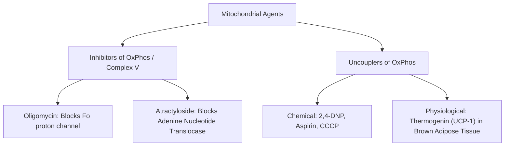

# 13. Biosynthesis of ATP by Oxidative Phosphorylation II

## 1. Peter Mitchell's Chemiosmotic Hypothesis

Proposed by Peter Mitchell in 1961 (Nobel Prize 1978). Electron transport through Complexes I, III, and IV pumps protons ($H^+$) from the mitochondrial matrix into the intermembrane space (IMS), creating an electrochemical proton gradient termed the **Proton Motive Force ($\Delta p$)**.

$$\Delta p = \Delta \psi - \frac{2.3 RT}{F} \Delta pH$$

*Where:*
* $\Delta \psi$ = Membrane potential difference across IMM ($\sim 160–180\text{ mV}$, matrix negative)
* $\Delta pH$ = Chemical $pH$ gradient across IMM ($\sim 0.5–0.75\text{ pH}$ units, matrix alkaline)
* Total $\Delta p \approx 180–220\text{ mV}$.



---

## 2. Complex V: ATP Synthase Architecture and Rotational Mechanics

ATP Synthase is a mushroom-shaped protein complex embedded in the IMM consisting of two functional domains: $F_0$ and $F_1$.

```
                       [Intermembrane Space (High H+)]
                                 ||      ||
                                 ||  H+  ||
                           +-----||------||-----+
                           |    | a |   c-ring  |  <--- F0 Domain (Hydrophobic)
                           +-----||------||-----+
                                 ||      ||
                                 ||  g   ||  <--- Central Stalk (Gamma)
                                 ||      ||
                           +-----||------||-----+
                           |   (alpha3 beta3)   |  <--- F1 Headpiece (Catalytic)
                           +--------------------+
                           [Mitochondrial Matrix]
```

### 1. $F_0$ Domain (Hydrophobic, Membrane-Spanning)
* Subunits: $a_1, b_2, c_{8-15}$ (forms the rotating $c$-ring).
* Function: Acts as a proton translocating channel across the IMM.

### 2. $F_1$ Domain (Hydrophilic, Matrix-Facing)
* Subunits: $\alpha_3 \beta_3 \gamma \delta \epsilon$.
* Catalytic site resides on the **$\beta$ subunits**.
* Central shaft ($\gamma$ subunit) connects $c$-ring of $F_0$ to the $\alpha_3\beta_3$ headpiece of $F_1$.

### Boyer's Binding Change Mechanism (Rotational Catalysis)
Paul Boyer proposed that proton translocation drives the rotation of the asymmetrical $\gamma$ subunit, forcing the 3 $\beta$ subunits through three distinct conformational states:



---

## 3. P/O Ratios and Proton Stoichiometry

* Rotation of $c$-ring through $360^\circ$ requires inflow of protons corresponding to the number of $c$-subunits in the ring (human $c$-ring has $8$ subunits = **$8 H^+$**).
* $1$ full $360^\circ$ rotation synthesizes **$3\text{ ATP}$** (1 per $\beta$ subunit).
* Export of $1\text{ ATP}$ to cytosol in exchange for $1\text{ ADP}$ (via Adenine Nucleotide Translocase) plus symport of $1\text{ P}_i + 1 H^+$ (via Phosphate Translocase) consumes **$1 H^+$**.
* **Total $H^+$ required per ATP synthesized and exported = $3 + 1 = 4 H^+$**.

$$\text{P/O Ratio for NADH} = \frac{10 H^+ \text{ pumped}}{4 H^+ \text{ per ATP}} = \mathbf{2.5\text{ ATP}}$$

$$\text{P/O Ratio for FADH}_2 = \frac{6 H^+ \text{ pumped}}{4 H^+ \text{ per ATP}} = \mathbf{1.5\text{ ATP}}$$

---

## 4. Inhibitors vs. Uncouplers of Oxidative Phosphorylation

It is critical to distinguish between agents that inhibit electron transport, agents that inhibit Complex V, and uncoupling agents.



| Parameter | Complex V / Transport Inhibitors | Uncouplers of OxPhos |
| :--- | :--- | :--- |
| **Primary Action** | Directly blocks ATP Synthase ($F_0$) or translocases | Dissipates proton gradient by carrying $H^+$ across IMM |
| **Electron Transport Rate** | **Decreased / Arrested** | **Markedly Increased (Maximal)** |
| **Oxygen Consumption** | **Decreased / Stopped** | **Markedly Increased** |
| **ATP Synthesis** | **Inhibited** | **Abolished** |
| **Heat Generation** | Decreased | **Massively Increased (Hyperthermia)** |
| **Proton Gradient ($\Delta p$)** | Intact / Elevated | **Collapsed / Destroyed** |

### Specific Agents
1. **Oligomycin:** Binds subunit $a$ of $F_0$, closing the proton channel.
2. **Atractyloside & Bongkrekic Acid:** Inhibit **Adenine Nucleotide Translocase (ANT)**, preventing $ADP/ATP$ exchange across IMM.
3. **2,4-Dinitrophenol (2,4-DNP):** Lipophilic weak acid that binds $H^+$ in IMS, diffuses across IMM, and releases $H^+$ into matrix, collapsing $\Delta p$. Historical diet drug caused fatal hyperthermia.
4. **Thermogenin (UCP-1):** Endogenous physiological uncoupler expressed in **Brown Adipose Tissue (BAT)** of newborns and hibernating mammals. Activated by norepinephrine/fatty acids to generate heat (**non-shivering thermogenesis**).

---

## 5. Mitochondrial Myopathies and Inherited Disorders

Mitochondria contain their own circular genome ($mtDNA$, $16.5\text{ kb}$) encoding 13 ETC subunits, 22 $tRNAs$, and 2 $rRNAs$. Inheritance is strictly **Maternal**. Characterized by **heteroplasmy** and threshold effect.

### Key Clinical Syndromes
1. **MELAS** (Mitochondrial Encephalomyopathy, Lactic Acidosis, and Stroke-like episodes): Most common $mtDNA$ point mutation ($A3243G$ in $tRNA^{\text{Leu}}$).
2. **MERRF** (Myoclonic Epilepsy with Ragged Red Fibers): Point mutation in $tRNA^{\text{Lys}}$.
3. **LHON** (Leber Hereditary Optic Neuropathy): Mutations in Complex I subunits ($ND1, ND4, ND6$). Causes bilateral subacute painless visual loss in young males.
4. **Kearns-Sayre Syndrome:** Large single deletion in $mtDNA$; progressive external ophthalmoplegia, pigmentary retinopathy, cardiac conduction defects.

> **Pathology Benchmark:** Diagnostic muscle biopsy reveals **"Ragged Red Fibers"** on Modified Gomori Trichrome stain (due to subsarcolemmal proliferation of abnormal mitochondria).

```
   Normal Muscle Fiber  vs.  Ragged Red Fiber (Mitochondrial Proliferation)
   [Smooth Pink Cytoplasm]    [Subsarcolemmal Aggregates Staining Red with Gomori]
```

---

## 6. Coverage Audit

* **Major Concepts Covered:** Chemiosmotic theory mechanics, ATP synthase ($F_0F_1$) architecture, Boyer's rotational catalysis, modern P/O ratios ($2.5$ and $1.5$), inhibitors vs uncouplers, Thermogenin (UCP-1), and maternal mitochondrial myopathies (MELAS, MERRF, LHON).
* **Source Gaps / Conflicting Claims:** None identified.
* **Obsidian Links:** Linked to 12 Oxidative Phosphorylation Part 1 and 14 Proton and Electron Leakage from Respiratory Chain.

---
