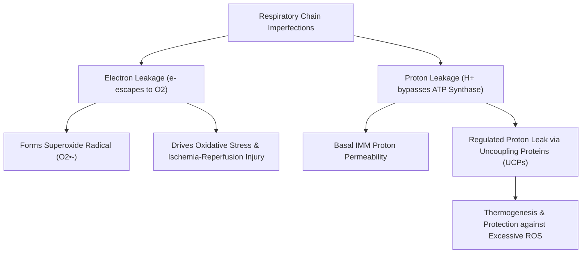
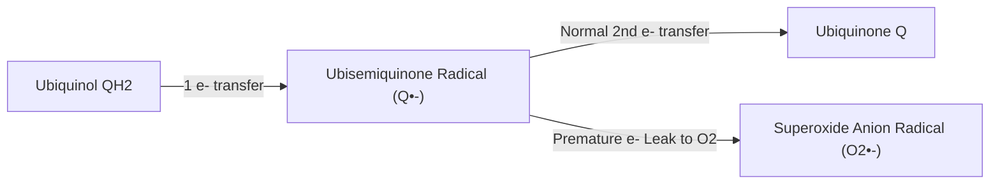
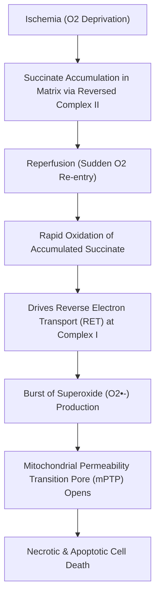

# 14. What Happens When Protons or Electrons Leak from the Respiratory Chain?

## 1. Overview of Respiratory Chain Leakage

The transfer of electrons through Complexes I–IV and the pumping of protons into the intermembrane space are not $100\%$ efficient. Minor physiological "flaws" in electron transport and proton containment have profound physiological and pathological consequences.



---

## 2. Electron Leakage and ROS Generation

A small, variable fraction of mitochondrial oxygen consumption can undergo premature single-electron reduction from the ETC, forming the **superoxide anion radical ($O_2^{\bullet-}$)**. Older teaching texts often quote approximately $1–2\%$, but this is not a fixed physiological constant: the measured fraction varies by tissue, respiratory substrate, membrane potential, redox state, and experimental method.

$$\text{Electron Leak:} \quad e^- + O_2 \rightarrow O_2^{\bullet-}$$

### Primary Sites of Electron Leakage
1. **Complex I (NADH Dehydrogenase):**
   * *Site:* Reduced Flavin Mononucleotide ($FMNH_2$) site and $I_Q$ site.
   * *Trigger:* High $NADH/NAD^+$ ratio in matrix or high membrane potential ($\Delta \psi$).
   * *Reverse Electron Transport (RET):* When Complex II forces electrons backward into Complex I under high $\Delta \psi$, generating massive amounts of $O_2^{\bullet-}$.
2. **Complex III (Ubiquinol-Cytochrome c Oxidoreductase):**
   * *Site:* $Q_o$ site facing the intermembrane space.
   * *Mechanism:* During the Q-cycle, the unstable **Ubisequi-quinone radical ($Q^{\bullet-}$)** intermediate directly reacts with $O_2$.



---

## 3. Proton Leakage and Uncoupling Proteins (UCPs)

Proton leakage refers to the influx of $H^+$ from the intermembrane space back into the matrix through pathways **other than ATP Synthase**.

### Basal vs. Inducible Proton Leak
* **Basal Proton Leak:** Unregulated $H^+$ diffusion across the IMM lipid bilayer (mediated largely by Adenine Nucleotide Translocase). can contribute materially to resting energy expenditure; estimates vary substantially with tissue, physiological state, and experimental method, so a single percentage should not be treated as universal.
* **Inducible (Regulated) Proton Leak:** Mediated by a specialized family of anion carrier proteins called **Uncoupling Proteins (UCPs)**.

### The Uncoupling Protein (UCP) Family

| Protein | Primary Tissue Distribution | Physiological Role / Clinical Relevance |
| :--- | :--- | :--- |
| **UCP-1 (Thermogenin)** | Brown Adipose Tissue (BAT) | Non-shivering thermogenesis in newborns/hibernating animals; activated by fatty acids/norepinephrine |
| **UCP-2** | Ubiquitous (Immune cells, $\beta$-cells, brain) | Regulates insulin secretion in pancreatic $\beta$-cells; attenuates ROS production |
| **UCP-3** | Skeletal Muscle, Heart, BAT | Protects mitochondria from lipid peroxidation by exporting fatty acid anions |
| **UCP-4 & UCP-5 (BMCP1)** | Brain / Central Nervous System | Neuronal neuroprotection against oxidative stress and excitotoxicity |

> **High-Yield Physiological Role of Mild Uncoupling:** High proton motive force ($\Delta p$) slows electron transport, prolonging the lifetime of $Q^{\bullet-}$ radicals and exponentially INCREASING ROS production. Mild proton leak mediated by UCPs lowers $\Delta p$ slightly, acting as a **safety valve to suppress ROS formation**.

```
    High Δp (Overpotential)  ===>  Slow e- flow  ===>  Massive ROS Generation
              ||                                            ||
       [UCP Activation]                              [UCP Suppression]
              ||                                            ||
     Mild Proton Leak  ========>  Slight ↓ in Δp  ===>  can reduce ROS formation; the magnitude is context-dependent and should not be assigned a universal percentage
```

---

## 4. Pathological Electron Leakage: Ischemia-Reperfusion Injury

During tissue ischemia (e.g., Acute Myocardial Infarction, Ischemic Stroke):



### Therapeutic Interventions Target Mitochondrial Leakage
* **Elamipretide (SS-31):** Cardiolipin-targeted peptide that stabilizes IMM cristae structure and prevents electron leakage.
* **MitoQ / SkQ1:** Lipophilic cation-tagged antioxidants (triphenylphosphonium attached to CoQ) that selectively accumulate $1000\text{-fold}$ inside the mitochondrial matrix to neutralize leaked ROS at the site of origin.

---

## 5. Coverage Audit

* **Major Concepts Covered:** Mechanics of $e^-$ leak at Complex I and III, $O_2^{\bullet-}$ formation, basal vs inducible proton leak, UCP family (UCP1–5), ROS suppression by mild uncoupling, and Ischemia-Reperfusion RET pathology.
* **Interpretive limitation:** Quantitative estimates of electron/proton leak and ROS suppression vary substantially across tissues and experimental conditions; numerical values are therefore presented as approximate rather than universal.
* **Obsidian Links:** Linked to 12 Oxidative Phosphorylation Part 1, 13 Oxidative Phosphorylation Part 2, and 15 Free Radicals ROS and Oxidative Damage.

---
