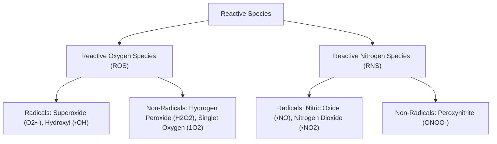
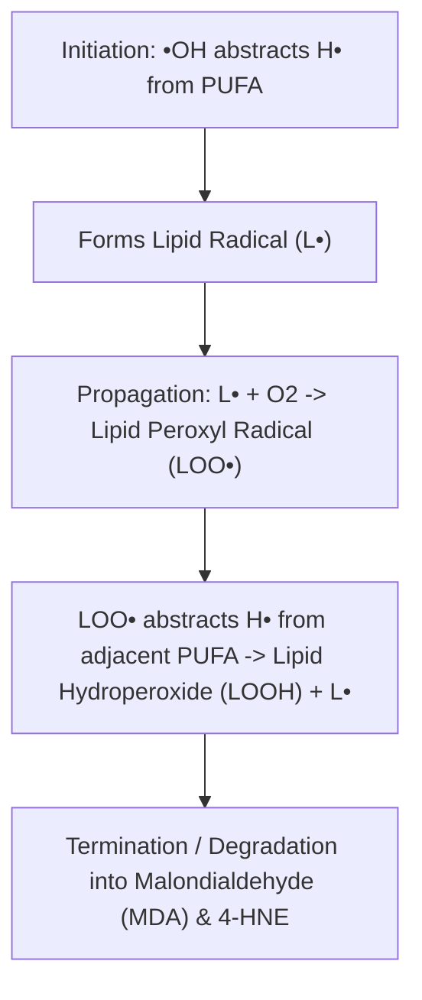
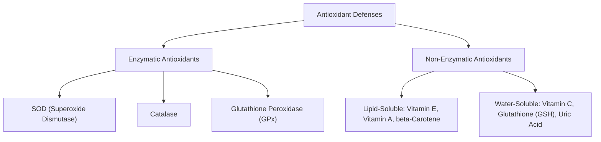

# 15. Free Radicals, Reactive Oxygen Species and Oxidative Damage

## 1. Chemical Nature of Free Radicals and ROS/RNS

A **free radical** is any chemical species capable of independent existence that contains one or more unpaired electrons in its outer atomic orbital. This unshared electron renders the molecule highly reactive and unstable.



### Hierarchy of Oxygen Reduction Intermediates

$$O_2 \xrightarrow{+e^-} O_2^{\bullet-} \text{ (Superoxide)} \xrightarrow{+e^-, +2H^+} H_2O_2 \text{ (Hydrogen Peroxide)} \xrightarrow{+e^-, +H^+} \bullet OH \text{ (Hydroxyl Radical)} \xrightarrow{+e^-, +H^+} H_2O$$

* **Hydroxyl Radical ($\bullet OH$):** The **most reactive, destructive, and damaging** free radical known to biology. Has an extremely short half-life ($\sim 10^{-9}\text{ seconds}$) and reacts instantaneously at its site of formation.

---

## 2. Key Generation Reactions

### 1. Fenton Reaction
Transition metals ($Fe^{2+}$ or $Cu^+$) reduce $H_2O_2$ to generate the highly toxic hydroxyl radical:

$$Fe^{2+} + H_2O_2 \rightarrow Fe^{3+} + \bullet OH + OH^-$$

### 2. Haber-Weiss Reaction
Superoxide radical reacts with $H_2O_2$ in the presence of trace iron catalysts to generate $\bullet OH$:

$$O_2^{\bullet-} + H_2O_2 \xrightarrow{Fe^{3+}/Fe^{2+}} O_2 + \bullet OH + OH^-$$

### 3. Neutrophil Respiratory Burst (NADPH Oxidase & Myeloperoxidase)
Activated phagocytes generate ROS to kill ingested pathogens:

```mermaid
graph LR
    O2 -->|1. NADPH Oxidase| O2_minus["Superoxide O2•-"]
    O2_minus -->|2. Superoxide Dismutase| H2O2
    H2O2 + Cl_minus -->|3. Myeloperoxidase MPO| HOCl["Hypochlorous Acid (Bleach)"]
```

> **Clinical Correlation — Chronic Granulomatous Disease (CGD):** X-linked recessive defect in **NADPH Oxidase** (gp91phox subunit). Phagocytes cannot produce superoxide to kill catalase-positive organisms (*S. aureus, A. fumigatus, Serratia, Burkholderia*). Diagnostic test: Negative **Nitroblue Tetrazolium (NBT)** reduction test (fails to turn blue) or abnormal **Dihydrorhodamine (DHR) flow cytometry**.

---

## 3. Cellular Targets of Oxidative Damage

### 1. Lipid Peroxidation (Polyunsaturated Fatty Acids - PUFAs)
Free radicals attack methylene carbon between double bonds of cell membrane PUFAs:



* **Biomarkers of Lipid Peroxidation:** Malondialdehyde (MDA), 4-hydroxynonenal (4-HNE), and **F2-Isoprostanes** (measured in urine/plasma).

### 2. Protein Oxidation
Oxidative modification of amino acid side chains (especially Cysteine $-SH$ groups and Methionine), leading to protein cross-linking, carbonyl group formation, aggregation, and proteasomal degradation.

### 3. DNA Damage
$\bullet OH$ attacks purine and pyrimidine bases and deoxyribose backbone.
* **Biomarker:** **8-hydroxy-2'-deoxyguanosine (8-OHdG)** excreted in urine.

---

## 4. Antioxidant Defense Systems

Antioxidants neutralize reactive species to maintain cellular redox homeostasis.



### Enzymatic Antioxidants

| Enzyme | Subcellular Location | Reaction Catalyzed / Cofactor |
| :--- | :--- | :--- |
| **SOD1 (Cu-Zn SOD)** | Cytosol, Intermembrane space | $2 O_2^{\bullet-} + 2 H^+ \rightarrow H_2O_2 + O_2$ (Cofactors: **Copper & Zinc**) |
| **SOD2 (Mn-SOD)** | Mitochondrial Matrix | $2 O_2^{\bullet-} + 2 H^+ \rightarrow H_2O_2 + O_2$ (Cofactor: **Manganese**) |
| **Catalase** | Peroxisomes | $2 H_2O_2 \rightarrow 2 H_2O + O_2$ (Prosthetic group: **Heme / Iron**) |
| **Glutathione Peroxidase (GPx)** | Cytosol, Mitochondria | $2 GSH + H_2O_2 \rightarrow GSSG + 2 H_2O$ (Essential element: **Selenium**) |
| **Glutathione Reductase (GR)** | Cytosol, Mitochondria | $GSSG + NADPH + H^+ \rightarrow 2 GSH + NADP^+$ (Cofactor: **$FAD$ / Vitamin B2**) |

```
                       Glutathione Antioxidant Cycle
                       -----------------------------
                             Glutathione Peroxidase (Selenium)
                     2 GSH + H2O2  =================>  GSSG + 2 H2O
                       ^                                 |
                       |     Glutathione Reductase (FAD) |
                       +<================================+
                            NADPH + H+ ----> NADP+
```

### Non-Enzymatic Antioxidants
1. **Vitamin E ($\alpha$-Tocopherol):** Primary **chain-breaking lipid-soluble** antioxidant in cell membranes. Donates hydrogen to lipid peroxyl radicals ($LOO^\bullet$).
2. **Vitamin C (Ascorbic Acid):** Water-soluble antioxidant; directly scavenges radicals and **regenerates oxidized Vitamin E** back to its functional reduced form.
3. **Glutathione ($GSH$):** Tripeptide (**$\gamma$-Glutamyl-Cysteinyl-Glycine**) containing a active sulfhydryl ($-SH$) group on cysteine. Major intracellular water-soluble redox buffer.

---

## 5. Coverage Audit

* **Major Concepts Covered:** Radical vs non-radical ROS/RNS, hydroxyl radical toxicity, Fenton and Haber-Weiss chemistry, NADPH oxidase/CGD, lipid peroxidation mechanism & markers (MDA, 8-OHdG), SOD/Catalase/GPx/GR enzyme systems, and Vitamin E/C synergy.
* **Source Gaps / Conflicting Claims:** None identified.
* **Obsidian Links:** Linked to 14 Proton and Electron Leakage from Respiratory Chain and 17 Anaerobic Glycolysis and Lactate Formation.

---
