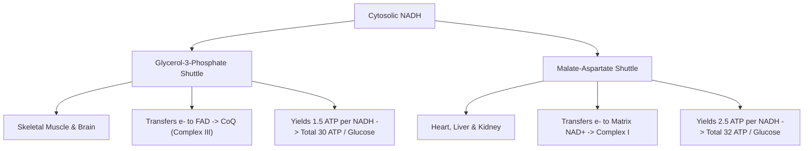

# 16. Aerobic Oxidation of Glucose to Provide Energy as ATP

## 1. Complete Pathway of Aerobic Glucose Oxidation

Complete aerobic catabolism of 1 molecule of Glucose ($6C$) to $CO_2$ and $H_2O$ proceeds through four interconnected metabolic stages:

```mermaid
graph TD
    Glucose["Glucose (6C)"] -->|1. Cytosolic Glycolysis| Pyruvate["2 Pyruvate (3C) + 2 NADH + 2 ATP"]
    Pyruvate -->|2. Pyruvate Dehydrogenase (Mitochondria)| AcetylCoA["2 Acetyl-CoA (2C) + 2 NADH + 2 CO2"]
    AcetylCoA -->|3. TCA Cycle (2 Turns)| ReducingEquiv["6 NADH + 2 FADH2 + 2 GTP + 4 CO2"]
    ReducingEquiv -->|4. Electron Transport Chain & OxPhos| ATP["30 or 32 ATP Generated Total"]
```

---

## 2. Mitochondrial Shuttle Systems for Cytosolic $NADH$

$NADH$ generated in the cytosol during glycolysis (at the Glyceraldehyde-3-Phosphate Dehydrogenase step) **cannot cross the impermeable Inner Mitochondrial Membrane (IMM)** directly. Its reducing equivalents are imported via specialized shuttle systems.



### 1. Glycerol-3-Phosphate Shuttle (G3P Shuttle)
* **Predominant Tissues:** Skeletal Muscle and Brain (adapted for rapid ATP generation).
* **Mechanism:**
  1. Cytosolic $NADH$ reduces Dihydroxyacetone Phosphate (DHAP) to Glycerol-3-Phosphate via **Cytosolic G3P Dehydrogenase (GPD1)**.
  2. Glycerol-3-Phosphate diffuses across OMM to the outer face of IMM, where **Mitochondrial G3P Dehydrogenase (GPD2)** re-oxidizes it to DHAP, transferring $2 e^-$ to its prosthetic group **$FAD$**.
  3. $FADH_2$ transfers electrons directly to **Coenzyme Q** in the IMM, bypassing Complex I.

$$\text{Yield per cytosolic } NADH = 1.5\text{ ATP} \quad \implies \quad \mathbf{\text{Total Net Yield = 30 ATP / Glucose}}$$

### 2. Malate-Aspartate Shuttle
* **Predominant Tissues:** Heart, Liver, and Kidney.
* **Mechanism:**
  1. Cytosolic $NADH$ reduces Oxaloacetate ($OAA$) to **Malate** via **Cytosolic Malate Dehydrogenase (MDH1)**.
  2. Malate enters mitochondrial matrix via the **Malate-$\alpha$-Ketoglutarate Antiporter**.
  3. Matrix **Mitochondrial MDH2** re-oxidizes Malate to $OAA$, generating **Matrix $NADH$** (which enters Complex I).
  4. Matrix $OAA$ cannot cross IMM; it is transaminated by **Aspartate Transaminase (AST / GOT)** to **Aspartate** (requires Vitamin B6 / $PLP$), which exits to cytosol via the **Aspartate-Glutamate Antiporter**.

$$\text{Yield per cytosolic } NADH = 2.5\text{ ATP} \quad \implies \quad \mathbf{\text{Total Net Yield = 32 ATP / Glucose}}$$

```
                      Malate-Aspartate Shuttle Mechanism
  CYTOSOL                                                 MITOCHONDRIAL MATRIX
  -------                                                 --------------------
  NADH + H+ + OAA  --->  Malate  =======================>  Malate ---> OAA + NADH + H+
                           ||   (Malate-aKG Antiporter)      ||        |
                           ||                                ||        v
  Glutamate + OAA  <--- Aspartate <====================== Aspartate  Complex I (2.5 ATP)
                         (Aspartate-Glutamate Antiporter)
```

---

## 3. Comprehensive Net ATP Balance Sheet

| Stage of Oxidation | Enzyme Reaction Step | High-Energy Product | Equivalent ATP (G3P Shuttle) | Equivalent ATP (Malate-Aspartate) |
| :--- | :--- | :--- | :--- | :--- |
| **Glycolysis** | Hexokinase & PFK-1 | $-2\text{ ATP}$ (Investment) | $-2.0\text{ ATP}$ | $-2.0\text{ ATP}$ |
| **Glycolysis** | PGK & Pyruvate Kinase | $+4\text{ ATP}$ (SLP) | $+4.0\text{ ATP}$ | $+4.0\text{ ATP}$ |
| **Glycolysis** | GAPDH | $+2\text{ Cytosolic NADH}$ | $+3.0\text{ ATP}$ ($2 \times 1.5$) | $+5.0\text{ ATP}$ ($2 \times 2.5$) |
| **PDH Reaction** | Pyruvate Dehydrogenase | $+2\text{ Matrix NADH}$ | $+5.0\text{ ATP}$ ($2 \times 2.5$) | $+5.0\text{ ATP}$ ($2 \times 2.5$) |
| **TCA Cycle** | Isocitrate DH | $+2\text{ Matrix NADH}$ | $+5.0\text{ ATP}$ ($2 \times 2.5$) | $+5.0\text{ ATP}$ ($2 \times 2.5$) |
| **TCA Cycle** | $\alpha$-KGDH Complex | $+2\text{ Matrix NADH}$ | $+5.0\text{ ATP}$ ($2 \times 2.5$) | $+5.0\text{ ATP}$ ($2 \times 2.5$) |
| **TCA Cycle** | Succinate Thiokinase | $+2\text{ GTP (ATP)}$ (SLP) | $+2.0\text{ ATP}$ | $+2.0\text{ ATP}$ |
| **TCA Cycle** | Succinate DH | $+2\text{ Matrix FADH}_2$ | $+3.0\text{ ATP}$ ($2 \times 1.5$) | $+3.0\text{ ATP}$ ($2 \times 1.5$) |
| **TCA Cycle** | Malate DH | $+2\text{ Matrix NADH}$ | $+5.0\text{ ATP}$ ($2 \times 2.5$) | $+5.0\text{ ATP}$ ($2 \times 2.5$) |
| **TOTAL YIELD** | **Per Glucose Molecule** | — | **30 ATP** | **32 ATP** |

> **Exam Tip:** Older board questions may cite **36 or 38 ATP** based on outdated P/O ratios of 3 for $NADH$ and 2 for $FADH_2$. Modern NEET PG/INI-CET questions test **30 or 32 ATP**.

---

## 4. Regulation of Glucose Oxidation Pathways

1. **Pasteur Effect:** Inhibition of glycolysis by oxygen. Under aerobic conditions, OxPhos produces abundant ATP and Citrate, which allosterically inhibit **PFK-1**, slowing glycolytic flux while maximizing ATP yield per glucose ($30–32$ vs $2\text{ ATP}$).
2. **Crabtree Effect:** Inhibition of oxygen consumption/respiration by high extracellular glucose concentrations (observed in rapidly proliferating tumor cells and yeast).

---

## 5. Coverage Audit

* **Major Concepts Covered:** 4 stages of glucose oxidation, G3P shuttle vs Malate-Aspartate shuttle comparison, step-by-step ATP balance sheet ($30$ vs $32\text{ ATP}$), Pasteur effect, Crabtree effect.
* **Source Gaps / Conflicting Claims:** P/O ratio historical values explicitly clarified.
* **Obsidian Links:** Linked to 11 Aerobic Production of ATP, 13 Oxidative Phosphorylation Part 2, and 17 Anaerobic Glycolysis and Lactate Formation.

---
