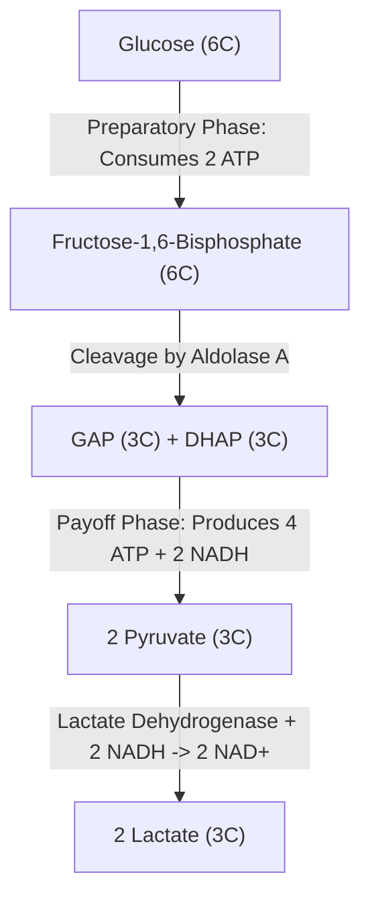
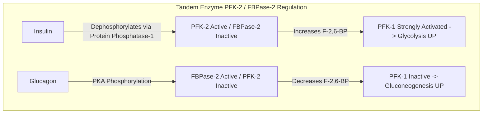
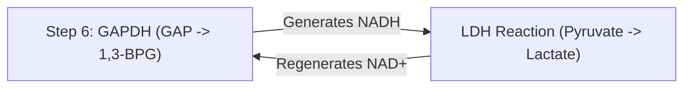

# 17. Anaerobic Oxidation of Glucose by Glycolysis to Form ATP and Lactate

## 1. Subcellular Location and Pathway Overview

Glycolysis (Embden-Meyerhof-Parnas pathway) occurs in the **cytosol** of all human cells. Under **anaerobic conditions** (or in cells lacking mitochondria, such as erythrocytes), the pathway oxidizes $1\text{ molecule}$ of Glucose ($6C$) into $2\text{ molecules}$ of **Lactate ($3C$)**, yielding a net of **$2\text{ ATP}$** per glucose without requiring oxygen.



---

## 2. Detailed Sequential Reactions of Glycolysis

### Preparatory Phase (Energy Investment: Consumes 2 ATP)

#### Step 1: Phosphorylation of Glucose
Irreversible entry step. Traps glucose inside the cell as Glucose-6-Phosphate (G6P).

$$\text{Glucose} + ATP \xrightarrow{\text{Hexokinase / Glucokinase, } Mg^{2+}} \text{Glucose-6-Phosphate} + ADP$$

| Feature | Hexokinase (Types I–III) | Glucokinase (Hexokinase IV) |
| :--- | :--- | :--- |
| **Tissue Distribution** | All parenchymal tissues (ubiquitous) | Liver parenchymal cells & Pancreatic $\beta$-cells |
| **$K_m$ for Glucose** | Very Low ($\sim 0.05\text{ mM}$, high affinity) | High ($\sim 10\text{ mM}$, low affinity; active postprandially) |
| **$V_{\max}$** | Low (saturates under basal conditions) | High (clears large portal glucose loads) |
| **G6P Inhibition** | **Inhibited by G6P** (Feedback) | **NOT inhibited by G6P** |
| **Regulation** | Allosteric | Bound to Glucokinase Regulatory Protein (GKRP) in nucleus |

> **Clinical Mutation — MODY2:** Inactivating mutations in **Glucokinase** cause Maturity-Onset Diabetes of the Young Type 2 (MODY2), characterized by mild non-progressive fasting hyperglycemia due to an elevated threshold for glucose-stimulated insulin release.

#### Step 2: Isomerization
Reversible conversion of G6P to Fructose-6-Phosphate (F6P) by **Phosphohexose Isomerase**.

#### Step 3: Second Phosphorylation (Rate-Limiting Step)
First committed step of glycolysis.

$$\text{Fructose-6-Phosphate} + ATP \xrightarrow{\text{PFK-1, } Mg^{2+}} \text{Fructose-1,6-Bisphosphate} + ADP$$

* **Phosphofructokinase-1 (PFK-1) Regulation:**
  * **Allosteric Activators:** **$AMP$**, **Fructose-2,6-Bisphosphate ($F-2,6-BP$)**.
  * **Allosteric Inhibitors:** **$ATP$**, **Citrate**, $H^+$ (Acidosis protects tissue from overproducing lactate).



#### Step 4: Cleavage
Cleavage of $F-1,6-BP$ ($6C$) into Glyceraldehyde-3-Phosphate ($GAP, 3C$) and Dihydroxyacetone Phosphate ($DHAP, 3C$) by **Aldolase A**.

#### Step 5: Isomerization of Trioses
Reversible interconversion of DHAP to GAP by **Triose Phosphate Isomerase (TPI)**.

---

### Payoff Phase (Energy Generation: Yields 4 ATP + 2 NADH)

#### Step 6: Oxidation and Phosphorylation
Oxidation of GAP to 1,3-Bisphosphoglycerate (1,3-BPG) by **Glyceraldehyde-3-Phosphate Dehydrogenase (GAPDH)**.

$$\text{GAP} + NAD^+ + P_i \xrightarrow{\text{GAPDH}} \text{1,3-BPG} + NADH + H^+$$

* **Inhibitors:**
  * **Iodoacetate:** Covalently alkylates essential cysteine $-SH$ at active site.
  * **Arsenate ($AsO_4^{3-}$):** Competes with $P_i$, forming unstable 1-arseno-3-phosphoglycerate which hydrolyzes spontaneously without generating ATP, uncoupling glycolysis at this step.

#### Step 7: First Substrate-Level Phosphorylation
Transfer of high-energy acyl-phosphate from 1,3-BPG to $ADP$ by **Phosphoglycerate Kinase (PGK)**, yielding **3-Phosphoglycerate + ATP** (see Chapter 10).

#### Step 8: Phosphate Shift
Conversion of 3-PG to 2-Phosphoglycerate (2-PG) by **Phosphoglycerate Mutase**.

#### Step 9: Dehydration
Dehydration of 2-PG to Phosphoenolpyruvate (PEP) by **Enolase**.

$$\text{2-Phosphoglycerate} \xrightarrow{\text{Enolase, } Mg^{2+}} \text{Phosphoenolpyruvate} + H_2O$$

* **Inhibitor:** **Fluoride ($F^-$)** inhibits enolase by forming a complex with $Mg^{2+}$ and phosphate. *Clinical Application:* Blood samples collected for blood glucose measurement are placed in **Sodium Fluoride (Gray-top) tubes** to arrest ex vivo erythrocyte glycolysis.

#### Step 10: Second Substrate-Level Phosphorylation
Irreversible conversion of PEP to Pyruvate by **Pyruvate Kinase (PK)**, yielding **Pyruvate + ATP**.
* **Regulation:** Feed-forward activation by **$F-1,6-BP$**. Allosteric inhibition by $ATP$, Acetyl-CoA, Alanine. In liver, glucagon (via PKA) phosphorylates and INACTIVATES PK.

---

## 3. Anaerobic Regeneration of $NAD^+$: Lactate Dehydrogenase (LDH)

Under anaerobic conditions, $NADH$ generated at Step 6 cannot be re-oxidized by the electron transport chain. Without a mechanism to regenerate $NAD^+$, cytosolic $NAD^+$ stores would be completely depleted, causing immediate arrest of GAPDH and halting all ATP generation.

**Lactate Dehydrogenase (LDH)** solves this by reducing Pyruvate to Lactate, using $NADH$ and regenerating $NAD^+$:

$$\text{Pyruvate} + NADH + H^+ \xlefteqn{\text{LDH}} \text{Lactate} + NAD^+$$

$$\Delta G^\circ' = -25.1\text{ kJ/mol}$$



---

## 4. The Cori Cycle (Lactic Acid Cycle)

Lactate produced by anaerobic glycolysis in muscle and erythrocytes diffuses into the bloodstream and is transported to the **liver**.

```mermaid
graph TD
    subgraph Skeletal Muscle / Erythrocytes
        M_Glucose[Glucose] -->|Anaerobic Glycolysis (+2 ATP)| M_Lactate[2 Lactate]
    end
    M_Lactate -->|Bloodstream Transport| L_Lactate[2 Lactate]
    subgraph Liver
        L_Lactate -->|Gluconeogenesis (-6 ATP)| L_Glucose[Glucose]
    end
    L_Glucose -->|Bloodstream Transport| M_Glucose
```

* **Net Cost to Organism:** Liver spends $6\text{ ATP}$ to convert 2 Lactate back to Glucose, while muscle/RBC gains $2\text{ ATP}$. Net cost = **$4\text{ ATP}$ per cycle turn**.

---

## 5. High-Yield Clinical Correlations

1. **Pyruvate Kinase (PK) Deficiency:** Autosomal recessive. Second most common cause of hereditary hemolytic anemia (after G6PD deficiency). Erythrocytes lack mitochondria and depend entirely on PK for ATP. ATP depletion causes failure of $Na^+/K^+$-ATPase, cell swelling, membrane rigidity, and splenic sequestration/hemolysis. Characterized by **elevated 2,3-BPG levels** (which shifts ODC to the right, improving tissue oxygen release).
2. **Lactic Acidosis:** Occurs when lactate production exceeds hepatic clearing capacity ($>5\text{ mmol/L}$, blood $pH < 7.35$).
   * *Type A (Hypoxic):* Tissue hypoperfusion (Shock, MI, Severe Anemia, Carbon Monoxide poisoning).
   * *Type B (Non-Hypoxic):* Diabetic Ketoacidosis, Severe Liver Disease, Metformin toxicity, Cyanide poisoning.
3. **Tarui Disease (Glycogen Storage Disease Type VII):** Muscle PFK-1 deficiency leading to exercise-induced muscle cramps and exertional hemolysis.

---

## 6. Coverage Audit

* **Major Concepts Covered:** 10 sequential glycolytic steps, Hexokinase vs Glucokinase, PFK-1 and tandem enzyme PFK-2/FBPase-2 regulation, GAPDH/Enolase inhibitors, LDH reaction mechanics, Cori cycle, PK deficiency, and Lactic Acidosis classification.
* **Source Gaps / Conflicting Claims:** None identified.
* **Obsidian Links:** Linked to 10 Anaerobic ATP Production and Substrate Level Phosphorylation, 16 Aerobic Oxidation of Glucose, and 18 RBC Glycolysis 2 3 BPG and Bohr Effect.

---
