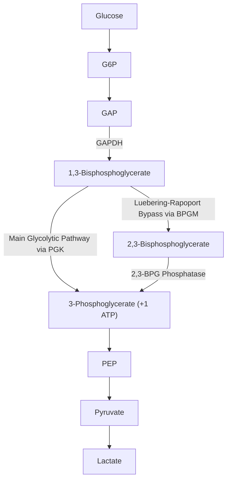
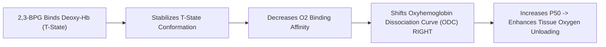

# 18. Anaerobic Glycolysis in Red Blood Cells, 2,3-BPG (2,3-DPG) and the Bohr Effect

## 1. Metabolic Specialization of the Mature Erythrocyte

Mature human erythrocytes (RBCs) lack mitochondria, nuclei, endoplasmic reticulum, and ribosomes. Consequently:
* They are **100% dependent on cytosolic anaerobic glycolysis** for ATP production ($2\text{ ATP}$ / glucose).
* ATP is required to maintain membrane shape, lipid asymmetry, and drive the **$Na^+/K^+$-ATPase** and **$Ca^{2+}$-ATPase** pumps.
* Approximately **$15–20\%$** of glycolytic intermediate 1,3-BPG is diverted into the **Luebering-Rapoport Shunt** to generate **2,3-Bisphosphoglycerate (2,3-BPG)**.



---

## 2. The Luebering-Rapoport Pathway

The shunt is catalyzed by a bifunctional enzyme, **Bisphosphoglycerate Mutase / Phosphatase (BPGM)**:

1. **Mutase Reaction:** Converts 1,3-BPG ($1,3\text{-acyl-phosphate}$) into 2,3-BPG ($2,3\text{-bisphosphate}$).
2. **Phosphatase Reaction:** Hydrolyzes 2,3-BPG into 3-Phosphoglycerate ($3\text{-PG}$), which re-enters main glycolysis.

> **Energetic Trade-off:** Bypassing the Phosphoglycerate Kinase (PGK) step forfeits ATP generation at Step 7 of glycolysis. If all glycolytic flux passes through the Luebering-Rapoport shunt, the **net ATP yield of RBC glycolysis drops from $2\text{ ATP}$ to $0\text{ ATP}$**.

---

## 3. Molecular Physiology of 2,3-BPG and Hemoglobin Regulation

2,3-BPG is present in erythrocytes at extremely high equimolar concentrations relative to hemoglobin ($\sim 4.5–5.0\text{ mmol/L}$).

### Binding Site and Mechanics
* **Binding Pocket:** 2,3-BPG contains 5 negative charges ($2\text{ phosphate groups} + 1\text{ carboxylate}$) that bind to a positively charged central cavity present **ONLY in Deoxyhemoglobin (T-State)** between the two $\beta$-chains.
* **Residues Involved:** Lysine ($\beta82$), Histidine ($\beta2$), Histidine ($\beta143$), and N-terminal Valine ($\beta1$).

$$\text{HbO}_2 \text{ (R-State)} + 2,3\text{-BPG} \rightleftharpoons \text{Hb-2,3-BPG (T-State)} + O_2$$



```
                     Oxyhemoglobin Dissociation Curve (ODC)
             100 |---------------------------------
                 |                              /
              80 |                             /  <-- Left Shift (↑ O2 Affinity)
      SaO2 (%)   |                            /       [↓ 2,3-BPG, ↓ Temp, ↓ H+, HbF]
              60 |                           /
                 |                          /     <-- Normal Curve (P50 = 26.8 mmHg)
              40 |                         /
                 |                        /  <-- Right Shift (↓ O2 Affinity)
              20 |                       /       [↑ 2,3-BPG, ↑ Temp, ↑ H+, Altitude]
               0 +----------------------+----------------------
                 0                     40                     80
                                     PaO2 (mmHg)
```

---

## 4. Fetal Hemoglobin ($HbF$) vs. Adult Hemoglobin ($HbA$)

Fetal Hemoglobin ($HbF$) consists of **$\alpha_2\gamma_2$** subunits, whereas Adult Hemoglobin ($HbA$) is **$\alpha_2\beta_2$**.

* In the $\gamma$-chain of $HbF$, **Histidine-143 is replaced by Serine** ($\gamma143\text{ Ser}$).
* Loss of two positive charges in the central cavity drastically **reduces $HbF$ binding affinity for 2,3-BPG**.
* Consequently, $HbF$ remains predominantly in the high-affinity **R-State**, shifting the ODC to the **LEFT** ($P_{50} \approx 19\text{ mmHg}$ vs $26.8\text{ mmHg}$ for $HbA$).

> **Physiological Significance:** Enables efficient, unidirectional oxygen transfer across the placenta from maternal $HbA$ to fetal $HbF$.

---

## 5. The Bohr Effect vs. The Haldane Effect

| Characteristic | The Bohr Effect | The Haldane Effect |
| :--- | :--- | :--- |
| **Primary Principle** | Effect of $H^+$ ($pH$) and $pCO_2$ on **$O_2$ binding to $Hb$** | Effect of $pO_2$ on **$CO_2$ and $H^+$ carriage by $Hb$** |
| **Anatomical Site** | **Peripheral Tissues** | **Pulmonary Capillaries (Lungs)** |
| **Mechanism** | $CO_2 + H_2O \rightleftharpoons H_2CO_3 \rightleftharpoons H^+ + HCO_3^-$. Protons protonate $Hb$ Histidine residues, forming salt bridges that stabilize T-state, forcing release of $O_2$. | Binding of $O_2$ to $Hb$ in lungs forces $Hb$ into R-state, releasing $H^+$ and $CO_2$ to be exhaled. |
| **Clinical Outcome** | High metabolic activity ($CO_2 \uparrow, pH \downarrow$) **enhances $O_2$ delivery** to active tissues. | High oxygenation **enhances $CO_2$ clearance** from blood into alveoli. |

---

## 6. High-Yield Clinical Applications

1. **Stored Blood Transfusion Depletion:** In stored blood, 2,3-BPG degrades rapidly within $1–2\text{ weeks}$. Transfusion of 2,3-BPG-depleted blood results in a **left-shifted ODC**, trapping oxygen on $Hb$ and causing transient **tissue hypoxia** in the recipient until RBCs re-synthesize 2,3-BPG ($6–24\text{ hours}$).
2. **High-Altitude Acclimatization:** Chronic hypoxia at high altitude stimulates erythropoietin and increases BPGM expression within $24–48\text{ hours}$. Elevated 2,3-BPG shifts ODC to the **right**, restoring tissue oxygen delivery despite reduced ambient $pO_2$.
3. **Pyruvate Kinase Deficiency:** Blockade at PK step causes upstream accumulation of 1,3-BPG, driving 2,3-BPG synthesis to levels $2–3\times$ normal. The resulting right-shifted ODC partially compensates for anemia by facilitating tissue oxygen extraction.

---

## 7. Coverage Audit

* **Major Concepts Covered:** Mature RBC metabolic restrictions, Luebering-Rapoport pathway & BPGM, 2,3-BPG molecular binding site ($\beta$-chain), ODC right shift dynamics, $HbF$ ($\gamma143\text{ Ser}$) mechanics, Bohr vs Haldane effect, stored blood 2,3-BPG depletion, high-altitude adaptation.
* **Source Gaps / Conflicting Claims:** None identified.
* **Obsidian Links:** Linked to 17 Anaerobic Glycolysis and Lactate Formation and oxygen-carriage material (not included in the supplied collection).

---
