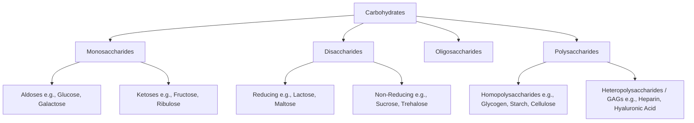

# 19. Carbohydrates: Structure, Classification, and Biological Significance

## 1. Introduction and General Definition

Carbohydrates are polyhydroxy aldehydes or ketones, or substances that yield these compounds upon hydrolysis. They are the most abundant biomolecules on Earth and serve as the primary source of cellular energy, structural frameworks, and cell-surface recognition elements.

* **Empirical Formula:** $(CH_2O)_n$ for simple monosaccharides (where $n \ge 3$).
* **Caloric Value:** $4\text{ kcal/g}$ ($16.7\text{ kJ/g}$).
* **Biological Roles:**
  1. **Metabolic Fuel:** Glucose is the universal energy substrate for human cells and the essential fuel for the brain, renal medulla, and erythrocytes.
  2. **Energy Storage:** Glycogen in animals; starch in plants.
  3. **Structural Components:** Cellulose in plant cell walls; chitin in fungal walls and arthropod exoskeletons; glycosaminoglycans (GAGs) in human extracellular matrix.
  4. **Informational Molecules:** Glycoproteins and glycolipids participate in cell-cell recognition, blood group specificity, and receptor signaling.

---

## 2. Classification of Carbohydrates

Carbohydrates are broadly classified into four major groups based on the degree of polymerization:



### A. Monosaccharides
Monosaccharides (simple sugars) cannot be hydrolyzed into simpler carbohydrates. They are classified by:
1. **Functional Group:**
   * **Aldoses:** Contain an aldehyde group ($-\text{CHO}$) at C-1 (e.g., Glyceraldehyde, Glucose, Galactose, Mannose).
   * **Ketoses:** Contain a keto group ($-\text{C=O}$) typically at C-2 (e.g., Dihydroxyacetone, Fructose, Ribulose).
2. **Number of Carbon Atoms:**
   * *Trioses ($C_3$):* Glyceraldehyde (aldose), Dihydroxyacetone (ketose).
   * *Tetroses ($C_4$):* Erythrose (aldose).
   * *Pentoses ($C_5$):* Ribose, Deoxyribose, Xylulose.
   * *Hexoses ($C_6$):* Glucose, Galactose, Mannose (aldoses); Fructose (ketose).
   * *Heptoses ($C_7$):* Sedoheptulose.

### B. Disaccharides
Consist of two monosaccharide units joined by a **glycosidic bond**:
* **Maltose:** $\alpha\text{-D-glucopyranosyl-(1}\rightarrow\text{4)-D-glucopyranose}$. Reducing sugar. Derived from starch digestion.
* **Lactose:** $\beta\text{-D-galactopyranosyl-(1}\rightarrow\text{4)-D-glucopyranose}$. Reducing sugar. Principal carbohydrate in milk.
* **Sucrose:** $\alpha\text{-D-glucopyranosyl-(1}\rightarrow\text{2)}-\beta\text{-D-fructofuranoside}$. **Non-reducing sugar** because both anomeric carbons (C-1 of glucose and C-2 of fructose) are tied up in the glycosidic bond.
* **Trehalose:** $\alpha\text{-D-glucopyranosyl-(1}\rightarrow\text{1)}-\alpha\text{-D-glucopyranoside}$. Non-reducing disaccharide found in fungi and insects.
* **Isomaltose:** $\alpha\text{-D-glucopyranosyl-(1}\rightarrow\text{6)-D-glucopyranose}$. Reducing sugar formed at starch branch points.

### C. Oligosaccharides
Contain 3 to 10 monosaccharide units (e.g., Raffinose [trisaccharide], Stachyose [tetrasaccharide]). Frequently conjugated to proteins (glycoproteins) or lipids (glycolipids).

### D. Polysaccharides (Glycans)
Contain $> 10$ monosaccharide units:
1. **Homopolysaccharides:** Composed of a single repeating monosaccharide species.
   * **Glycogen:** Animal storage polysaccharide. Highly branched polymer of $\alpha\text{-D-glucose}$ with $\alpha(1\rightarrow 4)$ main chains and $\alpha(1\rightarrow 6)$ branch points occurring every 8–12 glucose residues.
   * **Starch:** Plant storage polysaccharide consisting of:
     * *Amylose:* Unbranched helical chain of $\alpha\text{-D-glucose}$ linked by $\alpha(1\rightarrow 4)$ bonds ($15-20\%$).
     * *Amylopectin:* Branched chain with $\alpha(1\rightarrow 4)$ linkages and $\alpha(1\rightarrow 6)$ branches every 24–30 residues ($80-85\%$).
   * **Cellulose:** Structural plant polysaccharide. Unbranched linear polymer of $\beta\text{-D-glucose}$ joined by $\beta(1\rightarrow 4)$ glycosidic bonds. Humans cannot digest cellulose because they lack the enzyme $\beta(1\rightarrow 4)$ endoglucosidase (cellulase); cellulose functions as dietary insoluble fiber.
   * **Inulin:** Polymer of fructose ($\beta(2\rightarrow 1)$ fructan). Used clinically to measure Glomerular Filtration Rate (GFR) because it is freely filtered and neither reabsorbed nor secreted by renal tubules.
   * **Chitin:** Structural polymer of $N$-acetylglucosamine ($\text{GlcNAc}$) in $\beta(1\rightarrow 4)$ linkage.
2. **Heteropolysaccharides:** Composed of two or more different monosaccharide units (e.g., Glycosaminoglycans).

---

## 3. Isomerism in Carbohydrates

Stereoisomerism is a hallmark of carbohydrate biochemistry due to the presence of asymmetric (chiral) carbon atoms.

### A. D- and L-Isomers
* Determined by the spatial orientation of the $-H$ and $-OH$ groups attached to the **penultimate carbon atom** (the asymmetric carbon furthest from the aldehyde/keto group; e.g., C-5 in hexoses), referencing D- and L-glyceraldehyde.
* In human biochemistry, virtually all naturally occurring monosaccharides belong to the **D-series** (e.g., $\text{D-glucose}$, $\text{D-galactose}$). (In contrast, human amino acids belong to the L-series).

### B. Optical Activity ($d$ and $l$)
* The ability to rotate plane-polarized light to the right (dextrorotatory, $+$ or $d$) or left (levorotatory, $-$ or $l$).
* **High-Yield Point:** $D/L$ configuration does **not** dictate the direction of optical rotation. For example, $\text{D-fructose}$ is strongly levorotatory (hence termed *levulose*), whereas $\text{D-glucose}$ is dextrorotatory (*dextrose*).

### C. Epimers
Epimers are stereoisomers that differ in configuration around **only one specific asymmetric carbon atom** (excluding the anomeric carbon):
* **C-2 Epimers:** $\text{D-Glucose}$ and $\text{D-Mannose}$.
* **C-4 Epimers:** $\text{D-Glucose}$ and $\text{D-Galactose}$.
* *Note:* D-Mannose and D-Galactose differ at C-2 and C-4; therefore, they are diastereomers, **not** epimers of each other.

```
       CHO                 CHO                 CHO
      |                   |                   |
    H-C-OH             HO-C-H               H-C-OH
      |                   |                   |
   HO-C-H              HO-C-H              HO-C-H
      |                   |                   |
    H-C-OH              H-C-OH             HO-C-H
      |                   |                   |
    H-C-OH              H-C-OH              H-C-OH
      |                   |                   |
     CH2OH               CH2OH               CH2OH
   D-Glucose           D-Mannose           D-Galactose
                   (C-2 Epimer)        (C-4 Epimer)
```

### D. Anomers and Mutarotation
* In aqueous solution, hexoses undergo intramolecular cyclization forming a hemiacetal (aldoses) or hemiketal (ketoses) ring.
* C-1 of aldoses (or C-2 of ketoses) becomes a new asymmetric center termed the **anomeric carbon**.
* **$\alpha$ and $\beta$ Anomers:**
  * **$\alpha$-Anomer:** The hydroxyl group attached to C-1 lies below the plane of the Haworth ring (trans to the $-CH_2OH$ group).
  * **$\beta$-Anomer:** The hydroxyl group attached to C-1 lies above the plane of the Haworth ring (cis to the $-CH_2OH$ group).
* **Mutarotation:** The spontaneous change in specific optical rotation observed when an optically active $\alpha$ or $\beta$ anomer reaches an equilibrium mixture in aqueous solution ($\approx 36\%\ \alpha\text{-D-glucose}$ and $64\%\ \beta\text{-D-glucose}$, with $< 0.1\%$ open-chain form).

---

## 4. Glycosaminoglycans (GAGs) and Mucopolysaccharidoses

Glycosaminoglycans (formerly mucopolysaccharides) are long, unbranched heteropolysaccharide chains composed of repeating disaccharide units:

$$\text{Repeating Disaccharide} = [\text{Uronic Acid} / \text{Sialic Acid}] - [\text{Amino Sugar}]$$

* **Amino Sugar:** $D$-glucosamine or $D$-galactosamine (often $N$-acetylated).
* **Uronic Acid:** $D$-glucuronic acid or $L$-iduronic acid.
* High negative charge density (sulfate and carboxylate groups) attracts water, generating gel-like cushioning properties in connective tissue.

### Summary of Major Glycosaminoglycans

| GAG Species | Repeating Disaccharide Units | Tissue Distribution | High-Yield Unique Features |
| :--- | :--- | :--- | :--- |
| **Hyaluronic Acid** | D-Glucuronic acid + $N$-Acetylglucosamine | Synovial fluid, vitreous humor, umbilical cord | **Non-sulfated**; **Not bound to protein** (does not form proteoglycans); largest GAG |
| **Chondroitin Sulfate** | D-Glucuronic acid + $N$-Acetylgalactosamine-4/6-sulfate | Cartilage, bone, aorta, cornea | **Most abundant GAG** in the body; promotes structural integrity |
| **Heparin** | L-Iduronic/D-Glucuronic acid-2-sulfate + $N$-Sulfo/Acetylglucosamine-6-sulfate | Mast cell granules, lung, liver | Intracellular GAG; potent **anticoagulant** (activates Antithrombin III) |
| **Heparan Sulfate** | D-Glucuronic/L-Iduronic acid + $N$-Acetyl/Sulfo-glucosamine | Basement membranes, cell surfaces | Component of glomerular basement membrane (provides negative charge barrier) |
| **Dermatan Sulfate** | L-Iduronic acid + $N$-Acetylgalactosamine-4-sulfate | Skin, blood vessels, heart valves | Accumulates in Hurler/Hunter syndrome; associated with sclera |
| **Keratan Sulfate** | D-Galactose + $N$-Acetylglucosamine-6-sulfate | Cornea, cartilage, intervertebral discs | **Contains NO uronic acid**; replaced by galactose |

### Mucopolysaccharidoses (MPS)
Lysosomal storage disorders caused by deficiencies in specific lysosomal hydrolases required for GAG degradation:

1. **MPS I (Hurler Syndrome):**
   * *Deficient Enzyme:* $\alpha\text{-L-iduronidase}$.
   * *Accumulated Substrates:* Dermatan sulfate and heparan sulfate.
   * *Inheritance:* Autosomal Recessive.
   * *Clinical Features:* Coarse facial features, hepatosplenomegaly, severe skeletal dysplasia (dysostosis multiplex), developmental delay, **corneal clouding**.
2. **MPS II (Hunter Syndrome):**
   * *Deficient Enzyme:* Iduronate sulfatase.
   * *Accumulated Substrates:* Dermatan sulfate and heparan sulfate.
   * *Inheritance:* **X-linked Recessive** (High-yield exception!).
   * *Clinical Features:* Similar to Hurler syndrome but milder, behavioral hyperactivity, and **NO corneal clouding** (*"Hunter needs clear eyes to hunt"*).
3. **MPS III (Sanfilippo Syndrome):** Severe mental deterioration with mild somatic features (heparan sulfate accumulation).
4. **MPS IV (Morquio Syndrome):** Severe skeletal dysplasia with normal intelligence (keratan sulfate accumulation).

---

## 5. Qualitative Diagnostic/Biochemical Tests for Carbohydrates

| Diagnostic Test | Reagent / Principle | Positive Result | Clinical / Biochemical Specificity |
| :--- | :--- | :--- | :--- |
| **Molisch Test** | $\alpha$-naphthol + concentrated $H_2SO_4$ (dehydration to furfural/hydroxymethylfurfural) | Purple / Violet ring at junction | **General screening test** for all carbohydrates |
| **Benedict's Test** | Alkaline copper sulfate + sodium citrate/carbonate | Brick-red precipitate ($Cu_2O$) | Detects **reducing sugars** (free aldehyde or keto group); semi-quantitative |
| **Barfoed's Test** | Copper acetate in dilute acetic acid (weakly acidic) | Red precipitate in $< 3\text{ min}$ | Differentiates **reducing monosaccharides** (fast) from reducing disaccharides (slow) |
| **Seliwanoff's Test** | Resorcinol in concentrated $HCl$ | Cherry-red color | Specific for **ketohexoses** (e.g., Fructose) |
| **Bial's Test** | Orcinol + $FeCl_3$ in concentrated $HCl$ | Blue-green color | Specific for **pentoses** (e.g., Ribose, Xylulose) |
| **Osazone Test** | Phenylhydrazine reaction with anomeric carbon (C-1 and C-2) | Characteristic crystal geometry under microscope | **Needle-shaped:** Glucose, Fructose, Mannose (identical osazones due to C1/C2 involvement).<br>**Sunflower-shaped:** Lactose.<br>**Powder-puff / Hedgehog-shaped:** Maltose. |

---

## 6. High-Yield Examination Summary

* **Sucrose** is a non-reducing sugar because both anomeric carbons are linked ($\alpha1\rightarrow\beta2$).
* **Glucose, Fructose, and Mannose** form the exact same osazone crystals (needle-shaped) because they differ only at C-1 and C-2, which are modified during osazone formation.
* **C-2 Epimers:** Glucose and Mannose; **C-4 Epimers:** Glucose and Galactose.
* **Hyaluronic Acid** is unique among GAGs: non-sulfated, non-protein bound, extremely high molecular weight.
* **Keratan Sulfate** is the only GAG that lacks uronic acid (contains galactose instead).
* **Hunter Syndrome (MPS II)** is X-linked recessive and lacks corneal clouding, distinguishing it from Hurler Syndrome (MPS I, AR, with corneal clouding).

---

## 7. Inter-Chapter Links
* 06 Amino Acids and Primary Protein Structure - Amino Acid Structures and Properties
* 08 Tertiary Quaternary Structure and Collagen - Collagen Structure and Extracellular Matrix
* 20 Carbohydrate Absorption and Galactose Metabolism - Digestion, Absorption, and Leloir Pathway
* 26 Glycogenolysis and Glycogen Storage Diseases - Glycogen Storage Diseases
