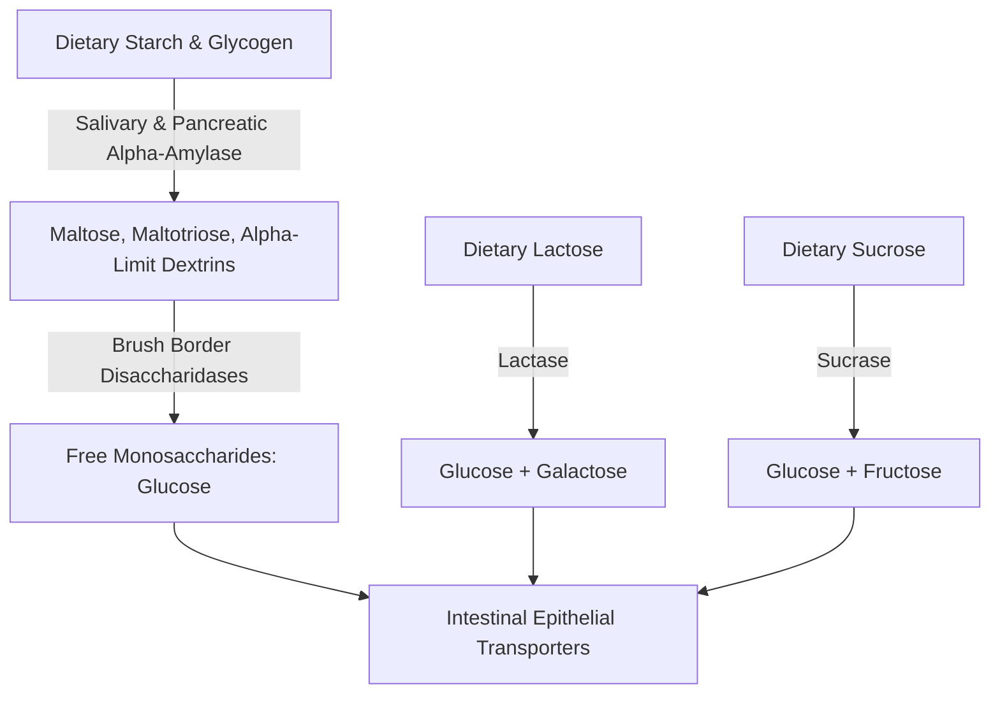
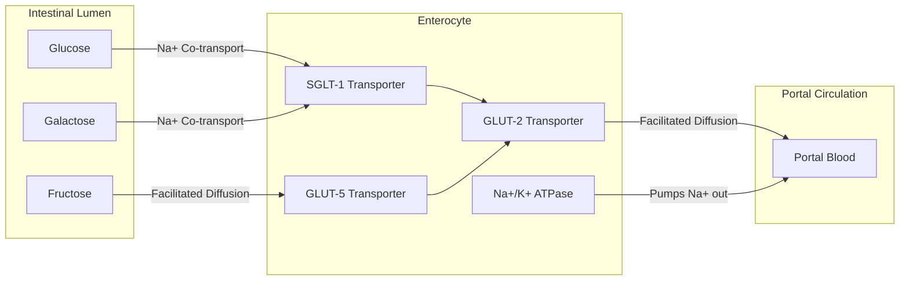
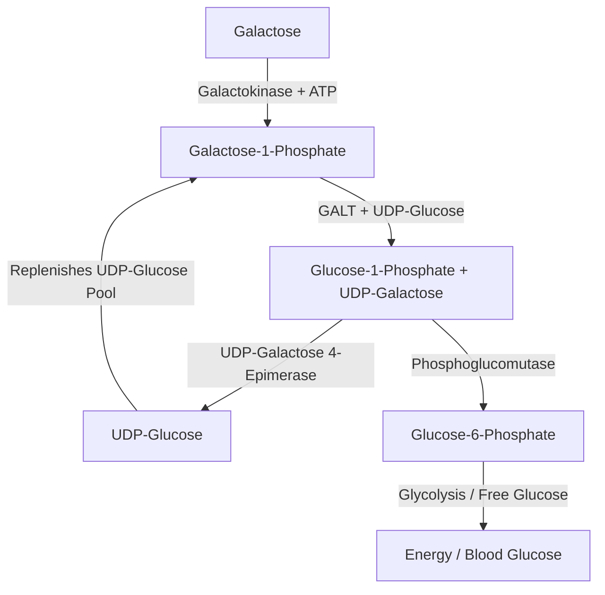
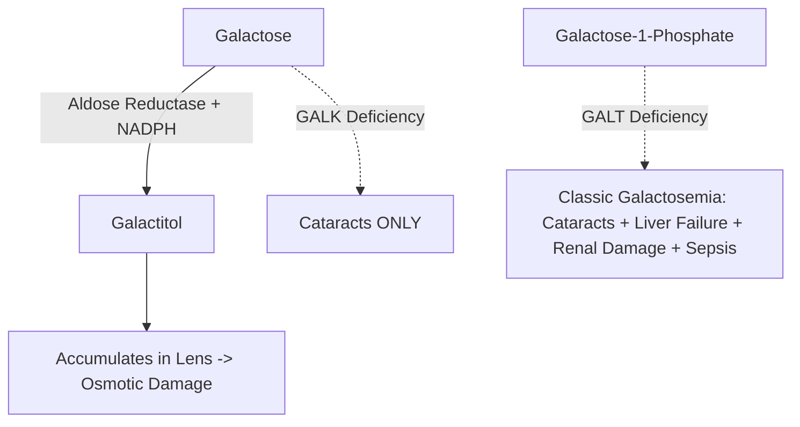

# 20. Digestion, Absorption of Carbohydrates, and Galactose Metabolism

## 1. Digestion of Dietary Carbohydrates

Dietary carbohydrates consist mainly of starch, lactose, sucrose, and cellulose. Digestion involves sequential enzymatic cleavage of glycosidic bonds along the gastrointestinal tract.

### A. Salivary and Pancreatic Digestion
1. **Salivary $\alpha$-Amylase (Ptyalin):**
   * Endoglucosidase secreted by parotid/submandibular glands.
   * Cleaves internal $\alpha(1\rightarrow 4)$ glycosidic bonds in starch and glycogen.
   * Cannot cleave $\alpha(1\rightarrow 6)$ branch points or terminal bonds.
   * Inactivated rapidly by gastric acid ($pH < 4.0$) in the stomach.
2. **Pancreatic $\alpha$-Amylase:**
   * Secreted into duodenum; operates at optimal $pH \approx 7.1-8.0$.
   * Cleaves remaining $\alpha(1\rightarrow 4)$ bonds, yielding disaccharides (maltose), trisaccharides (maltotriose), and branched **$\alpha$-limit dextrins** (containing $\alpha(1\rightarrow 6)$ branch points).

### B. Intestinal Brush Border Enzymes
Synthesized by enterocytes and anchored to the mucosal microvilli:
* **Maltase:** Hydrolyzes maltose $\rightarrow 2\text{ Glucose}$.
* **Isomaltase ($\alpha$-Dextrinase):** Cleaves $\alpha(1\rightarrow 6)$ bonds in $\alpha$-limit dextrins.
* **Sucrase-Isomaltase Complex:** Bifunctional enzyme; cleaves sucrose $\rightarrow \text{Glucose} + \text{Fructose}$.
* **Lactase ($\beta$-Galactosidase):** Cleaves lactose $\rightarrow \text{Glucose} + \text{Galactose}$. an important brush-border enzyme for lactose digestion; it is not generally described as the single rate-limiting enzyme for all carbohydrate digestion.
* **Trehalase:** Cleaves trehalase $\rightarrow 2\text{ Glucose}$.

---

## 2. Intestinal Absorption of Monosaccharides

Absorption occurs exclusively in the form of monosaccharides across the intestinal brush border membrane into the enterocytes, followed by basolateral exit into the portal circulation.

### Monosaccharide Transporters Summary Table

| Transporter | Transport Mechanism | Substrates | Primary Anatomical Locations | High-Yield Physiological / Clinical Characteristics |
| :--- | :--- | :--- | :--- | :--- |
| **SGLT-1** | Secondary Active Transport ($Na^+$ co-transport) | Glucose, Galactose | Apical enterocyte, Renal PCT (S3 segment) | Moves glucose/galactose **against** concentration gradient; driven by basolateral $Na^+/K^+$ ATPase; inhibited by **Phlorizin** |
| **SGLT-2** | Secondary Active Transport ($Na^+$ co-transport) | Glucose | Renal PCT (S1/S2 segments) | Responsible for $90\%$ of renal glucose reabsorption; targeted by **SGLT2 inhibitors** (e.g., Empagliflozin, Dapagliflozin) |
| **GLUT-1** | Facilitated Diffusion | Glucose, Galactose | Erythrocytes, Blood-Brain Barrier, Placenta | Low $K_m$ ($\approx 1\text{ mM}$); ensures continuous baseline glucose entry |
| **GLUT-2** | Facilitated Diffusion | Glucose, Galactose, Fructose | Liver, Pancreatic $\beta$-cell, Basolateral enterocyte, Kidney | High capacity, **high $K_m$** ($\approx 15-20\text{ mM}$); acts as liver/$\beta$-cell glucose sensor |
| **GLUT-3** | Facilitated Diffusion | Glucose | Neurons, Brain, Sperm | Very low $K_m$ ($< 1\text{ mM}$); high affinity ensures neuronal glucose supply during hypoglycemia |
| **GLUT-4** | Facilitated Diffusion | Glucose | Skeletal muscle, Cardiac muscle, Adipose tissue | **Insulin-dependent**; sequestered in intracellular vesicles; translocates to plasma membrane upon insulin/exercise |
| **GLUT-5** | Facilitated Diffusion | Fructose | Apical enterocyte, Spermatozoa, Kidney | Specific for **fructose** transport; independent of $Na^+$ |

### Clinical Correlation: Lactose Intolerance
* **Etiology:** Deficiency of intestinal mucosal lactase.
  * *Primary (Adult-type):* Age-dependent decline in lactase expression (genetically determined lactase non-persistence; common in Asian/African populations).
  * *Secondary:* Injury to microvilli (e.g., Rotavirus gastroenteritis, Celiac disease, Crohn's disease).
  * *Congenital:* Rare autosomal recessive loss of lactase.
* **Pathophysiology:** Undigested lactose remains in intestinal lumen $\rightarrow$ osmotic diarrhea. Colonic bacterial fermentation of lactose produces short-chain fatty acids, $CO_2$, and $H_2$ gas $\rightarrow$ abdominal bloating, flatulence, and cramps.
* **Diagnosis:**
  1. **Hydrogen Breath Test:** Elevated $H_2$ gas in expired air after oral lactose load.
  2. Stool testing: Low $pH$ ($< 5.5$) due to organic acids; presence of reducing substances.

---

## 3. Galactose Metabolism (Leloir Pathway)

Galactose is derived primarily from milk lactose. In the liver, galactose is rapidly converted to glucose intermediates via the **Leloir pathway**.

### Enzymatic Steps of the Leloir Pathway
1. **Phosphorylation:**
   $$\text{Galactose} + \text{ATP} \xrightarrow{\text{Galactokinase (GALK)}} \text{Galactose-1-Phosphate} + \text{ADP}$$
2. **Uridylyl Transfer (Rate-limiting / Critical step):**
   $$\text{Galactose-1-P} + \text{UDP-Glucose} \xrightarrow{\text{GALT}} \text{Glucose-1-P} + \text{UDP-Galactose}$$
   *Enzyme:* **Galactose-1-Phosphate Uridylyltransferase (GALT)**.
3. **Epimerization:**
   $$\text{UDP-Galactose} \xleftrightarrow{\text{UDP-Galactose 4-Epimerase (GALE)}} \text{UDP-Glucose}$$
4. **Isomerization:**
   $$\text{Glucose-1-Phosphate} \xleftrightarrow{\text{Phosphoglucomutase}} \text{Glucose-6-Phosphate}$$

---

## 4. Inborn Errors of Galactose Metabolism (Galactosemias)

Galactosemia refers to a group of autosomal recessive disorders caused by deficiencies in enzymes of the Leloir pathway.

### Detailed Comparison of Galactosemia Subtypes

| Parameter | Classic Galactosemia (Type 1) | Galactokinase Deficiency (Type 2) | Epimerase Deficiency (Type 3) |
| :--- | :--- | :--- | :--- |
| **Deficient Enzyme** | **Galactose-1-Phosphate Uridylyltransferase (GALT)** | **Galactokinase (GALK)** | **UDP-Galactose 4-Epimerase (GALE)** |
| **Accumulated Metabolites** | **Galactose-1-Phosphate**, Galactose, **Galactitol** | **Galactose**, **Galactitol** | UDP-Galactose, Galactose-1-P |
| **Mode of Inheritance** | Autosomal Recessive | Autosomal Recessive | Autosomal Recessive |
| **Clinical Presentation** | Neonatal presentation after milk feeds: • **Oil-drop cataracts** (due to galactitol accumulation in lens) • Hepatomegaly, jaundice, liver cirrhosis • Failure to thrive, intellectual disability • Renal tubular dysfunction (Fanconi-like) • **E. coli neonatal sepsis** (high-yield!) | **Mild form:** • **Infantile Cataracts ONLY** • No hepatic, renal, or central nervous system toxicity | **Two Forms:** 1. *Benign/Peripheral:* Asymptomatic (blood cells only) 2. *Severe/Generalized:* Mimics Classic Galactosemia |
| **Diagnostic Marker** | Absent/reduced GALT activity in erythrocytes; elevated blood galactose & urine galactose-1-P | Elevated blood galactose; galactosemia/galactosuria | Reduced GALE activity in RBCs |
| **Management** | Complete elimination of galactose and lactose from diet (e.g., soy-based formula) | Dietary galactose restriction | Dietary galactose restriction in severe form |

### Biochemical Mechanism of Cataract Formation
When galactose accumulates in blood, excess galactose enters the ocular lens where **Aldose Reductase** reduces it to **Galactitol** (a sugar alcohol):

$$\text{Galactose} + \text{NADPH} + H^+ \xrightarrow{\text{Aldose Reductase}} \text{Galactitol} + \text{NADP}^+$$

Galactitol cannot cross the lens membrane and is not metabolized by sorbitol dehydrogenase. Intracellular galactitol accumulation creates an **osmotic gradient**, drawing water into the lens fiber cells $\rightarrow$ cellular swelling, protein denaturation, and cataract formation ("oil-drop" appearance).

---

## 5. High-Yield Examination Summary

* **SGLT-1** transports Glucose and Galactose via $Na^+$ co-transport; **GLUT-5** transports Fructose via facilitated diffusion.
* **GLUT-2** is a high-capacity, relatively high-$K_m$ transporter in hepatocytes and basolateral enterocytes. The transporter profile of human pancreatic $\beta$-cells differs from the classic rodent model; see Chapter 24 Glucose Stimulated Insulin Secretion.
* **GLUT-4** is the only insulin-dependent glucose transporter (found in muscle and adipose tissue).
* **Classic Galactosemia (GALT deficiency)** presents with oil-drop cataracts, hepatomegaly, intellectual disability, and **E. coli sepsis** in neonates.
* **GALK deficiency** causes **cataracts ONLY** without hepatic/renal impairment.
* Galactitol production by **Aldose Reductase** is responsible for cataract formation in galactosemia.

---

## 6. Inter-Chapter Links
* 19 Carbohydrates - Structure and Classification of Carbohydrates
* 22 Fructose Metabolism - Sorbitol Pathway and Polyol Damage
* 24 Glucose Stimulated Insulin Secretion - GLUT-2 and Pancreatic $\beta$-Cell Glucose Sensing
* 27 Insulin Signal Transduction and Diabetes Mellitus - GLUT-4 Translocation Mechanisms

## Selected References for Clinical Updates

- [Caspi et al. Glucose Transporters Are Key Components of the Human Glucostat. Diabetes. 2024.](https://doi.org/10.2337/db23-0508)
