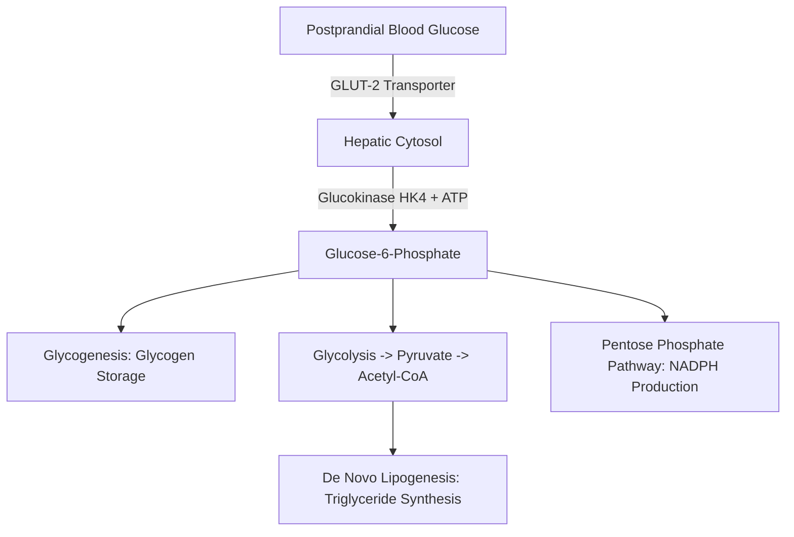
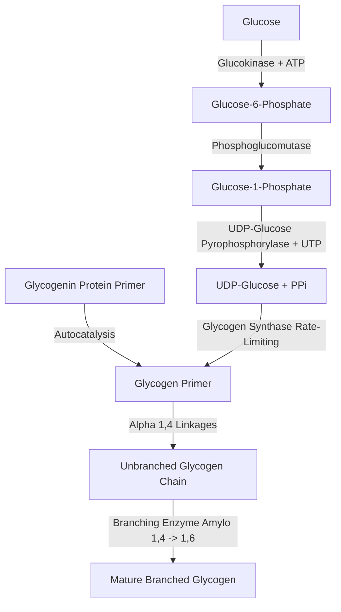
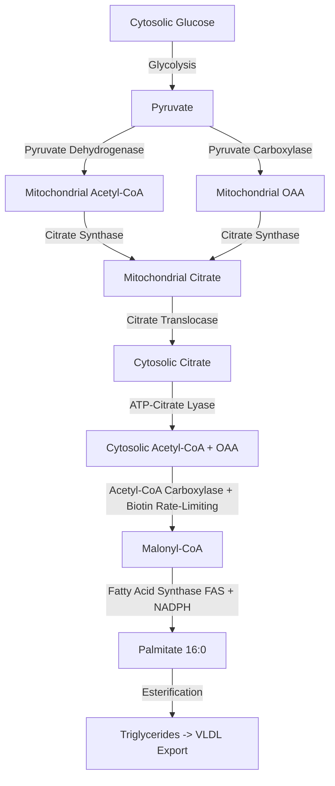
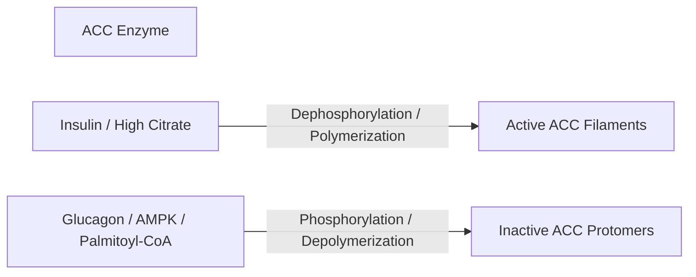

# 21. Hepatic Glucose Metabolism: Glycogenesis and Lipogenesis

## 1. Postprandial Hepatic Glucose Fate and Glucokinase Kinetics

Following a carbohydrate-rich meal, portal vein glucose concentration rises significantly ($> 10-15\text{ mM}$). The liver plays a primary role as a "glucose sink," clearing up to $60\%$ of portal glucose to maintain systemic glucose homeostasis.

### Glucokinase (HK4) vs. Hexokinase (HK1–3)
The rapid phosphorylation of glucose to Glucose-6-Phosphate (G6P) in hepatocytes is catalyzed by **Glucokinase (Hexokinase IV)**.

| Parameter | Hexokinase (HK I–III) | Glucokinase (HK IV) |
| :--- | :--- | :--- |
| **Tissue Distribution** | Ubiquitous (Brain, Muscle, RBCs) | **Liver** and **Pancreatic $\beta$-cells** |
| **$K_m$ for Glucose** | **Very Low** ($\approx 0.05\text{ mM}$); high affinity | **High** ($\approx 10\text{ mM}$); low affinity |
| **$V_{max}$** | Low capacity | **High capacity** (prevents saturation postprandially) |
| **Allosteric Inhibition by G6P** | **Inhibited** by Glucose-6-Phosphate | **NOT inhibited** by Glucose-6-Phosphate |
| **Hormonal / Gene Regulation** | Constitutive; unaffected by insulin | **Induced by Insulin** |
| **Sigmoidal vs Hyperbolic** | Hyperbolic kinetics | **Sigmoidal kinetics** (cooperative binding) |
| **Regulation by GKRP** | No regulation | Regulated by **Glucokinase Regulatory Protein (GKRP)** |

### Regulation of Glucokinase by GKRP
* In the **fasted state** (low glucose, high fructose-6-phosphate), Glucokinase binds **GKRP** and is sequestered inside the **nucleus** in an inactive form.
* In the **fed state** (high intrahepatic glucose), glucose causes the dissociation of Glucokinase from GKRP, prompting its translocation into the **cytosol** to actively phosphorylate glucose.

---

## 2. Glycogenesis (Glycogen Synthesis)

Glycogenesis is the anabolic pathway that converts free glucose into stored glycogen in hepatocytes (and skeletal muscle).

### Pathway Steps
1. **Phosphorylation:** $\text{Glucose} + \text{ATP} \xrightarrow{\text{Glucokinase}} \text{Glucose-6-P} + \text{ADP}$.
2. **Isomerization:** $\text{Glucose-6-P} \xleftrightarrow{\text{Phosphoglucomutase}} \text{Glucose-1-P}$.
3. **Activation (UDP-Glucose Formation):**
   $$\text{Glucose-1-P} + \text{UTP} \xrightarrow{\text{UDP-Glucose Pyrophosphorylase}} \text{UDP-Glucose} + \text{PP}_i$$
   *Inorganic Pyrophosphatase* rapidly hydrolyzes $\text{PP}_i \rightarrow 2\text{ P}_i$, driving the overall reaction forward.
4. **Initiation (Primer Requirement):**
   Glycogen Synthase cannot initiate glycogen chain synthesis *de novo*. It requires a primer:
   * **Glycogenin:** An enzyme/protein primer that glucosylates itself at a specific **Tyrosine-194** residue using UDP-glucose, forming an initial oligo-glucose chain of $\approx 8$ residues.
5. **Elongation (Rate-Limiting Step):**
   $$\text{UDP-Glucose} + \text{Glycogen}_{n} \xrightarrow{\text{Glycogen Synthase}} \text{Glycogen}_{n+1} + \text{UDP}$$
   *Forms $\alpha(1\rightarrow 4)$ glycosidic linkages.*
6. **Branching:**
   * **Branching Enzyme** (*Amylo-$\alpha(1\rightarrow 4)\rightarrow\alpha(1\rightarrow 6)$-transglucosidase*):
   * When an elongation chain reaches $\ge 11$ residues, the branching enzyme transfers a terminal block of 6–8 glucose residues to a C-6 hydroxyl group of an internal glucose, creating an **$\alpha(1\rightarrow 6)$ branch point**.

---

## 3. De Novo Lipogenesis (DNL) in the Liver

When hepatic glycogen stores become saturated ($\approx 100\text{ g}$ in liver), excess postprandial carbohydrate is converted into fatty acids and triglycerides via **De Novo Lipogenesis (DNL)**.

### A. Citrate Shuttle
Acetyl-CoA is generated inside the mitochondrial matrix but fatty acid synthesis occurs in the cytosol. Since the inner mitochondrial membrane is impermeable to Acetyl-CoA:
1. Acetyl-CoA condenses with Oxaloacetate (OAA) to form **Citrate** via *Citrate Synthase*.
2. Elevated ATP inhibits *Isocitrate Dehydrogenase* in the TCA cycle, causing Citrate to accumulate and exit to the cytosol via the **Tricarboxylate Transporter**.
3. In the cytosol, **ATP-Citrate Lyase** cleaves Citrate back into Acetyl-CoA and OAA:
   $$\text{Citrate} + \text{ATP} + \text{CoA} \xrightarrow{\text{ATP-Citrate Lyase}} \text{Acetyl-CoA} + \text{OAA} + \text{ADP} + \text{P}_i$$

### B. Rate-Limiting Step: Acetyl-CoA Carboxylase (ACC)
Converts Acetyl-CoA into Malonyl-CoA:
$$\text{Acetyl-CoA} + \text{HCO}_3^- + \text{ATP} \xrightarrow[\text{Biotin (Vit B7)}]{\text{ACC}} \text{Malonyl-CoA} + \text{ADP} + \text{P}_i$$

#### Regulation of ACC:
* **Allosteric Regulation:**
  * *Activated by:* **Citrate** (promotes polymerization of inactive protomers into active filaments).
  * *Inhibited by:* **Palmitoyl-CoA** (end-product feedback inhibition).
* **Covalent Modification (Hormonal):**
  * *Insulin (Fed State):* Activates protein phosphatases $\rightarrow$ **Dephosphorylates ACC $\rightarrow$ ACTIVE**.
  * *Glucagon / Epinephrine / AMP (Fasted/Exercise State):* Activates **AMP-Activated Protein Kinase (AMPK)** $\rightarrow$ **Phosphorylates ACC $\rightarrow$ INACTIVE**.

### C. Fatty Acid Synthase (FAS) Complex
* A multifunctional homodimeric enzyme complex containing 7 catalytic domains and an **Acyl Carrier Protein (ACP)** domain containing a **4'-phosphopantetheine** prosthetic group (derived from Pantothenic Acid / Vitamin B5).
* Sequential addition of 2-carbon units from Malonyl-CoA using **NADPH** (generated by the Pentose Phosphate Pathway) yields **Palmitate ($16:0$)**.

### D. Prevention of Futile Cycling: Role of Malonyl-CoA
Malonyl-CoA produced by ACC acts as a potent allosteric inhibitor of **Carnitine Palmitoyltransferase-1 (CPT-1)**. This completely blocks cytosolic fatty acids from entering the mitochondria for $\beta$-oxidation during active fatty acid synthesis in the fed state.

---

## 4. High-Yield Examination Summary

* **Glucokinase (HK4)** has a high $K_m$ ($\approx 10\text{ mM}$), high $V_{max}$, is **not** inhibited by G6P, and is sequestered in the nucleus by **GKRP**.
* **Glycogenin** is an essential protein primer that glucosylates its own **Tyrosine-194** residue to initiate glycogenesis.
* **Glycogen Synthase** forms $\alpha(1\rightarrow 4)$ bonds; **Branching Enzyme** forms $\alpha(1\rightarrow 6)$ branch points.
* **ATP-Citrate Lyase** cleaves cytosolic citrate to produce Acetyl-CoA for lipogenesis.
* **Acetyl-CoA Carboxylase (ACC)** is the rate-limiting enzyme of lipogenesis; requires **Biotin**, is activated by **Citrate** and **Insulin**, and is inhibited by **AMPK** and **Palmitoyl-CoA**.
* **Malonyl-CoA** inhibits **CPT-1**, preventing simultaneous fatty acid synthesis and $\beta$-oxidation.

---

## 5. Inter-Chapter Links
* 19 Carbohydrates - Carbohydrate Structures and Glycogen Architecture
* 24 Glucose Stimulated Insulin Secretion - Glucokinase in Pancreatic $\beta$-Cells
* 25 Regulation of Glycogen Metabolism - Hormonal Regulation of Glycogen Synthase
* 29 Alcohol Metabolism and Metabolic Consequences - Hepatic Steatosis Pathomechanisms
