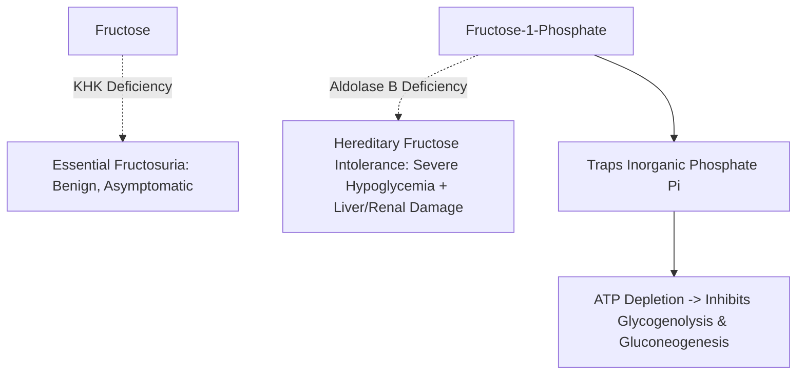
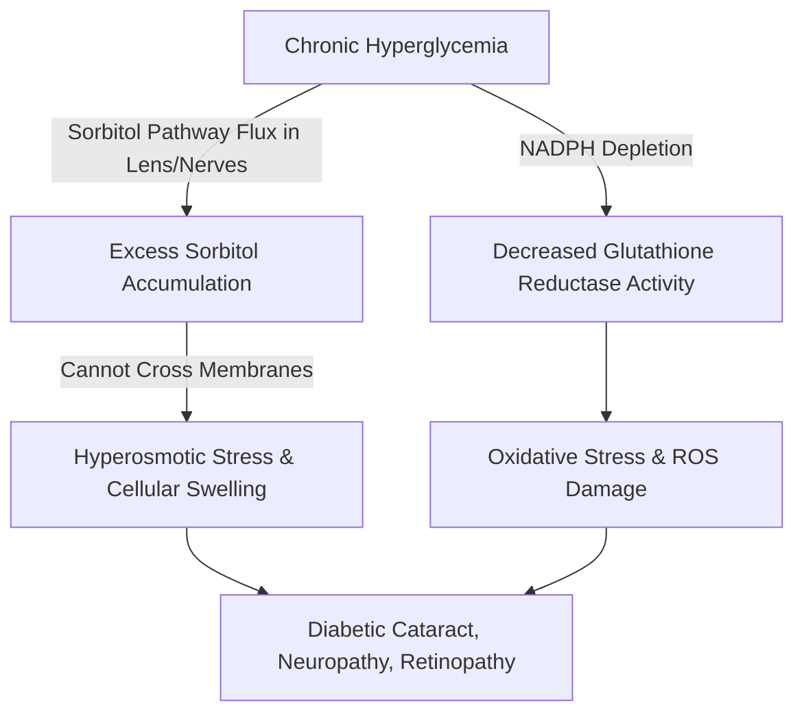

# 22. Fructose Metabolism and Associated Inborn Errors

## 1. Introduction and Fructolysis Pathway

Fructose is a ketohexose abundant in fruits, honey, sucrose, and high-fructose corn syrup (HFCS). Fructose metabolism occurs predominantly in the **liver**, **kidneys**, and **small intestine**.

```mermaid
graph TD
    A[Fructose] -->|Fructokinase KHK + ATP| B[Fructose-1-Phosphate]
    B -->|Aldolase B Rate-Limiting| C[DHAP] + D[Glyceraldehyde]
    D -->|Triokinase + ATP| E[Glyceraldehyde-3-Phosphate]
    C & E -->|Enter Glycolysis| F[Pyruvate -> Acetyl-CoA -> Lipogenesis]
```

### Pathway Steps (Fructolysis)
1. **Phosphorylation:**
   $$\text{Fructose} + \text{ATP} \xrightarrow{\text{Fructokinase (Ketohexokinase, KHK)}} \text{Fructose-1-Phosphate} + \text{ADP}$$
   * *Properties of Fructokinase:* High $V_{max}$, rapid phosphorylation. Unlike hexokinase/glucokinase, fructokinase is **not** dependent on insulin.
2. **Cleavage (Rate-Limiting Step):**
   $$\text{Fructose-1-Phosphate} \xrightarrow{\text{Aldolase B}} \text{Dihydroxyacetone Phosphate (DHAP)} + \text{Glyceraldehyde}$$
   * *Isozymes of Aldolase:*
     * **Aldolase A:** Found in muscle/brain; prefers Fructose-1,6-bisphosphate (glycolysis).
     * **Aldolase B:** Found in **liver**, kidney, cortex; cleaves both Fructose-1,6-BP and **Fructose-1-Phosphate**.
     * **Aldolase C:** Found in brain.
3. **Phosphorylation of Glyceraldehyde:**
   $$\text{Glyceraldehyde} + \text{ATP} \xrightarrow{\text{Triokinase}} \text{Glyceraldehyde-3-Phosphate} + \text{ADP}$$

### Why Fructose Metabolism Is Faster Than Glucose Metabolism
Fructolysis **bypasses Phosphofructokinase-1 (PFK-1)**, the major rate-limiting control point of glycolysis. Consequently, hepatic fructose flood leads to rapid, unregulated production of Acetyl-CoA, driving increased **de novo lipogenesis**, hypertriglyceridemia, and hepatic steatosis (NAFLD/MASLD).

---

## 2. Inborn Errors of Fructose Metabolism



### Detailed Comparison of Fructose Disorders

| Parameter | Essential Fructosuria | Hereditary Fructose Intolerance (HFI) |
| :--- | :--- | :--- |
| **Deficient Enzyme** | **Fructokinase (Ketohexokinase, KHK)** | **Aldolase B** |
| **Accumulated Substance** | Fructose (in blood and urine) | **Fructose-1-Phosphate (F1P)** (trapped intracellularly) |
| **Mode of Inheritance** | Autosomal Recessive | Autosomal Recessive |
| **Clinical Presentation** | **Benign and asymptomatic condition**:<br>• Fructose excreted in urine (fructosuria)<br>• Discovered incidentally on urine screening for reducing sugars | **Severe infantile presentation** upon introduction of fruits, juices, or sucrose during weaning:<br>• Severe **hypoglycemia** and vomiting<br>• Jaundice, hepatomegaly, liver cirrhosis<br>• Renal tubular dysfunction (**Fanconi syndrome**)<br>• Aversion to sweet foods/fruits |
| **Pathomechanism** | Lack of phosphorylation; fructose is excreted safely in urine or phosphorylated slowly by Hexokinase in muscle | Accumulation of **F1P traps inorganic phosphate ($P_i$)** $\rightarrow$ ATP depletion $\rightarrow$ inhibits Glycogen Phosphorylase and Gluconeogenesis $\rightarrow$ **Severe Hypoglycemia** |
| **Urine Dipstick vs Benedict's** | Dipstick (glucose oxidase) is **Negative**; Benedict's test is **Positive** (reducing sugar) | Dipstick is **Negative**; Benedict's test is **Positive**; F1P leads to proximal tubular proteinuria/aminoaciduria |
| **Management** | No treatment required | Strict elimination of **Fructose**, **Sucrose**, and **Sorbitol** from diet |

---

## 3. The Sorbitol (Polyol) Pathway

The polyol pathway converts glucose into fructose via a sorbitol intermediate.


### Two-Step Reaction Sequence
1. **Reduction of Glucose:**
   $$\text{Glucose} + \text{NADPH} + \text{H}^+ \xrightarrow{\text{Aldose Reductase}} \text{Sorbitol} + \text{NADP}^+$$
2. **Oxidation of Sorbitol:**
   $$\text{Sorbitol} + \text{NAD}^+ \xrightarrow{\text{Sorbitol Dehydrogenase}} \text{Fructose} + \text{NADH} + \text{H}^+$$

### Tissue Distribution and Physiological Significance
* **Seminal Vesicles:** Possess both enzymes; produce large amounts of fructose, which serves as the primary energy fuel for spermatozoa.
* **Liver and Ovaries:** Contain both enzymes.

### Pathophysiological Role in Diabetic Microvascular Complications
Certain tissues possess **Aldose Reductase** but have **low or absent Sorbitol Dehydrogenase**:
* **Susceptible Tissues:** Ocular Lens, Retina, Renal Schwann cells, Peripheral Nerves.



1. **Hyperosmotic Damage:** In chronic uncontrolled diabetes mellitus, intracellular glucose floods these cells. Aldose Reductase produces **Sorbitol**, which cannot diffuse out across plasma membranes. Sorbitol accumulates, drawing water into cells $\rightarrow$ **osmotic swelling and tissue damage**.
2. **Oxidative Damage:** Heavy consumption of **NADPH** by aldose reductase depletes NADPH reserves required by *Glutathione Reductase* to regenerate reduced glutathione (GSH), exposing tissues to severe **oxidative stress**.

---

## 4. High-Yield Examination Summary

* **Fructolysis bypasses PFK-1**, leading to unregulated hepatic lipogenesis.
* **Essential Fructosuria** (KHK deficiency) is benign and asymptomatic.
* **Hereditary Fructose Intolerance (HFI)** (Aldolase B deficiency) causes **Fructose-1-P accumulation**, $P_i$ trapping, ATP depletion, and severe hypoglycemia after fruit/sucrose ingestion.
* Urine glucose dipstick (glucose oxidase) is **negative** in fructosuria and HFI, but Benedict's test is **positive**.
* **Aldose Reductase** converts Glucose to Sorbitol; **Sorbitol Dehydrogenase** converts Sorbitol to Fructose.
* Tissue accumulation of sorbitol causes **diabetic cataracts** and **peripheral neuropathy** due to osmotic stress and NADPH depletion.

---

## 5. Inter-Chapter Links
* 19 Carbohydrates - Disaccharides (Sucrose composition) and Tests for Reducing Sugars
* 20 Carbohydrate Absorption and Galactose Metabolism - Aldose Reductase in Cataract Formation
* 21 Hepatic Glucose Glycogenesis and Lipogenesis - De Novo Lipogenesis from Fructose Intermediates
* 28 Diabetes Mellitus - Polyol Pathway in Diabetic Microvascular Complications
