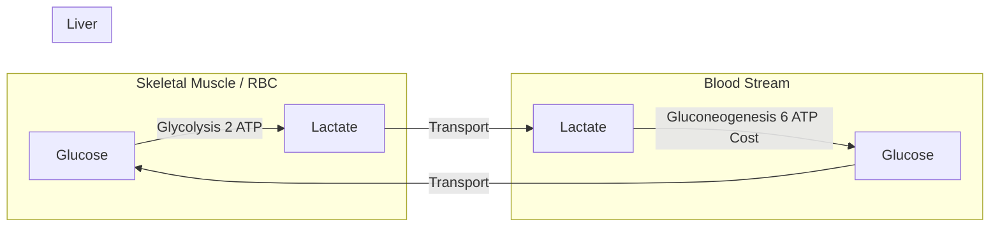
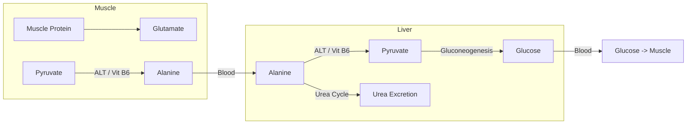
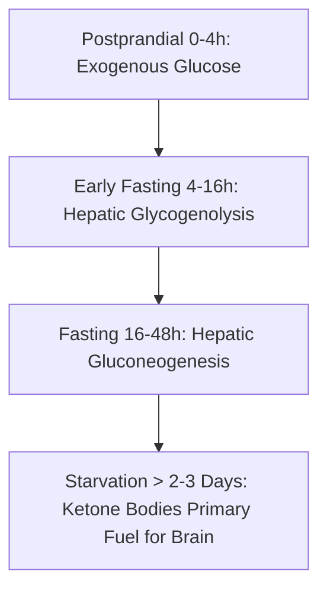

# 23. Glucose Homeostasis: Hormonal Integration, Gluconeogenesis, and Inter-Organ Crosstalk

## 1. Physiological Blood Glucose Regulation

Tight regulation of systemic blood glucose concentration is vital to preserve central nervous system function.

* **Normal Reference Ranges:**
  * Fasting Plasma Glucose (FPG): $70-99\text{ mg/dL}$ ($3.9-5.5\text{ mmol/L}$).
  * Postprandial Glucose (2-hour): $< 140\text{ mg/dL}$ ($< 7.8\text{ mmol/L}$).
* **Hormonal Balance:**
  * **Hypoglycemic (Anabolic) Hormone:** **Insulin** (promotes glucose uptake, glycogenesis, lipogenesis; suppresses gluconeogenesis and glycogenolysis).
  * **Hyperglycemic (Catabolic / Counter-Regulatory) Hormones:** **Glucagon**, **Epinephrine**, **Cortisol**, and **Growth Hormone (GH)**.

---

## 2. Gluconeogenesis (GNG)

Gluconeogenesis is the synthesis of new glucose from non-carbohydrate precursors. It occurs primarily in the **liver** ($90\%$) and **kidney cortex** ($10\%$ in early fasting, up to $40\%$ in severe starvation).

```mermaid
graph TD
    Substrates[Gluconeogenic Substrates: Lactate, Alanine, Glycerol, Propionate] --> Pathway[Gluconeogenesis Pathway]
    
    subgraph Bypass 1: Pyruvate to PEP
        Pyruvate -->|Pyruvate Carboxylase + Biotin + ATP| OAA[Oxaloacetate]
        OAA -->|PEPCK + GTP| PEP[Phosphoenolpyruvate]
    end
    
    subgraph Bypass 2: F-1,6-BP to F-6-P
        F16BP[Fructose-1,6-Bisphosphate] -->|FBPase-1 Rate-Limiting| F6P[Fructose-6-Phosphate]
    end
    
    subgraph Bypass 3: G-6-P to Free Glucose
        G6P[Glucose-6-Phosphate] -->|Glucose-6-Phosphatase ER Bound| Glucose[Free Glucose -> Blood]
    end
```

### A. Substrates for Gluconeogenesis
1. **Lactate:** Produced by anaerobic glycolysis in RBCs and exercising muscle; transported to liver via the **Cori Cycle**.
2. **Glucogenic Amino Acids:** **Alanine** is the principal glucogenic precursor released from skeletal muscle via the **Glucose-Alanine Cycle**. (All amino acids except **Leucine** and **Lysine** are glucogenic).
3. **Glycerol:** Released from adipose tissue lipolysis (triglyceride breakdown). Phosphorylated by *Glycerol Kinase* (present in liver, absent in adipose tissue) to Glycerol-3-P $\rightarrow$ converted to DHAP.
4. **Propionate:** Odd-chain fatty acids and branched-chain amino acid catabolism yield Propionyl-CoA $\rightarrow$ Methylmalonyl-CoA $\rightarrow$ **Succinate-CoA** (enters TCA cycle). *Note:* Even-chain fatty acids yield Acetyl-CoA and **cannot** net synthesize glucose.

### B. Overcoming Glycolytic Irreversible Steps (The 3 Bypasses)

| Glycolytic Step | Gluconeogenic Bypass Enzyme(s) | Subcellular Location | Cofactors / Energy Required | Regulation |
| :--- | :--- | :--- | :--- | :--- |
| **Pyruvate $\rightarrow$ PEP** | **1. Pyruvate Carboxylase (PC)**<br>**2. PEP Carboxykinase (PEPCK)** | PC: Mitochondria<br>PEPCK: Cytosol / Mitochondria | PC: **Biotin**, $ATP$, $CO_2$<br>PEPCK: **$GTP$** | PC is obligately activated by **Acetyl-CoA**. PEPCK induced by Glucagon/Cortisol. |
| **$\text{F-1,6-BP} \rightarrow \text{F-6-P}$** | **Fructose-1,6-Bisphosphatase (FBPase-1)** | Cytosol | None | **Rate-limiting enzyme**. Inhibited by **AMP** and **$\text{F-2,6-BP}$**; activated by Citrate. |
| **$\text{G-6-P} \rightarrow \text{Glucose}$** | **Glucose-6-Phosphatase** | Endoplasmic Reticulum membrane | None | Absent in skeletal muscle (hence muscle cannot release free glucose into blood). |

---

## 3. Inter-Organ Metabolic Cycles

### A. Cori Cycle (Lactic Acid Cycle)
recycles lactate-derived carbon between peripheral tissues (especially erythrocytes and exercising muscle) and the liver. It helps dispose of lactate, but does **not** prevent lactic acidosis when lactate production exceeds clearance or hepatic metabolism is impaired.



* **Net Energetic Cost:** 2 ATP generated in muscle/RBC; 6 ATP equivalents consumed in liver $\rightarrow$ **Net cost of 4 ATP per cycle**.

### B. Glucose-Alanine Cycle (Cahill Cycle)
Transfers nitrogen and carbon skeletons from skeletal muscle to the liver.



---

## 4. Metabolic Timeline During Fasting and Starvation



| Phase / Duration | Primary Fuel Source | Major Organs Supplying Fuel | Brain Energy Source |
| :--- | :--- | :--- | :--- |
| **Postprandial** ($0-4\text{ hours}$) | Exogenous dietary glucose | Intestinal absorption | Free Glucose |
| **Early Fasting** ($4-16\text{ hours}$) | Hepatic **Glycogenolysis** | Liver | Free Glucose |
| **Fasting** ($16-48\text{ hours}$) | **Gluconeogenesis** + Adipose Lipolysis | Liver ($90\%$) and Kidney ($10\%$) | Free Glucose |
| **Starvation** ($> 2-3\text{ days}$) | **Ketone Bodies** ($\beta$-hydroxybutyrate, acetoacetate) | Adipose Lipolysis $\rightarrow$ Hepatic Ketogenesis | **Ketone Bodies** ($2/3rd$ energy) + Reduced Glucose ($1/3rd$) |

---

## 5. High-Yield Examination Summary

* **Glucose-6-Phosphatase** is present in liver and kidney ER, but **absent** in muscle.
* **Pyruvate Carboxylase** requires **Biotin** and is obligately activated by **Acetyl-CoA**.
* **FBPase-1** is the rate-limiting enzyme of GNG; inhibited by **$\text{F-2,6-BP}$** and **AMP**.
* The **Cori Cycle** costs the liver 6 ATP to convert lactate back to glucose (net loss of 4 ATP).
* Even-chain fatty acids **cannot** yield net glucose; odd-chain fatty acids yield propionyl-CoA $\rightarrow$ succinyl-CoA.
* During prolonged starvation, **ketone bodies** adapt as the primary fuel for the brain, sparing muscle protein breakdown.

---

## 6. Inter-Chapter Links
* 17 Anaerobic Glycolysis and Lactate Formation - Irreversible Steps of Glycolysis and Lactic Acidosis
* 21 Hepatic Glucose Glycogenesis and Lipogenesis - Postprandial Glucose Fate
* 26 Glycogenolysis and Glycogen Storage Diseases - Hepatic Glycogen Breakdown
* 29 Alcohol Metabolism and Metabolic Consequences - Ethanol-Induced Suppression of Gluconeogenesis
