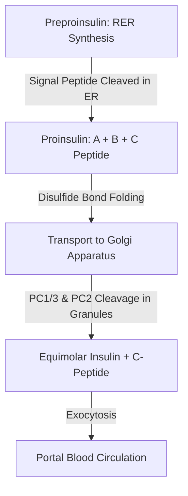
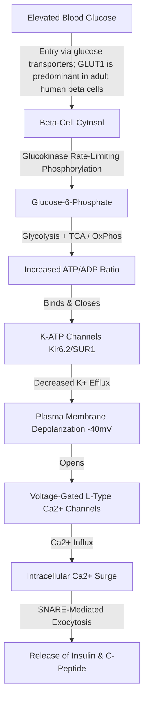
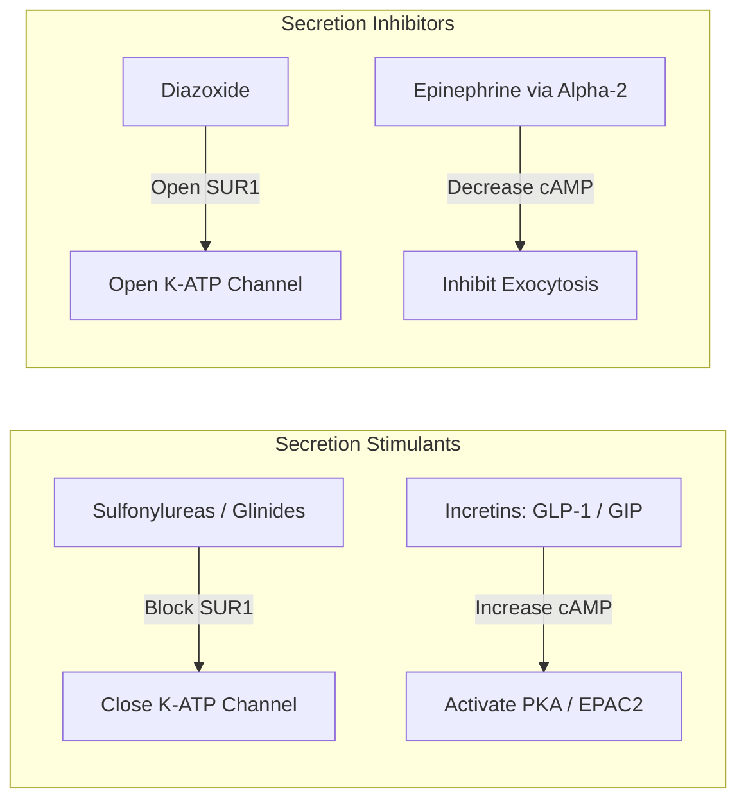

# 24. Glucose-Stimulated Secretion of Insulin from β-Cells

## 1. Pancreatic Islet Architecture and Structure of Insulin

The Islets of Langerhans constitute $1-2\%$ of pancreatic parenchyma.
* **$\beta$-Cells ($60-70\%$):** Located centrally; secrete **Insulin** and Amylin.
* **$\alpha$-Cells ($20\%$):** Located peripherally; secrete **Glucagon**.
* **$\delta$-Cells ($5-10\%$):** Secrete **Somatostatin**.

### Structure and Biosynthesis of Insulin
Insulin is a 51-amino-acid peptide hormone ($5.8\text{ kDa}$) consisting of two chains:
* **A Chain:** 21 amino acids.
* **B Chain:** 30 amino acids.
* **Disulfide Linkages:** Joined by **2 interchain disulfide bonds** ($A7-B7$ and $A20-B19$) and **1 intrachain disulfide bond** ($A6-A11$).

### Diagnostic Importance of C-Peptide
* **C-Peptide (Connecting Peptide):** 31-amino-acid peptide cleaved from proinsulin in secretory granules.
* **Clinical Significance:**
  1. Equimolar release with insulin into portal blood.
  2. Longer half-life ($\approx 20-30\text{ min}$) compared to insulin ($\approx 3-5\text{ min}$).
  3. Serves as a reliable marker of **endogenous $\beta$-cell secretory reserve**.
  4. Used to differentiate **Factitious Hypoglycemia** (exogenous insulin administration $\rightarrow$ High Insulin, **Low/Suppressed C-peptide**) from **Insulinoma / Sulfonylurea abuse** (High Insulin, **High C-peptide**).

---

## 2. Molecular Pathway of Glucose-Stimulated Insulin Secretion (GSIS)

Insulin secretion from pancreatic $\beta$-cells is tightly coupled to extracellular blood glucose concentrations through a specific stimulus-secretion pathway.

### Detailed Sequential Steps
1. **Glucose Entry:** Glucose enters $\beta$-cells through facilitative glucose transporters. **GLUT1 is the predominant transporter reported in adult human $\beta$-cells**; GLUT2 is the dominant transporter in many rodent models and is present in a smaller human $\beta$-cell subpopulation. This species difference is important when translating experimental models to human physiology.
2. **Glucose Sensing:** **Glucokinase (HK4)** phosphorylates glucose to G6P. Glucokinase acts as the primary **"glucose sensor"** of the $\beta$-cell due to its sigmoidal kinetics and $K_m \approx 5-10\text{ mM}$ matching physiological postprandial glucose levels.
3. **Mitochondrial ATP Production:** Accelerated glycolysis and mitochondrial oxidative phosphorylation produce a marked rise in cytosolic **$[\text{ATP}]/[\text{ADP}]$ ratio**.
4. **Closure of $K_{ATP}$ Channels:**
   * The $\text{K}_{ATP}$ channel is an octameric complex composed of 4 **Kir6.2** pore-forming subunits and 4 **SUR1** (Sulfonylurea Receptor 1) regulatory subunits.
   * Elevated ATP binds Kir6.2, closing the channel and halting $K^+$ efflux.
5. **Membrane Depolarization:** Cessation of $K^+$ efflux depolarizes the $\beta$-cell membrane from its resting potential ($\approx -70\text{ mV}$) to $\approx -40\text{ mV}$.
6. **$Ca^{2+}$ Influx:** Depolarization triggers the opening of **Voltage-Gated L-type $Ca^{2+}$ Channels ($VDCCs$)**, driving rapid $Ca^{2+}$ entry into the cytosol.
7. **Exocytosis:** Increased $[\text{Ca}^{2+}]_i$ induces SNARE-protein-mediated fusion of insulin-containing secretory vesicles with the plasma membrane, releasing insulin into the capillary network.

---

## 3. Pharmacological and Physiological Modulators of Insulin Secretion

### Summary of Modulators

| Agent / Drug Class | Mechanism of Action | Effect on Insulin Secretion | Clinical Utility |
| :--- | :--- | :--- | :--- |
| **Sulfonylureas** (e.g., Glimepiride, Glibenclamide) | Bind and inhibit **SUR1** subunit of $K_{ATP}$ channels $\rightarrow$ forced closure | **Stimulate** (Glucose-independent) | Oral hypoglycemic agents for Type 2 DM |
| **Glinides** (e.g., Repaglinide) | Bind SUR1 at a distinct site $\rightarrow$ rapid $K_{ATP}$ closure | **Stimulate** (Rapid onset) | Postprandial glucose control in T2DM |
| **Diazoxide** | $K_{ATP}$ channel **opener** $\rightarrow$ maintains hyperpolarization | **Inhibit** | Treatment of Insulinoma and Congenital Hyperinsulinism |
| **Incretins (GLP-1, GIP)** | Bind $G_s$-coupled GLP-1 receptors $\rightarrow \text{cAMP} \uparrow \rightarrow \text{PKA / EPAC2} \uparrow$ | **Enhance** (Glucose-dependent) | GLP-1 Receptor Agonists (e.g., Semaglutide) |
| **Epinephrine** | Binds **$\alpha_2$-adrenergic receptors** $\rightarrow G_i \rightarrow \text{cAMP} \downarrow$ | **Inhibit** | Prevents hypoglycemia during exercise/stress |
| **Somatostatin** | Binds $SST_2$ receptors $\rightarrow G_i \rightarrow$ decreases cAMP & $Ca^{2+}$ | **Inhibit** | Paracrine inhibition of islet secretion |

### The Incretin Effect
Oral glucose load induces a significantly **greater insulin secretion** response than an equivalent dose of intravenous glucose. This phenomenon (the *Incretin Effect*) is mediated by gut-derived hormones (**GLP-1** from L-cells, **GIP** from K-cells) released upon luminal nutrient contact.

---

## 4. High-Yield Examination Summary

* **C-peptide** measurement evaluates endogenous $\beta$-cell function and differentiates insulinoma from exogenous insulin toxicity.
* **Glucokinase (HK4)** functions as the molecular "glucose sensor" in pancreatic $\beta$-cells.
* The **$K_{ATP}$ channel** consists of **Kir6.2** (pore) and **SUR1** (regulatory) subunits.
* **Sulfonylureas** close $K_{ATP}$ channels by binding SUR1, inducing $Ca^{2+}$ influx and insulin release.
* **Diazoxide** opens $K_{ATP}$ channels, inhibiting insulin secretion.
* **GLP-1** amplifies insulin secretion in a **glucose-dependent** manner via cAMP/PKA signaling.

---

## 5. Inter-Chapter Links
* 20 Carbohydrate Absorption and Galactose Metabolism - Intestinal and hepatic GLUT transporters
* 21 Hepatic Glucose Glycogenesis and Lipogenesis - Glucokinase Isozyme Properties
* 27 Insulin Signal Transduction and Diabetes Mellitus - Downstream Insulin Signaling
* 28 Diabetes Mellitus - Pathophysiology of $\beta$-Cell Failure and Incretin Therapies

## Selected References for Clinical Updates

- [Caspi et al. Glucose Transporters Are Key Components of the Human Glucostat. Diabetes. 2024.](https://doi.org/10.2337/db23-0508)
