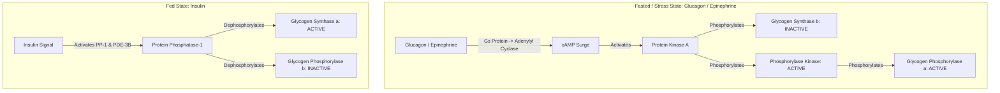
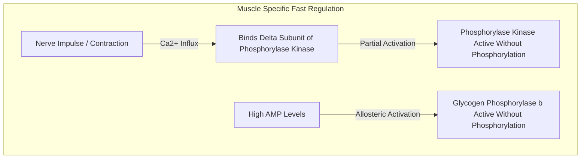

# 25. Hormonal and Allosteric Regulation of Glycogen Metabolism

## 1. Principles of Reciprocal Regulation

To prevent futile cycling (simultaneous glycogen synthesis and breakdown), **Glycogenesis** and **Glycogenolysis** are reciprocally regulated by covalent modification (phosphorylation/dephosphorylation) and allosteric effectors.

* **Key Rate-Limiting Enzymes:**
  * **Glycogenesis:** **Glycogen Synthase (GS)**.
  * **Glycogenolysis:** **Glycogen Phosphorylase (GP)**.

---

## 2. Covalent Regulation (Hormonal Control)

Phosphorylation acts as a molecular switch with **opposite effects** on Glycogen Synthase and Glycogen Phosphorylase.

### Rule of Thumb for Glycogen Enzymes
* **Dephosphorylated Enzymes** are produced by **Insulin** action $\rightarrow$ **Glycogenesis ON**, Glycogenolysis OFF.
* **Phosphorylated Enzymes** are produced by **Glucagon / Epinephrine** action $\rightarrow$ **Glycogenolysis ON**, Glycogenesis OFF.

### Detailed Signal Cascades
1. **Fasted / Exercise State (Glucagon in Liver; Epinephrine in Muscle/Liver):**
   * Hormone binds $G_s$-coupled receptor $\rightarrow$ Adenylyl Cyclase $\rightarrow$ **cAMP $\uparrow$** $\rightarrow$ **Protein Kinase A (PKA)** activation.
   * Active PKA:
     1. Phosphorylates **Glycogen Synthase $a$** (active) $\rightarrow$ converts it to **Glycogen Synthase $b$** (inactive).
     2. Phosphorylates **Phosphorylase Kinase** (activating it). Active Phosphorylase Kinase phosphorylates **Glycogen Phosphorylase $b$** (inactive) $\rightarrow$ converts it to **Glycogen Phosphorylase $a$** (active).
     3. Phosphorylates **Inhibitor-1**, which inhibits **Protein Phosphatase-1 (PP-1)**, maintaining the hyperphosphorylated active state of phosphorylase.
2. **Fed State (Insulin):**
   * Insulin binds RTK $\rightarrow$ Akt activation $\rightarrow$ activates **Protein Phosphatase-1 (PP-1)** and **Phosphodiesterase-3B** (lowers cAMP).
   * PP-1 dephosphorylates:
     1. **Glycogen Phosphorylase $a \rightarrow b$** (INACTIVATED).
     2. **Phosphorylase Kinase** (INACTIVATED).
     3. **Glycogen Synthase $b \rightarrow a$** (ACTIVATED).
   * Akt also phosphorylates and inactivates **Glycogen Synthase Kinase-3 (GSK-3)**, removing an inhibitory phosphorylation on Glycogen Synthase.

---

## 3. Allosteric Regulation

Allosteric mechanisms allow rapid, local regulation in response to cellular energy charge, independent of hormonal control.

### Tissue-Specific Allosteric Controls

| Organ | Enzyme | Allosteric Activator(s) | Allosteric Inhibitor(s) | Physiological Significance |
| :--- | :--- | :--- | :--- | :--- |
| **Liver** | **Glycogen Phosphorylase $a$** | None | **Free Glucose** | High blood glucose directly binds $GP_a$, shifting it to T-state, promoting PP-1 dephosphorylation to halt glucose release |
| **Liver** | **Glycogen Synthase $b$** | **Glucose-6-Phosphate** | None | High G6P overrides inhibitory phosphorylation on GS |
| **Muscle** | **Glycogen Phosphorylase $b$** | **AMP** | **ATP**, **Glucose-6-Phosphate** | High AMP during muscle contraction activates $GP_b$ **without** requiring phosphorylation |
| **Muscle** | **Phosphorylase Kinase** | **$Ca^{2+}$** (binds Calmodulin $\delta$-subunit) | None | Couples muscle contraction directly to glycogen degradation |

---

## 4. Summary Matrix of Glycogen Enzyme States

| Condition | Glycogen Synthase State | Glycogen Phosphorylase State | Net Pathway Active |
| :--- | :--- | :--- | :--- |
| **High Insulin (Fed)** | Dephosphorylated ($a$ form) — **ACTIVE** | Dephosphorylated ($b$ form) — **INACTIVE** | **Glycogenesis** |
| **High Glucagon / Epinephrine (Fasted/Stress)** | Phosphorylated ($b$ form) — **INACTIVE** | Phosphorylated ($a$ form) — **ACTIVE** | **Glycogenolysis** |
| **High Muscle AMP / $Ca^{2+}$ (Exercise)** | Inactive | Allosterically Activated ($b \rightarrow$ Active) | **Muscle Glycogenolysis** |

---

## 5. High-Yield Examination Summary

* **Glycogen Synthase** is ACTIVE when **dephosphorylated** ($a$ form).
* **Glycogen Phosphorylase** is ACTIVE when **phosphorylated** ($a$ form).
* **Glucagon** acts on the liver; **Epinephrine** acts on both muscle and liver. Glucagon receptors are **absent** on skeletal muscle.
* **AMP** is a potent allosteric activator of muscle Glycogen Phosphorylase $b$ during extreme exercise.
* **$Ca^{2+}$** binds the $\delta$-subunit (Calmodulin) of Phosphorylase Kinase, coupling muscle contraction directly to glycogen degradation.
* **Free Glucose** is a direct allosteric inhibitor of hepatic Glycogen Phosphorylase $a$.

---

## 6. Inter-Chapter Links
* 21 Hepatic Glucose Glycogenesis and Lipogenesis - Hepatic Glycogen Synthesis Steps
* 26 Glycogenolysis and Glycogen Storage Diseases - Glycogenolysis Enzymatic Steps and GSDs
* 27 Insulin Signal Transduction and Diabetes Mellitus - Akt and PP-1 Activation Mechanisms
