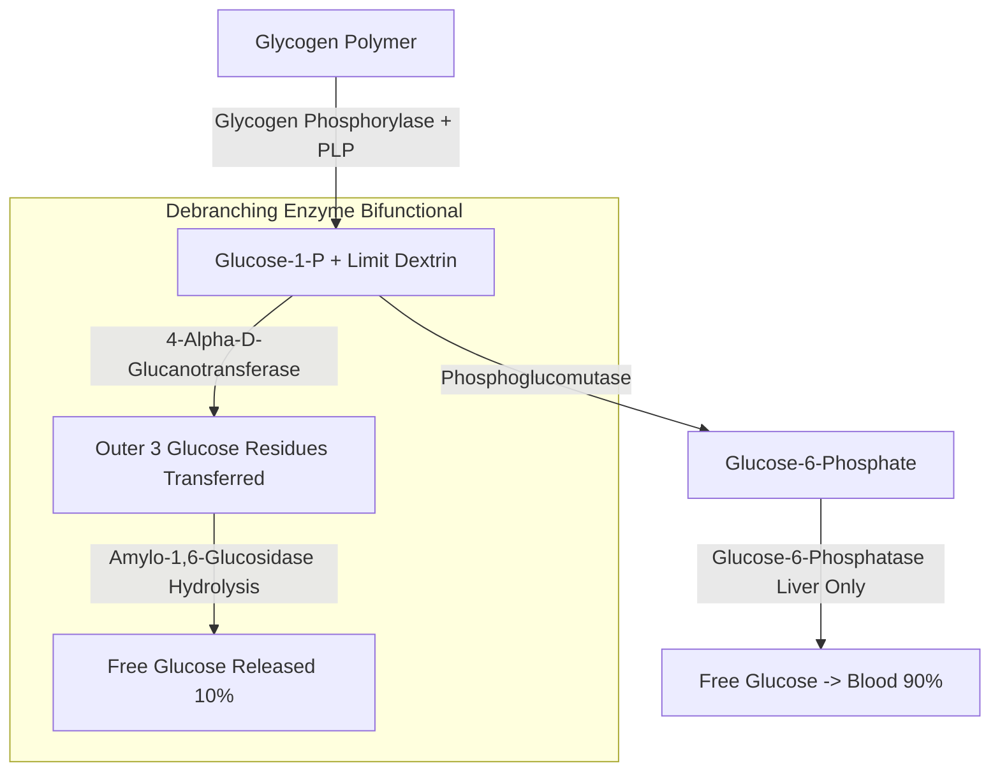
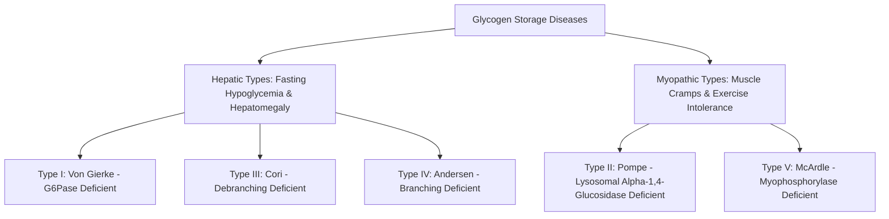

# 26. Glycogenolysis Pathway and Glycogen Storage Diseases (GSDs)

## 1. Enzymatic Steps of Glycogenolysis

Glycogenolysis is the enzymatic cleavage of stored glycogen to yield Glucose-1-Phosphate (G1P) and free glucose.

### Detailed Reactions
1. **Phosphorolytic Cleavage (Rate-Limiting Step):**
   $$\text{Glycogen}_{(n\text{ residues})} + \text{P}_i \xrightarrow[\text{PLP (Vit B6)}]{\text{Glycogen Phosphorylase}} \text{Glycogen}_{(n-1)} + \text{Glucose-1-P}$$
   * *Requirement:* Requires **Pyridoxal Phosphate (PLP / Vitamin B6)** as an essential cofactor.
   * Cleaves $\alpha(1\rightarrow 4)$ bonds sequentially until it reaches **4 glucose residues away** from an $\alpha(1\rightarrow 6)$ branch point. The resulting structure is termed a **Limit Dextrin**.
2. **Debranching Activity (Bifunctional Enzyme):**
   * **Transferase Activity** (*4-$\alpha$-D-Glucanotransferase*): Transfers the outer 3 glucose residues from the 4-residue limit dextrin branch to the non-reducing end of an adjacent main chain.
   * **Glucosidase Activity** (*Amylo-1,6-Glucosidase*): Hydrolytically cleaves the single remaining glucose residue attached via $\alpha(1\rightarrow 6)$ linkage, releasing **one molecule of free Glucose** (accounts for $\approx 10\%$ of glucose released from glycogen).
3. **Conversion to Glucose-6-Phosphate:**
   $$\text{Glucose-1-P} \xleftrightarrow{\text{Phosphoglucomutase}} \text{Glucose-6-P}$$
4. **Free Glucose Generation:**
   In liver (and kidney), **Glucose-6-Phosphatase** in the ER membrane hydrolyzes $\text{G6P} \rightarrow \text{Free Glucose} + \text{P}_i$.
   *Skeletal muscle lacks Glucose-6-Phosphatase*, so muscle glycogen cannot contribute directly to blood glucose regulation; muscle G6P enters glycolysis for local ATP generation.

---

## 2. Comprehensive Classification of Glycogen Storage Diseases (GSDs)

GSDs are autosomal recessive inherited metabolic disorders (except Type IX, which is X-linked) characterized by enzyme deficiencies in glycogen synthesis or breakdown.

### Detailed Summary Table of GSD Types I–VII

| Type & Name | Deficient Enzyme | Primary Organ(s) Affected | Major Clinical Manifestations | High-Yield Diagnostic / Biochemical Hallmarks |
| :--- | :--- | :--- | :--- | :--- |
| **Type I (Von Gierke Disease)** | **Ia:** Glucose-6-Phosphatase **Ib:** G6P Translocase | Liver, Kidney | • Severe **fasting hypoglycemia** • Massive **hepatomegaly** & nephromegaly • Doll-like facies, stunted growth • Type Ib includes **neutropenia** & recurrent infections | • **Hyperlacticacidemia** (lactic acidosis) • **Hyperuricemia** (gout) • **Hyperlipidemia** (hypertriglyceridemia) • NO muscle involvement |
| **Type II (Pompe Disease)** | **Lysosomal $\alpha$-1,4-glucosidase** (Acid Maltase) | Heart, Skeletal Muscle, Liver | • **Infantile Form:** Severe **hypertrophic cardiomyopathy**, massive cardiomegaly, profound hypotonia ("floppy infant"), macroglossia • Early death from cardiac failure | • **Normal blood glucose** (cytosolic glycogen degradation intact) • PAS-positive glycogen accumulation inside **lysosomes** |
| **Type III (Cori / Forbes Disease)** | **Debranching Enzyme** (*Amylo-1,6-glucosidase*) | Liver, Skeletal Muscle, Heart | • Fasting hypoglycemia (milder than Type I) • Hepatomegaly • Progressive **skeletal muscle weakness** and cardiomyopathy | • Accumulation of **limit dextrin** (short, branched outer chains) • **Normal blood lactate and uric acid** (distinguishes from Type I) |
| **Type IV (Andersen Disease)** | **Branching Enzyme** (*Amylo-1,4$\rightarrow$1,6-transglucosidase*) | Liver, Heart, Muscle | • Infantile progressive **liver cirrhosis** • Hepatosplenomegaly, failure to thrive • Death usually by age 2 | • Accumulation of abnormal glycogen with long unbranched outer chains (**polyglucosan bodies** / Amylopectin-like) |
| **Type V (McArdle Disease)** | **Skeletal Muscle Glycogen Phosphorylase** (Myophosphorylase) | Skeletal Muscle | • Exercise intolerance, muscle cramps • **"Second-Wind Phenomenon"** (improvement after 10 min exercise due to blood-borne fuel delivery) • Post-exertional **myoglobinuria** (burgundy urine) $\rightarrow$ risk of AKI | • **Flat lactate curve** on ischemic forearm exercise test with normal ammonia spike • Normal hepatic glycogen breakdown & normal blood glucose |
| **Type VI (Hers Disease)** | **Hepatic Glycogen Phosphorylase** | Liver | • Mild fasting hypoglycemia, hepatomegaly • Benign clinical course | • Normal muscle phosphorylase; no hyperuricemia or severe lactic acidosis |
| **Type VII (Tarui Disease)** | **Muscle & RBC Phosphofructokinase-1 (PFK-1)** | Skeletal Muscle, Erythrocytes | • Mimics McArdle disease (cramps, exercise intolerance) • Plus **hemolytic anemia** (due to RBC PFK-1 defect) | • Flat lactate curve on ischemic exercise test; elevated bilirubin/reticulocytes |

---

## 3. High-Yield Examination Summary

* **Glycogen Phosphorylase** requires **Pyridoxal Phosphate (PLP / Vitamin B6)** as a coenzyme.
* **Von Gierke Disease (GSD I)** presents with severe hypoglycemia, massive hepatomegaly, **hyperlacticacidemia, hyperuricemia, and hyperlipidemia**, but **no muscle involvement**.
* **Pompe Disease (GSD II)** is a lysosomal storage disorder causing **severe hypertrophic cardiomyopathy** with normal blood glucose levels.
* **Cori Disease (GSD III)** accumulates **limit dextrin**; blood lactate levels are normal.
* **Andersen Disease (GSD IV)** accumulates **polyglucosan bodies** (amylopectin-like) causing early juvenile cirrhosis.
* **McArdle Disease (GSD V)** is characterized by **muscle cramps, myoglobinuria, second-wind phenomenon**, and a **flat venous lactate curve** during exercise.

---

## 4. Inter-Chapter Links
* 23 Glucose Homeostasis - Role of Hepatic Glycogen in Fasting
* 25 Regulation of Glycogen Metabolism - Hormonal Control of Glycogen Phosphorylase
* 27 Insulin Signal Transduction and Diabetes Mellitus - Insulin Regulation of Debranching and Phosphorylase Enzymes
