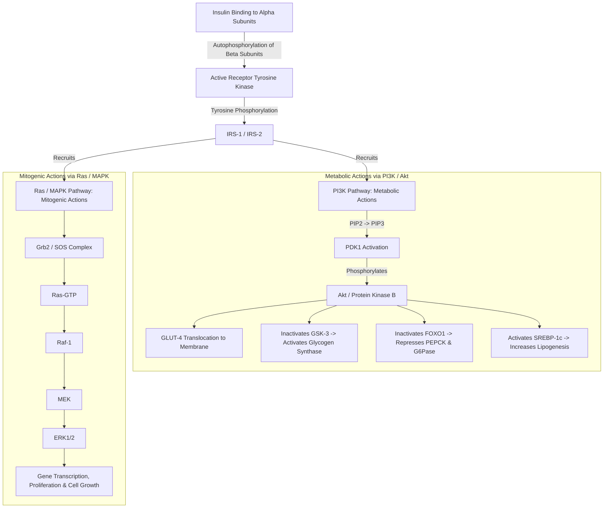
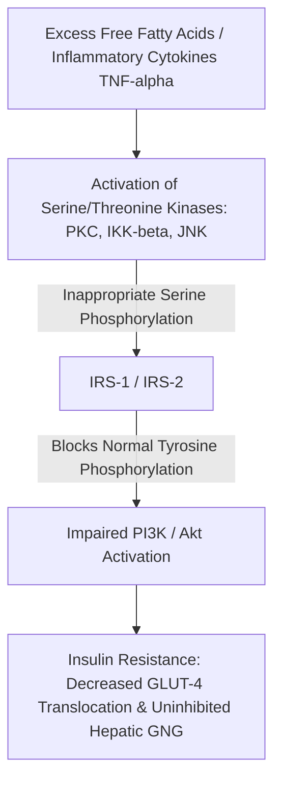

# 27. Insulin Signal Transduction and Molecular Mechanisms of Insulin Resistance

## 1. Architecture of the Insulin Receptor

The insulin receptor is a pre-formed heterotetrameric complex consisting of **two $\alpha$ subunits** and **two $\beta$ subunits** ($\alpha_2\beta_2$) linked by disulfide bonds.

* **$\alpha$-Subunits:** Located entirely extracellularly; contain the high-affinity insulin-binding domain.
* **$\beta$-Subunits:** Transmembrane proteins containing an extracellular region, a single transmembrane domain, and a cytosolic domain with intrinsic **Receptor Tyrosine Kinase (RTK)** activity.

---

## 2. The Insulin Signal Transduction Cascade

Insulin binding triggers two major parallel intracellular signaling pathways: the **PI3K/Akt pathway** (mediating metabolic actions) and the **Ras/MAPK pathway** (mediating growth and mitogenic actions).

### A. The Metabolic Pathway (PI3K / Akt)
1. **Insulin Binding & Autophosphorylation:** Insulin binds $\alpha$-subunits $\rightarrow$ conformational change $\rightarrow$ trans-autophosphorylation of specific **Tyrosine residues** on the cytosolic $\beta$-subunit domains.
2. **IRS Docking:** Phosphorylated $\beta$-subunits recruit and phosphorylate **Insulin Receptor Substrate (IRS-1, IRS-2)** on specific tyrosine residues.
3. **PI3K Activation:** Phosphotyrosines on IRS-1 bind the SH2 domain of **Phosphoinositide 3-Kinase (PI3K)**. Active PI3K phosphorylates membrane $\text{PIP}_2 \rightarrow \mathbf{\text{PIP}_3}$ ($\text{Phosphatidylinositol-3,4,5-trisphosphate}$).
4. **Akt Activation:** $\text{PIP}_3$ recruits **PDK1** and **Akt (Protein Kinase B)** to the plasma membrane. PDK1 phosphorylates and activates **Akt**.
   * *Negative Regulator:* **PTEN** (Phosphatase and Tensin homolog) dephosphorylates $\text{PIP}_3 \rightarrow \text{PIP}_2$, turning off Akt signaling.
5. **Downstream Metabolic Effects of Active Akt:**
   * **GLUT-4 Translocation:** Promotes fusion of GLUT-4 storage vesicles with the plasma membrane in skeletal muscle and adipose tissue $\rightarrow$ accelerates glucose uptake.
   * **Glycogen Synthesis:** Phosphorylates and inactivates **Glycogen Synthase Kinase-3 (GSK-3)**. Inactivation of GSK-3 removes inhibitory phosphorylation from **Glycogen Synthase**, activating it.
   * **Inhibition of Gluconeogenesis:** Phosphorylates **FOXO1** transcription factor, causing its nuclear exclusion and degradation, thereby repressing gene expression of **PEPCK** and **Glucose-6-Phosphatase**.
   * **Lipogenesis:** Activates **SREBP-1c**, upregulating fatty acid synthesis enzymes (ACC, FAS).

### B. The Mitogenic Pathway (Ras / MAPK)
* Phosphorylated IRS-1 recruits **Grb2 / SOS** complex $\rightarrow$ activates **Ras** (a small monomeric $G$-protein) $\rightarrow$ **Raf-1** $\rightarrow$ **MEK** $\rightarrow$ **ERK1/2 (MAPK)**.
* Active ERK translocates to the nucleus to regulate gene transcription for cell survival, growth, and protein synthesis.

---

## 3. Molecular Mechanisms of Insulin Resistance

Insulin resistance is defined as a subnormal biological response of target tissues (liver, muscle, adipose) to circulating insulin levels.

### Key Pathomechanisms
1. **Inappropriate Serine/Threonine Phosphorylation of IRS-1:**
   * Elevated circulating **Free Fatty Acids (FFAs)**, intracellular Diacylglycerol (DAG), and inflammatory cytokines ($\text{TNF}-\alpha, \text{IL-6}$) activate intracellular stress kinases: **Protein Kinase C (PKC)**, **IKK-$\beta$**, and **JNK**.
   * These kinases phosphorylate **Serine/Threonine residues** on IRS-1 (e.g., $Ser-307$), preventing normal tyrosine phosphorylation by the insulin receptor and disrupting downstream PI3K/Akt signaling.
2. **Upregulation of Protein Tyrosine Phosphatases:** **PTP1B** dephosphorylates and inactivates the insulin receptor and IRS-1.
3. **SOCS Proteins:** **SOCS-3** (Suppressor of Cytokine Signaling) targets IRS-1 for proteasomal degradation.

---

## 4. High-Yield Examination Summary

* The insulin receptor is a heterotetramer ($\alpha_2\beta_2$) with intrinsic **Receptor Tyrosine Kinase** activity on its $\beta$-subunits.
* **PI3K / Akt pathway** mediates the metabolic actions of insulin (GLUT-4 translocation, glycogen synthesis, lipogenesis).
* **Ras / MAPK pathway** mediates the mitogenic and cell growth actions of insulin.
* **Akt** inactivates **GSK-3** (activating Glycogen Synthase) and excludes **FOXO1** from the nucleus (repressing PEPCK & G6Pase).
* **PTEN** is a crucial negative regulator that converts $\text{PIP}_3 \rightarrow \text{PIP}_2$.
* **Insulin Resistance** is primarily driven by **Serine/Threonine phosphorylation** of IRS-1 induced by FFAs, DAG, and inflammatory cytokines.

---

## 5. Inter-Chapter Links
* 20 Carbohydrate Absorption and Galactose Metabolism - GLUT Transporter Profiles
* 21 Hepatic Glucose Glycogenesis and Lipogenesis - De Novo Lipogenesis Control
* 25 Regulation of Glycogen Metabolism - Covalent Regulation of Glycogen Synthase
* 28 Diabetes Mellitus - Clinical Pathophysiology of Type 2 Diabetes
