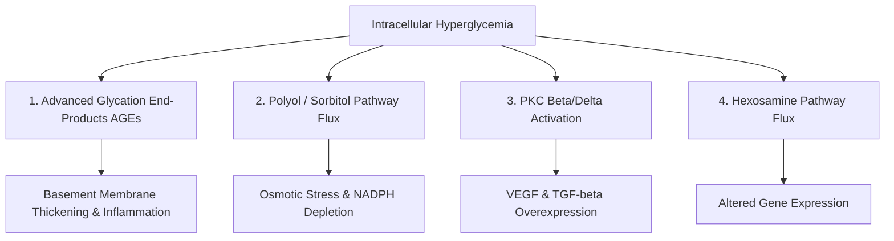

# 28. Diabetes Mellitus: Etiology, Pathophysiology, Diagnosis, and Complications

## 1. Classification and Etiology

Diabetes Mellitus (DM) is a metabolic disorder characterized by chronic hyperglycemia resulting from defects in insulin secretion, insulin action, or both.

### A. Major Types
1. **Type 1 Diabetes Mellitus (T1DM):**
   * Autoimmune destruction of pancreatic $\beta$-cells ($> 80-90\%$ destruction prior to clinical onset).
   * Associated with **HLA-DR3** and **HLA-DR4**.
   * Circulating Autoantibodies: Anti-Glutamic Acid Decarboxylase (**anti-GAD65**), Anti-Islet Antigen 2 (**anti-IA2**), Anti-Insulin (**IAA**), and Anti-Zinc Transporter 8 (**anti-ZnT8**).
   * Absolute insulin deficiency; prone to **Diabetic Ketoacidosis (DKA)**.
2. **Type 2 Diabetes Mellitus (T2DM):**
   * Progressive combination of **peripheral insulin resistance** and inadequate compensatory insulin secretion by $\beta$-cells.
   * Strong genetic component; strongly linked to central obesity and metabolic syndrome.
3. **Gestational Diabetes Mellitus (GDM):** Diabetes diagnosed in the 2nd or 3rd trimester of pregnancy.
4. **Monogenic / Specific Types:**
   * **MODY (Maturity-Onset Diabetes of the Young):** Autosomal dominant inheritance, onset $< 25\text{ years}$.
     * *MODY-2:* Mutation in **Glucokinase (GCK)** gene (mild, stable fasting hyperglycemia).
     * *MODY-3:* Mutation in **HNF-1$\alpha$** gene (most common severe form).
   * **Neonatal Diabetes:** Mutations in **KCNJ11** or **ABCC8** ($K_{ATP}$ channel gain-of-function; treated with sulfonylureas).

---

## 2. Diagnostic Criteria (ADA Guidelines)

Diagnosis requires meeting **any one** of the following criteria. In the absence of unequivocal hyperglycemia (for example, classic symptoms or hyperglycemic crisis with a diagnostic random plasma glucose), confirm with **two abnormal results**: the same test on separate occasions or two different tests, which may be obtained at the same time.

| Parameter | Normal Range | Prediabetes Range | Diabetes Mellitus Diagnosis |
| :--- | :--- | :--- | :--- |
| **Fasting Plasma Glucose (FPG)** | $70-99\text{ mg/dL}$ | $100-125\text{ mg/dL}$ (IFG) | **$\ge 126\text{ mg/dL}$** ($7.0\text{ mmol/L}$) |
| **2-Hour OGTT** ($75\text{g}$ glucose load) | $< 140\text{ mg/dL}$ | $140-199\text{ mg/dL}$ (IGT) | **$\ge 200\text{ mg/dL}$** ($11.1\text{ mmol/L}$) |
| **HbA1c** (Glycated Hemoglobin) | $< 5.7\%$ | $5.7-6.4\%$ | **$\ge 6.5\%$** ($48\text{ mmol/mol}$) |
| **Random Plasma Glucose** | N/A | N/A | **$\ge 200\text{ mg/dL}$** with classic symptoms of hyperglycemia or hyperglycemic crisis |

---

## 3. Acute Metabolic Complications: DKA vs. HHS

**Updated diagnostic criteria (adult consensus / ADA 2026):** DKA requires all three components: (1) glucose $\ge 200\text{ mg/dL}$ **or a prior history of diabetes**, (2) ketosis with blood $\beta$-hydroxybutyrate $\ge 3.0\text{ mmol/L}$ or urine ketones $\ge 2+$, and (3) acidosis with pH $<7.30$ and/or bicarbonate $<18\text{ mmol/L}$. Approximately 10% of DKA presentations are euglycaemic (glucose $<200\text{ mg/dL}$), especially with SGLT2 inhibitors, pregnancy, low intake, alcohol use, or liver failure.

HHS requires glucose $\ge 600\text{ mg/dL}$, hyperosmolality (effective $>300$ or total $>320\text{ mOsm/kg}$), absence of significant ketonaemia, and no substantial acidosis (pH $\ge7.30$ and bicarbonate $\ge15\text{ mmol/L}$). DKA/HHS overlap is recognised; these criteria are diagnostic framework points, not a substitute for emergency management protocols.

```mermaid
graph TD
    A[Absolute Insulin Lack e.g., T1DM] --> B[Uninhibited Lipolysis -> High Free Fatty Acids]
    B --> C[Hepatic Beta-Oxidation -> Excess Acetyl-CoA]
    C --> D[Ketogenesis: Acetoacetate & Beta-Hydroxybutyrate]
    D --> E[Diabetic Ketoacidosis DKA: High Anion Gap Metabolic Acidosis]
    
    F[Relative Insulin Deficiency e.g., T2DM] --> G[Sufficient Insulin to Block Lipolysis but Not Hyperglycemia]
    G --> H[Profound Hyperglycemia >= 600 mg/dL & Severe Osmotic Diuresis]
    H --> I[Hyperosmolar Hyperglycemic State HHS: Hyperosmolality (effective >300 or total >320 mOsm/kg)]
```

### Detailed Comparison Table

| Parameter | Diabetic Ketoacidosis (DKA) | Hyperosmolar Hyperglycemic State (HHS) |
| :--- | :--- | :--- |
| **Typical Patient Profile** | Type 1 DM (younger, lean) | Type 2 DM (elderly, nursing home residents) |
| **Insulin Deficiency** | **Absolute** | **Relative** (enough to suppress ketogenesis) |
| **Plasma Glucose Level** | Often high, but may be below 200 mg/dL in euglycemic DKA; diagnostic criterion is $\ge 200\text{ mg/dL}$ or known diabetes | **$\ge 600\text{ mg/dL}$** |
| **Arterial/venous $pH$** | **$< 7.30$** (severity is graded; severe DKA often has pH $<7.00$) | **$\ge 7.30$** |
| **Serum Bicarbonate** | **$< 18\text{ mmol/L}$** (severe DKA often $<10$) | **$\ge 15\text{ mmol/L}$** |
| **Serum Anion Gap** | **High Anion Gap** ($> 12\text{ mEq/L}$) | Normal or mildly elevated |
| **Serum / Urine Ketones** | Significant ketosis: blood $\beta$-hydroxybutyrate **$\ge 3.0\text{ mmol/L}$** or urine ketones $\ge 2+$ | No significant ketonemia: $\beta$-hydroxybutyrate $<3.0\text{ mmol/L}$ or urine ketones $<2+$ |
| **Effective / total serum osmolality** | Variable; overlap with HHS can occur | Effective osmolality **$>300\text{ mOsm/kg}$** or total osmolality **$>320\text{ mOsm/kg}$** |
| **Clinical Presentation** | Kussmaul respirations, fruity breath, abdominal pain, vomiting | Severe dehydration, altered sensorium, lethargy, focal neurological deficits |

---

## 4. Biochemical Mechanisms of Chronic Diabetic Microvascular Complications

Hyperglycemia induces tissue damage in non-insulin-dependent tissues (endothelium, glomeruli, nerves) via four main pathways:



### Pathomechanism Details
1. **Advanced Glycation End-Products (AGEs):** Non-enzymatic glycation of tissue proteins (Maillard reaction) $\rightarrow$ cross-links vascular collagen, thickens basement membranes, and activates **RAGE** receptors $\rightarrow \text{NF-}\kappa\text{B}$ inflammatory response.
2. **Polyol (Sorbitol) Pathway Flux:** Sorbitol accumulation causes osmotic cell swelling and depletes cellular **NADPH**, compromising reduced glutathione (GSH) antioxidant defenses.
3. **Protein Kinase C (PKC) Activation:** Increased diacylglycerol (DAG) activates PKC-$\beta/\delta \rightarrow$ increases **VEGF** (driving proliferative retinopathy), **TGF-$\beta$** (driving mesangial matrix deposition), and **Endothelin-1**.
4. **Hexosamine Pathway Flux:** Excess fructose-6-phosphate converted to UDP-$N$-acetylglucosamine $\rightarrow$ aberrant $O$-GlcNAcylation of transcription factors.

---

## 5. Chronic Microvascular and Macrovascular Complications

* **Diabetic Retinopathy:**
  * *Non-proliferative:* Microaneurysms, hard exudates, cotton-wool spots (retinal ischemia).
  * *Proliferative:* Neovascularization induced by elevated VEGF $\rightarrow$ vitreous hemorrhage and tractional retinal detachment.
* **Diabetic Nephropathy:**
  * Use **urine albumin-to-creatinine ratio (UACR)** and eGFR for screening: begin at diagnosis in type 2 diabetes and after 5 years in type 1 diabetes; if CKD is present, monitor at least annually and more often according to CKD stage/risk. Moderately increased albuminuria (A2) is UACR $30$ to $<300\text{ mg/g}$; albumin excretion rate is approximately $30$–$300\text{ mg/24 h}$. Confirm persistence with at least **2 abnormal samples out of 3 over 3–6 months**, after excluding transient causes.
  * Pathognomonic Histopathological Lesion: **Kimmelstiel-Wilson nodules** (nodular glomerulosclerosis) and diffuse mesangial matrix expansion.
  * **Management is risk- and phenotype-dependent:** in people with diabetes, hypertension and albuminuria, an ACE inhibitor or ARB is recommended; SGLT2 inhibitors are recommended for many patients with type 2 diabetes and CKD when eGFR criteria are met, and for appropriate heart-failure indications. These are not interchangeable universal first-line drugs for every person with diabetes; see current ADA/KDIGO guidance.
* **Diabetic Neuropathy:** Distal symmetric sensorimotor polyneuropathy ("glove and stocking" distribution) and autonomic neuropathy (gastroparesis, neurogenic bladder, orthostatic hypotension).

---

## 6. High-Yield Examination Summary

* **HbA1c $\ge 6.5\%$** or **FPG $\ge 126\text{ mg/dL}$** diagnoses Diabetes Mellitus.
* **GAD65, IA-2, insulin, and ZnT8 autoantibodies** support autoimmune diabetes classification; the sensitivity of individual antibodies varies with age, disease duration, and assay, so anti-GAD65 should not be presented as universally the single most sensitive marker in every population.
* **DKA** presents with hyperglycemia, high anion gap metabolic acidosis, and $\beta$-hydroxybutyrate accumulation; **HHS** presents with glucose $\ge 600\text{ mg/dL}$, effective osmolality $>300$ or total osmolality $>320\text{ mOsm/kg}$, with no significant ketonaemia or acidosis.
* **Kimmelstiel-Wilson lesions** (nodular glomerulosclerosis) are pathognomonic for diabetic nephropathy.
* **UACR 30 to <300 mg/g** is moderately increased albuminuria (A2); it is a risk marker rather than an inevitable or uniquely earliest manifestation of diabetic kidney disease.

---

## 7. Inter-Chapter Links
* 22 Fructose Metabolism - Sorbitol Pathway in Microvascular Complications
* 24 Glucose Stimulated Insulin Secretion - Pancreatic $\beta$-Cell Function
* 27 Insulin Signal Transduction and Diabetes Mellitus - Insulin Resistance Mechanisms

## Selected References for Clinical Updates

- [American Diabetes Association. Standards of Care in Diabetes—2026: Diagnosis and Classification.](https://diabetesjournals.org/care/article/49/Supplement_1/S27/163926)
- [American Diabetes Association. Standards of Care in Diabetes—2026: Diabetes Care in the Hospital (DKA/HHS criteria).](https://diabetesjournals.org/care/article/49/Supplement_1/S339/163925/16-Diabetes-Care-in-the-Hospital-Standards-of-Care)
- [American Diabetes Association. Standards of Care in Diabetes—2026: Chronic Kidney Disease and Risk Management.](https://doi.org/10.2337/dc26-s011)
- [KDIGO 2024 Clinical Practice Guideline for the Evaluation and Management of CKD.](https://doi.org/10.1016/j.kint.2023.10.016)
