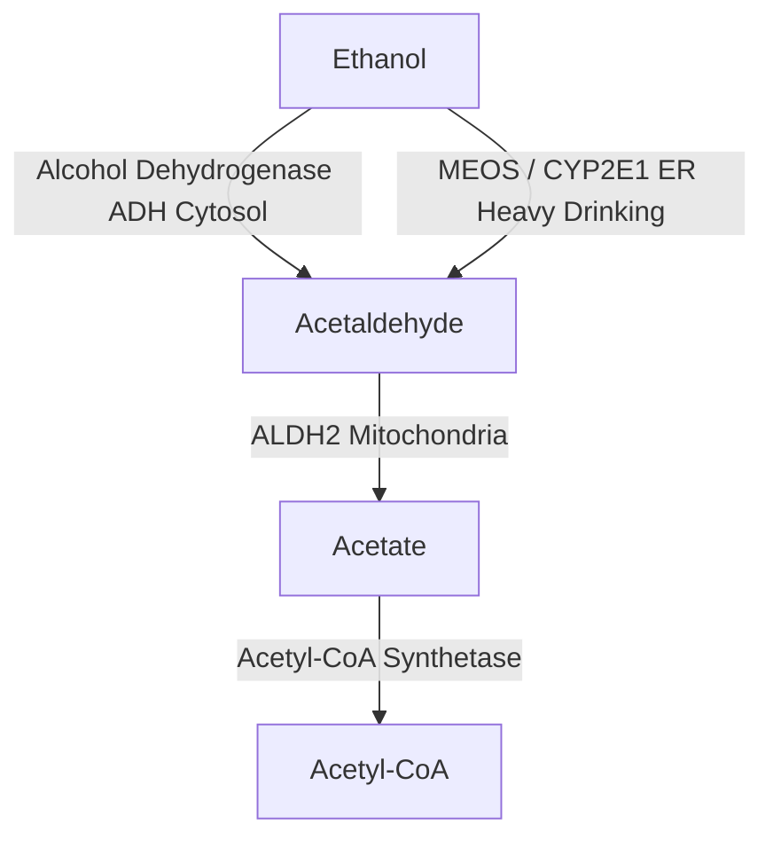
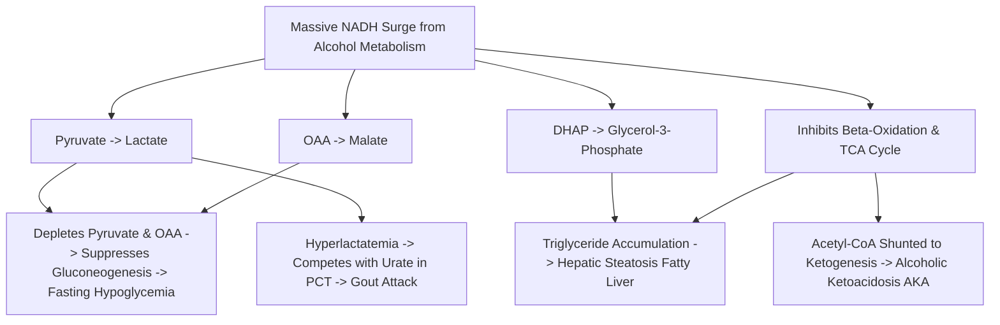

# 29. Ethanol Metabolism and Its Metabolic Consequences

## 1. Pathways of Ethanol Oxidation

Ethanol ($CH_3CH_2OH$) is metabolized primarily in the liver by two distinct sequential oxidation steps to yield Acetate.

### A. Step 1: Oxidation of Ethanol to Acetaldehyde
1. **Alcohol Dehydrogenase (ADH):**
   * *Location:* Cytosol of hepatocytes.
   * *Properties:* Low $K_m$ ($\approx 0.05\text{ g/dL}$ / $1-2\text{ mM}$); saturated at low alcohol concentrations (exhibits **zero-order kinetics**).
   * *Reaction:*
     $$\text{Ethanol} + \text{NAD}^+ \xrightarrow{\text{ADH}} \text{Acetaldehyde} + \mathbf{\text{NADH}} + \text{H}^+$$
2. **Microsomal Ethanol Oxidizing System (MEOS / CYP2E1):**
   * *Location:* Endoplasmic Reticulum (microsomes).
   * *Properties:* High $K_m$ ($\approx 10\text{ mM}$); induced in chronic heavy alcohol consumption. Generates **Reactive Oxygen Species (ROS)**.
   * *Reaction:*
     $$\text{Ethanol} + \text{NADPH} + \text{H}^+ + \text{O}_2 \xrightarrow{\text{CYP2E1}} \text{Acetaldehyde} + \text{NADP}^+ + 2\text{ H}_2\text{O}$$

### B. Step 2: Oxidation of Acetaldehyde to Acetate
* **Acetaldehyde Dehydrogenase-2 (ALDH2):**
  * *Location:* Mitochondrial matrix.
  * *Reaction:*
    $$\text{Acetaldehyde} + \text{NAD}^+ + \text{H}_2\text{O} \xrightarrow{\text{ALDH2}} \text{Acetate} + \mathbf{\text{NADH}} + \text{H}^+$$
* **ALDH2*2 Polymorphism (Asian Flush Syndrome):**
  * Point mutation ($Glu504Lys$) common in East Asian populations inactivates ALDH2.
  * Toxic **Acetaldehyde** accumulates rapidly $\rightarrow$ facial flushing, severe tachycardia, nausea, headache, and hypotension.
  * **Disulfiram (Antabuse)** competitively inhibits ALDH2, producing the same toxic acetaldehyde accumulation to deter alcohol use.

---

## 2. Metabolic Consequences of High Cytosolic $NADH / NAD^+$ Ratio

The simultaneous activity of ADH and ALDH2 generates massive amounts of **NADH**, resulting in a high cytosolic and mitochondrial **$NADH / NAD^+$ ratio**. This high ratio alters reversible redox reactions, causing severe metabolic derangements.

### Summary Matrix of Metabolic Consequences

| Metabolic Deviation | Biochemical Mechanism Driven by High $NADH / NAD^+$ Ratio | Clinical Manifestation |
| :--- | :--- | :--- |
| **Fasting Hypoglycemia** | $NADH$ shifts $\text{Pyruvate} \rightarrow \text{Lactate}$ and $\text{OAA} \rightarrow \text{Malate}$. Depletion of Pyruvate and OAA halts **Gluconeogenesis**. | Severe hypoglycemia in fasted/malnourished drinkers |
| **Lactic Acidosis** | Excess $NADH$ forces pyruvate conversion to **Lactate** via Lactate Dehydrogenase ($LDH$). | High Anion Gap Metabolic Acidosis |
| **Hyperuricemia & Gout** | High circulating lactate competitively inhibits uric acid excretion at the PCT anion exchanger. | Precipitates **acute gouty arthritis** ("binge-drinking gout") |
| **Hepatic Steatosis (Fatty Liver)** | 1. High $NADH$ inhibits TCA cycle enzymes ($\alpha$-KGDH, Isocitrate DH). 2. High $NADH$ inhibits $\beta$-oxidation. 3. High $NADH$ converts $\text{DHAP} \rightarrow \text{Glycerol-3-P}$, which condenses with fatty acids to form **Triglycerides**. | Fatty Liver (Alcoholic Steatosis) |
| **Alcoholic Ketoacidosis (AKA)** | Blocked TCA cycle causes excess Acetyl-CoA to shuttle into **Ketogenesis**. High $NADH$ favors **$\beta$-hydroxybutyrate** over acetoacetate. | Ketoacidosis; nitroprusside urine dipstick may be falsely negative |

---

## 3. Stages of Alcoholic Liver Disease (ALD)

1. **Alcoholic Hepatic Steatosis (Fatty Liver):** Reversible accumulation of micro- and macrovesicular lipid droplets inside hepatocytes.
2. **Alcoholic Hepatitis:** Hepatocyte ballooning degeneration, **Mallory-Denk hyaline bodies** (cytokeratin intermediate filaments), and neutrophilic infiltration.
3. **Alcoholic Cirrhosis:** Irreversible bridging fibrosis and regenerative nodules (**micronodular cirrhosis**).

---

## 4. High-Yield Examination Summary

* **Alcohol Dehydrogenase (ADH)** operates via zero-order kinetics in the cytosol ($NAD^+$ dependent).
* **MEOS (CYP2E1)** is induced in chronic alcoholism and produces ROS.
* **Disulfiram** inhibits mitochondrial **ALDH2**, leading to toxic accumulation of **Acetaldehyde**.
* The core cause of alcohol-induced metabolic derangements is a **massive surge in the $NADH / NAD^+$ ratio**.
* **Hypoglycemia** occurs because elevated $NADH$ drains Pyruvate and OAA into Lactate and Malate, blocking gluconeogenesis.
* **Hyperuricemia** occurs because high lactate competes with urate excretion in renal tubules.
* **$\beta$-hydroxybutyrate** is the predominant ketone body in Alcoholic Ketoacidosis due to high $NADH$.

---

## 5. Inter-Chapter Links
* 09 Oxidation Reduction Coenzymes and Prosthetic Groups - $NAD^+/NADH$ Redox Mechanics
* 17 Anaerobic Glycolysis and Lactate Formation - Lactate Dehydrogenase Kinetics
* 21 Hepatic Glucose Glycogenesis and Lipogenesis - Fatty Acid Esterification to Triglycerides
* 23 Glucose Homeostasis - Substrates for Gluconeogenesis
