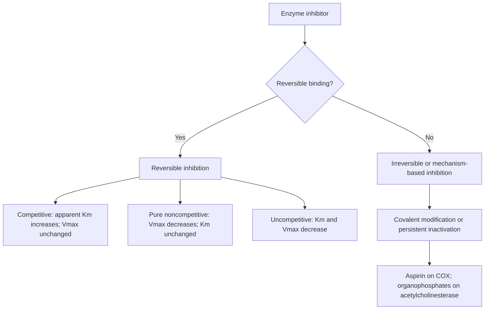

# 30. Enzymes: Nomenclature, Kinetics and Inhibitors

## 1. Enzyme Nomenclature and IUBMB Classification

Enzymes are biological catalysts that accelerate chemical reactions by lowering the **activation energy ($E_a$)** without altering the overall free energy change ($\Delta G$) or equilibrium constant ($K_{eq}$) of the reaction.

### IUBMB Enzyme Commission (EC) Classification
The International Union of Biochemistry and Molecular Biology (IUBMB) categorizes enzymes into **7 major classes** based on the type of reaction catalyzed:

| EC Class | Class Name | Mechanism / Reaction Catalyzed | Key Examples & Clinical Significance |
| :--- | :--- | :--- | :--- |
| **EC 1** | **Oxidoreductases** | Catalyze oxidation-reduction reactions (electron/hydrogen transfer). | *Lactate Dehydrogenase (LDH)*, *Alcohol Dehydrogenase*, *Cytochrome P450*. |
| **EC 2** | **Transferases** | Transfer functional groups (e.g., phosphate, amino, methyl) between donor and acceptor molecules. | *Hexokinase*, *Aminotransferases (ALT, AST)*, *Protein Kinase A*. |
| **EC 3** | **Hydrolases** | Catalyze hydrolytic cleavage of bonds (C-O, C-N, C-C) by adding water ($H_2O$). | *Lipoprotein Lipase (LPL)*, *Trypsin*, *Glucose-6-Phosphatase*, *Lactase*. |
| **EC 4** | **Lyases** | Cleave C-C, C-O, or C-N bonds by elimination, leaving double bonds, or adding groups across double bonds without hydrolysis. | *Aldolase B*, *Fumarase*, *Pyruvate Decarboxylase*, *Histidine Decarboxylase*. |
| **EC 5** | **Isomerases** | Catalyze geometric, structural, or optical rearrangements within a single molecule. | *Triose Phosphate Isomerase*, *Phosphoglycerate Mutase*, *Methylmalonyl-CoA Mutase*. |
| **EC 6** | **Ligases** | Join two molecules coupled with the hydrolysis of high-energy phosphate bonds (ATP). | *Pyruvate Carboxylase*, *Acetyl-CoA Carboxylase*, *DNA Ligase*. |
| **EC 7** | **Translocases** | Catalyze the movement of ions or molecules across membranes or their separation within membranes. | *$Na^+/K^+$-ATPase*, *Carnitine-Acylcarnitine Translocase*, *ABC Transporters*. |

---

## 2. Enzyme Kinetics and the Michaelis–Menten Model

### The Michaelis–Menten Model
For a single-substrate enzymatic reaction:

```
        E + S <===> ES ---> E + P
```

The reaction velocity ($v$) as a function of substrate concentration ($[S]$) follows hyperbolic kinetics defined by the **Michaelis–Menten equation**:

$$v = \frac{V_{max} [S]}{K_m + [S]}$$

```
   Velocity (v) ^
                |                    ------------------- Vmax
                |                  /
        1/2 Vmax|................/|
                |               / |
                |              /  |
                |             /   |
                +------------+----+-----------------------> Substrate [S]
                             Km
```

### Key Kinetic Parameters
1. **$V_{max}$ (Maximum Velocity):**
   * The theoretical maximal rate reached when all enzyme active sites are completely saturated with substrate ($[S] \gg K_m$).
   * Proportional to total enzyme concentration: $V_{max} = k_{cat} [E]_T$.
2. **$K_m$ (Michaelis Constant):**
   * The substrate concentration at which the reaction velocity is exactly **half of $V_{max}$** ($v = \frac{1}{2} V_{max}$).
   * Expressed in units of concentration (e.g., $\text{mmol/L}$ or $\mu\text{mol/L}$).
   * **Interpretation:** In the simple Michaelis–Menten mechanism, a lower $K_m$ can correlate with greater apparent substrate affinity. However, $K_m=(k_{-1}+k_{cat})/k_1$ for the simplest mechanism; it is not generally an equilibrium dissociation constant and should not automatically be equated with binding affinity.
3. **$k_{cat}$ (Turnover Number) and Catalytic Efficiency:**
   * $k_{cat} = \frac{V_{max}}{[E]_T}$ (number of substrate molecules converted to product per enzyme active site per unit time, $\text{s}^{-1}$).
   * **Catalytic Efficiency Ratio ($k_{cat} / K_m$):** Reflects both binding affinity and catalytic rate. The upper physical limit is dictated by diffusion speed ($\approx 10^8 - 10^9 \text{ M}^{-1}\text{s}^{-1}$).

---

## 3. Lineweaver–Burk and Double-Reciprocal Plots

Taking the reciprocal of the Michaelis–Menten equation yields the linear **Lineweaver–Burk equation**:

$$\frac{1}{v} = \left( \frac{K_m}{V_{max}} \right) \frac{1}{[S]} + \frac{1}{V_{max}}$$

In a plot of $\frac{1}{v}$ (Y-axis) versus $\frac{1}{[S]}$ (X-axis):
* **Y-intercept:** $\frac{1}{V_{max}}$
* **X-intercept:** $-\frac{1}{K_m}$
* **Slope:** $\frac{K_m}{V_{max}}$

---

## 4. Reversible and Irreversible Enzyme Inhibition

Enzyme inhibitors are substances that decrease the rate of enzyme-catalyzed reactions.



### Comparison of Reversible Inhibition Types

| Feature | Competitive Inhibition | Noncompetitive Inhibition | Uncompetitive Inhibition |
| :--- | :--- | :--- | :--- |
| **Binding Site** | Binds exclusively to the **free enzyme ($E$) active site**; competes with substrate. | Binds to an **allosteric site** on both free enzyme ($E$) and $ES$ complex with equal affinity. | Binds **only to the enzyme-substrate ($ES$) complex** at an allosteric site created upon $S$ binding. |
| **Apparent $K_m$** | **Increased** ($\uparrow$) (requires higher $[S]$ to achieve $\frac{1}{2}V_{max}$). | **Unchanged** (affinity for substrate remains unaltered). | **Decreased** ($\downarrow$) (apparent affinity increases due to Le Chatelier shift). |
| **Apparent $V_{max}$** | **Unchanged** (can be fully overcome by increasing $[S]$). | **Decreased** ($\downarrow$) (cannot be overcome by adding substrate). | **Decreased** ($\downarrow$) ($V_{max}$ reduced proportionally with $K_m$). |
| **Lineweaver-Burk Plot** | Lines intersect on the **Y-axis** ($1/V_{max}$ identical; X-intercept moves closer to origin). | Lines intersect on the **X-axis** ($-1/K_m$ identical; Y-intercept increases). | Lines are **parallel** (slope $K_m/V_{max}$ remains constant). |
| **Classic Clinical Examples** | • **Statins** (HMG-CoA reductase)<br>• **Methotrexate** (Dihydrofolate reductase)<br>• **Malonate** (Succinate DH)<br>• **Captopril** (ACE)<br>• **Allopurinol/oxypurinol** (xanthine oxidase; substrate-analogue/tight-binding inhibition rather than a simple generic competitive example) | • **Heavy metals** ($Pb^{2+}, Hg^{2+}$) binding $-SH$ groups<br>• **Acetazolamide** is an active-site zinc-binding sulfonamide inhibitor of carbonic anhydrase; it is not a clean textbook example of pure noncompetitive inhibition<br>• **Non-ATP competitive kinase inhibitors** | • **Lithium** (Inositol monophosphatase)<br>• **Glyphosate** (EPSP synthase) |

### Irreversible / Suicide Inhibition
Irreversible inhibitors bind covalently or destroy an essential functional group on the enzyme.
* **Aspirin (Acetylsalicylic Acid):** Irreversibly acetylates a Serine residue (Ser-530 in COX-1, Ser-516 in COX-2) near the active site of **Cyclooxygenase**, blocking thromboxane $A_2$ synthesis in platelets for their lifespan (~7–10 days).
* **Organophosphates (e.g., Malathion, Sarin):** Irreversibly phosphorylate the active site Serine hydroxyl group of **Acetylcholinesterase**, causing cholinergic crisis. Treatment requires **Atropine** (muscarinic antagonist) and **Pralidoxime (2-PAM)** (cholinesterase regenerator if given before "aging").
* **5-Fluorouracil (5-FU):** Converted to 5-FdUMP, a suicide substrate that irreversibly binds **Thymidylate Synthase** in the presence of $N^5,N^{10}$-methylene tetrahydrofolate, blocking dTTP synthesis.
* **Disulfiram:** Irreversibly inactivates hepatic **Aldehyde Dehydrogenase (ALDH2)**, causing toxic accumulation of acetaldehyde upon alcohol ingestion.

---

## 5. Enzyme Units and Diagnostic Enzymology

### Enzyme Activity Units
* **International Unit (IU):** Amount of enzyme that transforms $1 \ \mu\text{mol}$ of substrate per minute under specified optimal conditions ($1 \ \text{IU} = 1 \ \mu\text{mol/min} = 16.67 \ \text{nkat}$).
* **Katal (kat):** SI unit of enzyme activity; amount of enzyme converting $1 \ \text{mole}$ of substrate per second ($1 \ \text{kat} = 6 \times 10^7 \ \text{IU}$).

### Isoenzymes and Diagnostic Enzymes
Isoenzymes (isozymes) are physically distinct forms of the same enzyme that catalyze the same reaction but differ in amino acid sequence, tissue distribution, electrophoretic mobility, and kinetic parameters.

```
                            Diagnostic Isoenzyme Profiles
                                          |
        +---------------------------------+---------------------------------+
        |                                                                   |
Creatine Kinase (CK)                                            Lactate Dehydrogenase (LDH)
  - CK-BB (CK-1): Brain, smooth muscle                            - LDH-1 (H4): Myocardium, RBCs
  - CK-MB (CK-2): Cardiac muscle (historical MI marker)                 - LDH-2 (H3M): Reticuloendothelial
  - CK-MM (CK-3): Skeletal muscle (98%)                            - Historical "flipped" pattern (LDH1 > LDH2); not used for current MI diagnosis
```

| Enzyme / Isoenzyme | Major Tissue Sources | Clinical Utility & Diagnostic Correlations |
| :--- | :--- | :--- |
| **CK-MB (CK-2)** | Myocardium | Historically rises after myocardial infarction and returns towards baseline in 2–3 days; it is not the preferred contemporary biomarker when high-sensitivity cardiac troponin is available and is not routinely used to diagnose reinfarction. |
| **CK-MM (CK-3)** | Skeletal Muscle | Elevated in rhabdomyolysis, muscular dystrophy (Duchenne), polymyositis, strenuous exercise. |
| **LDH-1 ($H_4$) / LDH-2 ($H_3M$)** | Heart, Erythrocytes | Normal ratio: LDH2 > LDH1. A historical **"flipped" LDH ratio (LDH1 > LDH2)** may occur after MI or with hemolysis but is not used for contemporary MI diagnosis. |
| **ALT (SGPT)** | Liver (cytosol) | More liver-associated than AST, but not absolutely liver-specific; interpret with the clinical picture and other tests. |
| **AST (SGOT)** | Liver (cytosol & mitochondria), Heart, Muscle | Elevated in liver disease and muscle injury. **De Ritis ratio (AST/ALT > 2)** can support alcohol-associated liver disease in context but is not diagnostic. |
| **Alkaline Phosphatase (ALP)** | Bile duct epithelium, Bone (osteoblasts), Placenta | Marked elevation in cholestasis/biliary obstruction and bone disorders with high osteoblast activity (Paget disease, rickets). |
| **$\gamma$-Glutamyl Transferase (GGT)** | Hepatobiliary tree, Pancreas | Can support a hepatobiliary source of elevated ALP because it is not produced by bone; GGT may also be induced by alcohol and drugs and is not specific for alcohol exposure. |
| **Amylase & Lipase** | Pancreas, Salivary glands | Elevated in **Acute Pancreatitis**. Serum Lipase is more specific and remains elevated longer than Amylase. |

---

## 6. Coverage Audit

* **Textbook Alignment:** Covers EC 1–7 classification, Michaelis–Menten kinetics, Lineweaver–Burk equations, competitive vs noncompetitive vs uncompetitive vs irreversible inhibition, enzyme units, and diagnostic isoenzymes.
* **Integrations:** Includes complete equation derivations, suicide substrate mechanisms, organophosphate poisoning antidotes, and AST/ALT De Ritis ratio.

## Selected References for Clinical Updates

- [ESC/ACC/AHA/WHF. Fifth Universal Definition of Myocardial Infarction. 2026.](https://www.escardio.org/guidelines/clinical-practice-guidelines/pocket-guidelines/universal-definition-of-myocardial-infarction/)
