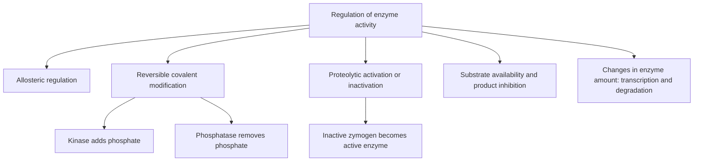
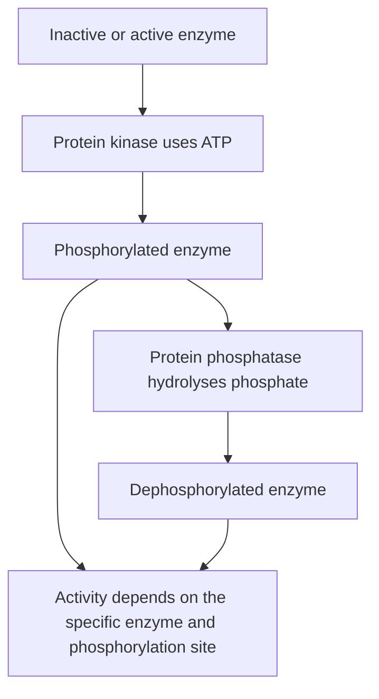
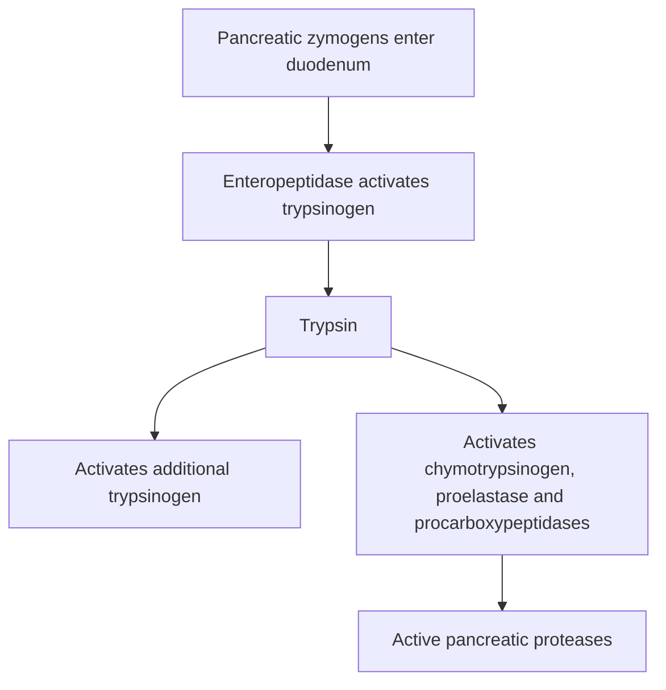

# 31. Regulation of Enzyme Activity

## 1. Overview of Metabolic Regulation Mechanisms

To maintain homeostasis, cellular enzyme activity is controlled via two primary operational modes:
1. **Short-Term / Fast Regulation (Seconds to Minutes):** Alters the intrinsic catalytic activity of pre-existing enzyme molecules via **allosteric control**, **covalent modification**, or **zymogen activation**.
2. **Long-Term / Slow Regulation (Hours to Days):** Controls the absolute quantity of enzyme present by altering gene transcription, mRNA translation, or protein degradation (**enzyme induction and repression**).



---

## 2. Allosteric Regulation and Cooperativity

Allosteric ("other site") enzymes possess regulatory sites distinct from the catalytic active site. Binding of an **allosteric effector (effector/modulator)** induces a conformational change that alters substrate binding or catalytic velocity.

### Characteristics of Allosteric Kinetics
* **Sigmoidal Curve:** Allosteric enzymes display a **sigmoidal (S-shaped)** velocity versus substrate curve rather than a hyperbolic Michaelis–Menten curve, reflecting **cooperativity**.
* **Hill Equation and Hill Coefficient ($n_H$):**
  $$\log\left(\frac{v}{V_{max} - v}\right) = n_H \log[S] - \log K'$$
  * **$n_H > 1$:** Positive cooperativity (binding of one substrate molecule increases affinity for subsequent molecules; e.g., Hemoglobin $n_H \approx 2.8$, Phosphofructokinase-1).
  * **$n_H = 1$:** Non-cooperative (standard Michaelis–Menten kinetics).
  * **$n_H < 1$:** Negative cooperativity.

### Two-State Monod–Wyman–Changeux (MWC) Concerted Model
Allosteric proteins exist in two interconvertible conformational states at equilibrium:
1. **T-State (Tense State):** Low substrate affinity; favored by **allosteric inhibitors (negative effectors)**.
2. **R-State (Relaxed State):** High substrate affinity; favored by **allosteric activators (positive effectors)** and substrate molecules.

```
     T-State (Tense, Low Affinity)  <=================>  R-State (Relaxed, High Affinity)
     Favored by Inhibitors (ATP, Citrate)               Favored by Activators (AMP, F-2,6-BP)
```

* **Homotropic Effectors:** Substrate itself acts as an allosteric activator (drives T $\rightarrow$ R transition).
* **Heterotropic Effectors:** Molecules other than the substrate act as activators or inhibitors (e.g., $AMP$ activates PFK-1, while $ATP$ and Citrate inhibit it).

---

## 3. Reversible Covalent Modification

Covalent addition or removal of chemical groups serves as a reversible molecular switch regulated by hormonal signaling cascades.

### Phosphorylation and Dephosphorylation
The most prevalent covalent modification in eukaryotic metabolic control:
* **Protein Kinases:** Transfer the $\gamma$-phosphate from ATP to specific hydroxyl group side chains of **Serine**, **Threonine**, or **Tyrosine** residues.
* **Protein Phosphatases:** Hydrolyze phosphate esters, releasing inorganic phosphate ($P_i$).



### Reciprocal Hormonal Logic Mnemonic
In key rate-limiting enzymes of carbohydrate and lipid metabolism:
* **Glucagon and Epinephrine (via PKA):** Cause **PHOSPHORYLATION**.
  * Phosphorylation **ACTIVATES** catabolic/fasting enzymes (e.g., Glycogen Phosphorylase, Hormone-Sensitive Lipase, FBPase-2).
  * Phosphorylation **INACTIVATES** anabolic/fed-state enzymes (e.g., Glycogen Synthase, Acetyl-CoA Carboxylase, Pyruvate Dehydrogenase, PFK-2).
* **Insulin (via Protein Phosphatase 1 / PP1):** Causes **DEPHOSPHORYLATION**.
  * Dephosphorylation **ACTIVATES** anabolic enzymes and **INACTIVATES** catabolic enzymes.

### Other Important Covalent Modifications
* **Acetylation / Deacetylation:** Histone Acetyltransferases (HATs) add acetyl groups to Lysine residues (loosens chromatin, activates transcription); Histone Deacetyltransferases (HDACs, Sirtuins/SIRT1-7 dependent on $NAD^+$) remove them.
* **ADP-Ribosylation:**
  * **Cholera Toxin:** ADP-ribosylates $\text{G}_{\alpha s}$ subunit, locking it in active GTP-bound state $\rightarrow cAMP \uparrow \uparrow \rightarrow$ watery diarrhea.
  * **Pertussis Toxin:** ADP-ribosylates $\text{G}_{\alpha i}$ subunit, locking it in inactive state $\rightarrow$ disinhibits adenylate cyclase $\rightarrow cAMP \uparrow \uparrow$.
  * **Diphtheria Toxin & Exotoxin A:** ADP-ribosylate Elongation Factor 2 (EF-2), halting eukaryotic protein synthesis.
* **Zymogen Activation (Proteolytic Cleavage):** See Section 4.

---

## 4. Zymogen Activation (Proteolytic Cleavage)

Zymogens (proenzymes) are inactive precursors stored in secretory vesicles that are irreversibly activated by selective peptide bond cleavage.



### Key Physiological Examples
1. **Digestive Zymogens:**
   * **Pepsinogen:** Auto-activated by gastric $HCl$ ($pH < 2.0$) into active **Pepsin**.
   * **Trypsinogen:** Activated by duodenal brush-border **Enteropeptidase (Enterokinase)** into **Trypsin**, which then auto-catalytically activates further trypsinogen, chymotrypsinogen, procarboxypeptidase, and proelastase.
2. **Coagulation Cascade:** Factor X $\rightarrow$ Xa, Prothrombin (Factor II) $\rightarrow$ Thrombin (Factor IIa) via prothrombinase complex.
3. **Apoptosis:** Pro-caspases cleaved to active **Caspases** (initiator caspases 8, 9; executioner caspases 3, 6, 7).

---

## 5. Feedback Inhibition and Compartmentalization

### Feedback Inhibition
The ultimate end-product of a multi-step biosynthetic pathway binds allosterically to and inhibits the first committed rate-limiting enzyme of that pathway:
* **Cholesterol Biosynthesis:** Cholesterol inhibits HMG-CoA Reductase.
* **Purine Biosynthesis:** IMP, AMP, and GMP inhibit **PRPP Amidotransferase**.
* **Pyrimidine Biosynthesis:** CTP inhibits **Aspartate Transcarbamoylase (ATCase)** in bacteria; UTP inhibits **CPS-II** in humans.

### Feed-Forward Activation
An early pathway intermediate activates a downstream enzyme:
* Fructose-1,6-bisphosphate allosterically activates **Pyruvate Kinase** in glycolysis.

### Cellular Compartmentalization
Enclosing metabolic pathways in distinct intracellular organelles prevents futile cycles and permits independent regulation:

```
+-----------------------------------++-----------------------------------+
|            CYTOSOL                ||        MITOCHONDRIAL MATRIX       |
|  - Glycolysis                     ||  - TCA Cycle                      |
|  - Fatty Acid Synthesis           ||  - Beta-Oxidation                 |
|  - Pentose Phosphate Pathway      ||  - Ketogenesis                    |
|  - Glycogen Synthesis/Breakdown   ||  - Oxidative Phosphorylation      |
+-----------------------------------++-----------------------------------+
                  \                               /
                   \                             /
                    +---------------------------+
                    |   SHARED PATHWAYS         |
                    |  - Gluconeogenesis        |
                    |  - Urea Cycle             |
                    |  - Heme Synthesis         |
                    +---------------------------+
```

---

## 6. Coverage Audit

* **Textbook Alignment:** Covers short-term vs long-term regulation, allosteric kinetics, MWC T/R model, covalent phosphorylation logic, zymogen processing, feedback/feed-forward loops, and compartmentalization.
* **Integrations:** Includes Hill equation parameters, ADP-ribosylation toxins (Cholera, Pertussis, Diphtheria), and sub-cellular organelle localization maps.
