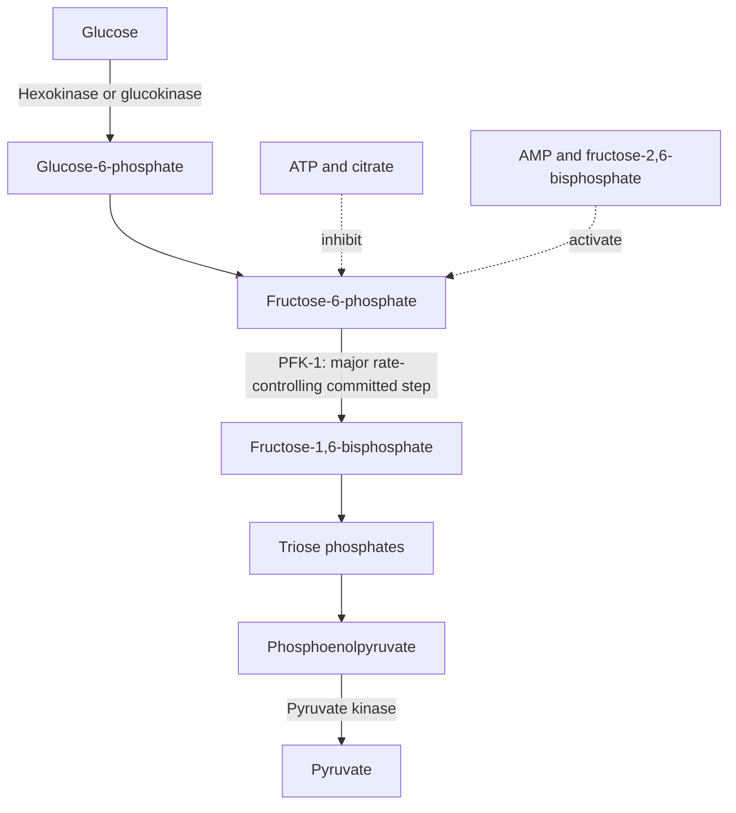
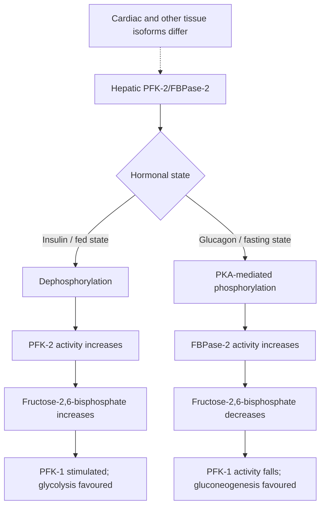
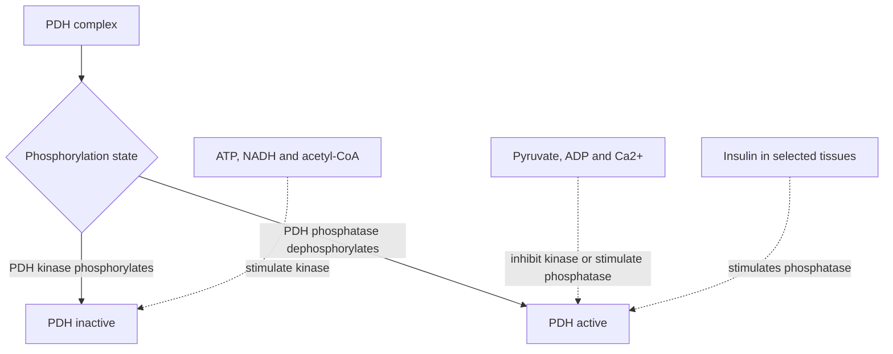
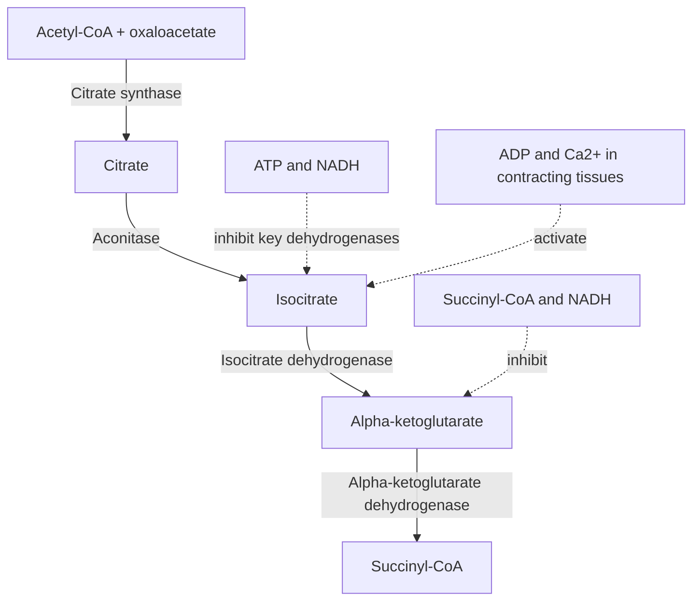

# 32. Regulation of Glycolysis and Krebs Cycle

## 1. Regulatory Checkpoints of Glycolysis

Glycolysis contains three thermodynamically irreversible exergonic reactions catalyzed by regulatory enzymes: **Hexokinase/Glucokinase**, **Phosphofructokinase-1 (PFK-1)**, and **Pyruvate Kinase**.

### Step 1: Hexokinase vs. Glucokinase Comparison

| Feature | Hexokinase (Types I–III) | Glucokinase (Hexokinase IV) |
| :--- | :--- | :--- |
| **Tissue Distribution** | Ubiquitous in peripheral tissues (brain, muscle, RBCs). | **Liver parenchymal cells** and **Pancreatic $\beta$-cells**. |
| **Substrate Affinity ($K_m$)** | **Very Low $K_m$** ($\sim 0.05 \ \text{mM}$; operating at $V_{max}$ even during fasting). | **High $K_m$** ($\sim 5 - 10 \ \text{mM}$; active only after carbohydrate-rich meals). |
| **Maximal Capacity ($V_{max}$)** | **Low $V_{max}$** (prevents tissue from trapping excess glucose). | **High $V_{max}$** (allows liver to rapidly clear portal glucose spikes). |
| **Product Inhibition** | **Inhibited by Glucose-6-Phosphate (G6P)**. | **NOT inhibited by G6P**. |
| **Nuclear Sequestration** | Unregulated by nuclear translocation. | Bound to **Glucokinase Regulatory Protein (GKRP)** and sequestered in the nucleus when $F6P \uparrow$; translocates to cytosol when Glucose $\uparrow$. |
| **Hormonal Regulation** | Uninduced by insulin. | Induced by **Insulin** at transcriptional level. |
| **Gene Mutation Diseases** | Hemolytic anemia (rare). | **MODY2** (Maturity-Onset Diabetes of the Young Type 2 - heterozygous) & Permanent Neonatal Diabetes (homozygous). |

---

## 2. Phosphofructokinase-1 (PFK-1): The Master Pacemaker

PFK-1 catalyzes the principal rate-limiting committed step of glycolysis:

$$\text{Fructose-6-Phosphate} + \text{ATP} \xrightarrow{\text{PFK-1}} \text{Fructose-1,6-Bisphosphate} + \text{ADP}$$

### Allosteric Regulation of PFK-1
* **Allosteric Inhibitors (High Energy / Abundance Signals):**
  * **ATP:** Binds to a low-affinity allosteric site, stabilizing the T-state.
  * **Citrate:** Signals abundant TCA cycle intermediates.
  * **$H^+$ / Low pH:** Inhibits PFK-1 to prevent excessive lactic acid production during muscle hypoxia.
* **Allosteric Activators (Low Energy / Starvation Signals):**
  * **AMP:** Reverses ATP inhibition.
  * **Fructose-2,6-Bisphosphate ($F-2,6-BP$):** The **most potent positive allosteric effector** of PFK-1.

---

## 3. Pyruvate Kinase Regulation

Catalyzes Step 10:

$$\text{Phosphoenolpyruvate (PEP)} + \text{ADP} \xrightarrow{\text{Pyruvate Kinase}} \text{Pyruvate} + \text{ATP}$$

* **Feed-Forward Activation:** Activated allosterically by **Fructose-1,6-bisphosphate** (ensures intermediates passing PFK-1 flow rapidly through glycolysis).
* **Allosteric Inhibition:** Inhibited by **ATP**, **Acetyl-CoA**, and **Alanine**.
* **Hormonal Covalent Modification (Liver L-type PK):**
  * **Glucagon / Fasting (via PKA):** Phosphorylates and **inactivates** Pyruvate Kinase (spares glucose for export).
  * **Insulin / Fed State (via PP1):** Dephosphorylates and **activates** Pyruvate Kinase.

---

## 4. Regulation of the Pyruvate Dehydrogenase (PDH) Complex

The PDH complex connects glycolysis to the Krebs cycle in the mitochondrial matrix:

$$\text{Pyruvate} + \text{CoA} + \text{NAD}^+ \xrightarrow{\text{PDH Complex}} \text{Acetyl-CoA} + \text{CO}_2 + \text{NADH} + \text{H}^+$$

### Five Essential Cofactors ("Tender Loving Care For Nancy")
1. **TPP (Thiamine Pyrophosphate, Vitamin $B_1$):** Bound to $E_1$ (Pyruvate Decarboxylase).
2. **Lipoic Acid / Lipoamide:** Bound to $E_2$ (Dihydrolipoyl Transacetylase).
3. **CoA (Coenzyme A, Vitamin $B_5$):** Substrate for $E_2$.
4. **FAD (Flavin Adenine Dinucleotide, Vitamin $B_2$):** Bound to $E_3$ (Dihydrolipoyl Dehydrogenase).
5. **$\text{NAD}^+$ (Niacin, Vitamin $B_3$):** Final electron acceptor for $E_3$.

* **Arsenic poisoning:** Trivalent arsenite binds the dithiol groups of lipoic acid/lipoamide and inhibits PDH, $\alpha$-ketoglutarate dehydrogenase, and branched-chain $\alpha$-ketoacid dehydrogenase. Acute inorganic arsenic poisoning can cause severe gastroenteritis (including profuse watery or 'rice-water' diarrhoea), garlic-like breath in some cases, QT prolongation, and neuropathy; clinical features vary with exposure.

---

## 5. Regulation of the Krebs (TCA) Cycle

The citric acid cycle is regulated at three non-equilibrium exergonic reactions:

| TCA Cycle Enzyme | Key Activators | Key Inhibitors | Physiological Logic |
| :--- | :--- | :--- | :--- |
| **1. Citrate Synthase** | Substrate availability (Acetyl-CoA, Oxaloacetate), ADP | **ATP**, **NADH**, **Citrate**, **Succinyl-CoA** | High energy charge or product accumulation slows entry of acetyl groups. |
| **2. Isocitrate Dehydrogenase** *(major regulatory/rate-controlling step in the classic mammalian TCA-cycle scheme)* | **ADP**, **$Ca^{2+}$** | **ATP**, **NADH** | ADP lowers $K_m$ for isocitrate. $Ca^{2+}$ activation signals muscle contraction and energy demand. |
| **3. $\alpha$-Ketoglutarate Dehydrogenase** | **$Ca^{2+}$** | **Succinyl-CoA**, **NADH**, $GTP$ | Multienzyme complex identical in mechanism and 5 cofactors to PDH. |

---

## 6. Coverage Audit

* **Textbook Alignment:** Covers Hexokinase vs Glucokinase kinetics, PFK-1 allosteric regulation, PFK-2/FBPase-2 tandem enzyme phosphorylation, Pyruvate Kinase control, PDH complex cofactors/regulation, and the 3 TCA cycle regulatory steps.
* **Integrations:** Includes MODY2 genetics, arsenic poisoning mechanism on lipoamide, and $Ca^{2+}$ stimulation during excitation-contraction coupling.
