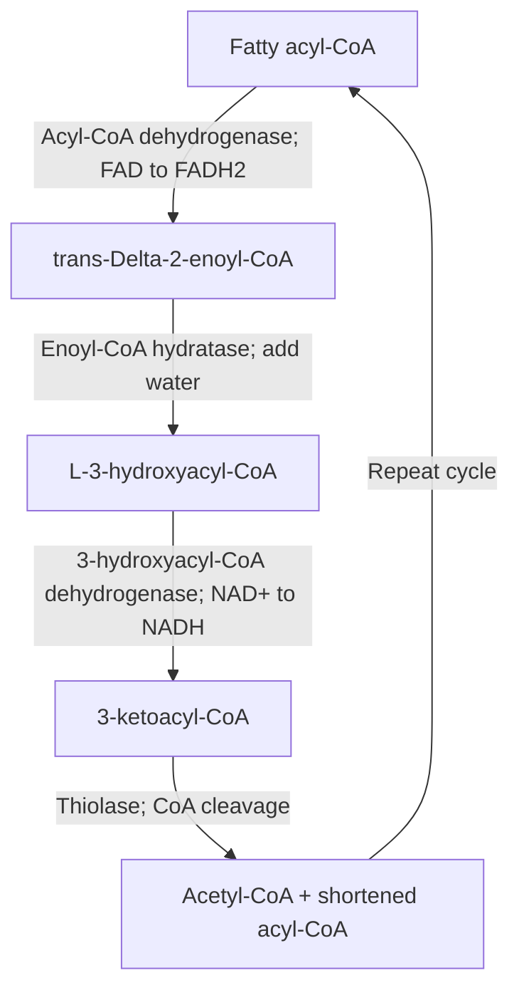
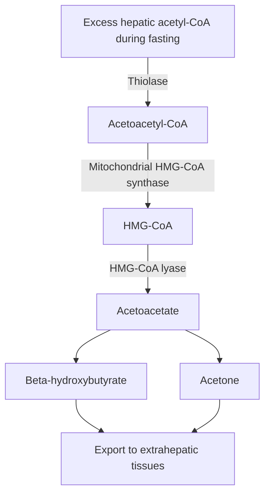

# 33. Oxidation of Fatty Acids to Produce ATP in Muscle and Ketone Bodies in Liver

## 1. Activation and Transport of Fatty Acids: The Carnitine Shuttle

Long-chain fatty acids (LCFAs, $C_{12}-C_{20}$) must be activated in the cytosol and transported into the mitochondrial matrix for $\beta$-oxidation.

### Step 1: Activation by Acyl-CoA Synthetase (Thiokinase)
Occurs on the outer mitochondrial membrane:

$$\text{Fatty Acid} + \text{CoA} + \text{ATP} \xrightarrow{\text{Acyl-CoA Synthetase}} \text{Acyl-CoA} + \text{AMP} + PP_i \xrightarrow{+\text{Pyrophosphatase}} 2 P_i$$

* **Energy Cost:** Hydrolysis of $PP_i$ drives the reaction forward, consuming **2 high-energy phosphate bonds ($2 \text{ ATP equivalents}$)**.

### Step 2: The Carnitine Shuttle System

1. **Carnitine Palmitoyltransferase I (CPT-I):** Outer mitochondrial membrane enzyme that converts Acyl-CoA + Free Carnitine $\rightarrow$ **Acylcarnitine** + CoA.
   * **Major regulated control point:** CPT-I is **potently inhibited by Malonyl-CoA** (the first intermediate of fatty acid synthesis), preventing simultaneous fatty acid synthesis and degradation (futile cycle).
2. **Carnitine-Acylcarnitine Translocase (CACT):** Antiporter in the inner mitochondrial membrane moving Acylcarnitine in and free Carnitine out.
3. **Carnitine Palmitoyltransferase II (CPT-II):** Inner mitochondrial membrane matrix-face enzyme that regenerates **Acyl-CoA** and free Carnitine.

### Carnitine Deficiency Disorders
* **Systemic Primary Carnitine Deficiency:** Defect in plasma membrane carnitine transporter (OCTN2) $\rightarrow$ impaired carnitine reabsorption in kidney and uptake in muscle/heart $\rightarrow$ hypoketotic hypoglycemia, muscle weakness, dilated cardiomyopathy.
* **CPT-I Deficiency:** Affects liver; severe fasting hypoketotic hypoglycemia.
* **CPT-II Deficiency:** Most common in adults; recurrent **myoglobinuria**, muscle pain, and breakdown triggered by prolonged exercise or fasting.

---

## 2. Mitochondrial $\beta$-Oxidation Pathway

$\beta$-Oxidation cleaves 2-carbon Acetyl-CoA units sequentially from the carboxyl end of fatty acyl-CoA molecules. Each cycle involves **4 recurring steps**:

### MCAD (Medium-Chain Acyl-CoA Dehydrogenase) Deficiency
* **Pathophysiology:** Autosomal recessive deficiency in breaking down $C_6-C_{12}$ fatty acids.
* **Clinical Presentation:** Manifests in infants during extended fasting or viral illness as **profound hypoketotic hypoglycemia**, lethargy, hepatic dysfunction, and dicarboxylic aciduria ($C_6-C_{10}$ dicarboxylic acids in urine from $\omega$-oxidation).
* **Risk:** Major cause of sudden unexpected infant death.
* **Management:** Frequent high-carbohydrate, low-fat feeding; avoid prolonged fasting.

---

## 3. ATP Yield Calculation for Fatty Acid Oxidation

For complete oxidation of **Palmitate ($C_{16}$, saturated)**:
* **Cycles of $\beta$-Oxidation:** $\frac{n}{2} - 1 = \frac{16}{2} - 1 = \mathbf{7 \text{ cycles}}$.
* **Products Generated:**
  * $7 \text{ FADH}_2 \times 1.5 \text{ ATP} = 10.5 \text{ ATP}$
  * $7 \text{ NADH} \times 2.5 \text{ ATP} = 17.5 \text{ ATP}$
  * $8 \text{ Acetyl-CoA} \times 10 \text{ ATP (via TCA cycle)} = 80.0 \text{ ATP}$
* **Gross ATP Produced:** $10.5 + 17.5 + 80 = \mathbf{108 \text{ ATP}}$.
* **Net ATP Yield:** $108 - 2 \text{ ATP equivalents (activation cost)} = \mathbf{106 \text{ ATP}}$.

---

## 4. Special Oxidation Pathways

### Odd-Chain Fatty Acid Oxidation
* $\beta$-oxidation proceeds until the final 3-carbon fragment, **Propionyl-CoA**, remains.
* **Propionyl-CoA Conversion Pathway:**

$$\text{Propionyl-CoA} \xrightarrow[\text{Biotin}, \text{ATP}, \text{CO}_2]{\text{Propionyl-CoA Carboxylase}} \text{D-Methylmalonyl-CoA} \xrightarrow{\text{Epimerase}} \text{L-Methylmalonyl-CoA} \xrightarrow[\text{Vitamin } B_{12}]{\text{Methylmalonyl-CoA Mutase}} \text{Succinyl-CoA}$$

* **Clinical Disorders:**
  * **Propionic Acidemia:** Deficiency of Propionyl-CoA carboxylase.
  * **Methylmalonic Acidemia:** Deficiency of Methylmalonyl-CoA mutase or Vitamin $B_{12}$ (adenosylcobalamin). Causes severe ketoacidosis, hyperammonemia, and neurological damage.

### Peroxisomal $\beta$-Oxidation
* Handles **Very Long-Chain Fatty Acids (VLCFAs, $C_{\ge 22}$)** and branched-chain FAs.
* First step utilizes **Acyl-CoA Oxidase**, transferring electrons directly to $O_2$ to form hydrogen peroxide ($H_2O_2$, degraded by catalase) without generating $FADH_2$-ATP.
* Proceeds down to octanoyl-CoA ($C_8$), which is transferred to mitochondria for complete oxidation.
* **Zellweger Syndrome:** Autosomal recessive defect in *PEX* genes required for peroxisome biogenesis $\rightarrow$ empty peroxisomal ghosts $\rightarrow$ accumulation of VLCFAs, phytanic acid $\rightarrow$ dysmorphic facies, hypotonia, hepatomegaly, death in infancy.
* **X-Linked Adrenoleukodystrophy (X-ALD):** Defect in *ABCD1* peroxisomal membrane transporter $\rightarrow$ VLCFA accumulation in adrenal cortex and CNS white matter $\rightarrow$ adrenal insufficiency and progressive demyelination.

---

## 5. Ketogenesis in the Liver and Extrahepatic Ketolysis

Ketone bodies (**Acetoacetate**, **$\beta$-Hydroxybutyrate**, and **Acetone**) are water-soluble lipid derivatives synthesized exclusively in **hepatic mitochondria** during starvation or uncontrolled diabetes.

### Why Can the Liver NOT Utilize Ketone Bodies?
The liver lacks the essential enzyme **Succinyl-CoA:Acetoacetate CoA-Transferase (Thiophorase)**:

$$\text{Acetoacetate} + \text{Succinyl-CoA} \xrightarrow{\text{Thiophorase}} \text{Acetoacetyl-CoA} + \text{Succinate}$$

Consequently, the liver produces ketone bodies for export but cannot utilize them, preserving them for extrahepatic tissues (brain, cardiac/skeletal muscle, renal cortex).

---

## 6. Coverage Audit

* **Textbook Alignment:** Covers activation, CPT-I/II shuttle mechanism, 4-step $\beta$-oxidation spiral, MCAD deficiency, palmitate ATP accounting, odd-chain conversion to succinyl-CoA, peroxisomal VLCFA processing (Zellweger, X-ALD), and hepatic ketogenesis/extrahepatic ketolysis.
* **Integrations:** Includes thiophorase absence logic in liver, 2 ATP activation cost calculation, and differential diagnosis of hypoketotic hypoglycemia.
