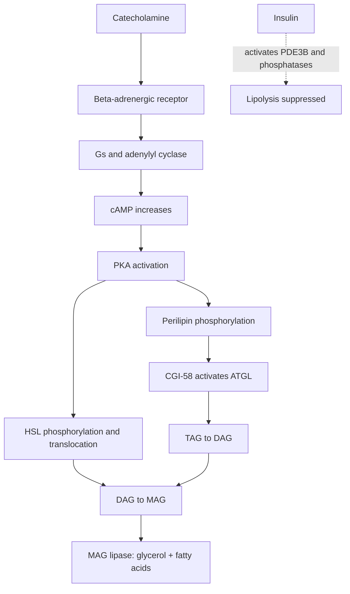
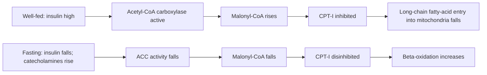
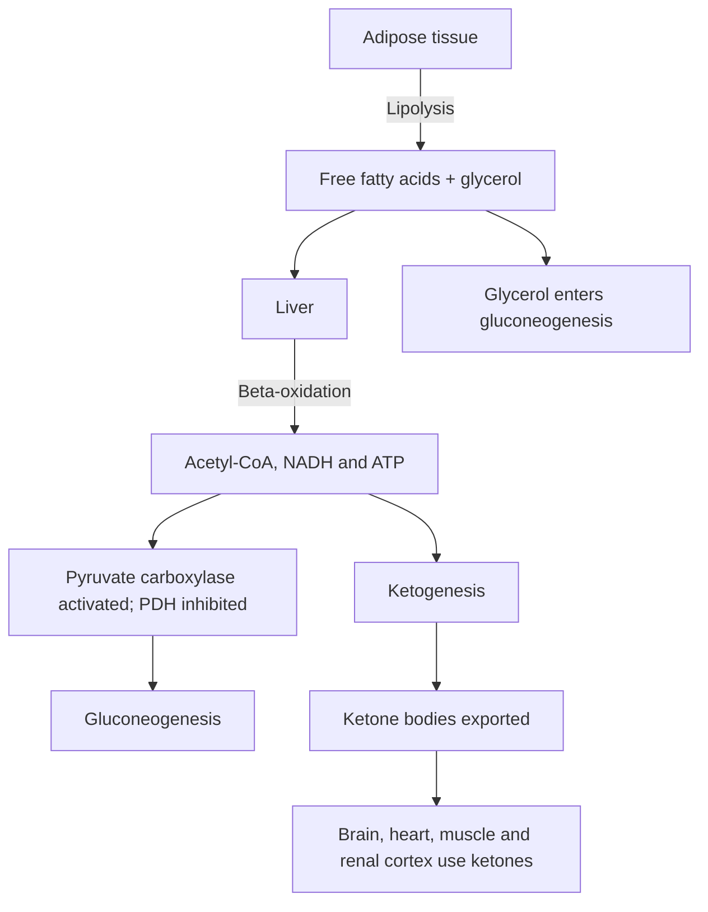
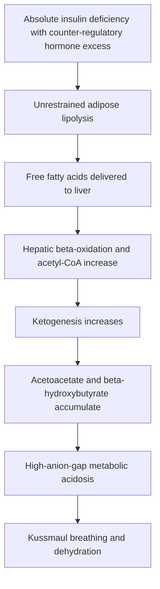

# 34. Regulation of Lipolysis, β-Oxidation, Ketogenesis and Gluconeogenesis

## 1. Hormonal Regulation of Adipose Tissue Lipolysis

Lipolysis is the sequential enzymatic hydrolysis of triacylglycerols (TAGs) stored in adipocyte lipid droplets into free fatty acids (FFAs) and glycerol.

### Key Lipolytic Enzymes
1. **Adipose Triglyceride Lipase (ATGL):** Initiates lipolysis by converting TAG $\rightarrow$ Diacylglycerol (DAG) + 1 FFA. Activated by co-factor **CGI-58**, which dissociates from perilipin upon PKA phosphorylation.
2. **Hormone-Sensitive Lipase (HSL):** Converts DAG $\rightarrow$ Monoacylglycerol (MAG) + 1 FFA. PKA directly phosphorylates HSL (Ser-660), inducing its translocation from cytosol to the droplet surface.
3. **Monoacylglycerol Lipase (MAG Lipase):** Hydrolyzes MAG $\rightarrow$ Glycerol + 1 FFA.

### Antagonistic Action of Insulin
Insulin potently suppresses lipolysis through two mechanisms:
* Activates **Phosphodiesterase 3B (PDE3B)**, hydrolyzing $cAMP \rightarrow 5'-AMP$, shutting off PKA.
* Activates protein phosphatases that dephosphorylate HSL and perilipin.

---

## 2. Cross-Regulation Between $\beta$-Oxidation and Fatty Acid Synthesis

Reciprocal regulation prevents the simultaneous synthesis and destruction of fatty acids.

---

## 3. Integrated Fasting / Starvation Metabolic Axis

During extended fasting, the starvation network coordinates lipolysis, $\beta$-oxidation, ketogenesis, and gluconeogenesis across tissues.

### Step-by-Step Metabolic Events
1. **Adipose mobilization:** Catecholamines activate beta-adrenergic Gs signalling in human adipocytes, increasing $cAMP \rightarrow \text{PKA} \rightarrow$ perilipin/ATGL/HSL activation. The direct lipolytic effect of glucagon in human adipose tissue is limited/variable and should not be treated as the dominant physiological signal. $\rightarrow$ large influx of FFAs and glycerol into plasma.
2. **Hepatic $\beta$-Oxidation Surge:** FFAs enter hepatocytes $\rightarrow$ rapid $\beta$-oxidation yields massive quantities of **NADH**, **$\text{FADH}_2$**, and **Acetyl-CoA**.
3. **Allosteric Switching of Pyruvate Fate:**
   * High Acetyl-CoA **potently inhibits Pyruvate Dehydrogenase (PDH)**, blocking carbohydrate oxidation.
   * High Acetyl-CoA **allosterically activates Pyruvate Carboxylase (PC)**, initiating Gluconeogenesis.
4. **Shunting to Ketogenesis:** High NADH/NAD+ ratio and consumption of oxaloacetate for gluconeogenesis prevents Acetyl-CoA from entering the TCA cycle. Excess Acetyl-CoA is diverted into **Ketogenesis**.

---

## 4. Diabetic Ketoacidosis (DKA) Pathophysiology

---

## 5. Coverage Audit

* **Textbook Alignment:** Covers ATGL/HSL/MAG lipase cascade, CGI-58/perilipin mechanics, PDE3B insulin suppression, Malonyl-CoA CPT-I cross-regulation, integrated fasting axis (lipolysis $\rightarrow \beta$-oxidation $\rightarrow$ PC activation / PDH inhibition $\rightarrow$ gluconeogenesis + ketogenesis), and DKA pathophysiology.
* **Integrations:** Includes exact phosphorylation sites (HSL Ser-660), high-anion gap metabolic acidosis links, and hepatic fuel partition logic.
