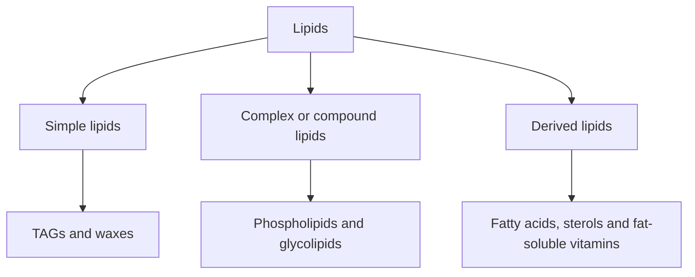
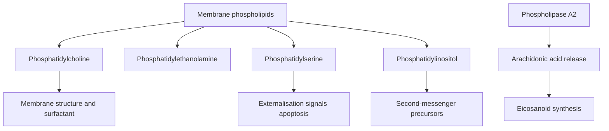

# 35. Structure of Lipids

## 1. Classification and Chemical Nature of Lipids

Lipids are heterogeneous organic compounds insoluble in water but soluble in non-polar organic solvents (ether, chloroform, benzene).



---

## 2. Fatty Acid Structure and Nomenclature

Fatty acids are monocarboxylic aliphatic hydrocarbons ($\text{R-COOH}$).

### Systemic Nomenclature Rules
* **Delta ($\Delta$) System:** Counts carbons starting from the **carboxyl carbon (C-1)**.
* **Omega ($\omega$ or $n$) System:** Counts carbons starting from the **terminal methyl carbon (omega carbon)**.

```
      HOOC - CH2 - CH2 - CH2 - ... - CH2 - CH3
       C1    C2    C3    C4           C(n)   (Omega Carbon)
       (alpha) (beta)
```

### Essential Fatty Acids (EFAs)
Humans lack $\Delta^{12}$ and $\Delta^{15}$ desaturases and cannot synthesize double bonds beyond carbon-9 from the carboxyl end.
1. **Linoleic Acid ($18:2; \Delta^{9,12} \ / \ \omega\text{-6}$):** Precursor to arachidonic acid.
2. **$\alpha$-Linolenic Acid ($18:3; \Delta^{9,12,15} \ / \ \omega\text{-3}$):** Precursor to eicosapentaenoic acid (EPA) and docosahexaenoic acid (DHA).
3. **Arachidonic Acid ($20:4; \Delta^{5,8,11,14} \ / \ \omega\text{-6}$):** Conditionally essential if linoleic acid is lacking.

---

## 3. Triacylglycerols (TAGs / Triglycerides)

Triacylglycerols consist of a **glycerol backbone** esterified to **three fatty acid molecules**.

$$\text{Glycerol} + 3 \text{ Fatty Acids} \xrightarrow{\text{Esterification}} \text{Triacylglycerol} + 3 H_2O$$

* Uncharged neutral fats stored in a anhydrous state inside adipocyte lipid droplets.
* Provide $\mathbf{9 \text{ kcal/g}}$ of metabolic energy (compared to $4 \text{ kcal/g}$ for carbohydrates and proteins).

---

## 4. Eicosanoids: Prostaglandins, Thromboxanes, and Leukotrienes

Eicosanoids are 20-carbon signaling molecules synthesized from **Arachidonic Acid**.



### The Cyclooxygenase (COX) Pathway
* **COX-1:** Constitutively expressed; maintains gastric mucosal integrity, renal blood flow, and platelet aggregation.
* **COX-2:** Inducible by inflammatory cytokines ($\text{IL-1}, \text{TNF}-\alpha$) at sites of tissue injury.

| Eicosanoid Derivative | Primary Sites of Production | Key Physiological Actions |
| :--- | :--- | :--- |
| **Prostacyclin ($\text{PGI}_2$)** | Vascular Endothelium | Potent **vasodilator**; **inhibits platelet aggregation**. |
| **Thromboxane $A_2$ ($\text{TXA}_2$)** | Activated Platelets | Potent **vasoconstrictor**; **promotes platelet aggregation**. |
| **Prostaglandin $E_2$ ($\text{PGE}_2$)** | Kidney, Brain, Uterus | Induces fever (hypothalamus), vasodilation, uterine contractions, gastric mucosal protection. |
| **Prostaglandin $F_{2\alpha}$ ($\text{PGF}_{2\alpha}$)** | Uterus, Eye | Uterine contraction (induces labor/abortion); reduces intraocular pressure (Latanoprost). |

### The Lipoxygenase (LOX) Pathway
* **$\text{LTB}_4$:** Potent neutrophil chemotactic agent ("Neutrophils B-line for $\text{LTB}_4$").
* **Cysteinyl Leukotrienes ($\text{LTC}_4, \text{LTD}_4, \text{LTE}_4$):** Comprise the **Slow-Reacting Substance of Anaphylaxis (SRS-A)**; cause profound bronchoconstriction, airway edema, and mucus secretion in bronchial asthma.
* **Pharmacological Targets:**
  * **Zileuton:** Selective 5-LOX inhibitor.
  * **Montelukast / Zafirlukast:** Cysteinyl leukotriene receptor $1$ ($\text{CysLT}_1$) antagonists.

---

## 5. Coverage Audit

* **Textbook Alignment:** Covers simple vs complex vs derived lipid classifications, $\Delta$ and $\omega$ fatty acid nomenclature, essential fatty acids, TAG energy density ($9 \text{ kcal/g}$), and the complete eicosanoid cascade (COX-1/2, LOX, prostaglandins, thromboxane $A_2$, leukotrienes).
* **Integrations:** Includes $\text{PGI}_2$ vs $\text{TXA}_2$ vascular balance, SRS-A leukotriene asthma mechanics, and targeted anti-inflammatory pharmacology (Aspirin, NSAIDs, Zileuton, Montelukast).
