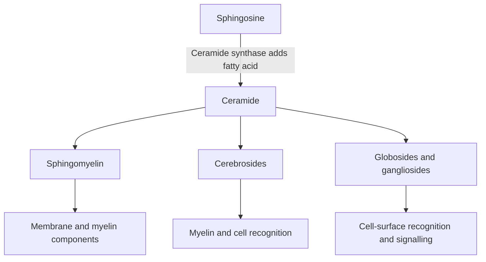
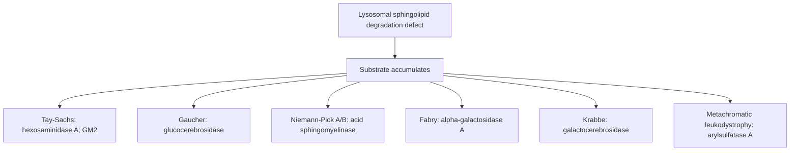

# 36. Phospholipids I: Phospholipids and Sphingolipids

## 1. Glycerophospholipids: Structure and Function

Glycerophospholipids consist of a **phosphatidic acid** core (glycerol-3-phosphate esterified to two fatty acids) attached to a polar head group via a phosphodiester linkage.

```
                          Phospholipase Cleavage Sites
                                       
                     O
                     ||
       Glycerol - O - C - R1   <--- [Phospholipase A1]
         |           O
         |           ||
         |----- O - C - R2   <--- [Phospholipase A2]
         |
         |----- O - P - O - Head Group
                    ||        ^
                    O         |--- [Phospholipase D]
                    ^
                    |--- [Phospholipase C]
```

### Major Glycerophospholipids
1. **Phosphatidylcholine (Lecithin):**
   * Contains choline head group. Major structural component of cell membranes and bile.
   * **Dipalmitoylphosphatidylcholine (DPPC / Surface Active Lecithin):** Primary component of **lung surfactant** produced by Type II pneumocytes. Reduces alveolar surface tension to prevent end-expiratory collapse.
   * **Lecithin-to-Sphingomyelin (L/S) Ratio:** Amniotic fluid ratio $\ge 2.0$ indicates fetal lung maturity.
2. **Phosphatidylethanolamine (Cephalin) & Phosphatidylserine:**
   * **Phosphatidylserine** normally restricted to inner membrane leaflet; flipped to outer leaflet during **apoptosis**, serving as an "eat-me" signal for phagocytes.
3. **Phosphatidylinositol ($PI$):**
   * Phosphorylated to $PIP_2$ (Phosphatidylinositol-4,5-bisphosphate).
   * Cleaved by **Phospholipase C ($\text{PLC}-\beta$)** upon $\text{G}_q$-protein receptor activation into **$\text{IP}_3$** (releases intracellular $Ca^{2+}$) and **DAG** (activates Protein Kinase C).
4. **Cardiolipin (Diphosphatidylglycerol):**
   * Unique double-phospholipid containing 4 fatty acyl chains localized exclusively in the **inner mitochondrial membrane**. Essential for ETC Complex activity.
   * Antigenic target in **Syphilis (VDRL/RPR test)** and **Antiphospholipid Syndrome (APLS)**.

---

## 2. Sphingolipids and Glycosphingolipids

Sphingolipids possess an 18-carbon amino alcohol backbone called **Sphingosine** rather than glycerol.



---

## 3. Sphingolipidoses (Lysosomal Storage Diseases)

Deficiencies in specific lysosomal hydrolases cause toxic accumulation of undegraded sphingolipids.



### Comprehensive Sphingolipidoses Comparison Table

| Disease | Deficient Enzyme | Accumulated Substrate | Key Clinical Manifestations | Pathognomonic Histology / Features |
| :--- | :--- | :--- | :--- | :--- |
| **Tay-Sachs Disease** | **Hexosaminidase A** ($\beta$-subunit defect) | **$GM_2$ Ganglioside** | Progressive neurodegeneration, developmental regression, hyperacusis, **cherry-red spot on macula**. **NO hepatosplenomegaly**. | **Onion-skin lysosomes** on electron microscopy. |
| **Gaucher Disease** *(Most Common)* | **Glucocerebrosidase** ($\beta$-Glucosidase) | **Glucocerebroside** | **Hepatosplenomegaly**, severe bone pain/crises, avascular necrosis of femoral head, pancytopenia, osteoporosis. | **Gaucher cells:** Macrophages with **wrinkled tissue paper / crumpled silk** cytoplasm. |
| **Niemann-Pick Disease** | **Sphingomyelinase** | **Sphingomyelin** | Progressive neurodegeneration, **cherry-red spot on macula**, **HAS hepatosplenomegaly**, interstitial lung disease. | **Foam cells:** Lipid-laden macrophages with vacuolated cytoplasm; **zebra bodies** on EM. |
| **Fabry Disease** *(X-Linked Recessive)* | **$\alpha$-Galactosidase A** | **Ceramide Trihexoside** (Globotriaosylceramide) | Early: **Angiokeratomas** (red-purple skin papules), **painful acroparesthesias**, hypohidrosis. Late: Progressive renal failure, hypertrophic cardiomyopathy. | X-linked inheritance (males affected). Recombinant enzyme replacement available. |
| **Krabbe Disease** (Globoid Cell Leukodystrophy) | **Galactocerebrosidase** | **Galactocerebroside** & Psychosine | Developmental delay, severe spasticity, optic atrophy, seizures, peripheral neuropathy. | **Globoid cells** (multinucleated macrophages) in white matter; demyelination. |
| **Metachromatic Leukodystrophy** | **Arylsulfatase A** | **Cerebroside Sulfate** (Sulfatides) | Central and peripheral demyelination, progressive ataxia, dementia, gallbladder dysfunction. | **Metachromasia:** Sulfatides stain brown/purple with toluidine blue dye. |

---

## 4. Coverage Audit

* **Textbook Alignment:** Covers glycerophospholipids (lecithin, DPPC, L/S ratio, cardiolipin, PLC signaling) and sphingolipid architecture (ceramide, sphingomyelin, cerebrosides, gangliosides).
* **Integrations:** Includes complete high-yield comparison table of Sphingolipidoses (Tay-Sachs vs Niemann-Pick hepatosplenomegaly distinction, Gaucher cells, Fabry angiokeratomas, metachromasia).
