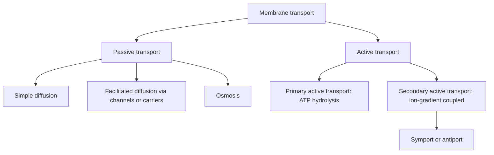

# 37. Phospholipids II: Micelles, Liposomes, Lipoproteins and Membranes

## 1. Amphipathic Lipid Assemblies in Aqueous Media

Amphipathic lipids possess both hydrophilic (polar head) and hydrophobic (non-polar tail) regions. When mixed with water, they spontaneously assemble into thermodynamically stable structures to sequester non-polar chains away from water.

```
       MICELLE                    LIPOSOME (BILAYER VESICLE)               EMULSION
 (Single Layer, Wedge)             (Double Layer, Aqueous Core)       (Large Core, Amphipathic Shell)
     \  /  \  /                          / \  / \                           / \  / \  / \
      ||    ||                          ||   ||                            ||   ||   ||
      /\    /\                          \/   \/                            /\   /\   /\
```

1. **Micelles:** Spherical single-layered structures formed by wedge-shaped lipids (free fatty acids, bile salts, lysophospholipids). Critical for intestinal lipid absorption.
2. **Liposomes:** Synthetic spherical vesicles surrounded by a lipid bilayer enclosing an aqueous central core. Used clinically as drug delivery vehicles (e.g., Liposomal Amphotericin B, Doxil).
3. **Emulsion Droplets:** Large aggregations of non-polar lipids (TAGs, cholesteryl esters) stabilized by a surface monolayer of amphipathic phospholipids and proteins (e.g., dietary fat chylomicrons).

---

## 2. Architecture and Fluidity of Biological Membranes

The **Fluid Mosaic Model** (Singer and Nicolson, 1972) depicts biological membranes as dynamic two-dimensional liquids composed of a phospholipid bilayer with embedded integral and peripheral proteins.

```
                      Extracellular Side (Glycoproteins, Glycolipids)
   ----------------------------------------------------------------------------------
     OO   OO   OO   OO   OO   OO   OO   OO   OO   OO   OO   OO   OO   OO   OO   OO   (Phospholipid
     ||   ||   ||   ||   ||   ||   ||   ||   ||   ||   ||   ||   ||   ||   ||   ||    Outer Leaflet)
     ||   ||   ||   ||   ||   ||   ||   ||   ||   ||   ||   ||   ||   ||   ||   ||
     OO   OO   OO   OO   OO   OO   OO   OO   OO   OO   OO   OO   OO   OO   OO   OO   (Phospholipid
   ---------------------------------------------------------------------------------- Inner Leaflet)
                       Cytosolic Side (Phosphatidylserine [-], Spectrin)
```

### Transbilayer Membrane Asymmetry
* **Outer Leaflet:** Enriched in **Phosphatidylcholine**, **Sphingomyelin**, and glycolipids.
* **Inner (Cytosolic) Leaflet:** Enriched in **Phosphatidylserine** (negative charge) and **Phosphatidylethanolamine**.
* **Flip-Flop Enzymes:**
  * **Flippase:** Moves PS and PE from outer to inner leaflet (ATP-dependent).
  * **Floppase:** Moves phospholipids from inner to outer leaflet (ATP-dependent).
  * **Scramblase:** Bidirectional randomization of phospholipids down concentration gradients ($Ca^{2+}$-activated, ATP-independent; active during apoptosis and blood clotting).

### Determinants of Membrane Fluidity
1. **Unsaturated Fatty Acid Content:** Cis-double bonds introduce rigid $30^\circ$ kinks, preventing tight hydrocarbon packing $\rightarrow$ **increases membrane fluidity**.
2. **Fatty Acid Chain Length:** Shorter chain length $\rightarrow$ less van der Waals interactions $\rightarrow$ **increases fluidity**.
3. **Cholesterol Content (Fluidity Buffer):**
   * At physiological body temperature ($37^\circ\text{C}$): Intercalates between phospholipids, restricting hydrocarbon motion $\rightarrow$ **decreases fluidity**.
   * At low temperatures: Prevents hydrocarbon chains from crystallizing together $\rightarrow$ **maintains fluidity**.
4. **Lipid Rafts:** Specialized microdomains enriched in **Sphingolipids**, **Cholesterol**, and GPI-anchored proteins that serve as signaling hubs.

---

## 3. Membrane Transport Mechanisms



### 1. Passive Transport Mechanisms
* **Simple Diffusion:** Unassisted movement of non-polar hydrophobic molecules ($O_2, CO_2, N_2$, steroid hormones) down concentration gradients.
* **Facilitated Diffusion:** Carrier- or channel-mediated transport of polar molecules down concentration gradients without energy expenditure.
  * *Glucose Transporters (GLUT1–5):* Conformational carriers.
  * *Aquaporins:* Water-selective channels.

### 2. Active Transport Mechanisms
* **Primary Active Transport:** Directly hydrolyzes ATP to move solutes against electrochemical gradients.
  * **$Na^+/K^+$-ATPase Pump:** Electrogenic pump that exports **$3 \ Na^+$** and imports **$2 \ K^+$** per ATP hydrolyzed. Inhibited by cardiac glycosides (**Digoxin**, **Ouabain**) binding to the extracellular $K^+$ site.
  * **SERCA ($Ca^{2+}$-ATPase):** Pumps $Ca^{2+}$ from cytosol into sarcoplasmic reticulum.
  * **$H^+/K^+$-ATPase:** Gastric parietal cell proton pump. Inhibited by **Proton Pump Inhibitors (Omeprazole)**.
* **Secondary Active Transport:** Uses energy stored in an ion gradient established by primary active transport.
  * **SGLT-1 / SGLT-2:** $Na^+$-glucose symporters in small intestine and renal PCT.
  * **$Na^+/Ca^{2+}$ Exchanger (NCX):** Antiporter in cardiac myocytes.

---

## 4. Coverage Audit

* **Textbook Alignment:** Covers micelles vs liposomes vs emulsions, fluid mosaic model, membrane asymmetry, determinants of fluidity, lipid rafts, simple vs facilitated diffusion, $Na^+/K^+$-ATPase mechanics, and secondary active transport.
* **Integrations:** Includes Digoxin mechanism on $Na^+/K^+$-ATPase, Omeprazole on $H^+/K^+$-ATPase, and Flippase/Floppase/Scramblase enzymes.
