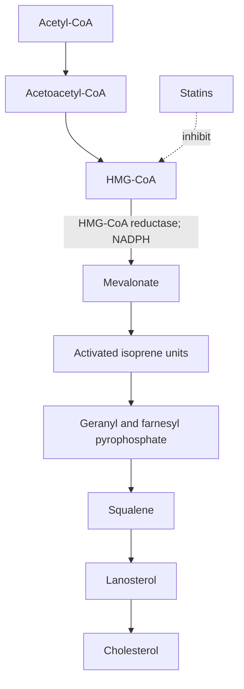
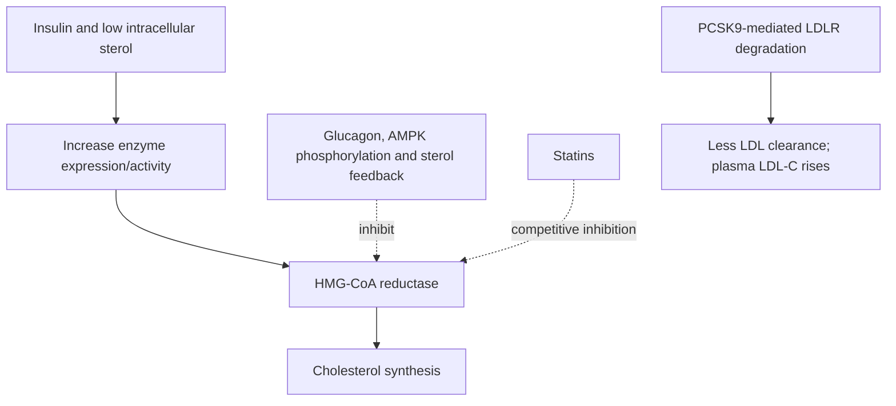
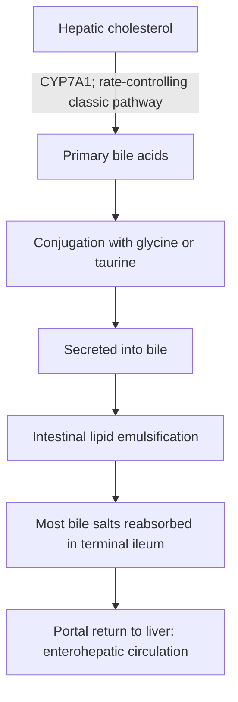

# 38. Metabolism of Carbohydrate to Cholesterol

## 1. Overview and Subcellular Location of Cholesterol Biosynthesis

All 27 carbon atoms of cholesterol are derived from **Acetyl-CoA**. Biosynthesis occurs predominantly in hepatocytes, enterocytes, adrenal cortex, and gonads.

* **Subcellular Localization:** Cytosol and smooth endoplasmic reticulum (SER).

---

## 2. Step-by-Step Pathway of Cholesterol Biosynthesis

### Key Enzymatic Steps
1. **Condensation:** $2 \text{ Acetyl-CoA} \rightarrow \text{Acetoacetyl-CoA} \xrightarrow{+\text{Acetyl-CoA (Cytosolic HMG-CoA Synthase)}} \text{HMG-CoA}$.
2. **Rate-Limiting Step:** HMG-CoA is reduced to **Mevalonate** by **HMG-CoA Reductase** on the ER membrane, consuming **$2 \text{ NADPH}$**.
3. **Formation of Isoprenoid Units:** Mevalonate is phosphorylated and decarboxylated to 5-carbon **Isopentenyl Pyrophosphate (IPP)**.
4. **Condensations:** $2 \text{ IPP} (C_5) \rightarrow \text{Geranyl pyrophosphate} (C_{10}) \xrightarrow{+\text{IPP}} \mathbf{\text{Farnesyl Pyrophosphate (FPP, } C_{15}\mathbf{)}}$.
5. **Squalene Synthesis:** Two FPP molecules condense tail-to-tail to form 30-carbon **Squalene** (first non-cyclic sterol precursor).
6. **Cyclization:** Squalene Monooxygenase cyclizes squalene to Lanosterol ($C_{30}$, first ringed sterol), which undergoes 19 steps to yield **Cholesterol ($C_{27}$)**.

---

## 3. Regulation of HMG-CoA Reductase

HMG-CoA Reductase is tightly controlled by four complementary mechanisms:

1. **Transcriptional Control via SREBP-2:**
   * **SREBP-2 (Sterol Regulatory Element-Binding Protein-2)** resides in the ER membrane bound to **SCAP (SREBP Cleavage-Activating Protein)**.
   * **Low Cholesterol:** SCAP escorts SREBP-2 to the Golgi apparatus, where **Site-1 Protease (S1P)** and **Site-2 Protease (S2P)** cleave the transcription factor domain, which enters the nucleus to induce HMG-CoA reductase and LDL receptor expression.
   * **High Cholesterol:** Cholesterol binds SCAP, trapping the SREBP-SCAP complex in the ER via **INSIG** protein.
2. **Covalent Modification (Phosphorylation / Dephosphorylation):**
   * **AMP-Activated Protein Kinase (AMPK):** Phosphorylates and **inactivates** HMG-CoA reductase during low energy states ($AMP \uparrow$, Glucagon $\uparrow$).
   * **Insulin:** Activates phosphoprotein phosphatase, dephosphorylating and **activating** HMG-CoA reductase in the fed state.
3. **Proteasomal Degradation:** High intracellular cholesterol and mevalonate promote insig-mediated ubiquitination and degradation of HMG-CoA reductase.
4. **Pharmacological Inhibition (Statins):**
   * **Statins (Atorvastatin, Rosuvastatin, Simvastatin):** Structural analogs of HMG-CoA that act as **reversible competitive inhibitors** of HMG-CoA reductase. Reduces intracellular cholesterol $\rightarrow$ triggers SREBP-2 activation $\rightarrow$ upregulates **LDL Receptor expression** on hepatocytes $\rightarrow$ lowers circulating plasma LDL-C.

---

## 4. Synthesis and Enterohepatic Circulation of Bile Acids

Bile acids are the major excretory breakdown product of cholesterol.

### Primary vs. Secondary Bile Acids

| Parameter | Primary Bile Acids | Secondary Bile Acids |
| :--- | :--- | :--- |
| **Synthesis Site** | Formed in the **liver** from cholesterol. | Formed in the **colon** by bacterial dehydroxylation. |
| **Chemical Compounds** | **Cholic Acid** and **Chenodeoxycholic Acid**. | **Deoxycholic Acid** (from cholic) and **Lithocholic Acid** (from chenodeoxycholic). |
| **Rate-Limiting Enzyme** | **7$\alpha$-Hydroxylase (CYP7A1)** (requires $NADPH, O_2, \text{Vit C}$). | Non-enzymatic bacterial 7$\alpha$-dehydroxylation. |
| **Conjugation** | Conjugated with **Glycine** or **Taurine** ($3:1$ ratio) to form bile salts. | Minimal conjugation. |

### Enterohepatic Circulation
* Over $95\%$ of bile salts secreted into bile are reabsorbed in the **terminal ileum** via the **Apical Sodium-Dependent Bile Acid Transporter (ASBT)** and returned to the liver via portal blood.
* **Bile Acid Sequestrants (Cholestyramine, Colesevelam):** Non-absorbable resins that bind bile acids in the intestinal lumen and promote fecal excretion. Interruption of enterohepatic circulation relieves feedback inhibition on $7\alpha$-hydroxylase, forcing the liver to convert more cholesterol into bile acids, upregulating LDLRs and lowering plasma LDL-C.

---

## 5. Coverage Audit

* **Textbook Alignment:** Covers cholesterol synthesis (all 27 carbons from Acetyl-CoA), cytosol/SER localization, HMG-CoA reductase rate-limiting step, mevalonate-to-squalene pathway, SREBP-2/SCAP regulation, statin pharmacology, $7\alpha$-hydroxylase rate-limiting step in bile acid synthesis, and enterohepatic circulation.
* **Integrations:** Includes INSIG protein mechanics, ASBT terminal ileum transport, and cholestyramine mechanism.
