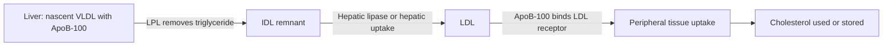
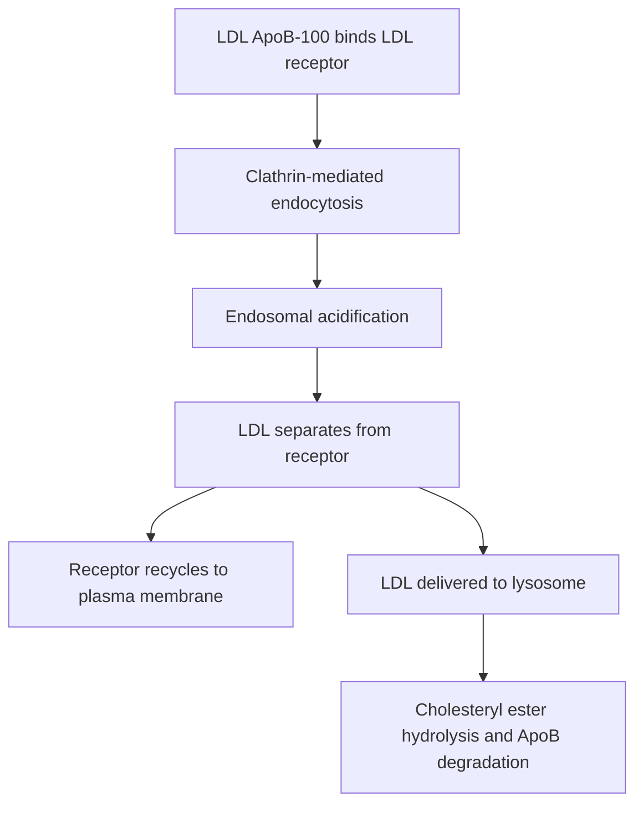
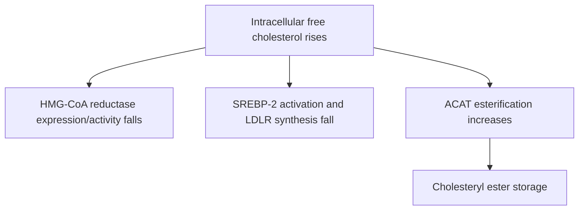
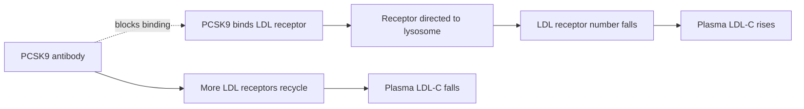
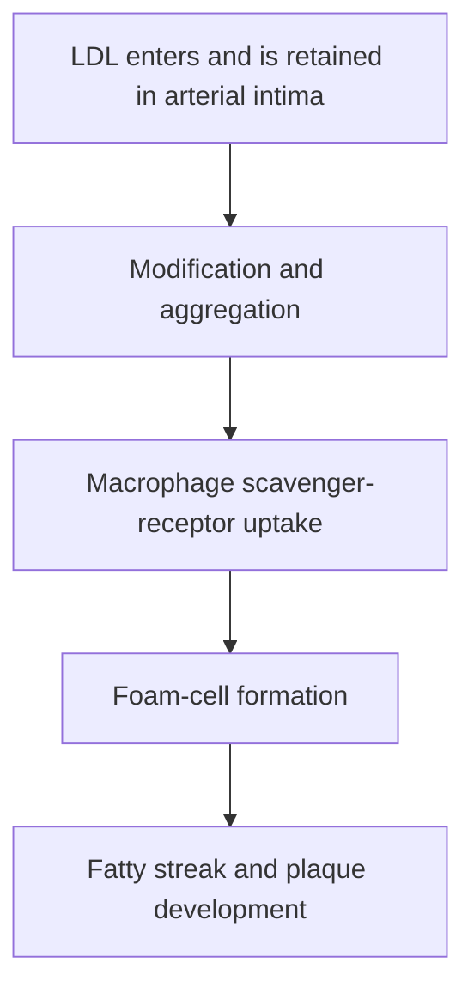

# 39. VLDL and LDL Metabolism I: Forward Cholesterol Transport

## 1. Overview of Forward Cholesterol Transport

Forward cholesterol transport delivers liver-synthesized and dietary cholesterol to peripheral tissues via apoB-containing lipoproteins: **VLDL $\rightarrow$ IDL $\rightarrow$ LDL**.

---

## 2. Low-Density Lipoprotein (LDL) Characteristics

* **Function:** Principal carrier of plasma cholesterol ($>60\%$ of total circulating cholesterol).
* **Composition:** Cholesteryl ester-dense hydrophobic core surrounded by a monolayer of phospholipids, unesterified cholesterol, and a single structural apoprotein molecule: **ApoB-100**.

---

## 3. LDL Receptor (LDLR) Mechanics and Endocytosis

Michael Brown and Joseph Goldstein elucidated the **receptor-mediated endocytosis pathway** of LDL (Nobel Prize 1985).

---

## 4. PCSK9 and Monoclonal Antibody Pharmacology

**PCSK9 (Proprotein Convertase Subtilisin/Kexin Type 9)** is a liver-secreted protease that acts as a post-translational regulator of LDLR density.

---

## 5. Atherogenesis and Scavenger Receptors

When plasma LDL levels exceed receptor clearance capacity, native LDL becomes trapped in the subendothelial space of arteries and undergoes oxidative modification to **Oxidized LDL (oxLDL)**.

---

## 6. Coverage Audit

* **Textbook Alignment:** Covers forward cholesterol transport pathway, LDL structural ApoB-100, LDLR clathrin-coated pit endocytosis steps, 3 intracellular cholesterol regulatory responses (HMG-CoA reductase, SREBP-2 LDLR suppression, ACAT activation), PCSK9 destruction mechanics, and macrophage foam cell atherogenesis.
* **Integrations:** Includes PCSK9 inhibitor pharmacology (Evolocumab, Alirocumab) and SR-A1 scavenger receptor non-saturability.
