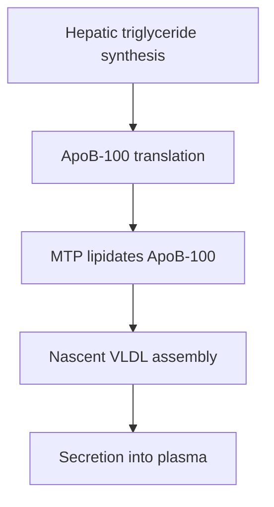
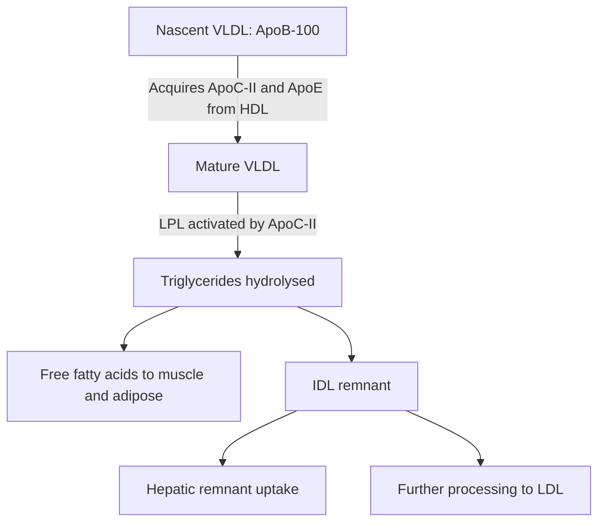

# 40. VLDL and LDL Metabolism II: Endogenous Triacylglycerol Transport

## 1. VLDL Synthesis and Assembly in Hepatocytes

Very Low-Density Lipoprotein (VLDL) transports endogenously synthesized triacylglycerols (TAGs) from the liver to peripheral adipose and muscle tissues.

### Abetalipoproteinemia
* **Genetics:** Autosomal recessive loss-of-function mutation in the gene encoding **MTP (Microsomal Triglyceride Transfer Protein)**.
* **Pathophysiology:** Inability to assemble and secrete ApoB-containing lipoproteins (**Chylomicrons** in intestine, **VLDL/LDL** in liver).
* **Clinical Manifestations:**
  * Severe fat malabsorption, steatorrhea, failure to thrive in infancy.
  * Absence of chylomicrons, VLDL, and LDL in plasma (extremely low serum cholesterol and TAGs).
  * Peripheral blood smear shows **Acanthocytes** (thorny RBCs due to altered membrane lipid composition).
  * Severe fat-soluble vitamin deficiencies (Vitamin E deficiency $\rightarrow$ spinocerebellar ataxia, posterior column loss, retinitis pigmentosa).

---

## 2. Intravascular Processing of VLDL

### Lipoprotein Lipase (LPL) Mechanics
* **Location:** Anchored to capillary endothelial walls of extrahepatic tissues (cardiac muscle, skeletal muscle, adipose) via **Heparan Sulfate Proteoglycans**.
* **Activation:** Requires **ApoC-II** present on VLDL and Chylomicrons.
* **Hormonal Control:** Induced by **Insulin** in adipose tissue (promotes fat storage after meals); activated by **Epinephrine/Exercise** in cardiac and skeletal muscle (supplies oxidative fuel).

---

## 3. Cholesteryl Ester Transfer Protein (CETP) Dynamics

**CETP** is a plasma protein that mediates lipid exchange between lipoprotein classes:

$$\text{HDL (Cholesteryl Esters)} + \text{VLDL / IDL (TAGs)} \xrightarrow{\text{CETP}} \text{HDL (TAGs)} + \text{VLDL / IDL (Cholesteryl Esters)}$$

* **Clinical Significance:** CETP activity enriches VLDL/LDL with pro-atherogenic cholesteryl esters while depleting HDL. CETP inhibitors (e.g., Anacetrapib) raise HDL-C but have shown variable clinical cardiovascular outcomes.

---

## 4. Major Human Apoproteins Master Reference Table

| Apoprotein | Primary Lipoproteins | Synthesis Site | Key Biochemical Function & Clinical Relevance |
| :--- | :--- | :--- | :--- |
| **ApoA-I** | HDL, Chylomicrons | Liver, Intestine | Structural protein of HDL; **activates LCAT**; mediates ABCA1 binding for reverse cholesterol transport. |
| **ApoB-48** | Chylomicrons, Remnants | Intestine | Structural protein of chylomicrons; formed by **APOBEC-1 RNA editing** ($48\%$ of ApoB gene). Lacks LDLR binding domain. |
| **ApoB-100** | VLDL, IDL, LDL | Liver | Structural protein of endogenous lipoproteins; **binds LDLR**. |
| **ApoC-II** | VLDL, Chylomicrons, HDL | Liver | **Essential cofactor that activates Lipoprotein Lipase (LPL)**. Deficiency $\rightarrow$ Familial Chylomicronemia. |
| **ApoE** | Chylomicron Remnants, VLDL, IDL, HDL | Liver, Brain | **High-affinity ligand for hepatic remnant receptors (LDLR and LRP)**. Isoform **ApoE4** increases risk for **Alzheimer's Disease**; ApoE2 homozygosity causes **Type III Dysbetalipoproteinemia**. |

---

## 5. Coverage Audit

* **Textbook Alignment:** Covers VLDL synthesis, MTP role, Abetalipoproteinemia, LPL vascular mechanics, ApoC-II/ApoE acquisition from HDL, IDL conversion by Hepatic Lipase, CETP lipid exchange, and the master apoprotein functional summary table.
* **Integrations:** Includes ApoE4 Alzheimer risk association, APOBEC-1 RNA editing logic, and acanthocyte histology in abetalipoproteinemia.
