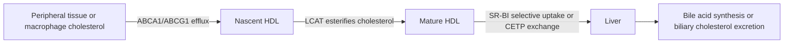

# 41. HDL Metabolism: Reverse Cholesterol Transport

## 1. Overview and Anti-Atherogenic Properties of HDL

High-Density Lipoprotein (HDL) protects against cardiovascular disease primarily through **Reverse Cholesterol Transport (RCT)**—the process of extracting excess unesterified cholesterol from peripheral tissues and macrophages and returning it to the liver for biliary excretion.

---

## 2. Step-by-Step Reverse Cholesterol Transport Pathway

### Step 1: Synthesis and Secretion of Nascent HDL
* Synthesized by liver and intestine as discoidal particles consisting of a phospholipid bilayer containing **ApoA-I**, **ApoA-II**, **ApoC-II**, and **ApoE**.

### Step 2: Cellular Cholesterol Efflux via ABCA1 and ABCG1
* Excess free cholesterol in macrophage foam cells is transported across the plasma membrane to extracellular ApoA-I acceptors via the **ABCA1 (ATP-Binding Cassette Transporter A1)** transporter.
* **ABCG1** mediates further cholesterol efflux to mature spherical HDL particles.

### Step 3: Esterification by LCAT
* **LCAT (Lecithin-Cholesterol Acyltransferase / PCAT):** Plasma enzyme synthesized by the liver, **activated by ApoA-I**.
* Transfers a fatty acid from position 2 of phosphatidylcholine (lecithin) to free cholesterol, forming **Cholesteryl Ester** + Lysophosphatidylcholine.

$$\text{Phosphatidylcholine} + \text{Free Cholesterol} \xrightarrow{\text{LCAT (Activated by ApoA-I)}} \text{Cholesteryl Ester} + \text{Lysophosphatidylcholine}$$

* Hydrophobic cholesteryl esters sink into the core of the particle, converting discoidal nascent HDL into spherical **$\text{HDL}_3$** and larger **$\text{HDL}_2$**.

### Step 4: Hepatic Clearance
1. **Direct Selective Uptake via SR-BI:** $\text{HDL}_2$ binds **SR-BI (Scavenger Receptor Class B Type I)** on hepatocytes. Cholesteryl esters are selectively transferred into the liver without internalizing and degrading the HDL protein particle.
2. **Indirect Transport via CETP:** CETP transfers cholesteryl esters from HDL to VLDL/LDL in exchange for TAGs $\rightarrow$ clearance via hepatic LDLR.

---

## 3. Clinical Disorders of HDL Metabolism

### Tangier Disease (ABCA1 Deficiency)
* **Genetics:** Autosomal recessive mutation in the *ABCA1* gene.
* **Pathophysiology:** Complete absence of cellular cholesterol efflux to ApoA-I $\rightarrow$ lipid-poor ApoA-I is rapidly degraded by kidneys $\rightarrow$ **near-zero plasma HDL-C and ApoA-I levels**.
* **Clinical Hallmarks:**
  * Cholesteryl ester accumulation in the reticuloendothelial system.
  * **Pathognomonic Large, Orange/Yellow Hypertrophic Tonsils**.
  * Hepatosplenomegaly, generalized lymphadenopathy, and progressive peripheral neuropathy.

### LCAT Deficiency Disorders
1. **Familial LCAT Deficiency (Complete / Norum Disease):** Complete absence of LCAT activity. Unesterified cholesterol accumulates in tissues $\rightarrow$ **triad of corneal opacities, target-cell hemolytic anemia, and progressive renal failure**.
2. **Fish-Eye Disease (Partial LCAT Deficiency):** Partial loss of LCAT activity against HDL $\rightarrow$ severe corneal opacities without renal failure or anemia.

---

## 4. Coverage Audit

* **Textbook Alignment:** Covers anti-atherogenic properties of HDL, reverse cholesterol transport mechanics, ABCA1/ABCG1 efflux, LCAT esterification equation, SR-BI selective uptake, Tangier disease pathognomonic orange tonsils, and complete/partial LCAT deficiency.
* **Integrations:** Includes distinction between direct SR-BI uptake vs CETP indirect uptake, and target-cell hemolytic anemia in LCAT deficiency.
