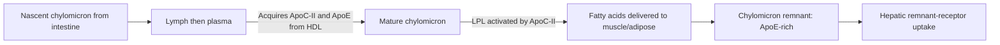
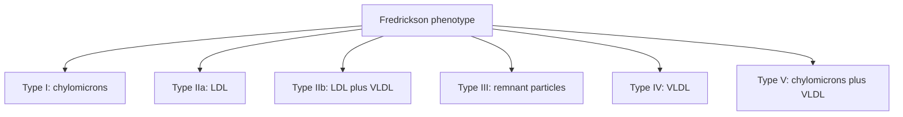

# 42. Absorption and Disposal of Dietary Triacylglycerols and Cholesterol by Chylomicrons

## 1. Intestinal Lipid Digestion and Absorption

Dietary lipids (predominantly TAGs, with minor cholesterol and phospholipids) are emulsified by bile salts in the duodenum and hydrolyzed by pancreatic enzymes.

* **NPC1L1 (Niemann-Pick C1-Like 1) Transporter:** Mediates active uptake of dietary cholesterol into enterocytes. Inhibited specifically by the hypolipidemic drug **Ezetimibe**.

---

## 2. Chylomicron Assembly, Secretion, and Exogenous Pathway

1. **Assembly:** Enterocyte MTP loads re-esterified TAGs and cholesteryl esters onto **ApoB-48**.
2. **Secretion:** Secreted via exocytosis into **intestinal lacteals / lymphatic system** (bypasses portal liver circulation initially).
3. **Maturation:** Enters venous bloodstream via thoracic duct and acquires **ApoC-II** and **ApoE** from circulating HDL.
4. **Lipolysis:** Capillary **Lipoprotein Lipase (LPL)** in adipose and muscle hydrolyzes core TAGs, releasing FFAs.
5. **Remnant Clearance:** Depleted **Chylomicron Remnants** retain ApoE and ApoB-48, detached from ApoC-II, and are rapidly cleared by hepatic hepatocytes via ApoE binding to **LRP (LDL Receptor-Related Protein)** and **LDLR**.

---

## 3. Primary Familial Dyslipidaemias Classification

Fredrickson classification categorizes primary hyperlipidemias based on elevated lipoprotein patterns:

### Comprehensive Dyslipidaemia Master Comparison Table

| Fredrickson Type | Primary Disease Name | Underlying Molecular Defect | Elevated Lipoprotein(s) | Key Clinical Hallmarks & Physical Signs |
| :--- | :--- | :--- | :--- | :--- |
| **Type I** | **Familial Chylomicronemia** | Autosomal recessive mutation in **LPL** or **ApoC-II**. | **Chylomicrons** ($\uparrow\uparrow\uparrow$) | **Eruptive xanthomas** (pruritic yellow papules), **recurrent acute pancreatitis**, lipemia retinalis, and milky supernatant serum. This phenotype is not usually associated with the marked premature atherosclerosis seen with LDL-rich disorders, although overall cardiovascular risk still depends on coexisting risk factors. |
| **Type IIa** | **Familial Hypercholesterolemia (FH)** | Autosomal dominant mutation in **LDLR** gene ($>90\%$), *APOB* gene, or *PCSK9* gain-of-function. | **LDL** ($\uparrow\uparrow\uparrow$) | Accelerated atherosclerosis / **premature CAD** (MI before age 30 in homozygotes). **Tendon xanthomas** (especially Achilles tendon), **xanthelasma**, corneal arcus. |
| **Type IIb** | **Familial Combined Hyperlipidemia** | Overproduction of ApoB-100 and hepatic VLDL. | **LDL** & **VLDL** ($\uparrow\uparrow$) | Premature CAD, metabolic syndrome, obesity, diabetes. |
| **Type III** | **Familial Dysbetalipoproteinemia** (Broad Beta Disease) | Homozygosity for **ApoE2 ($E2/E2$)** allele (defective binding to hepatic remnant receptors). | **Chylomicron Remnants** & **IDL** ($\uparrow\uparrow$) | Premature CAD and peripheral vascular disease. Pathognomonic **Palmar Xanthomas (Xanthoma striatum palmare)** and tuberoeruptive xanthomas on elbows/knees. |
| **Type IV** | **Familial hypertriglyceridemia** | Hepatic overproduction or reduced clearance of VLDL. | **VLDL** ($\uparrow\uparrow$) | Often associated with insulin resistance/obesity; pancreatitis risk rises with severe hypertriglyceridemia, especially around or above $1,000\text{ mg/dL}$. |
| **Type V** | **Mixed chylomicronemia / hypertriglyceridemia** | Increased chylomicrons plus VLDL; may reflect polygenic susceptibility with secondary factors or rare inherited defects. | **Chylomicrons + VLDL** | Very high triglycerides; eruptive xanthomas and acute pancreatitis risk; phenotype can vary with diabetes, alcohol, obesity, and medications. |

---

## 4. Lipid-Lowering Pharmacotherapy Summary

| Drug Class | Key Examples | Primary Mechanism of Action | Major Lipid Effects | Key Adverse Effects |
| :--- | :--- | :--- | :--- | :--- |
| **Statins** | Atorvastatin, Rosuvastatin | Competitive inhibitors of **HMG-CoA Reductase** $\rightarrow$ upregulates LDLRs. | **LDL $\downarrow\downarrow\downarrow$ (20–60%)**, TAG $\downarrow$, HDL $\uparrow$ | **Myopathy / Rhabdomyolysis** (elevated CK; risk increases with fibrates), hepatotoxicity (elevated transaminases). |
| **Ezetimibe** | Ezetimibe | Blocks **NPC1L1 transporter** at enterocyte brush border, inhibiting cholesterol absorption. | **LDL $\downarrow$ (15–20%)** | Diarrhea, mild transaminase elevation when combined with statins. |
| **PCSK9 Inhibitors** | Evolocumab, Alirocumab | Monoclonal antibodies blocking PCSK9 $\rightarrow$ prevents LDLR lysosomal degradation. | **LDL $\downarrow\downarrow\downarrow$ (50–70%)** | Injection site reactions, nasopharyngitis. |
| **Fibrates** | Fenofibrate, Gemfibrozil | Activate **PPAR-$\alpha$** $\rightarrow$ induces LPL expression, decreases ApoC-III. | **TAG $\downarrow\downarrow\downarrow$ (30–50%)**, HDL $\uparrow$ | Myopathy (especially with gemfibrozil plus a statin; this combination is generally avoided and fenofibrate is usually preferred if a fibrate–statin combination is required), and increased risk of cholesterol gallstones due to increased biliary cholesterol saturation. |
| **Bile Acid Sequestrants** | Cholestyramine, Colesevelam | Binds intestinal bile acids $\rightarrow$ interrupts enterohepatic circulation $\rightarrow 7\alpha$-hydroxylase $\uparrow$. | **LDL $\downarrow$**, **TAG $\uparrow$ (mild increase)** | GI distress, bloating, constipation, impaired absorption of fat-soluble vitamins and drugs (warfarin, digoxin). |
| **Niacin (Vitamin $B_3$)** | Niacin | Inhibits lipolysis in adipose tissue via HCAR2 $\rightarrow$ decreases FFA flux to liver $\rightarrow$ VLDL $\downarrow$. | HDL-C rises substantially and LDL-C/TG may fall; however, pharmacologically raising HDL-C with niacin has not translated into routine additional ASCVD-event reduction when added to statin therapy. | **Cutaneous flushing & warmth** (mediated by prostaglandins $\rightarrow$ prevented by Aspirin), hyperglycemia, hyperuricemia (gout). |

---

### Interpretation of the pharmacotherapy table

The drug-effect table is primarily biochemical/exam-oriented and should not be used as a current prescribing pathway. The 2026 ACC/AHA guideline advises against routine niacin or fibrate addition to statins for ASCVD-event reduction; use of triglyceride-lowering therapy for severe hypertriglyceridaemia is a separate clinical decision.

## 5. Coverage Audit

* **Textbook Alignment:** Covers digestion/absorption, NPC1L1, Ezetimibe mechanism, chylomicron assembly (MTP, ApoB-48), lymphatic thoracic duct transport, LPL lipolysis, remnant ApoE hepatic uptake, Fredrickson dyslipidaemia Types I–IV table, and comprehensive lipid-lowering pharmacology.
* **Clinical update:** Statins remain central to ASCVD risk reduction. The 2026 ACC/AHA dyslipidaemia guideline recommends against routine addition of niacin or fibrates to statins for ASCVD-event reduction because benefit has not been demonstrated; fibrates may still be considered in selected severe hypertriglyceridaemia settings to reduce triglycerides/pancreatitis risk. A rise in HDL-C is a biochemical effect, not proof of improved clinical outcomes. The 2026 guideline also emphasizes PREVENT-ASCVD risk estimation, at least once-in-a-lifetime Lp(a) measurement, selective apoB measurement, LDL-C/non-HDL-C goals, and selective CAC scoring.

## Selected References for Clinical Updates

- [2026 ACC/AHA et al. Guideline on the Management of Dyslipidemia.](https://doi.org/10.1161/CIR.0000000000001423)
- [ESC/ACC/AHA/WHF. Fifth Universal Definition of Myocardial Infarction. 2026.](https://www.escardio.org/guidelines/clinical-practice-guidelines/pocket-guidelines/universal-definition-of-myocardial-infarction/)
