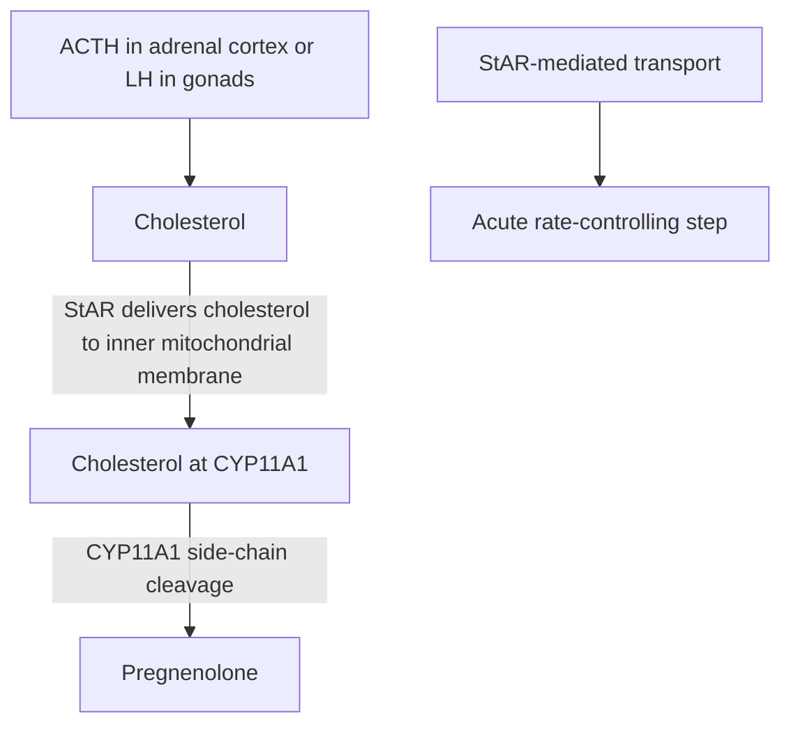
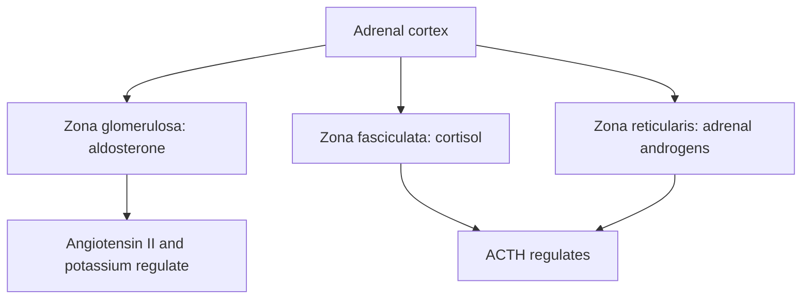
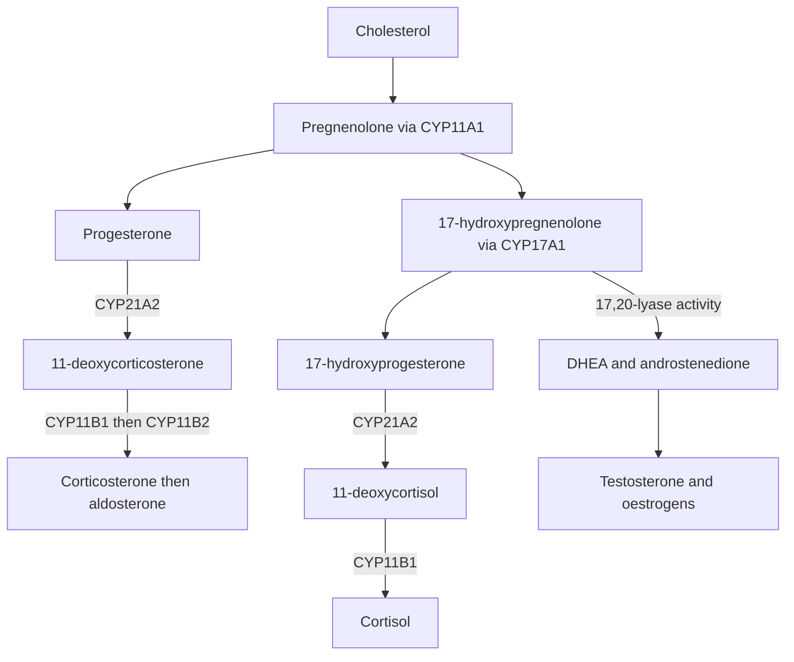
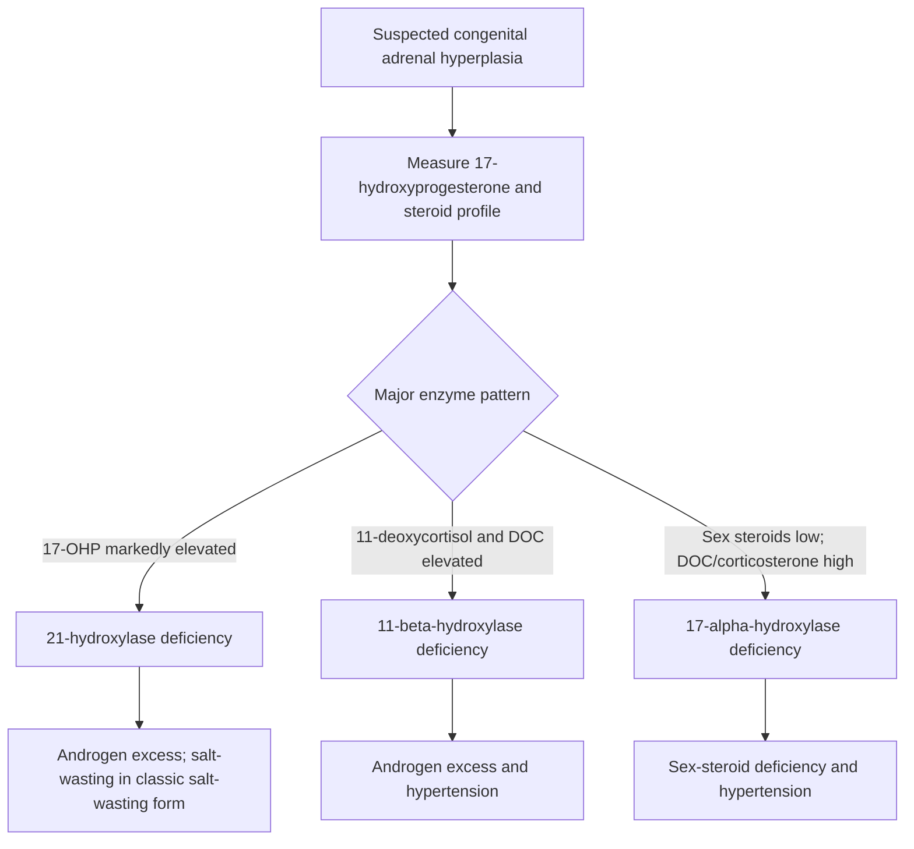

# 43. Steroid Hormones: Aldosterone, Cortisol, Androgens and Oestrogens

## 1. Steroidogenesis Overview and Rate-Limiting Step

All steroid hormones are synthesized from **Cholesterol** ($C_{27}$) in the adrenal cortex, gonads, and placenta.

* **StAR (Steroidogenic Acute Regulatory) protein:** Transfers cholesterol from the outer to the inner mitochondrial membrane; this is the acute rate-limiting/regulatory step for steroid hormone synthesis in steroidogenic tissues.
* **Cholesterol desmolase (CYP11A1 / side-chain cleavage enzyme):** Catalyses the first enzymatic conversion of cholesterol ($C_{27}$) $\rightarrow$ **pregnenolone ($C_{21}$)** in the mitochondrial inner membrane. It is an essential first enzyme, but StAR-mediated cholesterol delivery is the acute rate-limiting step. Stimulated by **ACTH** in the adrenal cortex and **LH** in gonads.

---

## 2. Adrenal Cortex Zonal Anatomy and Biosynthetic Pathways

---

## 3. Congenital Adrenal Hyperplasia (CAH)

CAH encompasses autosomal recessive enzyme deficiencies in the adrenal steroidogenesis pathway, leading to impaired cortisol synthesis, elevated ACTH, and adrenal cortical hyperplasia.

### CAH Subtype Master Comparison Table

| Feature | 21$\alpha$-Hydroxylase Deficiency | 11$\beta$-Hydroxylase Deficiency | 17$\alpha$-Hydroxylase Deficiency |
| :--- | :--- | :--- | :--- |
| **Frequency** | **~95% of all CAH cases** (Most common). | ~5% of cases. | Rare ($<1\%$). |
| **Enzyme Defect** | **CYP21A2** | **CYP11B1** | **CYP17A1** |
| **Mineralocorticoid Status** | **Variable:** aldosterone is markedly reduced in the classic salt-wasting form; it may be relatively preserved in simple-virilizing/non-classic disease. Classic salt-wasting causes hyponatremia, hyperkalemia, and elevated renin. | **INCREASED EFFECT** (Accumulation of **11-Deoxycorticosterone / 11-DOC**, a potent mineralocorticoid $\rightarrow$ fluid retention, suppressed renin). | **INCREASED** (Excess 11-DOC and corticosterone $\rightarrow$ low renin, hypokalemia). |
| **Blood Pressure** | **HYPOTENSION** / Hypovolemic shock in infants. | **HYPERTENSION** | **HYPERTENSION** |
| **Androgen Status** | **INCREASED** (Precursors diverted into androgen pathway). | **INCREASED** (Precursors diverted into androgen pathway). | **DECREASED** (Cannot synthesize 17-OH precursors or sex steroids). |
| **Female Phenotype ($46,XX$)** | **Virilization / Ambiguous Genitalia** at birth (clitoromegaly, urogenital sinus). | **Virilization / Ambiguous Genitalia** at birth. | **Phenotypically Female at birth**; lacks secondary sexual characteristics / primary amenorrhea at puberty. |
| **Male Phenotype ($46,XY$)** | Normal genitalia at birth; precocious pseudopuberty later in childhood. | Normal genitalia at birth; precocious pseudopuberty later. | **Undervirilised or female-appearing external genitalia** (severity varies; absent/poor pubertal virilisation and primary amenorrhoea are typical later clues). |
| **Diagnostic Marker** | **Serum 17-Hydroxyprogesterone (17-OHP) $\uparrow\uparrow\uparrow$** | **11-Deoxycortisol & 11-DOC $\uparrow\uparrow\uparrow$** | **Corticosterone & 11-DOC $\uparrow\uparrow\uparrow$**; low sex steroids. |

---

## 4. Peripheral Conversion and Target Organ Action

* **5$\alpha$-Reductase:** Converts Testosterone $\rightarrow$ **Dihydrotestosterone (DHT)** (more potent androgen than testosterone; a single fixed potency ratio is an oversimplification) in prostate and hair follicles. Inhibited by **Finasteride** (used in BPH and male-pattern baldness).
* **Aromatase (CYP19A1):** Converts Androstenedione $\rightarrow$ Estrone and Testosterone $\rightarrow$ **Estradiol** in ovarian granulosa cells, adipose tissue, and brain. Inhibited by **Anastrozole / Letrozole** (used in ER-positive breast cancer).

---

## 5. Coverage Audit

* **Textbook Alignment:** Covers StAR-mediated cholesterol transport as the acute rate-limiting step, CYP11A1 as the first enzyme,  zonal adrenal cortex anatomy (GFR), complete steroidogenesis pathways, CAH 21-hydroxylase vs 11-beta vs 17-alpha comparative table, 5$\alpha$-reductase, and aromatase enzymes.
* **Integrations:** Includes finasteride/anastrozole pharmacology, 11-DOC hypertensive mechanism in 11$\beta$-OH deficiency, and 17-OHP diagnostic marker.
