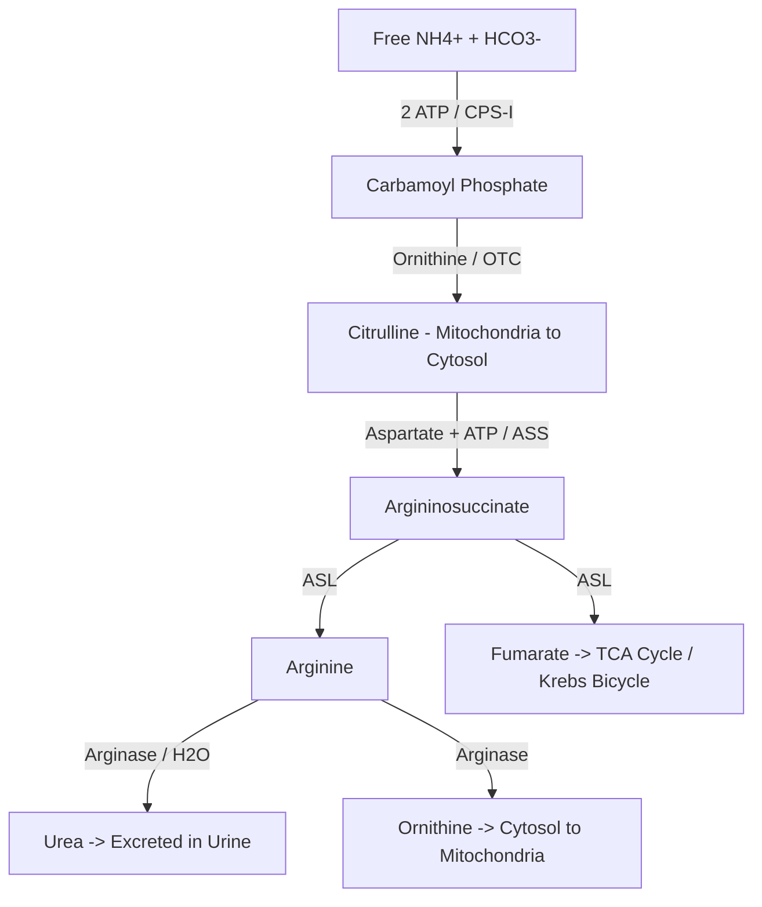
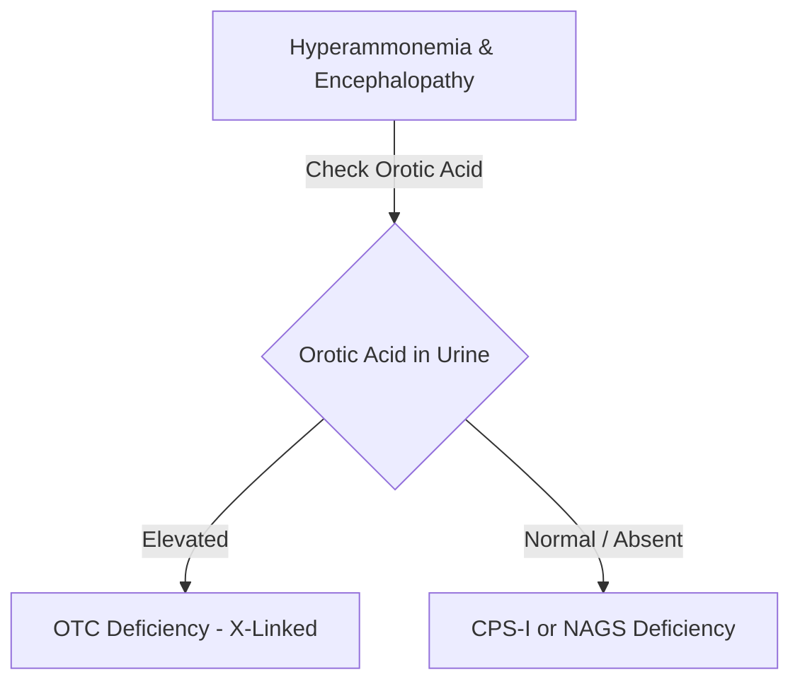

# 44. Urea Cycle and Overview of Amino Acid Catabolism

## Overview of Amino Acid Nitrogen Metabolism
Unlike carbohydrates and lipids, excess amino acids cannot be stored in the body. Amino acid catabolism requires the removal and disposal of the toxic $\alpha$-amino nitrogen group as **urea**, while the remaining carbon skeleton ($\alpha$-ketoacid) is funneled into energy production, gluconeogenesis, or lipogenesis.

```mermaid
gantt
    title Amino Acid Nitrogen Removal Flow
    dateFormat  X
    axisFormat %s
    section Nitrogen Removal
    Transamination (ALT/AST) : active, 0, 1
    Oxidative Deamination (GDH) : active, 1, 2
    Ammonia Transport (Glutamine/Alanine) : active, 2, 3
    Urea Cycle (Liver Mitochondria & Cytosol) : active, 3, 4
```

---

## 1. Transamination Reactions
Transamination is the initial step in amino acid catabolism, wherein the $\alpha$-amino group of an amino acid is transferred to an $\alpha$-ketoacid acceptor (predominantly **$\alpha$-ketoglutarate**), converting the original amino acid into its corresponding $\alpha$-ketoacid and generating **glutamate**.

$$\text{Amino Acid}_1 + \alpha\text{-Ketoglutarate} \xrightleftharpoons[\text{PLP}]{\text{Aminotransferase}} \alpha\text{-Ketoacid}_1 + \text{Glutamate}$$

* **Enzymes:** Aminotransferases / Transaminases (e.g., **Alanine Aminotransferase [ALT/SGPT]** and **Aspartate Aminotransferase [AST/SGOT]**).
* **Cofactor:** **Pyridoxal Phosphate (PLP / Vitamin $B_6$)**, acting via a **ping-pong kinetic mechanism** involving a Schiff base intermediate.
* **Exceptions:** **Lysine, Threonine, and Proline** do NOT undergo transamination directly.
* **Diagnostic Utility:**
  * **ALT:** Cytosolic enzyme, highly specific for hepatocellular injury.
  * **AST:** Present in both mitochondria and cytosol of heart, liver, skeletal muscle, and kidney. De Ritis ratio ($\text{AST}/\text{ALT} > 2.0$) indicates alcoholic liver disease.

---

## 2. Oxidative Deamination: Glutamate Dehydrogenase (GDH)
Glutamate serves as the central collection funnel for amino acid nitrogen. In the liver and kidney mitochondria, glutamate undergoes **oxidative deamination** by **Glutamate Dehydrogenase (GDH)** to release free toxic ammonia ($\text{NH}_4^+$) and regenerate $\alpha$-ketoglutarate.

$$\text{Glutamate} + \text{NAD}^+ (\text{or NADP}^+) + \text{H}_2\text{O} \xrightleftharpoons{\text{GDH}} \alpha\text{-Ketoglutarate} + \text{NH}_4^+ + \text{NADH} (\text{or NADPH}) + \text{H}^+$$

* **Unique Feature:** GDH is one of the few enzymes that can utilize either **$\text{NAD}^+$** (for oxidative catabolism) or **$\text{NADP}^+$** (for reductive amination).
* **Allosteric Regulation:**
  * **Inhibitors:** High energy state (**GTP**, **ATP**).
  * **Activators:** Low energy state (**ADP**, **GDP**).

---

## 3. Ammonia Transport & Neurotoxicity
Ammonia ($\text{NH}_3 / \text{NH}_4^+$) is a potent neurotoxin. Free $\text{NH}_3$ generated in peripheral tissues is converted into non-toxic transport forms before entering circulation:

### Non-Toxic Transport Forms
1. **Glutamine Pathway (Peripheral Tissues & Brain):**
   * **Glutamine Synthetase:** Fixes $\text{NH}_4^+$ onto glutamate to form **Glutamine** (requires 1 ATP).
   * **Glutaminase:** In the liver and kidney, renal/hepatic glutaminase cleaves glutamine to release free $\text{NH}_4^+$ for urea synthesis or renal excretion.
2. **Glucose-Alanine Cycle (Cori-like Cycle in Skeletal Muscle):**
   * Muscle pyruvate is transaminated by ALT to form **Alanine**, which travels via blood to the liver.
   * In the liver, ALT converts alanine back to pyruvate (for gluconeogenesis) and glutamate (for urea synthesis).

### Molecular Mechanisms of Ammonia Neurotoxicity
Elevated blood ammonia cross the blood-brain barrier:
* **Glutamate & ATP Depletion:** Excess $\text{NH}_3$ drives brain glutamine synthetase ($\text{Glutamate} + \text{NH}_3 + \text{ATP} \rightarrow \text{Glutamine}$), depleting brain glutamate (excitatory neurotransmitter) and $\alpha$-ketoglutarate (draining TCA cycle ATP production).
* **Astrocyte Swelling:** Glutamine accumulates inside astrocytes as an osmolyte, inducing cell swelling, brain edema, intracranial hypertension, and **Alzheimer Type II astrocytosis**.
* **GABA Imbalance:** Depletion of glutamate impairs GABA synthesis.

---

## 4. The Urea Cycle (Krebs-Henseleit Cycle)
The urea cycle operates exclusively in the **liver** (split between the **mitochondrial matrix** and **cytosol**) to dispose of ammonia.

### Enzymatic Steps of the Urea Cycle

| Step | Reaction & Substrates | Enzyme | Cellular Location | Energetics / Key Regulators |
| :--- | :--- | :--- | :--- | :--- |
| **1** | $\text{NH}_4^+ + \text{HCO}_3^- + 2\text{ ATP} \rightarrow \text{Carbamoyl Phosphate} + 2\text{ADP} + \text{P}_i$ | **Carbamoyl Phosphate Synthetase I (CPS-I)** | Mitochondrial Matrix | Rate-limiting step; Absolutely requires **$N$-Acetylglutamate (NAG)** as obligate allosteric activator. |
| **2** | $\text{Carbamoyl Phosphate} + \text{Ornithine} \rightarrow \text{Citrulline} + \text{P}_i$ | **Ornithine Transcarbamylase (OTC)** | Mitochondrial Matrix | Citrulline is transported out into cytosol via ORNT1. |
| **3** | $\text{Citrulline} + \text{Aspartate} + \text{ATP} \rightarrow \text{Argininosuccinate} + \text{AMP} + \text{PP}_i$ | **Argininosuccinate Synthetase (ASS)** | Cytosol | Consumes 1 ATP ($2\sim\text{P}$ high-energy bonds broken). |
| **4** | $\text{Argininosuccinate} \rightarrow \text{Arginine} + \text{Fumarate}$ | **Argininosuccinate Lyase (ASL)** | Cytosol | Fumarate links Urea Cycle to TCA Cycle (**Krebs Bicycle**). |
| **5** | $\text{Arginine} + \text{H}_2\text{O} \rightarrow \text{Urea} + \text{Ornithine}$ | **Arginase** | Cytosol | Cleaves urea; regenerated ornithine enters mitochondria via ORNT1. Absent in non-hepatic tissues. |

* **Overall Equation:**

$$\text{NH}_4^+ + \text{HCO}_3^- + \text{Aspartate} + 3\text{ ATP} + \text{H}_2\text{O} \rightarrow \text{Urea} + \text{Fumarate} + 2\text{ADP} + 2\text{P}_i + \text{AMP} + \text{PP}_i$$

* **Net Energy Cost:** **4 high-energy phosphate bonds ($4\sim\text{P}$)** from 3 ATP molecules.

### Regulation of the Urea Cycle
* **Short-Term Regulation (Allosteric):** **$N$-Acetylglutamate (NAG)** is synthesized from Acetyl-CoA and Glutamate by **NAG Synthetase (NAGS)**, which is strongly activated by **Arginine**.
* **Long-Term Regulation:** High-protein diets or prolonged starvation increase transcription of all 5 urea cycle enzymes.

---

## 5. Inherited Urea Cycle Disorders (UCDs)

UCDs can cause **hyperammonemia** and may present with encephalopathy, lethargy, vomiting, and respiratory alkalosis from central hyperventilation. Clinical onset is variable: severe neonatal presentations occur with near-complete enzyme deficiencies, while partial defects may present later or remain unrecognised until catabolic stress. Most UCDs are **autosomal recessive**; **OTC deficiency is X-linked**. Heterozygous females with OTC deficiency have variable expression because of X-chromosome inactivation.

### Diagnostic Comparison of Urea Cycle Deficiencies

| Disease | Defective Enzyme | Genetic Inheritance | Key Laboratory Findings | Unique Clinical Clues |
| :--- | :--- | :--- | :--- | :--- |
| **OTC Deficiency** | Ornithine Transcarbamylase | **X-Linked Recessive** | High blood $\text{NH}_3$, **Markedly High Urinary Orotic Acid**, Low Citrulline/Arginine | Most common UCD; excess carbamoyl phosphate spills into pyrimidine synthesis. |
| **CPS-I Deficiency** | Carbamoyl Phosphate Synthetase I | Autosomal Recessive | High blood $\text{NH}_3$, **No Orotic Aciduria**, Low Citrulline/Arginine | Severe neonatal hyperammonemia. |
| **NAGS Deficiency** | $N$-Acetylglutamate Synthetase | Autosomal Recessive | Identical laboratory findings to CPS-I deficiency | Phenotypically mimics CPS-I; **Dramatically responds to $N$-Carbamoylglutamate (Carglumic acid)**. |
| **Citrullinemia (Type I)** | Argininosuccinate Synthetase | Autosomal Recessive | High blood $\text{NH}_3$, **Massively Elevated Blood Citrulline** | Neurological deterioration, seizure activity. |
| **Argininosuccinic Aciduria** | Argininosuccinate Lyase | Autosomal Recessive | High blood $\text{NH}_3$, Elevated Argininosuccinate in plasma/urine | **Trichorrhexis nodosa** (fragile nodular hair). |
| **Hyperargininemia** | Arginase | Autosomal Recessive | Moderate $\text{NH}_3$ elevation, **Massively Elevated Blood Arginine** | Less severe hyperammonemia; presents as progressive **spastic diplegia/quadriplegia** and choreoathetosis. |

### Medical Management of Hyperammonemia

**Acute emergency principle:** stop catabolism rapidly with high-calorie glucose/lipid support, treat the precipitant, temporarily adjust protein intake under a metabolic team, use nitrogen scavengers and appropriate arginine/citrulline replacement, and monitor ammonia frequently. Do not delay specialist consultation or extracorporeal clearance in a deteriorating patient.
1. **Dietary Restriction:** Protein restriction while providing sufficient calories to prevent endogenous muscle catabolism.
2. **Ammonia Scavengers (Pharmacological Nitrogen Elimination):**
   * **Sodium Benzoate:** Binds Glycine to form **Hippurate**, excreted in urine (removes 1 nitrogen).
   * **Sodium Phenylbutyrate / Phenylacetate:** Binds Glutamine to form **Phenylacetylglutamine**, excreted in urine (removes 2 nitrogens).
3. **Arginine/citrulline supplementation:** Use is defect-specific and must be directed by a metabolic specialist. Arginine is used in most UCDs but is avoided in arginase deficiency; citrulline may be preferred in selected proximal defects, while arginine is commonly used in distal defects.
4. **Extracorporeal ammonia clearance (intermittent hemodialysis or continuous kidney replacement therapy):** Consider urgently in severe or rapidly worsening hyperammonemia, neurological deterioration/cerebral oedema, inadequate response to medical treatment, or according to age-specific metabolic-emergency protocols. Do **not** use one universal ammonia cut-off: thresholds vary by age, symptoms, rate of rise, comorbidity, and local expertise. Adult UCD guidance commonly advises considering extracorporeal detoxification around $>200\,\mu mol/L$, but the decision is not based on the number alone.

---

## High-Yield NEET PG / INI-CET Points
* **X-Linked Urea Cycle Disorder:** **OTC Deficiency**.
* **Differentiating OTC vs. CPS-I Deficiency:** High urinary orotic acid in OTC deficiency (absent in CPS-I).
* **Urea Cycle Link to TCA Cycle:** **Fumarate** released by Argininosuccinate Lyase (**Krebs Bicycle**).
* **Obligate Activator of CPS-I:** **$N$-Acetylglutamate (NAG)**.
* **Treatment for NAGS Deficiency:** **$N$-Carbamoylglutamate (Carglumic acid)**.
* **Arginase Deficiency Signature:** Progressive spastic diplegia without severe early hyperammonemic coma.

---

## Selected References for Clinical Updates

- [Häberle et al. Suggested guidelines for the diagnosis and management of urea cycle disorders: First revision. J Inherit Metab Dis. 2019.](https://doi.org/10.1002/jimd.12100)
