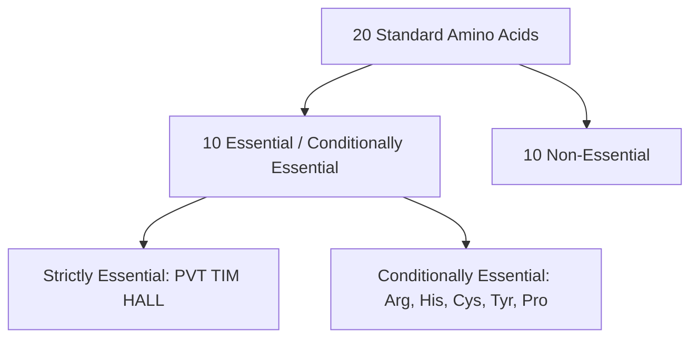
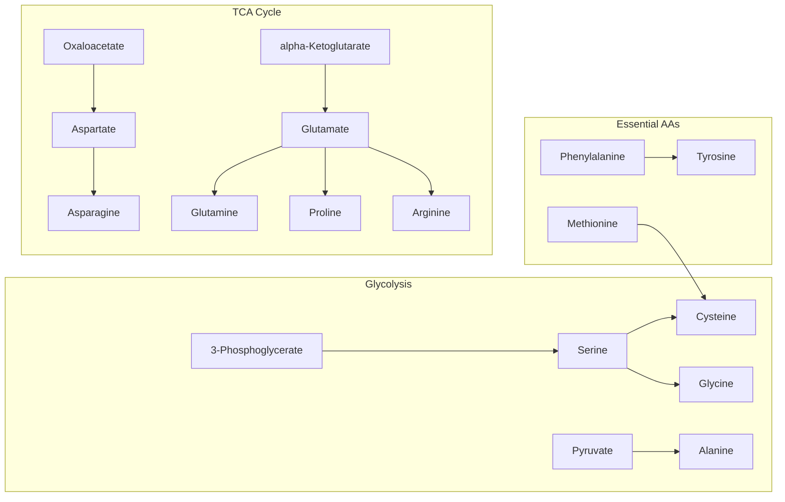
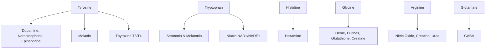

# 45. Non-essential and Essential Amino Acids

## Nutritional Classification of Amino Acids
Human proteins are constructed from 20 standard $\alpha$-amino acids. Based on dietary necessity, they are classified into essential, non-essential, and conditionally essential categories.

---

## 1. Essential, Non-Essential, and Conditionally Essential Amino Acids

### Strict Classification Matrix

| Category | Definition | Amino Acids |
| :--- | :--- | :--- |
| **Strictly Essential (Indispensable)** | Cannot be synthesized by human cells *de novo* at rates adequate to meet metabolic demands; must be supplied in diet. | **Phenylalanine, Valine, Threonine, Tryptophan, Isoleucine, Methionine, Histidine, Arginine, Leucine, Lysine** *(Mnemonic: **PVT TIM HALL**)* |
| **Non-Essential (Dispensable)** | Can be synthesized in sufficient quantities by endogeneous metabolic pathways from precursor metabolites. | **Alanine, Aspartate, Asparagine, Glutamate, Glutamine, Glycine, Proline, Serine, Cysteine, Tyrosine** |
| **Conditionally Essential** | Non-essential under normal conditions, but become dietary essential during rapid growth, severe stress, premature birth, or specific organ dysfunction. | **Arginine, Histidine, Cysteine, Tyrosine, Proline, Glutamine** |

* **Semi-Essential Note:** **Arginine** and **Histidine** are classified as semi-essential because adult urea cycle and tissue synthesis rates are sufficient, but growing infants and children require additional dietary intake.

---

## 2. Biosynthetic Pathways of Non-Essential Amino Acids

Non-essential amino acids are synthesized via simple enzymatic pathways originating from glycolytic, TCA cycle, or essential amino acid precursors.

### Detailed Synthetic Origins

| Amino Acid | Precursor Molecule | Key Enzymes & Cofactors | Biochemical Mechanism / Notes |
| :--- | :--- | :--- | :--- |
| **Alanine** | Pyruvate | Alanine Aminotransferase (ALT), **PLP** | Direct transamination of pyruvate from glutamate. |
| **Aspartate** | Oxaloacetate (OAA) | Aspartate Aminotransferase (AST), **PLP** | Direct transamination of OAA from glutamate. |
| **Asparagine** | Aspartate | Asparagine Synthetase, **ATP, Glutamine** | Amidation of aspartate using glutamine as nitrogen donor. |
| **Glutamate** | $\alpha$-Ketoglutarate | Glutamate Dehydrogenase / ALT / AST | Reductive amination of $\alpha$-KG or transamination. |
| **Glutamine** | Glutamate | Glutamine Synthetase, **ATP, $\text{NH}_4^+$** | Direct amidation of glutamate with free ammonium. |
| **Serine** | 3-Phosphoglycerate (3-PG) | 3-PG Dehydrogenase, Aminotransferase, Phosphatase | Oxidation of 3-PG to 3-phosphohydroxypyruvate, transamination, and dephosphorylation. |
| **Glycine** | Serine | Serine Hydroxymethyltransferase, **THF, PLP** | Reversible hydroxymethyl group transfer to THF. |
| **Cysteine** | Serine + Methionine | Cystathionine $\beta$-Synthase, **PLP** | Carbon skeleton from Serine; Sulfur atom from Methionine. |
| **Tyrosine** | Phenylalanine | Phenylalanine Hydroxylase, **$\text{BH}_4$, $\text{O}_2$** | Hydroxylation of essential Phe. Blocked in PKU. |
| **Proline** | Glutamate | Glutamate $\gamma$-semialdehyde reductase | Reduction and cyclization of glutamate semialdehyde. |

---

## 3. Specialized Metabolic Products of Amino Acids

Amino acids serve as building blocks for vital nitrogenous compounds:

---

## High-Yield NEET PG / INI-CET Points
* **Strictly Essential Amino Acids:** PVT TIM HALL (Phe, Val, Thr, Trp, Ile, Met, His, Arg, Leu, Lys).
* **Glucogenic & Ketogenic Dual Amino Acids:** PITTT (Phe, Ile, Thr, Trp, Tyr).
* **Purely Ketogenic Amino Acids:** Leucine and Lysine.
* **Precursor for Cysteine Sulfur:** **Methionine** (Serine supplies carbon skeleton).
* **Precursor for Tyrosine:** **Phenylalanine**.
* **Amino Acid Precursor for Nitric Oxide (NO):** **L-Arginine** (via Nitric Oxide Synthase).

---
