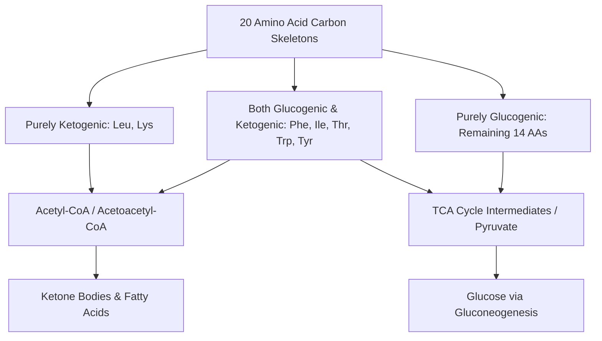
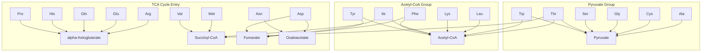
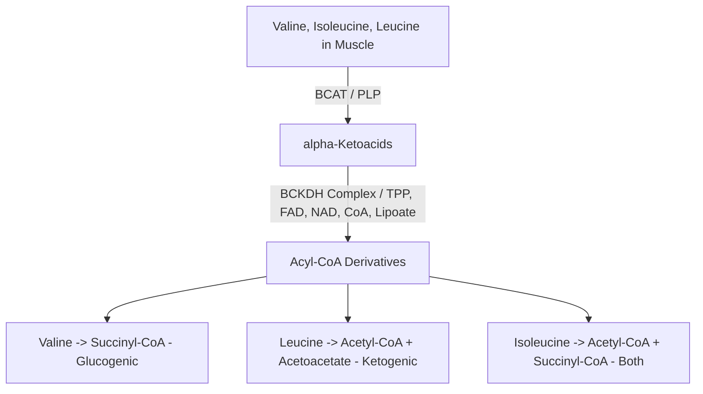

# 46. Amino Acid Metabolism: To Energy as ATP; to Glucose and Ketone Bodies

## Glucogenic vs. Ketogenic Metabolic Fates
Once nitrogen is stripped via transamination or deamination, the remaining carbon skeletons of the 20 standard amino acids are degraded into **7 major metabolic intermediates**: Acetyl-CoA, Acetoacetyl-CoA, Pyruvate, $\alpha$-Ketoglutarate, Succinyl-CoA, Fumarate, and Oxaloacetate.

---

## 1. Comprehensive Classification Matrix

| Metabolic Category | Definition | Amino Acids Included | End Products |
| :--- | :--- | :--- | :--- |
| **Purely Ketogenic** | Carbon skeletons yield only acetyl-CoA or acetoacetate; **cannot** contribute to net glucose synthesis. | **Leucine, Lysine** | Acetyl-CoA, Acetoacetyl-CoA |
| **Both Glucogenic & Ketogenic** | Carbon skeletons yield intermediates that can form both glucose and ketone bodies. | **Phenylalanine, Isoleucine, Threonine, Tryptophan, Tyrosine** *(Mnemonic: **PITTT**)* | Acetyl-CoA + Fumarate / Pyruvate / Succinyl-CoA |
| **Purely Glucogenic** | Carbon skeletons yield pyruvate or TCA cycle intermediates that can undergo net conversion to glucose. | **Alanine, Arginine, Asparagine, Aspartate, Cysteine, Glutamate, Glutamine, Glycine, Histidine, Methionine, Proline, Serine, Valine** (13 amino acids) | Pyruvate, $\alpha$-KG, Succinyl-CoA, Fumarate, OAA |

---

## 2. Point of Entry into Central Metabolism

### Detailed Entry Point Mapping

| Entry Intermediate | Precursor Amino Acids | Key Biochemical Enzymatic Pathways |
| :--- | :--- | :--- |
| **Pyruvate** | Alanine, Cysteine, Glycine, Serine, Threonine, Tryptophan | Alanine (ALT); Serine (Serine dehydratase); Glycine (Glycine cleavage system / SHMT). |
| **$\alpha$-Ketoglutarate** | Arginine, Glutamate, Glutamine, Histidine, Proline | All convert to Glutamate, which is converted to $\alpha$-KG by Glutamate Dehydrogenase. |
| **Succinyl-CoA** | Isoleucine, Methionine, Threonine, Valine *(Mnemonic: **VOMIT**)* | Convert via **Propionyl-CoA** $\rightarrow$ Methylmalonyl-CoA $\rightarrow$ Succinyl-CoA. |
| **Fumarate** | Phenylalanine, Tyrosine, Aspartate | Phenylalanine/Tyrosine catabolism yields Fumarate + Acetoacetate. |
| **Oxaloacetate** | Aspartate, Asparagine | Asparagine cleaved by Asparaginase to Aspartate; Aspartate transaminated (AST) to OAA. |
| **Acetyl-CoA / Acetoacetyl-CoA** | Leucine, Lysine, Isoleucine, Phenylalanine, Threonine, Tryptophan, Tyrosine | Direct ketogenic degradation pathways. |

---

## 3. Branched-Chain Amino Acid (BCAA) Catabolism
The **Branched-Chain Amino Acids (Valine, Isoleucine, Leucine)** are uniquely catabolized primarily in **skeletal muscle, cardiac muscle, and brain**, rather than the liver (which lacks initial transaminase activity).

### Enzymatic Steps of BCAA Catabolism
1. **Transamination:** Catalyzed by **Branched-Chain Amino Acid Aminotransferase (BCAT)** using **PLP**, converting Val, Ile, Leu into their respective $\alpha$-ketoacids.
2. **Oxidative Decarboxylation:** Catalyzed by the mitochondrial **Branched-Chain $\alpha$-Ketoacid Dehydrogenase (BCKDH) Complex**.
   * **Structure & Cofactors:** Multienzyme complex ($E_1, E_2, E_3$) identical in structure to PDH and $\alpha$-KGDH complexes. Requires 5 cofactors: **Thiamin pyrophosphate ($B_1$), Lipoic acid, CoA ($B_5$), FAD ($B_2$), and $\text{NAD}^+$ ($B_3$)**.
   * **Clinical Defect:** Inborn error of BCKDH causes **Maple Syrup Urine Disease (MSUD)**.
3. **Dehydrogenation & Cleavage:** FAD-dependent dehydrogenation yielding final ketogenic or glucogenic end-products.

---

## High-Yield NEET PG / INI-CET Points
* **Purely Ketogenic Amino Acids:** Leucine and Lysine.
* **Dual Glucogenic & Ketogenic Amino Acids:** PITTT (Phe, Ile, Thr, Trp, Tyr).
* **VOMIT Pathway to Succinyl-CoA:** Valine, Odd-chain fatty acids, Methionine, Isoleucine, Threonine.
* **BCAA Metabolism Primary Site:** **Skeletal Muscle** (liver lacks BCAT).
* **BCKDH Cofactor Requirements:** TPP, Lipoic acid, CoA, FAD, $\text{NAD}^+$ (Same as PDH complex).

---
