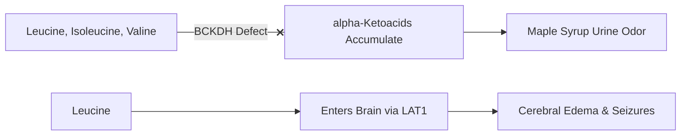
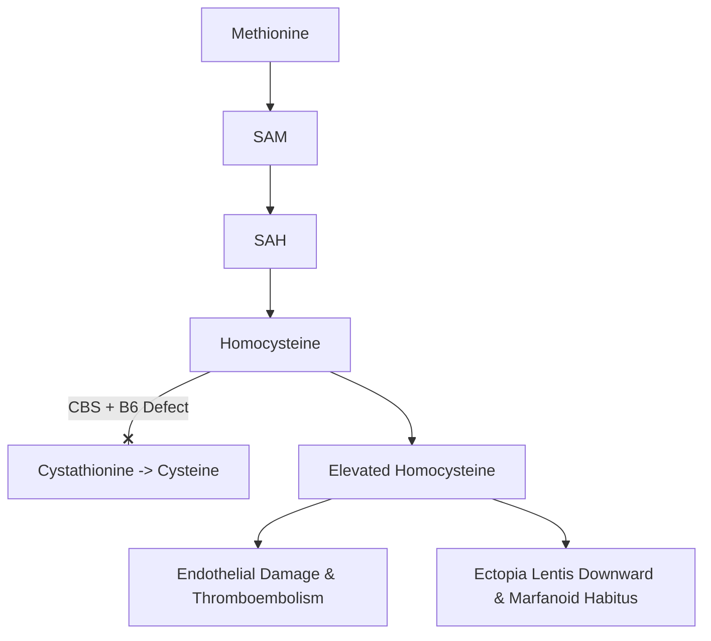
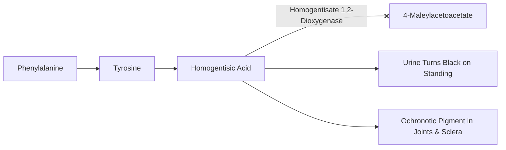

# 47. Amino Acid Disorders: Maple Syrup Urine Disease, Homocystinuria, Cystinuria, Alkaptonuria and Albinism

## Inborn Errors of Amino Acid Metabolism Overview

**Classification note:** Cystinosis is included because it presents with amino-acid-related cystine accumulation, but it is a lysosomal cystine-transport disorder rather than a classical amino-acid catabolic enzyme defect.
Disorders of amino acid metabolism result from inherited enzyme or transport protein deficiencies, leading to toxic accumulation of substrate precursors or deficiency of critical downstream products.

---

## 1. Comprehensive Diagnostic Comparison Table

| Disease Entity | Defective Enzyme / Transporter | Accumulated Metabolites | Pathognomonic Clinical Features | Key Laboratory / Diagnostic Test | Treatment Strategies |
| :--- | :--- | :--- | :--- | :--- | :--- |
| **Maple Syrup Urine Disease (MSUD)** | **Branched-Chain $\alpha$-Ketoacid Dehydrogenase (BCKDH)** | Leucine, Isoleucine, Valine, and $\alpha$-ketoacids | **Sweet maple syrup / burnt sugar odor** of urine/earwax; severe neonatal ketoacidosis, lethargy, dystonia, cerebral edema. | Elevated plasma BCAAs; **Presence of L-Alloisoleucine** (pathognomonic marker). | BCAA-restricted diet; specialist-supervised **thiamine trial** may be considered in selected genotypes/phenotypes; response is variable and should not replace urgent metabolic management |
| **Classic Homocystinuria** | **Cystathionine $\beta$-Synthase (CBS)** *(PLP-dependent)* | Homocysteine, Methionine | **Downward/inward lens subluxation (ectopia lentis)**; marfanoid habitus; osteoporosis; **severe premature thromboembolism**. | High plasma homocysteine & methionine; positive **cyanide–nitroprusside screening test** (historical/supportive; not confirmatory) | High-dose **Pyridoxine ($B_6$)**; Betaine; low-methionine diet. |
| **Cystinuria** | **COLA Dibasic Transporter** (SLC3A1/SLC7A9) in PCT & Gut | Cystine, Ornithine, Lysine, Arginine | Recurrent nephrolithiasis; **Hexagonal cystine crystals** in acidic urine. | Positive **cyanide–nitroprusside screening test**; quantitative urinary amino-acid analysis is more informative, with molecular testing where indicated. | High fluid intake, urinary alkalinization (Potassium citrate), **Penicillamine**. |
| **Alkaptonuria** | **Homogentisate 1,2-Dioxygenase** | Homogentisic acid | **Urine turns dark black on standing/alkalinization**; **Ochronosis** (blue-black scleral/ear cartilage pigment); severe debilitating spondylarthropathy. | Elevated homogentisic acid in urine via Gas Chromatography-Mass Spectrometry. | **Nitisinone** (inhibits 4-hydroxyphenylpyruvate dioxygenase/HPPD) with specialist-supervised phenylalanine/tyrosine restriction and plasma tyrosine monitoring; routine vitamin C is not a substitute for disease-specific therapy. |
| **Oculocutaneous Albinism Type 1 (OCA1)** | **Tyrosinase** *(Copper-containing enzyme)* | DOPAquinone deficiency (impaired melanin synthesis) | Hypopigmentation (fair skin, white hair, blue eyes); **nystagmus, photophobia**; high risk of skin carcinomas. | Clinical ophthalmic/dermatological assessment and molecular testing; hair-bulb tyrosinase assays are historical and are not the usual modern confirmatory test. | Strict sun avoidance, protective clothing, routine dermatological screening. |
| **Cystinosis** | Lysosomal Cystine Transporter (**Cystinosin / CTNS**) | Lysosomal Cystine accumulation | **Renal Fanconi syndrome** (PCT failure), corneal cystine crystals, growth failure, renal failure. | Leukocyte cystine levels; slit-lamp corneal examination. | **Cysteamine** (cleaves lysosomal cystine); renal transplantation. |
| **Tyrosinemia Type I** | **Fumarylacetoacetate Hydrolase (FAH)** | Succinylacetone, Fumarylacetoacetate | **Cabbage-like / boiled cabbage body odor**; severe infant hepatic failure, renal tubular dysfunction, high risk of **Hepatocellular Carcinoma**. | **Elevated Urinary Succinylacetone** (diagnostic hallmark). | **Nitisinone (NTBC)**; dietary restriction of Phe and Tyr. |

---

## 2. Individual Disease Mechanisms & Clinical Pearls

### A. Maple Syrup Urine Disease (MSUD)
* **Pathophysiology:** Defect in BCKDH complex ($E_1, E_2$, or $E_3$ subunit defect) prevents oxidative decarboxylation of branched-chain $\alpha$-ketoacids.
* **Neurotoxicity:** **Leucine** crosses the blood-brain barrier via LAT1 transporter, driving brain edema, seizures, and neurodegeneration.
* **Biochemical marker:** Elevated plasma **L-alloisoleucine** is a highly sensitive and specific marker supporting MSUD diagnosis; interpret with plasma amino-acid profiling and molecular/enzymatic confirmation as appropriate.

---

### B. Homocystinuria
* **Pathophysiology:** Inability to convert Homocysteine to Cystathionine via CBS.
* **Differentiating Homocystinuria vs. Marfan Syndrome:**
  * **Homocystinuria:** **Downward/inward** lens dislocation; **Autosomal Recessive**; Intellectual disability (+); **Thromboembolism (+)**.
  * **Marfan Syndrome:** **Upward/outward** lens dislocation; **Autosomal Dominant**; Normal intelligence; Aortic root dilation/dissection; *FBN1* mutation.

---

### C. Cystinuria
* **Pathophysiology:** Defective reabsorption of dibasic amino acids (**C**ystine, **O**rnithine, **L**ysine, **A**rginine = **COLA**) in renal PCT.
* **Calculus Formation:** Cystine is composed of 2 cysteine molecules joined by a disulfide bond and is insoluble at physiological acidic urine pH ($pH < 6.5$), forming **hexagonal cystine crystals** in urine and cystine calculi, which are typically faintly radiopaque and may be difficult to see on plain radiographs.

---

### D. Alkaptonuria
* **Pathophysiology:** Homogentisic acid cannot be converted to 4-maleylacetoacetate.
* **Ochronosis:** Homogentisic acid oxidizes and polymerizes into a black melanin-like pigment that deposits in connective tissues, sclera, intervertebral discs, and joint cartilage, causing severe premature destructive arthritis.

---

## High-Yield NEET PG / INI-CET Points
* **Pathognomonic Marker for MSUD:** **L-Alloisoleucine**.
* **Lens Dislocation Direction:** Homocystinuria = Downward; Marfan = Upward.
* **Cystine Stone Morphology:** Flat, yellow, **hexagonal crystals**; positive Cyanide-Nitroprusside test.
* **Ochronosis & Dark Black Urine:** **Alkaptonuria** (Homogentisate 1,2-dioxygenase defect).
* **Diagnostic Marker for Tyrosinemia Type I:** **Succinylacetone**.
* **Tyrosinase Cofactor:** **Copper ($Cu^{2+}$)**.

---

## Selected References for Clinical Updates

- [GeneReviews. Maple Syrup Urine Disease.](https://www.ncbi.nlm.nih.gov/books/NBK1319/)
