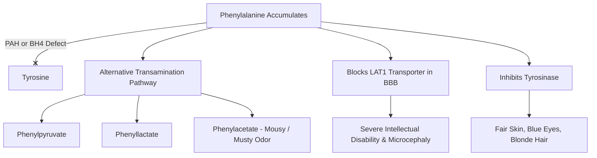

# 48. Phenylalanine and Tyrosine Metabolism in Health and Disease

## Phenylalanine & Tyrosine Metabolic Axis
Phenylalanine is an essential amino acid whose primary metabolic pathway is irreversible hydroxylation to **Tyrosine**. Tyrosine subsequently serves as the precursor for **catecholamines** (dopamine, norepinephrine, epinephrine), **thyroid hormones** ($T_3, T_4$), **melanin**, and energy intermediates (fumarate and acetoacetate).

```mermaid
graph TD
    Phe[Phenylalanine] -->|PAH + BH4| Tyr[Tyrosine]
    Tyr -->|Tyrosine Hydroxylase + BH4| DOPA
    DOPA -->|DOPA Decarboxylase + PLP| Dopamine
    Dopamine -->|Dopamine beta-Hydroxylase + Vit C, Cu| NE[Norepinephrine]
    NE -->|PNMT + SAM| Epi[Epinephrine]
    Tyr -->|Tyrosinase + Cu| Melanin
    Tyr --> Thyroid[Thyroid Hormones T3/T4]
    Tyr -->|Transamination & Oxidation| HGA[Homogentisic Acid] --> Fumarate + Acetoacetate
```

---

## 1. Enzymatic Pathways & Cofactor Requirements

| Step / Pathway | Reactants $\rightarrow$ Products | Key Enzyme | Required Cofactors | Clinical & Physiological Significance |
| :--- | :--- | :--- | :--- | :--- |
| **Phe Hydroxylation** | Phenylalanine $\rightarrow$ Tyrosine | **Phenylalanine Hydroxylase (PAH)** | **Tetrahydrobiopterin ($\text{BH}_4$), $\text{O}_2$** | Rate-limiting conversion. Defect causes Classic PKU. |
| **$\text{BH}_4$ Regeneration** | $\text{Dihydrobiopterin (BH}_2) \rightarrow \text{BH}_4$ | **Dihydrobiopterin Reductase (DHPR)** | **NADH** | Defect causes Malignant / Atypical PKU. |
| **Catecholamine Synthesis** | Tyrosine $\rightarrow$ L-DOPA | **Tyrosine Hydroxylase** | **$\text{BH}_4, \text{O}_2, \text{Fe}^{2+}$** | Rate-limiting step in catecholamine biosynthesis. |
| **DOPA Decarboxylated** | L-DOPA $\rightarrow$ Dopamine | **DOPA Decarboxylase** | **PLP (Vitamin $B_6$)** | Inhibited by Carbidopa in Parkinson's disease treatment. |
| **Norepinephrine Synth** | Dopamine $\rightarrow$ Norepinephrine | **Dopamine $\beta$-Hydroxylase** | **Vitamin C, Copper ($\text{Cu}^{2+}$)** | Occurs inside chromaffin granules / vesicles. |
| **Epinephrine Synth** | Norepinephrine $\rightarrow$ Epinephrine | **Phenylethanolamine $N$-Methyltransferase (PNMT)** | **$S$-Adenosylmethionine (SAM)** | Stimulated/induced by Cortisol from adrenal cortex. |
| **Melanin Synthesis** | Tyrosine $\rightarrow$ DOPAquinone $\rightarrow$ Melanin | **Tyrosinase** | **Copper ($\text{Cu}^{2+}$)** | Occurs in melanocytes. Defect causes OCA1 Albinism. |

---

## 2. Phenylketonuria (PKU)

PKU encompasses a group of disorders characterized by inability to convert phenylalanine to tyrosine, leading to severe hyperphenylalaninemia.



### Classic vs. Atypical PKU Comparison

| Feature | Classic PKU | Malignant / Atypical PKU |
| :--- | :--- | :--- |
| **Defective Enzyme** | **Phenylalanine Hydroxylase (PAH)** | **Dihydrobiopterin Reductase (DHPR)** or 6-pyruvoyltetrahydropterin synthase ($\text{BH}_4$ synthesis). |
| **Inheritance** | Autosomal Recessive | Autosomal Recessive |
| **Pathophysiology** | High Phe inhibits large neutral amino acid transport (LAT1) into brain, impairing brain protein synthesis. Alternative Phe metabolites accumulate. | High Phe PLUS deficiency of $\text{BH}_4$, which is also required for Tyrosine Hydroxylase and Tryptophan Hydroxylase. |
| **Neurotransmitter Status** | Catecholamines reduced secondary to low Tyrosine. | **Severe direct depletion of Dopamine, Norepinephrine, and Serotonin**. |
| **Clinical Presentation** | **Mousy / Musty body & urine odor** (phenylacetate); severe intellectual disability, microcephaly, seizures, eczema, fair skin/blue eyes. | Progressive severe neurological degradation, axial hypotonia, choreoathetosis, temperature instability despite Phe control. |
| **Diagnostic Findings** | High plasma Phe ($>1200\text{ }\mu\text{mol/L}$); positive Guthrie bacterial inhibition assay or MS/MS screening. | Hyperphenylalaninemia + low CSF 5-HIAA and HVA; abnormal DHPR assay. |
| **Treatment** | Dietary Phe restriction; Tyrosine supplementation; **Sapropterin** (synthetic $\text{BH}_4$ trial). | Dietary Phe restriction + **Sapropterin** + **L-DOPA/Carbidopa** + **5-HTP** supplementation. |

---

## 3. Maternal PKU Syndrome
Occurs in pregnant women with poorly controlled PKU (elevated plasma Phe levels):
* **Mechanism:** High maternal phenylalanine actively crosses the placenta via LAT1 transporters, acting as a potent **teratogen** to the developing fetus.
* **Fetal Manifestations:** **Microcephaly, Congenital Heart Defects** (e.g., VSD, ASD, Tetralogy of Fallot), intrauterine growth restriction (IUGR), dysmorphic facial features, and severe intellectual disability.
* **Prevention:** Strict dietary Phe restriction initiated **prior to conception** and maintained throughout pregnancy (target plasma $\text{Phe} < 120-360\text{ }\mu\text{mol/L}$).

---

## 4. Catecholamine Degradation & Clinical Markers
Catecholamines are degraded by **Monoamine Oxidase (MAO)** and **Catechol-$O$-Methyltransferase (COMT)**:

$$\text{Epinephrine / Norepinephrine} \xrightarrow{\text{MAO + COMT}} \text{Vanillylmandelic Acid (VMA)}$$

$$\text{Dopamine} \xrightarrow{\text{MAO + COMT}} \text{Homovanillic Acid (HVA)}$$

* **Pheochromocytoma:** Tumors of adrenal chromaffin cells secrete excess epinephrine/norepinephrine; diagnosed by elevated **plasma free metanephrines** and **24-hour urinary VMA/metanephrines**.
* **Neuroblastoma:** Neural crest tumor in children; secretes excess dopamine and norepinephrine; diagnosed by high **urinary HVA and VMA**.

---

## High-Yield NEET PG / INI-CET Points
* **Mousy / Musty Odor:** **Phenylketonuria (PKU)** due to phenylacetate.
* **Rate-limiting Enzyme in Catecholamine Synthesis:** **Tyrosine Hydroxylase** (requires $\text{BH}_4$).
* **Enzyme Converting Norepinephrine to Epinephrine:** **PNMT** (requires SAM; induced by cortisol).
* **Enzyme Defect in Malignant PKU:** **DHPR** (regenerates $\text{BH}_4$).
* **Maternal PKU Teratogenic Triad:** **Microcephaly, Congenital Heart Disease, IUGR**.
* **Metabolic End-Product of Epinephrine:** **VMA** (Vanillylmandelic Acid).

---
