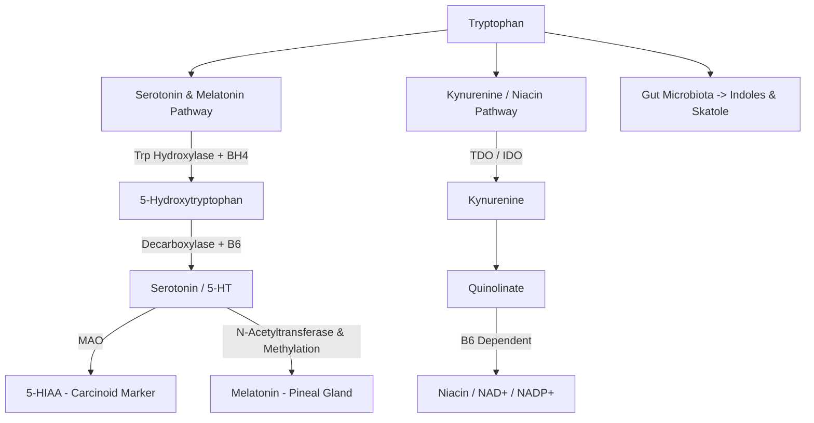
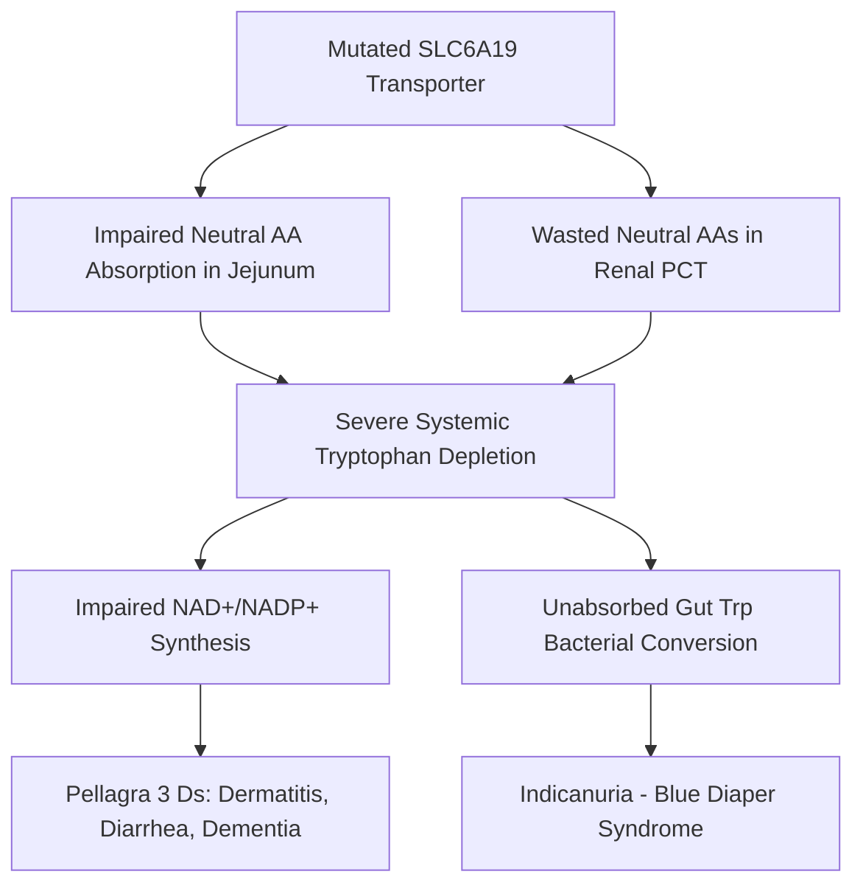
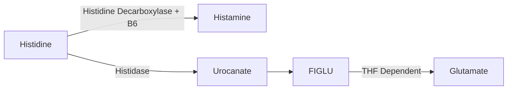

# 49. Products of Tryptophan and Histidine Metabolism

## Overview of Tryptophan and Histidine Metabolism
Tryptophan and Histidine are essential aromatic/heterocyclic amino acids that serve as precursors for vital neuroendocrine signaling molecules, including **serotonin**, **melatonin**, **niacin ($\text{NAD}^+/\text{NADP}^+$)**, and **histamine**.

---

## 1. Tryptophan Metabolic Pathways

### A. Serotonin & Melatonin Biosynthesis
1. **Tryptophan Hydroxylase:** Converts Tryptophan to 5-Hydroxytryptophan (5-HTP). Requires **$\text{BH}_4$** and $\text{O}_2$ (rate-limiting step).
2. **Aromatic L-Amino Acid Decarboxylase:** Converts 5-HTP to **Serotonin (5-Hydroxytryptamine / 5-HT)**. Requires **PLP (Vitamin $B_6$)**.
3. **Melatonin Formation:** In the pineal gland, Serotonin is $N$-acetylated and $O$-methylated (using SAM) to form **Melatonin**, which regulates circadian sleep-wake cycles.
4. **Serotonin Degradation:** Catalyzed by **MAO-A** to yield **5-HIAA (5-Hydroxyindoleacetic acid)**, excreted in urine.
   * **Carcinoid Syndrome:** Neuroendocrine tumors (typically ileal) secrete massive amounts of serotonin. Characterized by flushing, diarrhea, bronchospasm, and right-sided heart valvular lesions. Diagnostic marker: **24-hour urinary 5-HIAA** above the laboratory's reference interval; cut-offs depend on assay, diet/drug preparation, and laboratory method (a fixed $25\text{ mg/day}$ threshold is not universal).

### B. Kynurenine / Niacin Pathway
* Tryptophan is degraded via the kynurenine pathway to synthesize pyridine nucleotides ($\text{NAD}^+ / \text{NADP}^+$).
* **Equivalence:** **60 mg of dietary Tryptophan = 1 mg of Niacin (1 Niacin Equivalent / NE)**.
* **Cofactor Requirement:** Conversion of kynurenine steps requires **Vitamin $B_6$ (PLP)**. Vitamin $B_6$ deficiency impairs niacin synthesis, precipitating **pellagra-like symptoms**.

---

## 2. Hartnup Disease
Hartnup disease is an autosomal recessive inborn error of renal and intestinal neutral amino acid transport.

* **Defective Gene:** **SLC6A19**, encoding the **$\text{B}^0$ neutral amino acid transporter** in apical membranes of intestinal enterocytes and renal PCT cells.
* **Biochemical Abnormalities:**
  * Massive **neutral aminoaciduria** (alanine, valine, leucine, isoleucine, phenylalanine, tryptophan, tyrosine, threonine). Proline, hydroxyproline, and dibasic amino acids are spared.
  * Tryptophan malabsorption leads to systemic niacin deficiency ($\text{NAD}^+$ depletion).
  * Bacterial degradation of unabsorbed tryptophan in the colon produces indoles, converted in liver to **indican**, causing **indicanuria** (oxidizes to blue on diaper exposure = "Blue Diaper Syndrome").
* **Clinical Presentation:**
  * **Pellagra-like photosensitive rash** (Casal necklace distribution).
  * **Intermittent cerebellar ataxia**, emotional lability, psychosis.
* **Treatment:** High-protein diet + **Nicotinic acid / Niacinamide supplementation (50–300 mg/day)**.

---

## 3. Histidine Metabolism & Products

### A. Histamine Synthesis & Functions
* **Enzyme:** **Histidine Decarboxylase** (requires **PLP / Vitamin $B_6$**).
* **Actions:** Secreted by mast cells and basophils. Mediates Type I hypersensitivity, bronchoconstriction, vasodilation, vascular permeability, and gastric acid secretion (via parietal cell $H_2$ receptors).

### B. FIGLU (Formiminoglutamate) & Folate Deficiency Test
* Histidine degradation generates **Formiminoglutamate (FIGLU)**.
* The formimino group of FIGLU is transferred to **Tetrahydrofolate (THF)** by *FIGLU transferase* to form Glutamate.
* **FIGLU Excretion Test:** In **Folate deficiency**, FIGLU cannot be converted to glutamate and accumulates in blood and urine following an oral histidine load. This is a **historical/legacy test**; it is not routinely used in modern practice, where serum or red-cell folate and vitamin B12 assessment are used in context.

### C. Histidine Dipeptides
* **Carnosine ($\beta$-alanyl-L-histidine)** and **Anserine:** Intracellular buffers abundant in skeletal muscle and brain tissue.

---

## High-Yield NEET PG / INI-CET Points
* **Carcinoid Syndrome Diagnostic Marker:** **24-hour urinary 5-HIAA**.
* **Tryptophan to Niacin Conversion Ratio:** **60 mg Tryptophan = 1 mg Niacin**.
* **Defective Transporter in Hartnup Disease:** **SLC6A19** (Neutral amino acid transporter).
* **Hartnup Urine Finding:** Neutral aminoaciduria + **Indicanuria**.
* **Folate Deficiency Diagnostic Test:** **FIGLU Excretion Test** after histidine loading.
* **Enzyme Converting Histidine to Histamine:** **Histidine Decarboxylase** (requires PLP).

---

## Selected References for Clinical Updates

- [American College of Gastroenterology guideline and laboratory reference intervals should be followed for biochemical testing; urinary 5-HIAA cut-offs are assay-dependent.](https://www.acg.gi/)
