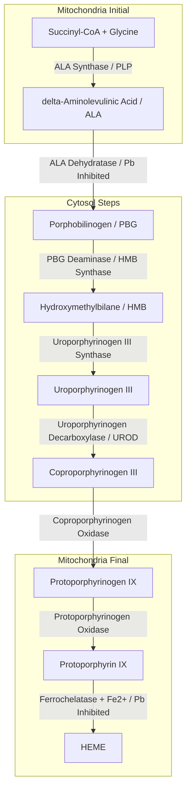
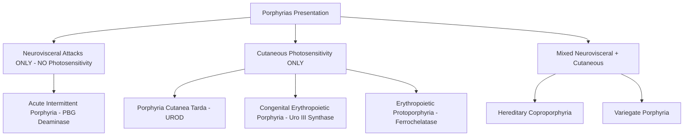

# 50. Haem, Bilirubin and Porphyria

## Overview of Heme Metabolism
Heme (iron-protoporphyrin IX) is an essential prosthetic group for hemoglobin, myoglobin, cytochromes ($P_{450}$), catalase, and nitric oxide synthase. Heme biosynthesis occurs in all nucleated cells (predominantly in bone marrow erythroid precursors and liver), partitioned between the **mitochondrial matrix** and **cytosol**.



---

## 1. Heme Biosynthetic Pathway & Regulation

### Detailed Enzymatic Steps

| Step | Reaction / Conversion | Enzyme | Location | Key Cofactors / Regulatory Factors |
| :--- | :--- | :--- | :--- | :--- |
| **1** | $\text{Succinyl-CoA} + \text{Glycine} \rightarrow \delta\text{-ALA} + \text{CoA} + \text{CO}_2$ | **$\delta$-Aminolevulinic Acid Synthase ($\delta$-ALAS)** | Mitochondria | **Rate-limiting step**. Requires **PLP ($B_6$)**. ALAS1 (liver) inhibited by Heme/Hematin. ALAS2 (erythroid) regulated by iron. |
| **2** | $2\text{ }\delta\text{-ALA} \rightarrow \text{Porphobilinogen (PBG)} + 2\text{H}_2\text{O}$ | **$\delta$-ALA Dehydratase (PBG Synthase)** | Cytosol | Contains $\text{Zn}^{2+}$. **Inhibited by Lead ($\text{Pb}$)**. |
| **3** | $4\text{ PBG} \rightarrow \text{Hydroxymethylbilane (HMB)}$ | **PBG Deaminase (HMB Synthase)** | Cytosol | Defect causes **Acute Intermittent Porphyria (AIP)**. |
| **4** | $\text{HMB} \rightarrow \text{Uroporphyrinogen III}$ | **Uroporphyrinogen III Synthase** | Cytosol | Defect causes **Congenital Erythropoietic Porphyria (CEP)**. |
| **5** | $\text{Uroporphyrinogen III} \rightarrow \text{Coproporphyrinogen III}$ | **Uroporphyrinogen Decarboxylase (UROD)** | Cytosol | Defect causes **Porphyria Cutanea Tarda (PCT)**. |
| **6** | $\text{Coproporphyrinogen III} \rightarrow \text{Protoporphyrinogen IX}$ | **Coproporphyrinogen Oxidase** | Mitochondria | Defect causes Hereditary Coproporphyria. |
| **7** | $\text{Protoporphyrinogen IX} \rightarrow \text{Protoporphyrin IX}$ | **Protoporphyrinogen Oxidase** | Mitochondria | Defect causes Variegate Porphyria. |
| **8** | $\text{Protoporphyrin IX} + \text{Fe}^{2+} \rightarrow \text{Heme}$ | **Ferrochelatase (Heme Synthase)** | Mitochondria | **Inhibited by Lead ($\text{Pb}$)**. Defect causes EPP. |

---

## 2. Porphyrias: Classification & Clinical Differentiation

Porphyrias are inherited (or acquired) metabolic disorders resulting from deficiencies of specific enzymes in heme synthesis. They present as **neurovisceral attacks** (due to accumulation of ALA and PBG) or **cutaneous photosensitivity** (due to accumulation of tetrapyrrole porphyrinogens that generate ROS upon exposure to UV light).



### Comprehensive Porphyria Comparison Table

| Porphyria Type | Enzyme Deficiency | Inheritance | Accumulated Intermediates | Key Clinical Features | Diagnostic Findings |
| :--- | :--- | :--- | :--- | :--- | :--- |
| **Acute Intermittent Porphyria (AIP)** | **PBG Deaminase (HMB Synthase)** | Autosomal Dominant | **$\delta$-ALA, PBG** | **5 Ps:** Painful abdomen, Polyneuropathy, Psychosis, Port-wine urine, Precipitated by drugs (CYP inducers). **NO PHOTOSENSITIVITY!** | PBG in urine turns dark port-wine color on exposure to light/air. |
| **Porphyria Cutanea Tarda (PCT)** | **Uroporphyrinogen Decarboxylase (UROD)** | Autosomal Dominant / Acquired | **Uroporphyrin** | **Most common porphyria**. Fragile skin, blistering photosensitivity on sun-exposed areas, hyperpigmentation, hypertrichosis. | Tea-colored urine; pink fluorescence under Wood's lamp; high uroporphyrin I. |
| **Congenital Erythropoietic Porphyria (CEP / Gunther)** | **Uroporphyrinogen III Synthase** | Autosomal Recessive | **Uroporphyrin I, Coproporphyrin I** | Extreme mutilating cutaneous photosensitivity, severe anemia, splenomegaly, **erythrodontia (red teeth fluorescence)**. | Massive uroporphyrin I in urine and teeth. |
| **Lead Poisoning (Plumbism)** | **$\delta$-ALA Dehydratase & Ferrochelatase** | Acquired Toxicity | **$\delta$-ALA, Protoporphyrin IX** | Microcytic anemia, **basophilic stippling**, **Burton lines** on gums, abdominal colic, wrist/foot drop. | High blood lead ($\text{Pb}$); elevated free erythrocyte protoporphyrin (FEP). |

---

## 3. Bilirubin Degradation & Hyperbilirubinemia Disorders

```mermaid
graph TD
    RBC[Senescent RBCs in RES] -->|Heme Oxygenase| Biliverdin + CO + Fe2+
    Biliverdin -->|Biliverdin Reductase| UCB[Unconjugated Bilirubin - Water Insoluble]
    UCB -->|Bound to Albumin in Blood| Liver[Hepatic Uptake via OATP1B1/B3]
    Liver -->|UGT1A1 Conjugation| CB[Conjugated Bilirubin - Water Soluble]
    CB -->|MRP2 Canalicular Secretion| Bile[Bile Duct to Duodenum]
    Bile -->|Gut Bacteria| Urobilinogen
    Urobilinogen -->|Oxidation| Stercobilin[Stercobilin - Stool Brown Color]
    Urobilinogen -->|Kidney Reabsorption| Urobilin[Urobilin - Urine Yellow Color]
```

### Inherited Hyperbilirubinemia Disorders Matrix

| Disease Entity | Defective Gene / Transport | Bilirubin Elevation | Liver Histology / Pigmentation | Key Clinical Features & Management |
| :--- | :--- | :--- | :--- | :--- |
| **Gilbert Syndrome** | Reduced **UGT1A1** promoter activity ($\sim 30\%$ activity) | **Unconjugated (Indirect)** | Normal | Mild, benign transient jaundice precipitated by fasting, stress, infection. **No treatment needed**. |
| **Crigler-Najjar Type I** | **Absent UGT1A1** activity ($0\%$) | **Severely High Unconjugated** | Normal | Lethal in infancy due to **Kernicterus** (bilirubin encephalopathy). Unresponsive to Phenobarbital. Treatment: Phototherapy, Liver transplant. |
| **Crigler-Najjar Type II** | Reduced **UGT1A1** activity ($<10\%$) | **Moderate-High Unconjugated** | Normal | Less severe; low risk of kernicterus. **Responds dramatically to Phenobarbital** (induces UGT1A1). |
| **Dubin-Johnson Syndrome** | Defective **MRP2** canalicular transporter | **Conjugated (Direct)** | **Dark Black Liver** (epinephrine metabolite accumulation in lysosomes) | Benign conjugated hyperbilirubinemia. Normal total urinary coproporphyrin, but **$>80\%$ Coproporphyrin I** (normal is Coproporphyrin III). |
| **Rotor Syndrome** | Defective **OATP1B1 & OATP1B3** reuptake | **Conjugated (Direct)** | **Normal Liver Color** (no pigment) | Benign conjugated hyperbilirubinemia. Total urinary coproporphyrin elevated. |

---

## High-Yield NEET PG / INI-CET Points
* **Rate-limiting Enzyme of Heme Synthesis:** **$\delta$-ALA Synthase** (requires PLP).
* **Enzymes Inhibited by Lead:** **$\delta$-ALA Dehydratase** and **Ferrochelatase**.
* **Porphyria WITHOUT Cutaneous Photosensitivity:** **Acute Intermittent Porphyria (AIP)**.
* **Most Common Porphyria:** **Porphyria Cutanea Tarda (PCT)** (UROD deficiency).
* **Red Teeth (Erythrodontia):** **Congenital Erythropoietic Porphyria (CEP)**.
* **Dark Black Liver:** **Dubin-Johnson Syndrome** (MRP2 defect).
* **Crigler-Najjar Type Response to Phenobarbital:** Type II responds (UGT1A1 induced); Type I does not respond.

---
